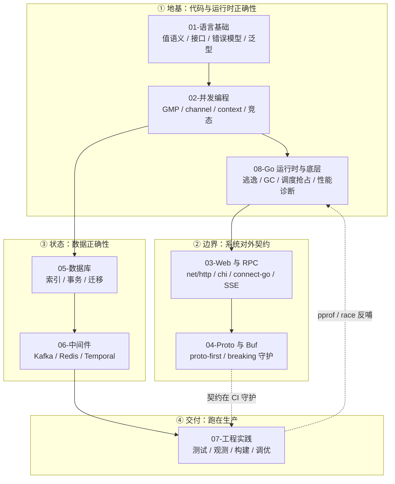

---
tags:
  - go
  - moc
created: 2026-11-01
updated: 2026-11-15
---

# 🐹 Go 开发

> **本文件是板块索引**：给出 Go 后端与云原生开发的知识地图、跨篇横切主线与学习路线。具体机制、代码与面试问答在各篇内，不在本文件展开。

**覆盖范围**：从语言核心到运行时底层、从网络协议到数据正确性、从中间件集成到工程化交付，全部按「知识点本身」组织，不绑定任何具体业务系统。

> ✅ **8 篇大笔记全部完成**（约 14.9 万字 / 77 张图 / 104 道面试问答），风格与 K8s 板块一致：多 Mermaid 图、可运行代码、无知识性错误、关键结论高亮、面试问答收尾、双链互通。
>
> 📌 本板块采用**编号笔记平铺**（`01-` ~ `08-`），不为每个知识点单独建目录——Obsidian 按文件名排序即学习路线。

## 全局知识地图

8 篇不是并列清单，而是**四层依赖**：下层是上层的正确性前提，越往上越贴近生产运行。



**读法**：① 决定「这段代码对不对、跑起来代价多大」，② 决定「边界怎么划」，③ 决定「并发下数据对不对」，④ 决定「出事能不能查、能不能发」。跨层出问题时按 ①→④ 逐层排查，比直接看业务代码有效。

## 跨篇横切主线

> 下面 7 个概念**每篇都会出现、但角色不同**——这是 8 篇之间真正的逻辑连接，也是最容易混淆的地方。同一行横向读完，比单篇纵向读更能建立整体感。

| 横切概念 | 地基（定义在哪） | 展开（应用在哪） | 一句话关系 |
|---|---|---|---|
| **错误模型** | [[01-语言基础]] `errors.Is/As` + 可重试分类 | [[03-Web 与 RPC]] 码映射/重试预算、[[05-数据库]] 冲突重试、[[06-中间件]] 永久错误标记 | 分类决定重试，重试必须幂等 |
| **context** | [[02-并发编程]] 取消传播树 + 三铁律 | [[03-Web 与 RPC]] 超时预算递减、[[05-数据库]] `QueryContext`、[[06-中间件]] Activity 心跳 | 一个请求生命周期贯穿所有层 |
| **幂等** | [[05-数据库]] 唯一索引 / `ON CONFLICT` | [[06-中间件]] Kafka 消费幂等 + Temporal 幂等键、[[03-Web 与 RPC]] 重试幂等键 | at-least-once 是常态，不是异常 |
| **复用 / 池化** | [[01-语言基础]] 值语义、`sync.Pool`（[[02-并发编程]]）| [[03-Web 与 RPC]] HTTP Transport、[[05-数据库]] `sql.DB`、[[06-中间件]] Redis Client | 三处同源：别每次 new，别用错生命周期 |
| **超时与重试** | [[01-语言基础]] 错误分类、[[02-并发编程]] `select`/`time` | [[03-Web 与 RPC]] 四层韧性、[[06-中间件]] Activity 超时族 | 超时是上限、重试是补救，两者都要预算 |
| **内存与 GC** | [[08-Go 运行时与底层]] 逃逸 / 分配 / GC pacing | [[01-语言基础]] 切片与 map 增长、[[07-工程实践]] pprof 定位 | 写法决定分配，分配决定 GC 压力 |
| **可观测** | [[07-工程实践]] slog / metrics / OTel 埋点 | [[02-可观测性]] 指标 / 日志 / 追踪通用机制、[[08-Go 运行时与底层]] GODEBUG 与 profile | 应用埋点 → 采集汇聚 → 反哺调优 |

## 笔记清单

### ① 语言与运行时

| 笔记 | 内容 | 状态 |
|---|---|---|
| [[01-语言基础]] | 类型系统、struct/方法/组合、接口底层、泛型、**reflect**、**time 陷阱**、错误模型、GC、go mod | ✅ 已整理 |
| [[02-并发编程]] | GMP、channel、sync、context、并发模式、race/泄漏排查 | ✅ 已整理 |
| [[08-Go 运行时与底层]] | 逃逸分析、内存分配器、GC 深入、调度抢占与 netpoller、unsafe、版本演进、性能诊断进阶 | ✅ 已整理 |

### ② 边界与契约

| 笔记 | 内容 | 状态 |
|---|---|---|
| [[03-Web 与 RPC]] | `net/http`、**chi**、**connect-go**、gRPC、SSE/WebSocket、**客户端韧性**、**原生 TCP/UDP/TLS** | ✅ 已整理 |
| [[04-Proto 与 Buf]] | proto3/wire 编码、**buf** 工具链、代码生成、breaking 兼容守护 | ✅ 已整理 |

### ③ 状态与集成

| 笔记 | 内容 | 状态 |
|---|---|---|
| [[05-数据库]] | **MySQL / PostgreSQL**、索引/MVCC、sqlc/GORM/pgx、迁移 | ✅ 已整理 |
| [[06-中间件]] | **Kafka**（franz-go）、**Redis**（缓存/锁）、**Temporal**（工作流） | ✅ 已整理 |

### ④ 工程化

| 笔记 | 内容 | 状态 |
|---|---|---|
| [[07-工程实践]] | 结构、测试（subtest/httptest/golden）、可观测、Dockerfile、**CGO/交叉编译**、优雅退出、pprof、CI、**依赖安全** | ✅ 已整理 |

## 技术选型速记（Go 生态常见组合）

> 这里是**技术本身的取舍**，不是任何系统的既定选型；每篇正文里都有完整的对比与适用边界。

| 领域 | 常见选择 | 取舍要点 |
|---|---|---|
| 路由 | chi / 标准库 `ServeMux` | 标准 `http.Handler` 兼容、中间件可组合 |
| RPC | connect-go / gRPC | 前者浏览器直连 + curl 可调试，后者生态与流量治理成熟 |
| 契约 | proto3 + buf | 契约唯一事实源，breaking 在 CI 拦截 |
| 数据库 | MySQL / PG | 前者 CRUD 与运维成熟，后者复杂查询与类型丰富 |
| 消息 | Kafka + franz-go | 纯 Go、幂等默认开、避免 cgo 破坏静态链接 |
| 缓存 / 锁 | Redis / go-redis | 缓存三大问题、分布式锁边界 |
| 工作流 | Temporal | 长流程、重试、人工介入、可追溯 |
| 构建 | `CGO_ENABLED=0` + `go:embed` + 多阶段 | 静态二进制、单文件、可交叉编译 |

## 学习路线（按依赖）

```
1. 01-语言基础 → 02-并发编程        ← 先能写对、再能并发写对
2. 08-Go 运行时与底层               ← 理解代价：分配 / GC / 调度 / 诊断
3. 03-Web 与 RPC → 04-Proto 与 Buf   ← 对外边界与机器可校验契约
4. 05-数据库 → 06-中间件             ← 状态正确性与系统集成
5. 07-工程实践                       ← 测试 / 观测 / 构建 / 调优，把服务跑稳
```

> 📌 两条主线并行：**「请求怎么走」**（②→③→④）与**「代码为什么这样跑」**（①→08）。只学前者能写出可用服务，补上后者才能定位性能与并发问题。

## 核心概念清单

- 值语义：切片 / map / 接口都只是把引用包成值
- 并发模型：GMP + CSP，数据归属用 channel、数据访问用锁
- 接口与组合：小接口、隐式实现、组合优于继承
- 错误链：`%w` 包装 + `errors.Join` 聚合 + `errors.Is/As` 判定 + 边界处分类映射
- 分配与 GC：逃逸到堆才产生 GC 压力，写法决定分配
- proto-first：契约是唯一事实源，breaking 在 CI 拦截
- 状态正确性：事务 / 幂等 / at-least-once 三件套
- 交付正确性：静态链接、多架构、可观测、优雅退出、依赖安全

## 相关

- 上游语言与运行时机制：本板块 [[01-语言基础]] / [[02-并发编程]] / [[08-Go 运行时与底层]]
- 云原生 Go 开发（client-go / Operator / CRD）→ [[Go 与 K8s 开发]]
- K8s 通用机制 → [[07-API 与 Watch 机制]]、[[05-调度与资源管理]]、[[02-工作负载资源]]
- 可观测通用机制 → [[02-可观测性]]
- 部署与集群运维 → [[08-集群运维]]、[[09-生态与工具]]、[[07-工程实践]]
