---
tags:
  - ai
  - infra
  - gpu
  - k8s
  - 面试
created: 2026-11-14
updated: 2026-11-15
status: 已整理
---

# 🎛️ GPU Operator

> 面向面试：把 GPU 从「插在机器上的硬件」变成「K8s 能声明、能调度、能监控、能升级的资源」。

**全文主线**：一条**设备链路**——驱动把内核模块装进宿主机 → container toolkit 把设备描述成 CDI 规范 → device plugin / DRA driver 把卡上报给 kubelet → 调度器按资源与拓扑放置 Pod → DCGM 把卡的健康与利用率暴露出来。GPU Operator 的全部价值，就是把这条链路上原本要 SSH 到每台机器手装的软件，收敛成**一个 CRD + 一组 DaemonSet**。

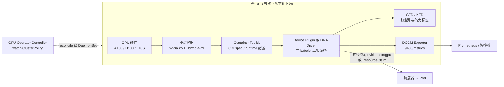

> 📌 **一句话定位**：GPU Operator 管的是**资源层**（让 K8s 认得卡、把卡交给 Pod）；它不管模型怎么加载、KV Cache 怎么省显存、服务怎么灰度——那些属于 [[03-vLLM]] / [[02-KServe]] / [[AI Infra]] 的② ③层。混淆这一层边界，是排障时最常见的误判来源。
>
> ⚠️ **版本口径（2026-11 核对）**：AI Infra 是快速演进领域，本文所有版本号都标了适用语境；**实际环境一律以 `helm list -n gpu-operator`、`kubectl get clusterpolicy -o yaml`、驱动 `--version` 实测为准**，不能拿笔记里的版本号当作依据（版本偏差原则见 [[08-集群运维]]）。

---

## 一、为什么需要 Operator：GPU 节点的软件栈问题

一个裸 K8s 节点插上 GPU，Pod 里 **看不到任何 GPU**。缺的是一整套与内核、容器运行时、kubelet 都耦合的软件：

| 层 | 缺什么 | 手工装的痛点 |
|---|---|---|
| 内核 | NVIDIA 驱动（`nvidia.ko`、NVML 库） | 与内核版本严格绑定，节点一升内核就挂 |
| 运行时 | NVIDIA Container Toolkit（让容器能拿到 `/dev/nvidia*` 与驱动库） | 要改 containerd/CRI-O 配置并重启运行时 |
| kubelet | device plugin / DRA driver（上报 GPU 为可调度资源） | 每节点一个 DaemonSet，版本要跟驱动对齐 |
| 调度 | 节点型号/显存/MIG 能力标签 | 不打标签就无法做异构选型与亲和 |
| 观测 | DCGM / dcgm-exporter | 没指标就没有容量、告警、SLO |

手工装 = **配置漂移 + 升级噩梦**：几十台节点、多代 GPU、多个集群，每台机器上的驱动/工具链/插件版本都可能不同。GPU Operator 的答案与 K8s 一切问题一样——**声明式 + 控制循环**（连 [[07-API 与 Watch 机制]]）：

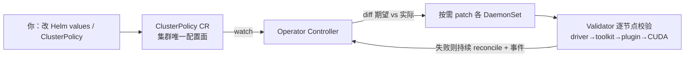

> 📌 **不解决什么**（边界要和「解决什么」一起记）：device plugin 只让 GPU **能被整卡分配**；显存切分、模型权重分发、多卡并行、服务灰度、推理网关都不在它的职责内。把「Pod 起不来」直接归因到引擎日志，往往真相在资源层。

---

## 二、装配：ClusterPolicy 与它管着的组件

### 2.1 ClusterPolicy：一个 CRD 管全集群

`ClusterPolicy`（`nvidia.com/v1`）是**集群级单例** CRD，也是唯一配置面：改 `spec` 字段 → Operator watch 到变化 → reconcile 出/改对应 DaemonSet，**全程不需要 SSH 上节点**。

```yaml
# 示意：字段以现场 chart 的 values.yaml / CRD 为准（kubectl explain clusterpolicy.spec）
apiVersion: nvidia.com/v1
kind: ClusterPolicy
metadata:
  name: cluster-policy
spec:
  operator:
    defaultRuntime: containerd
  driver:
    enabled: true
    version: "595"          # 必须与内核 / CUDA / GPU 型号一起锁定
    usePrecompiled: true    # 离线环境优先预编译，见 §3.2
  toolkit:
    enabled: true
  devicePlugin:
    enabled: true
    config:
      name: gpu-sharing-config   # 时间切片 / MIG 策略的 ConfigMap
  gfd:
    enabled: true
  dcgmExporter:
    enabled: true
  migManager:
    enabled: true
```

> ⚠️ **DRA 路径是另一套 CR**：`GPUCluster`（集群级单例，名字固定 `gpu-cluster`）负责 DRA / ComputeDomain / DCGM / DRA validator；`ClusterPolicy` 负责 device plugin 路径。**同一集群二者不能共存**（官方明确限制），选型在 §4.4 讲。

**组件在节点上的分层位置**（先记图，再记表）：

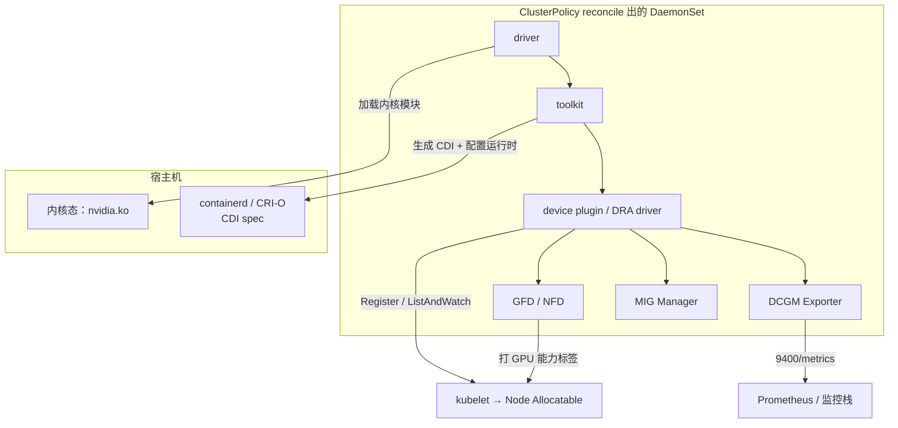

### 2.2 组件清单（面试按「装了什么」背）

| 组件 | 形态 | 职责 | 挂了的现象 |
|---|---|---|---|
| Operator Controller | Deployment | watch `ClusterPolicy` / `GPUCluster`，reconcile 全部子组件 | 改配置不生效 |
| **Driver Container** | DaemonSet | 在节点加载 `nvidia.ko`、装 NVML 用户态库 | `nvidia-smi` 都跑不了，卡全部不可见 |
| **Container Toolkit** | DaemonSet | 生成 CDI spec、配置 containerd/CRI-O、可选 NRI 插件 | 容器里 `/dev/nvidia*` 缺失，`nvidia-container-cli` 报错 |
| **Device Plugin** | DaemonSet | 通过 kubelet DevicePlugin gRPC 上报 `nvidia.com/gpu` 整数 | 节点 `Allocatable` 里 GPU 为 0，Pod Pending |
| **GFD**（GPU Feature Discovery） | DaemonSet | 给节点打 `nvidia.com/gpu.product`、`cuda.*` 等标签 | 异构调度/亲和失效 |
| NFD（Node Feature Discovery） | DaemonSet | 打 PCI 厂商标签（如 `feature.node.kubernetes.io/pci-10de.present=true`），作为 DaemonSet 的节点选择依据 | 新加 GPU 节点不被纳管 |
| **DCGM + DCGM Exporter** | DaemonSet | 采集利用率/显存/温度/功耗/ECC/XID，暴露 `:9400/metrics` | 监控无 GPU 数据，HPA/告警失灵 |
| MIG Manager | DaemonSet | 监听 `nvidia.com/mig.config` 标签，重配置 MIG 分区 | MIG 切分不生效或卡住 |
| k8s-driver-manager | DaemonSet | 驱动升级时 drain 节点、卸载/重载内核模块 | 升级把在跑的推理 Pod 打死 |
| Operator Validator | DaemonSet/Pod | 顺序校验 driver → toolkit → plugin → CUDA | 问题定位缺少统一信号 |
| Node Status Exporter | DaemonSet | 暴露 Operator 自身状态指标 | 说不清「哪个节点没装好」 |

> 📌 **装配顺序有因果**：驱动没起来 → toolkit 校验失败 → device plugin 不上报 → GFD 标签不全 → validator 卡在第一步。排查**永远从最底层往上走**，和 [[AI Infra]] §2 的「一条请求链路倒着走」是同一个原则。

---

## 三、驱动容器化：整条链路上最脆的一层

### 3.1 驱动为什么能「容器化」

驱动分两部分：

- **内核模块**（`nvidia.ko` 等）必须跑在**宿主机内核态**——容器只是个「安装器」：以特权容器挂载 `/lib/modules`、`/usr/src`，把模块编译/拷贝进去后 `insmod`/`modprobe`，模块一旦加载就**属于宿主机内核**，容器退出也不影响。
- **用户态库**（`libnvidia-ml.so`、CUDA 驱动库）由 toolkit 在容器启动时注入到业务容器里，业务镜像**不需要自带驱动**。

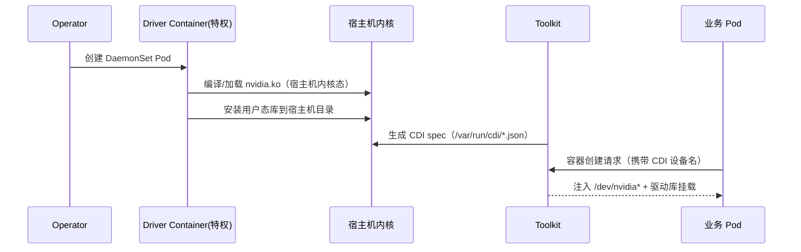

> ⚠️ **关键推论**：驱动容器挂了 ≠ 已加载的模块立刻消失；但**节点重启后**若驱动容器没先跑起来，所有 GPU Pod 都会失败。所以驱动 DaemonSet 的启动顺序与节点重启后的自愈，是运维必测项。

### 3.2 预编译 vs 现场编译（离线环境的核心取舍）

| 模式 | 原理 | 优点 | 坑 |
|---|---|---|---|
| **预编译** `usePrecompiled: true` | 使用 NVIDIA/OS 厂商为特定内核预先编好的模块包 | 离线快、不需要编译器、可预先同步到内网 | **目标节点内核版本不在支持列表就直接失败**；换内核要重新同步镜像 |
| 现场编译（DKMS 式） | 容器内用 `kernel-devel`/`kernel-headers` 编译 | 适配任意内核 | 需要内核头文件、gcc、编译耗时；**Secure Boot 需模块签名（MOK）**；离线环境要备齐编译工具链镜像 |

另有 **开源内核模块（open-gpu-kernel-modules）** 与专有模块之分：新架构（Turing 之后的数据中心卡）可以走开源模块，部分老卡仍需专有模块；`ClusterPolicy` 里通过 `driver.kernelModuleType`（示意字段名）选择，实际以现场 CRD 为准。

**离线驱动模式决策**：

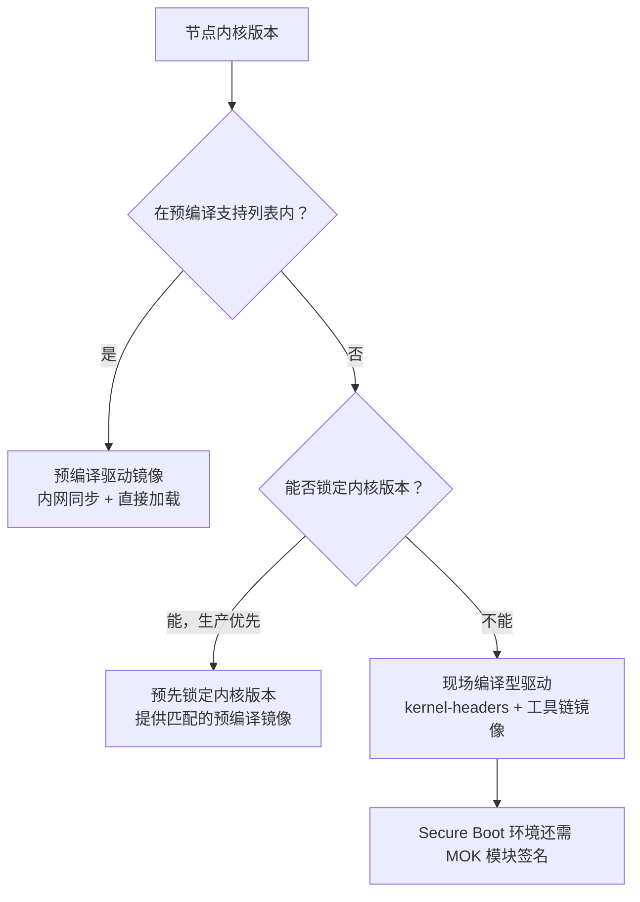

### 3.3 版本兼容矩阵

一条必须整体锁定的链：

```
GPU 型号 → 驱动分支 → 内核版本 → CUDA 运行时 → Container Toolkit
        → device plugin / GFD / DCGM → K8s 版本 → containerd 版本
        → 引擎镜像（vLLM/Triton 编译时链接的 CUDA） → 模型权重所需算力
```

> 📌 **CUDA 兼容的方向性**：驱动要**足够新**才能支撑容器里的 CUDA 运行时（每个 CUDA 版本有最低驱动版本）；较新的驱动可向后兼容旧 CUDA，反过来不行。vLLM 镜像里自带的 CUDA 与节点驱动不匹配，是「镜像在 A 集群能跑、B 集群报 `CUDA driver version is insufficient`」的头号原因。
>
> ⚠️ 这份矩阵必须**整体锁定**：升级时逐项核对，不要让不同集群滚动到互不兼容的组合（通用约束见 [[06-推理服务工程]]）。

---

## 四、GPU 如何进容器：device plugin → CDI → DRA（核心机制）

> 这一节回答一个核心问题：**Pod 写了 `nvidia.com/gpu: 1` 之后，设备到底怎么从宿主机进到容器里**。

### 4.1 传统路径：Device Plugin

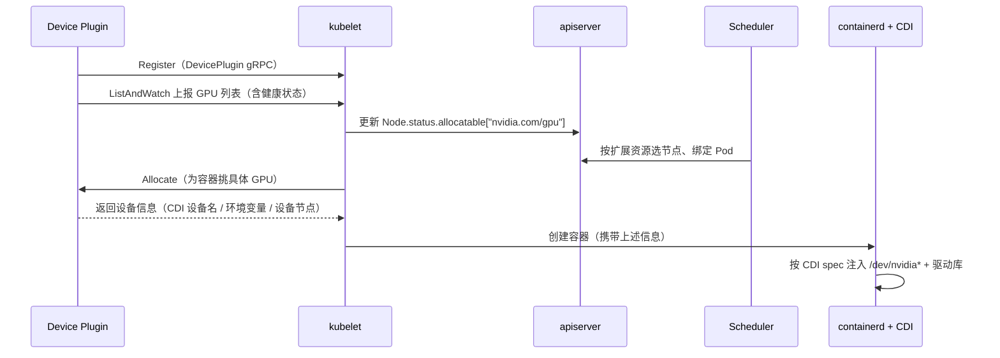

**device plugin 的硬限制**（面试高频）：

- `nvidia.com/gpu` 是**扩展资源**：只能是**非负整数**，只能写在 `limits`（requests 自动等于 limits），**不能超卖、不能写 0.5、不能被多个容器共享同一份分配**。
- 只表达「**几张卡**」，**表达不了型号、显存、NVLink 拓扑、MIG profile**——这些要靠 GFD 标签 + nodeSelector/affinity 在外部绕。
- 设备健康状况由插件 `ListAndWatch` 上报； unhealthy 设备不再分配，但**已在跑的 Pod 不会被自动驱逐**。

### 4.2 CDI：把「设备」变成标准描述

**CDI（Container Device Interface）** 是 CNCF 风格的开放规范：用 JSON 描述「要把哪些设备节点、挂载、环境变量注入容器」，容器运行时（containerd / CRI-O）原生读取，**不再依赖厂商专有的 runtime hook**。

```json
{
  "cdiVersion": "0.6.0",
  "kind": "nvidia.com/gpu",
  "devices": [{ "name": "GPU-UUID", "containerEdits": {
    "deviceNodes": [{ "path": "/dev/nvidia0" }],
    "mounts": [{ "hostPath": "/usr/lib/x86_64-linux-gnu/libnvidia-ml.so.1", "containerPath": "...", "options": ["ro", "nosuid", "nodev"] }]
  }}],
  "containerEdits": {}
}
```

> 📌 **版本分界（务必记）**：GPU Operator **v25.10.0 起 CDI 默认开启，且不再把 `nvidia` 设为默认 runtime handler**；之前是「nvidia runtime hook + `NVIDIA_VISIBLE_DEVICES`」为主。升级到 25.10+ 时：
> - 走 device plugin / DRA 正常申请 GPU 的**标准工作负载无需改配置**；
> - 但**「GPU 管理容器」**（监控 agent、device plugin、HAMi 等不通过分配、直接靠 `NVIDIA_VISIBLE_DEVICES` 拿全部 GPU 的容器）**必须显式写 `runtimeClassName: nvidia`**，否则拿不到设备；
> - 条件：容器运行时要支持并启用 CDI（containerd 2.x 线，具体以现场版本为准）。
>
> ⚠️ 这条是 25.10 升级后最典型的「升级完监控组件全瞎」根因，升级检查清单里必须单列。

### 4.3 DRA：从「数量」到「按属性选设备」

**DRA（Dynamic Resource Allocation）** 用一组 `resource.k8s.io` API 让工作负载按**属性**声明设备需求，调度器统一分配：

| 对象 | 作用 |
|---|---|
| `DeviceClass` | 驱动/管理员定义「一类设备」及 CEL 选择条件 |
| `ResourceSlice` | 驱动上报每个节点上可用设备及其属性 |
| `ResourceClaim` / `ResourceClaimTemplate` | 工作负载申请设备（可被多个 Pod/容器引用） |
| `Pod.spec.resourceClaims` + `container.resources.claims` | 把 claim 挂到容器 |

```yaml
# 示意：属性名与 selector 语法以现场 DRA 驱动文档为准
apiVersion: resource.k8s.io/v1
kind: ResourceClaimTemplate
metadata:
  name: llm-gpu
spec:
  spec:
    devices:
      requests:
      - name: gpu
        exactly: 1
        deviceClassName: gpu.nvidia.com
        # selectors 可用 CEL 表达「显存 ≥ 40G / 指定型号 / 拓扑亲和」等条件
---
apiVersion: v1
kind: Pod
metadata:
  name: vllm
spec:
  resourceClaims:
  - name: gpu
    resourceClaimTemplateName: llm-gpu
  containers:
  - name: engine
    image: registry.example.com/vllm:pinned
    resources:
      claims:
      - name: gpu
```

**版本口径**：DRA 自 K8s **1.30** 起以「结构化参数」重构（KEP-4381），**1.34 核心 GA**（`resource.k8s.io/v1` 稳定、默认启用，含 `ResourceClaim`/`DeviceClass`/`ResourceClaimTemplate`/`ResourceSlice`）。但**GA 的是 K8s 框架，不等于各家驱动能力全部 GA**——NVIDIA DRA driver 的全卡/MIG 分配、ComputeDomain 属稳定能力，动态 MIG、共享容量（ConsumableShares）、MPS、健康检查等仍是 **alpha 且默认关闭**，且 **K8s 目前不支持 DRA 资源的抢占**。

### 4.4 两条路径并存期与迁移

| 维度 | Device Plugin（`ClusterPolicy`） | DRA（`GPUCluster`） |
|---|---|---|
| 选择能力 | 数量 + 外部标签 | CEL 按型号/显存/拓扑/UUID 选择 |
| 共享 | 时间切片、MIG、实验性 MPS | 共享容量、动态 MIG（多为 alpha） |
| 配置 CR | `ClusterPolicy` | `GPUCluster`（单例，集群级） |
| 兼容 | 所有 K8s 版本 | 需较新 K8s + 较新驱动（官方对 GPUCluster 有最低版本要求，现场实测） |
| Pod 改造 | `resources.limits` 一行 | 新增 ClaimTemplate + `resourceClaims` 引用 |
| 生态成熟度 | 最成熟、文档最多 | 快速演进，能力按 feature gate 分级 |

> ⚠️ **同一集群 `GPUCluster` 与 `ClusterPolicy` 不能共存**，不存在「先都装上灰度一下」的中间态。迁移是**集群级切换 + 全量 Pod spec 改造**，通常按「新集群试点 → 存量集群维持」推进，避免在生产集群原地切换。
>
> 📌 **选型结论**：起步阶段用 **device plugin + CDI**（稳、资料多、Pod 写法简单）；当出现「同一集群多代 GPU、需要按显存/拓扑申请、多租户共享配额」这三类需求之一，再评估 DRA。

---

## 五、调度与拓扑：为什么默认调度器不够用

### 5.1 GPU 节点的放置约束

GPU 节点通常打污点，避免普通 Pod 白占昂贵资源：

```yaml
spec:
  tolerations:
  - key: nvidia.com/gpu
    operator: Exists
    effect: NoSchedule
  nodeSelector:
    nvidia.com/gpu.product: NVIDIA-H100-80GB-HBM3   # 由 GFD 打，字段名现场确认
  containers:
  - name: engine
    resources:
      limits:
        nvidia.com/gpu: 1     # 扩展资源：只能整数、只写 limits
```

- 标签来自 **GFD/NFD**（型号、显存、CUDA/驱动版本、MIG 能力），是异构调度与亲和的唯一依据。
- **NUMA / NVLink 拓扑**：多卡 Pod 要落在同一 PCIe 根复合体、同一 NVLink 域内，否则 TP 通信跨 NUMA 掉吞吐。K8s 侧靠 Topology Manager / 节点标签 / 亲和约束；更精细的多节点 NVLink 域编排属 DRA 的 `ComputeDomain`（进阶）。
- **碎片**：2 卡节点上先塞一个 1 卡 Pod，之后来一个 2 卡 Pod 就 Pending。GPU 调度要么**装箱策略 + 预留**，要么上队列。

### 5.2 Kueue 解决什么

默认调度器只做「单个 Pod → 单个节点」的即时决策，做不了**配额、排队、成组调度、公平份额、抢占**：

| 能力 | 说明 | 为什么推理/批处理需要 |
|---|---|---|
| ClusterQueue / LocalQueue | 按租户/团队配 GPU 配额 | 防止一个团队把卡吃光 |
| Gang scheduling | 多卡/多副本 Pod 要么全起、要么全等 | TP=4 的模型只起到 2 个副本就是资源浪费 |
| 公平份额 / 抢占 | 队列间借还与回收 | 在线推理优先于离线压测 |
| 与批处理错峰 | 睡前跑评测、白天保在线 | 提高利用率（未优化集群实测常仅 15–30%） |

> 📌 **典型配置（在线 + 离线混跑）**：划分两个 LocalQueue 指向同一 ClusterQueue，在线队列给 `guaranteed` 配额 + 高优先级，离线队列用 `borrowWithinCohort` 借用空闲卡、可被抢占；GPU 节点按型号打池标签；抢占配合 PDB 与优雅退出（连 [[05-调度与资源管理]]、[[02-工作负载资源]]）。

---

## 六、单卡共享与隔离：最容易选错的一节

| 方式 | 隔离性 | 显存限额 | 硬件要求 | 配置 |
|---|---|---|---|---|
| **整卡** | 完全隔离 | 全卡 | 任意 | `nvidia.com/gpu: 1` |
| **MIG** | **硬件级**（算力/显存/带宽/故障域分区） | 每个实例固定配额 | Ampere 及之后部分数据中心卡（A100/H100/H200 等，以 `nvidia-smi mig -lgip` 实测为准） | MIG Manager + `nvidia.com/mig.config` 标签 |
| **时间切片** | **无**（轮流用，彼此可见、可互相 OOM） | 无 | 任意 | device plugin ConfigMap `replicas` |
| **MPS** | 协作式（daemon 按客户端限额） | 按比例分配 | 仅整卡，不与 MIG 叠加 | 实验性，需客户端配合 |

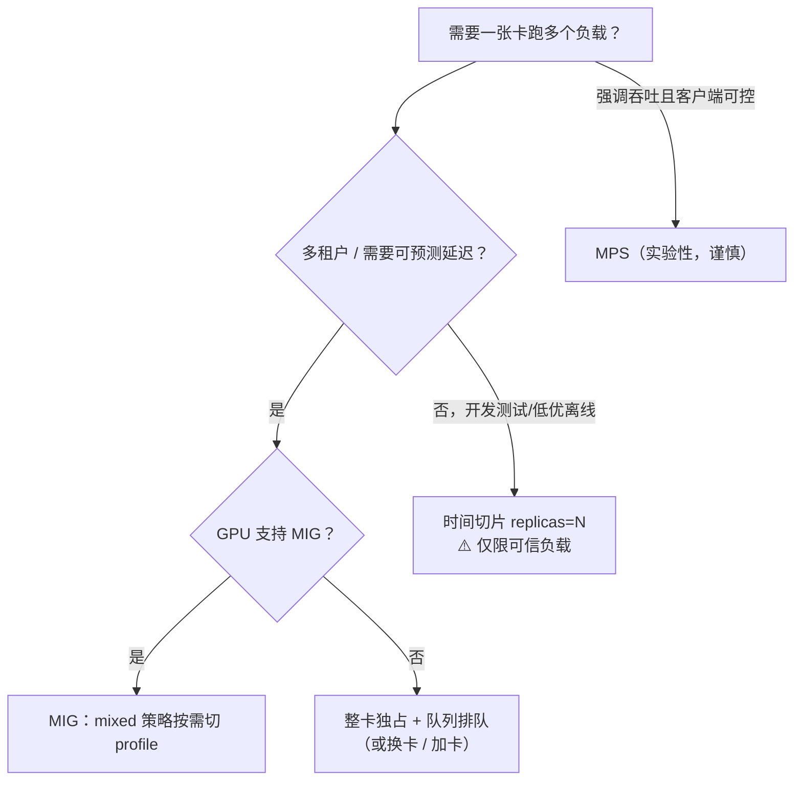

**MIG 是硬件分区，不是「软限额」**：

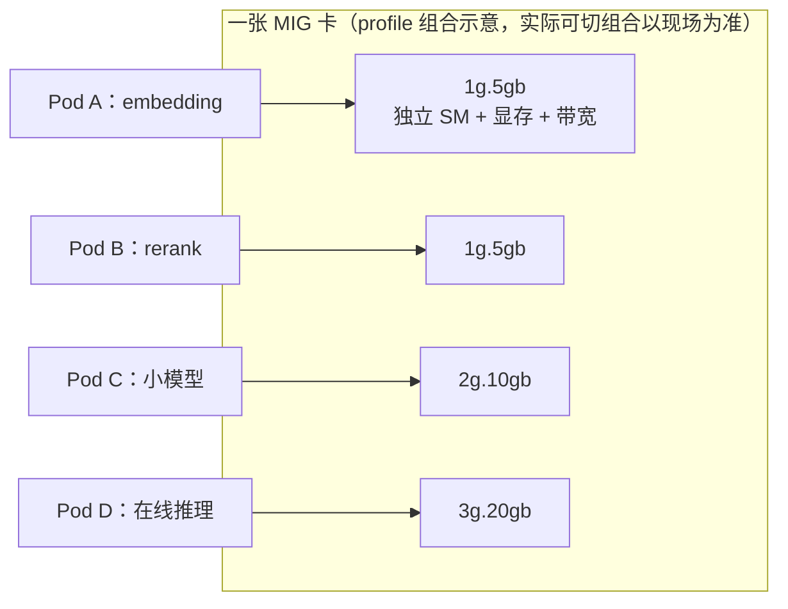

**MIG 要点**：

- profile 命名如 `1g.5gb`、`2g.10gb`、`3g.20gb`、`7g.40gb`（**算力份数 g + 显存**）；单卡最多 7 个 1g 实例；不同型号可用 profile 不同，现场用 `nvidia-smi mig -lgip` 列。
- 策略 `single`（全卡统一一种 profile）vs `mixed`（混切）；`nvidia.com/mig.config` 标签变更触发 MIG Manager 重配置。
- **重配置前必须 drain 该节点上所有 GPU Pod**——MIG  geometry 变更会重置设备，在跑的推理进程会被打死；这正是生产事故高发点。
- MIG 设备以 `nvidia.com/mig-1g.5gb` 这类资源名上报；Pod 用对应名字申请。

**时间切片**（示意，字段名以 chart 为准）：

```yaml
apiVersion: v1
kind: ConfigMap
metadata:
  name: gpu-sharing-config
  namespace: gpu-operator
data:
  any: |-
    version: v1
    sharing:
      timeSlicing:
        resources:
        - name: nvidia.com/gpu
          replicas: 4     # 一张物理卡「报」成 4 个可分配资源
```

> ⚠️ **时间切片是「虚假复制」**：调度器以为有 4 张卡，**底层只有 1 张**；没有显存隔离、没有故障隔离、没有 QoS，一个 Pod OOM 会连坐其余 Pod。生产多租户、在线推理**禁止只用时间切片**；它适合开发/测试、低优批处理的错峰复用。
>
> 📌 **典型推演（2 张卡同时跑 LLM 与 embedding）**：优先 1 张整卡给 LLM 引擎（要吃满显存放 KV Cache，连 [[03-vLLM]]），另 1 张若支持 MIG 切 `1g.*` 给 embedding / rerank（连 [[04-Triton]]）；不支持 MIG 才考虑时间切片，且明确标注「不可用于 SLO 服务」。若模型小、可接受冷启动，也可共用一张卡，但要用较新驱动提供的**每 GPU CUDA 显存限额**（需确认驱动是否支持该能力）避免互相打爆。

---

## 七、可观测与健康检查

### 7.1 DCGM 指标（不是只有利用率）

| 指标族 | 代表 | 用途 |
|---|---|---|
| 利用率 | `DCGM_FI_DEV_GPU_UTIL`、`DCGM_FI_DEV_SM_UTIL` | 粗粒度忙碌度 |
| 显存 | `DCGM_FI_DEV_FB_USED` / `FB_FREE` | 容量、OOM 预警 |
| 温度/功耗/时钟 | `GPU_TEMP`、`POWER_USAGE`、`SM_CLOCK` | 降频、散热故障 |
| 错误 | `DCGM_FI_DEV_XID_ERRORS`、ECC 相关 | 掉卡、双位 ECC、驱动异常 |
| 互联 | NVLink 吞吐/错误 | 多卡通信瓶颈 |

`dcgm-exporter` → Prometheus（`ServiceMonitor`）→ 集群监控看板 / 链路追踪 / 告警系统；Operator 自身健康由 Node Status Exporter 与 validator 输出（通用指标体系见 [[06-推理服务工程]]）。

> 📌 **`GPU_UTIL = 100%` 不代表算力跑满**：它统计的是采样周期内**至少有一个 kernel 在执行的时间占比**，一个只占 1 个 SM 的小 kernel 也能把它拉到 100%。判断是否饱和要看 SM/memory 利用率、吞吐（tokens/s）、队列深度一起看（连 [[AI Infra]] §4.1、[[02-可观测性]]）。

**指标链路**（谁采、谁存、谁消费）：

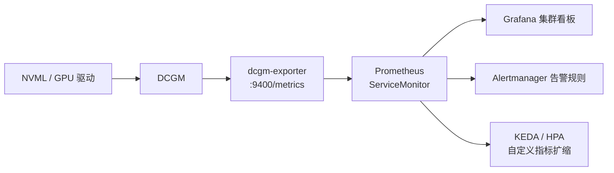

### 7.2 健康与 XID

- **validator** 按 driver → toolkit → plugin → CUDA 顺序跑校验（本质就是跑一个最小 CUDA 容器），失败会在节点事件/Pod 日志里留痕。
- **XID** 是 NVIDIA 驱动写进内核日志的硬件/驱动错误号（如 Xid 79「GPU has fallen off the bus」、Xid 48 双位 ECC 错误）。排查：`dmesg | grep -i NVRM`、`nvidia-smi -q -d ECC`、DCGM XID 指标。
- `nvidia-smi` 是一次性快照（人看的），DCGM 是持续采集与历史（机器看的）——**不要拿 `nvidia-smi` 当监控方案**。

### 7.3 部署后检查基线

```bash
# 1. 节点是否有卡、标签是否齐全
kubectl get node -o json | jq '.items[].status.allocatable["nvidia.com/gpu"]'
kubectl get node -L nvidia.com/gpu.product
# 2. Operator 组件是否全 Ready
kubectl get pods -n gpu-operator
kubectl get clusterpolicy -o yaml | grep -A3 'driver:'
# 3. 端到端跑一个 CUDA 负载（镜像需可从集群拉取）
kubectl run cuda-check --image=nvcr.io/nvidia/k8s/cuda-sample:vectoradd \
  --limits=nvidia.com/gpu=1 --restart=Never --rm -it
# 4. 指标是否出数
kubectl port-forward -n gpu-operator ds/nvidia-dcgm-exporter 9400:9400 &
curl -s localhost:9400/metrics | grep DCGM_FI_DEV_GPU_UTIL
```

> 📌 **GPU 明明空闲但 Pod Pending 的 5 条排查路径**：① 节点 `Allocatable` 里 `nvidia.com/gpu` 是否为 0（device plugin 未就绪）；② 污点没容忍 / nodeSelector 型号标签写错（GFD 未打标签）；③ 申请了 2 卡但碎片化，没有单节点满足；④ 时间切片/MIG 资源名写错（申请 `nvidia.com/gpu` 但节点只上报 `mig-*`）；⑤ 队列层被 Kueue 配额挡住 / PDB 或 ResourceQuota 限制。**先看 `kubectl describe pod` 的 Events，再按层往下钻。**

---

## 八、生产运维：升级、故障、回滚

### 8.1 升级顺序与约束

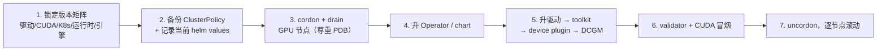

> ⚠️ **驱动升级会卸载/重载内核模块，必须先 drain 该节点上的 GPU Pod**（k8s-driver-manager 会协助，但别把安全寄托在自动化上）。升级顺序遵循依赖：**底层先就绪，上层再跟进**；跨多个大版本不建议跳级。回滚 = 恢复上一版 `ClusterPolicy`/chart + **把节点镜像/内核与驱动版本一起对齐**，只回滚 helm 而节点内核已升级，照样起不来（连 [[08-集群运维]] 变更管理）。

**排障决策树**（自底向上，每层一个可判定信号）：

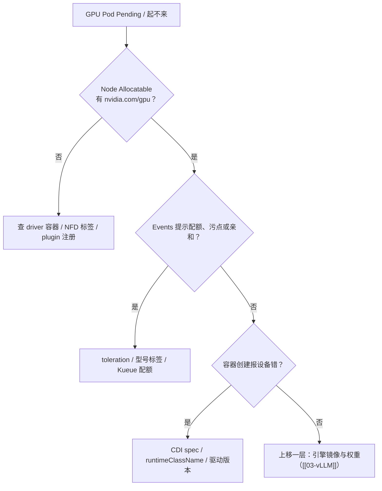

### 8.2 故障速查表

| 现象 | 高频根因 | 定位命令 |
|---|---|---|
| `Allocatable: nvidia.com/gpu = 0` | driver 容器没起来 / NFD 标签没打 / device plugin 未注册 | `kubectl logs -n gpu-operator ds/nvidia-driver-daemonset`；`kubectl describe node` |
| Pod Pending `Insufficient nvidia.com/gpu` | 卡被占、碎片、污点未容忍、Kueue 配额 | `kubectl describe pod` Events；`kubectl get clusterqueue` |
| 容器报 `nvidia-container-cli: initialization error` / 找不到设备 | CDI spec 缺失或过期、runtime 未启用 CDI、25.10+ 管理容器缺 `runtimeClassName: nvidia` | 节点上查 `/var/run/cdi/*.json`；`kubectl get pod -o yaml \| grep runtimeClassName` |
| driver DaemonSet CrashLoop | 内核不在预编译列表、缺 kernel-headers、Secure Boot 未签名 | 看驱动容器日志 `modprobe`/编译报错；`uname -r` 对矩阵 |
| CUDA 报驱动版本不足 | 引擎镜像 CUDA 运行时 > 节点驱动支持 | `nvidia-smi` 顶部 Driver Version 对 CUDA 最低驱动表 |
| MIG 重配置卡住 | 节点仍有 GPU Pod / 未 drain / 标签拼写错 | `kubectl get node -L nvidia.com/mig.config`；MIG Manager 日志 |
| DCGM 无数据 | exporter 未起、ServiceMonitor 没抓、DCGM 与驱动版本不匹配 | `curl :9400/metrics`；Prometheus targets |
| XID 反复出现 / 卡掉线 | 硬件、供电、驱动或 NVLink | `dmesg \| grep -i NVRM`；隔离节点并 cordon |

> 📌 **通用排查律**：按 §一 的分层**自底向上**（硬件/内核 → 驱动 → toolkit/CDI → plugin → 调度 → 引擎），每层用一个可判定的信号（`nvidia-smi` / CDI 文件 / Allocatable / Events / 指标），不要跳层。

---

## 九、离线环境与异构算力

### 9.1 air-gap 离线安装清单

| 类别 | 内容 | 易漏点 |
|---|---|---|
| Helm chart / Operator 镜像 | `gpu-operator` chart（新版支持 OCI 托管）+ controller 镜像 | chart 与组件镜像版本要**整体同步** |
| 驱动 | driver container 镜像、预编译模块包、kernel-headers 编译镜像 | **目标节点内核版本**决定要不要额外编；Secure Boot 签名材料 |
| 运行时栈 | container toolkit、device plugin、GFD、NFD、MIG Manager | 组件间版本由 chart 矩阵锁定，别单独挑 |
| 可观测 | DCGM、dcgm-exporter、Grafana dashboard JSON | 监控规则与告警也要随包 |
| 校验 | validator 用的 CUDA sample 镜像、压测脚本 | 没有冒烟负载等于没验证 |
| 引擎侧 | vLLM/Triton 镜像、权重、tokenizer | 属 [[03-vLLM]] 范畴，但常在 GPU 层验证时才暴露 |

全部预置进离线镜像仓库，由 Helm / GitOps 方式声明式安装（连 [[09-生态与工具]]），**离线集群不应依赖 nvcr.io / NGC / 公网 Helm repo**（离线交付的通用清单见 [[06-推理服务工程]]）。

> ⚠️ **离线驱动编译三件套**：内核头文件/开发包、匹配版本的编译器与工具链镜像、模块签名（Secure Boot）。「目标节点内核不在预编译列表」的解法有两条：① 用编译型驱动容器（要备齐上述材料）；② **锁定节点内核版本**，提供匹配该内核的预编译镜像。生产优先 ②，把不确定性挡在运行之前。

**离线环境的依赖准备链路**：

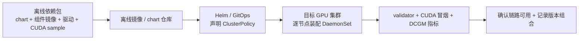

### 9.2 异构算力与多架构

| 维度 | NVIDIA 栈 | 昇腾（Ascend）类比 |
|---|---|---|
| 驱动/固件 | nvidia.ko + NVML | CANN + Ascend 固件 |
| 设备注入 | CDI / NVIDIA Container Toolkit | Ascend Docker Runtime（设备与驱动库挂载） |
| 资源上报 | device plugin `nvidia.com/gpu` | Ascend Device Plugin（`huawei.com/Ascend910` 类资源名，以厂商文档为准） |
| 观测 | DCGM / `nvidia-smi` | `npu-smi` / DCMI + 厂商 exporter |
| 引擎 | vLLM / Triton | MindIE / vLLM-Ascend（算子与量化格式有差异） |

> 📌 **抽象层在哪**：CDI、device plugin / DRA、K8s 扩展资源这些**机制是通用的**；差异全在「驱动 + 设备插件 + 引擎后端」三处。做多算力适配时，把「资源申请的资源名、runtimeClass、节点标签、健康检查命令」抽成配置，而不是在每个部署清单里写死厂商名。
>
> ⚠️ 多架构（amd64/arm64）要连 [[07-工程实践]] 交叉编译一起看：驱动容器、引擎镜像、DCGM 是否都有对应架构的 manifest，是多架构部署前必须验证的矩阵项。

---

## 十、演进与版本口径（避免写完就过时）

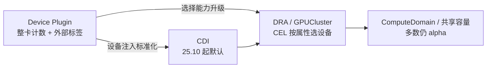

| 事实 | 口径（2026-11 核对） |
|---|---|
| CDI 默认 | GPU Operator **v25.10.0** 起默认启用、不再把 `nvidia` 设为默认 runtime；管理容器需 `runtimeClassName: nvidia` |
| DRA 核心 GA | **K8s 1.34**（`resource.k8s.io/v1` 稳定、默认启用；1.30 起结构化参数设计） |
| 驱动 ≠ 框架 | K8s 框架 GA 不代表 NVIDIA DRA driver 全部能力 GA——动态 MIG、ConsumableShares、MPS、健康检查多为 alpha 且默认关；DRA 资源抢占目前不支持 |
| GPUCluster | 与 `ClusterPolicy` **互斥**；有 K8s/驱动最低版本要求，现场用 chart 文档确认 |
| 每 GPU 显存限额 | 较新驱动/Operator 才提供，属「现场实测」项，不要默认认为目标集群具备 |
| EOL | 25.10.x 等旧分支已进入生命周期末期，需按支持周期规划升级 |

> ⚠️ **写给未来的自己**：本节的任何版本号都可能随时间变化。升级前用 `kubectl explain resourceclaim`、`kubectl api-resources | grep -i resource`、`helm show values` 三条命令确认现场能力，再决定用哪条路径。

---

## 十一、面试高频问答 🎯

**Q1：GPU Operator 解决什么问题？不解决什么？**
把驱动、container toolkit、device plugin/DRA driver、GFD/NFD、DCGM、MIG Manager 等节点级软件收敛成 `ClusterPolicy` 一个 CRD + 一组 DaemonSet，由 Operator reconcile，消除配置漂移、支持声明式升级。不解决模型加载、显存优化、多卡并行、服务灰度与网关——那是 [[03-vLLM]] / [[02-KServe]] 的层。

**Q2：ClusterPolicy 是什么？改一个字段会发生什么？**
集群级单例 CRD，Operator watch 它 → diff 期望与实际 → patch 对应 DaemonSet → validator 按 driver→toolkit→plugin→CUDA 顺序校验。改字段不需要登录节点；失败会持续 reconcile 并产生事件，符合 [[07-API 与 Watch 机制]] 的控制循环模型。

**Q3：驱动为什么能放进容器？内核模块怎么办？**
驱动容器只是**安装器**：特权挂载宿主机 `/lib/modules` 等目录，编译/加载 `nvidia.ko` 到**宿主机内核态**，并放置用户态库；模块加载后属于宿主内核，容器退出不影响，但节点重启后必须重新加载。用户态库由 toolkit 在业务容器启动时注入，业务镜像不需要自带驱动。

**Q4：Pod 写 `nvidia.com/gpu: 1` 后，设备怎么进容器？（全链路）**
device plugin 通过 kubelet DevicePlugin gRPC 注册并 `ListAndWatch` 上报 GPU → kubelet 更新 Node `Allocatable` → 调度器按扩展资源选节点 → kubelet 调 `Allocate` 拿到具体设备（CDI 设备名等）→ 创建容器时把该信息交给 containerd → 运行时按 CDI spec 注入 `/dev/nvidia*` 与驱动库 → 容器内 CUDA 可用。

**Q5：`nvidia.com/gpu: 0.5` 行不行？requests 能小于 limits 吗？**
都不行。扩展资源只能是**非负整数**，且必须写在 `limits`（requests 自动等于 limits），不能超卖、不能跨容器共享同一份分配。要表达「显存 ≥ 40G / 指定型号 / 拓扑」只能靠 GFD 标签 + 亲和约束，或走 DRA 的 CEL 选择。

**Q6：CDI 解决了什么？从旧版升级到 25.10+ 最容易踩什么坑？**
CDI 用标准 JSON 描述设备注入，运行时原生读取，去掉厂商专有 runtime hook。25.10.0 起默认启用且 `nvidia` 不再是默认 runtime handler：标准工作负载无需改动，但**靠 `NVIDIA_VISIBLE_DEVICES` 直接拿全部 GPU 的管理容器（监控 agent、插件）必须显式写 `runtimeClassName: nvidia`**，否则升级后集体失效；同时要确认运行时支持并启用了 CDI。

**Q7：DRA 与 device plugin 的本质区别？1.34 意味着什么？**
device plugin 只上报「N 张卡」这个计数，选择逻辑在外部标签；DRA 用 `DeviceClass`/`ResourceSlice`/`ResourceClaim` 让调度器按设备属性（CEL）统一分配，claim 还能被多 Pod/容器引用。K8s **1.34 把 DRA 核心 API 升到 GA 并默认启用**；但驱动侧的动态 MIG、共享容量等能力多为 alpha，且当前**不支持 DRA 资源抢占**。

**Q8：GPUCluster 和 ClusterPolicy 能共存吗？迁移成本在哪？**
不能，官方明确互斥。前者管 DRA 栈、后者管 device plugin 栈，是**集群级二选一**。迁移要改所有 GPU Pod 的清单（`resources.limits` → `ResourceClaimTemplate` + `pod.spec.resourceClaims`），并满足 K8s/驱动最低版本；生产建议新集群试点、老集群维持，不原地切换。

**Q9：MIG / 时间切片 / MPS 怎么选？2 张卡要同时跑 vLLM 和 embedding 呢？**
MIG 是硬件分区（算力/显存/故障域都隔离，仅部分数据中心卡支持）；时间切片只是轮流用、无内存与故障隔离，适合可信开发负载；MPS 是协作式共享、实验性。方案：1 张整卡给 vLLM（KV Cache 吃显存），另 1 张优先 MIG 切小实例给 embedding/rerank；不支持 MIG 才退时间切片，且不能承载 SLO 服务。

**Q10：MIG 重配置为什么危险？**
改 `nvidia.com/mig.config` 会重置 GPU 分区，节点上在跑的 GPU 进程会被打死。必须先 cordon + drain 该节点，等 MIG Manager 完成并校验 profile 生效，再恢复调度。

**Q11：`DCGM_FI_DEV_GPU_UTIL = 100%` 是不是算力跑满了？**
不是。它是「采样周期内至少有一个 kernel 在跑」的时间占比，一个只占单个 SM 的小 kernel 也能拉满。要综合 SM/显存带宽利用率、tokens/s、队列深度判断；这也是为什么容量基线必须压测得出，不能只看一个指标。

**Q12：为什么 GPU 节点要打污点？默认调度器哪里不够？**
污点 + toleration 阻止普通 Pod 占用昂贵 GPU 节点。默认调度器只做单 Pod 的即时放置，做不了配额、排队、成组调度（TP=4 必须 4 卡同时到位）、公平份额与抢占，也容易产生碎片；这些由 Kueue 的 ClusterQueue/LocalQueue 与装箱策略补。

**Q13：GPU 明明空闲但 Pod Pending，怎么排查？**
① 节点 `Allocatable` 是否真有 `nvidia.com/gpu`；② 污点/型号标签/亲和是否匹配（GFD 是否打全）；③ 多卡请求是否被碎片卡住；④ MIG/时间切片资源名是否写错；⑤ Kueue 配额、ResourceQuota、PDB 是否在挡。先看 `kubectl describe pod` 的 Events，再自底向上按层验证。

**Q14：离线（air-gap）集群装 GPU Operator 要准备什么？节点内核不在预编译列表怎么办？**
chart/controller/driver/toolkit/plugin/GFD/NFD/DCGM/validator/CUDA sample 全部镜像预置到离线镜像仓库，由 Helm / GitOps 声明式安装，断开 nvcr.io/NGC。内核不在列表：要么用编译型驱动（备 kernel-headers、工具链、Secure Boot 签名材料），要么**预先锁定节点内核版本**并提供匹配的预编译镜像——生产优先后者。

---

## 十二、关联

- 上游 → [[AI 工程]]、[[AI Infra]]（分层地图 §1/§4）、[[Kubernetes]]、[[01-架构与组件]]（kubelet / CRI）、[[07-API 与 Watch 机制]]（控制循环）
- 调度通用机制 → [[05-调度与资源管理]]（污点/PDB/配额）、[[02-工作负载资源]]（探针/优雅退出）
- 上层 → [[03-vLLM]]、[[04-Triton]]、[[02-KServe]]、[[05-推理网关与路由]]、[[06-推理服务工程]]、[[LLM 推理基础]]（显存估算）
- 观测 → [[02-可观测性]]、[[06-推理服务工程]]（指标与 SLO 口径）
- 工程 → [[09-生态与工具]]、[[08-集群运维]]（变更与回滚）、[[07-工程实践]]（多架构构建）（多集群纳管）
