---
tags:
  - ai
  - infra
  - serving
  - k8s
  - 面试
created: 2026-11-14
updated: 2026-11-15
status: 已整理
---

# 🚀 KServe

> 面向面试：**把「模型」变成 K8s 里的声明式对象**——AI Infra 的③平台层，管版本、灰度、弹性、多模型，不管推理吞吐。

**全文主线**：KServe 是一个标准的 **K8s 控制器**（连 [[07-API 与 Watch 机制]]）——你声明一个 `InferenceService`，控制器 reconcile 出 Deployment / Service / HPA / 路由规则，把「模型上线」从手写一堆 YAML 变成改一行 `storageUri`。理解它只需要抓住两件事：**控制平面把 CRD 翻译成 K8s 对象**，**数据平面按协议把请求送进引擎**。

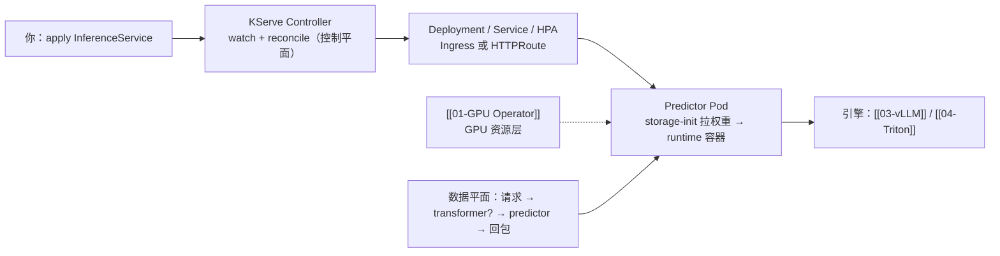

> 📌 **一句话定位**：①资源层 [[01-GPU Operator]] 让 K8s 认得卡，②引擎层 [[03-vLLM]] 把权重变成高吞吐 API，**③平台层 KServe 把「一个服务」变成可声明、可灰度、可伸缩的对象**。它不优化 tokens/s，也不训练模型、不做模型仓库、不保证准确率。
>
> ⚠️ **版本口径（2026-11 核对）**：KServe 是本篇最容易过时的领域——2026 年一年内从 0.17 走到 0.21，且**部署模式改了名**。所有版本号、模式名、依赖矩阵都标注了适用语境；实际环境以 `kubectl get crd`、`helm list`、官方 release notes 实测为准（连 [[08-集群运维]]）。

---

## 一、要不要上 KServe：先把回本点讲清楚

| 问题 | 裸跑 vLLM / Deployment | 上 KServe |
|---|---|---|
| 1~2 个模型 | YAML 手写，改起来直接 | **过度设计**：控制平面 + 证书 + 网关的装配成本高于收益 |
| 模型数量上量 | 每个模型一套 Deployment/Service/HPA/Ingress，开始复制粘贴 | 一个 CRD 统一，平台与模型团队解耦 |
| 需要灰度 / 流量切分 | 自己搭两套 Deployment + 改 Service/网关权重 | `canary` 与流量切分内建 |
| 需要按业务指标扩缩 | 自己接 KEDA / 自定义指标 | 与 KEDA / KPA / HPA 集成（仍是自己配） |
| 需要统一协议 | 各框架各写各的 | **Open Inference Protocol（V2）** 统一 HTTP/gRPC 形状 |

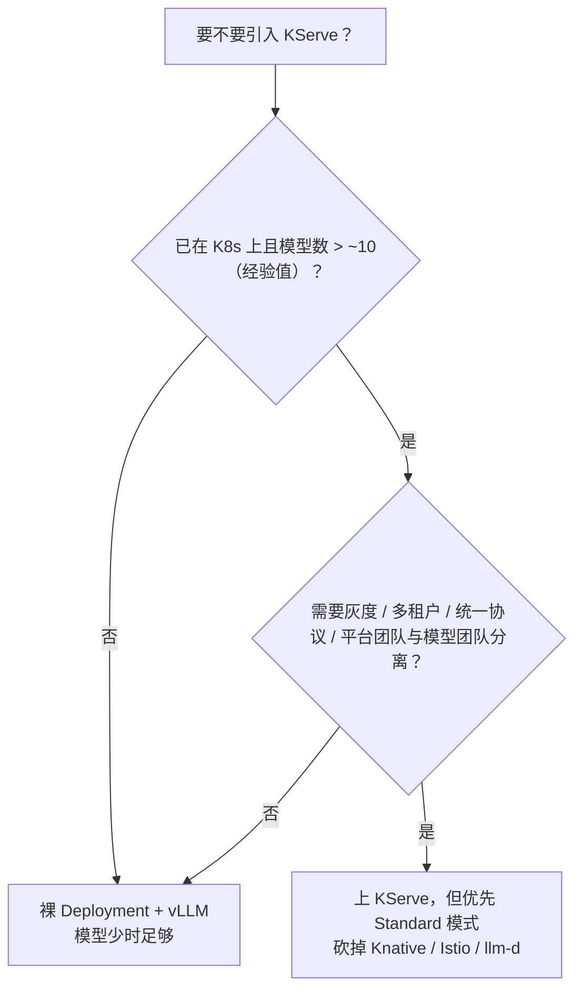

> ⚠️ **结论**：模型数量很少时，**最小组合 = GPU 资源层 + 裸 vLLM Deployment + 权重存储**（连 [[AI Infra]] §3）；KServe 是「模型与团队数量上来之后」的增量，不是准入门槛。这与具体用什么工具安装无关，取决于编排收益是否覆盖装配成本。
>
> 📌 完整形态涉及 **cert-manager、Gateway API CRDs、可选 Knative / Istio / KEDA / llm-d**，且有严格兼容矩阵；没有专职平台团队时，第一次装配以「天」计。这不是功能强弱问题，是**运维成本是否回本**的问题。

---

## 二、版本与命名口径（2026 年最大的坑）

### 2.1 部署模式改名（照旧教程抄必错）

| 旧名（≤0.19 及大量教程） | 0.20 起当前名 | 状态 |
|---|---|---|
| `Serverless` | **Knative** | 旧值 deprecated，自动归一化 |
| `RawDeployment` | **Standard** | 旧值 deprecated，自动归一化；**现在是默认模式** |
| `ModelMesh` | ModelMesh | 高密度多模型，**仓库 2026-04 已归档**，新项目不要用 |

> ⚠️ **模式默认值也变了**：KServe 早期的招牌是 Knative 的 scale-to-zero；但对 LLM 来说，缩到零后要重新拉几十 GB 权重 + 编译 + 图捕获，冷启动**分钟级**，交互式 SLO 直接崩。官方现在推荐**生产 LLM 用 Standard 模式**（无冷启动、Pod 生命周期可控），Knative 只留给「大量低频小模型 / 开发环境」。

### 2.2 版本线（理解演进，不当作事实依据）

| 版本 | 时间（以官方 release notes 为准） | 关键变化 |
|---|---|---|
| 0.15 | 2025-05 | Envoy AI Gateway / LMCache 实验性集成 |
| **0.17** | 2026-03 | **`LLMInferenceService` 生产可用**、独立 controller、KV 感知路由、PD 分离、LeaderWorkerSet 多节点并行、WVA、**Helm chart 由单 chart 拆成多个** |
| 0.18 | 2026-04 | 多节点推理不再依赖 Ray、LWS 自动伸缩、OpenAI Responses API 路由、namespace 级 ModelCache |
| 0.19 | 2026-06 | 静态 LoRA、按 model 名路由、**vLLM 优雅排空（drain）** |
| 0.20 | 2026-08 | LLM 流量切分、Standard 模式 canary、KV cache CPU 分层 offload、OTel 追踪、managed DRA、Anthropic Messages API 路由；**部署模式改名** |
| 0.21 | 2026-09 | CRD 独立安装、`LLMInferenceService` 支持 KEDA 缩零 |

- 项目 2025 下半年被 CNCF 接受为 **incubating**（各资料对具体月份口径不一，以 CNCF 项目页为准）。
- ⚠️ **升级陷阱**：0.17 把单 Helm chart 拆成多个（`kserve-crd` / `kserve-resources` 等），**从 0.16 及更早直接 `helm upgrade` 会失败**，必须先读迁移说明；`InferenceService` CRD 很大，安装清单要用 `kubectl apply --server-side`（client-side apply 会超注解限制）。

---

## 三、核心抽象：一个 CRD 怎么变成一套服务

### 3.1 控制平面 / 数据平面

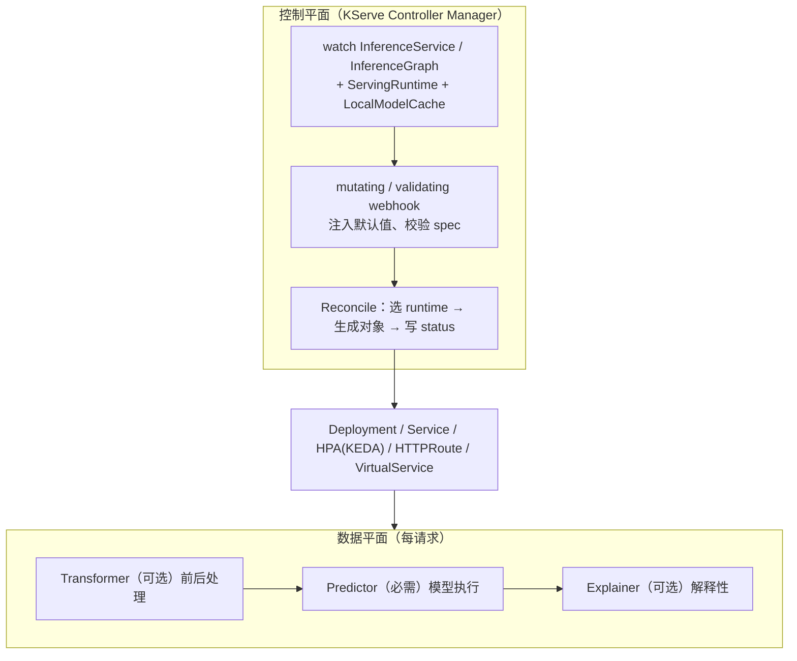

| 对象 | 作用域 | 职责 |
|---|---|---|
| `InferenceService`（`serving.kserve.io/v1beta1`） | 命名空间 | 核心 CRD：`predictor` 必需，`transformer` / `explainer` 可选；描述模型格式、位置、资源、伸缩 |
| `ServingRuntime` / `ClusterServingRuntime` | 命名空间 / 集群 | **runtime 模板**：把「模型格式」映射到容器镜像与 Pod 规格；内置 vLLM / Triton / sklearn 等，可自定义 |
| `InferenceGraph` | 命名空间 | 多模型编排：Sequence / Switch / Ensemble / Splitter |
| `LocalModelCache` / ModelCache | 节点 / 命名空间 | 权重节点级缓存，把大模型冷启动从十几分钟降到分钟级（官方口径，现场实测） |
| `storage-initializer` | init container | 按 `storageUri` 从 S3/GCS/Azure/PVC/HF/OCI 拉权重到 Pod 内共享卷 |

> 📌 **职责分离的工程意义**：平台团队维护 `ClusterServingRuntime`（镜像、资源默认值、探针），模型团队只写 `InferenceService`（模型 URI + 规格）。改 runtime 镜像不用动业务清单——这正是「平台层」的价值，也是 K8s 声明式 API 的一贯套路。

### 3.2 从 apply 到 Ready 的对象链路

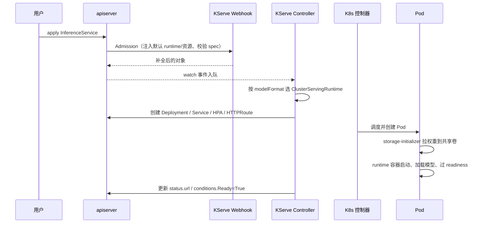

```yaml
# 示意：字段以现场 CRD 为准（kubectl explain inferenceservice.spec）
apiVersion: serving.kserve.io/v1beta1
kind: InferenceService
metadata:
  name: qwen3-8b
  namespace: ai-serving
spec:
  predictor:
    model:
      modelFormat: { name: vLLM }       # 取值由 ClusterServingRuntime.supportedModelFormats 决定
      storageUri: pvc://model-weights/qwen3-8b   # 离线环境走 PVC / OCI
      resources:
        limits: { nvidia.com/gpu: 1 }
    minReplicas: 1                      # Standard 模式：不缩零
    maxReplicas: 4
```

> 📌 **对象链路**：`apply → webhook 补全/校验 → controller 选 runtime → 生成 K8s 对象 → storage-init 拉权重 → runtime 就绪 → status.Ready`。排障就按这条链逐段看：CRD 有没有被 admission 拒、控制器有没有生成 Deployment、init container 有没有下载成功、模型有没有加载完。
>
> ⚠️ **协议不等于性能**：V2（Open Inference Protocol）统一了 `/v2/models/<name>/infer` 的 HTTP/gRPC 形状，但不同 runtime 的性能与特性并不因此等价；LLM 主链路走 **OpenAI 兼容 API**（`/v1/chat/completions`），不是 V2 predict（连 [[03-vLLM]] §五）。

### 3.3 storage-initializer 与 InferenceGraph

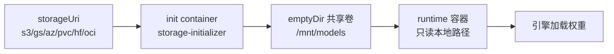

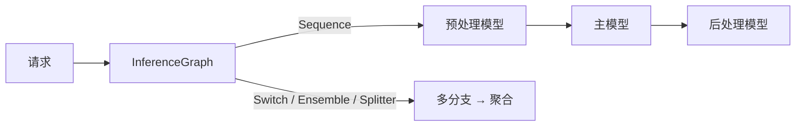

> ⚠️ InferenceGraph 每多一跳就多一次网络往返与一个故障点，**只有流水线确实需要时才用**；单模型服务不要为了「看起来平台化」套一层图。

---

## 四、部署模式与弹性：依赖与冷启动决定选型

| 维度 | **Standard**（旧 RawDeployment） | **Knative**（旧 Serverless） |
|---|---|---|
| 生成的对象 | 原生 Deployment + Service + HPA/KEDA | Knative Service + 网关路由（VirtualService / HTTPRoute） |
| 依赖 | 无 Knative；cert-manager 必需，Gateway API CRDs 推荐 | **Knative Serving + Istio / 网关**，装配重 |
| 伸缩 | HPA/KEDA，最小副本通常 ≥1 | **请求驱动、可缩到 0** |
| 冷启动 | 无（Pod 常驻） | 首个请求承担权重加载 + 编译 + 图捕获，**分钟级** |
| 适用 | **生产 LLM、延迟可预测、常驻服务** | 大量低频小模型、开发/测试、成本敏感 |

**两种模式生成的对象与依赖完全不同**（装配成本差在这里）：

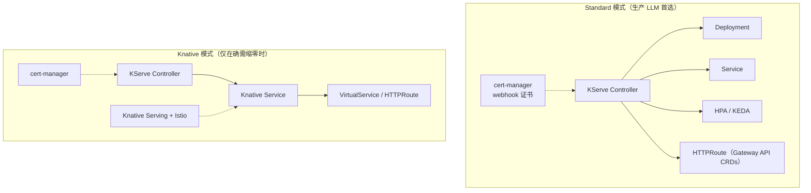


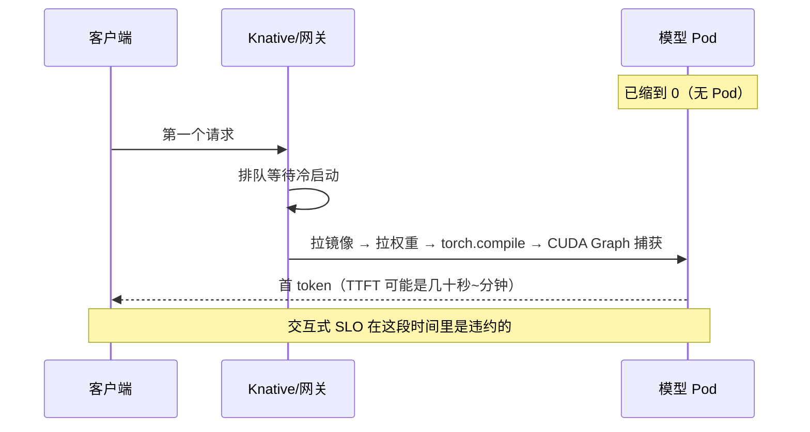

> 📌 **典型配置（模型数量少、无专职平台团队）**：**Standard 模式 + 内置 vLLM runtime + 权重 PVC，minReplicas≥1**；不装 Knative / Istio / llm-d，不动 scale-to-zero。理由：装配与升级成本无人承担，且交互式请求无法接受分钟级冷启动。KEDA 只作为「后续按队列深度扩缩」的增量，不用于缩零。
>
> ⚠️ **别用 CPU 做扩缩信号**：推理饱和看的是并发、队列深度、KV cache 使用率、TTFT / tokens·s⁻¹（连 [[03-vLLM]] §七、[[05-调度与资源管理]] HPA 通用机制）。0.21 起 `LLMInferenceService` 才有 KEDA 缩零能力，Standard 模式下通常不用。

---

## 五、流量治理与模型生命周期

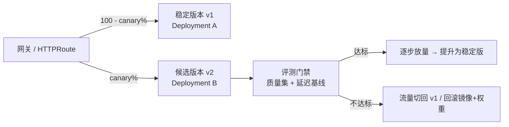

- **金丝雀**：`InferenceService` 支持 canary 版本与流量百分比（`canaryTrafficPercent`，字段名以现场 CRD 为准）；0.20 起 **Standard 模式也支持 canary**，0.20 起 `LLMInferenceService` 有专门的流量切分 API。
- **评测门禁**：模型上线不只是「能启动」，要有**回归质量集 + P95/P99 延迟基线**；灰度期间对照两组指标再放量（连 [[AI Infra]] §4.3）。
- **优雅退出**：0.19 起补了 vLLM drain，缩容/滚动更新时先停止接新请求、等在途流式生成结束再退出；K8s 侧仍要配 `terminationGracePeriodSeconds` ≥ 最长生成时间、`preStop` + `startupProbe`（连 [[02-工作负载资源]]、[[03-vLLM]] §8.1）。
- **回滚必须成对**：引擎镜像与权重版本一起回退，只回一个照样起不来。
- **多租户**：namespace + ResourceQuota + NetworkPolicy + RBAC 控制谁能改 `InferenceService`；模型权重凭证走 ServiceAccount/Secret，别塞进清单（连 [[06-配置与安全]]）。

---

## 六、LLM 专用路径：什么时候必须用 LLMInferenceService

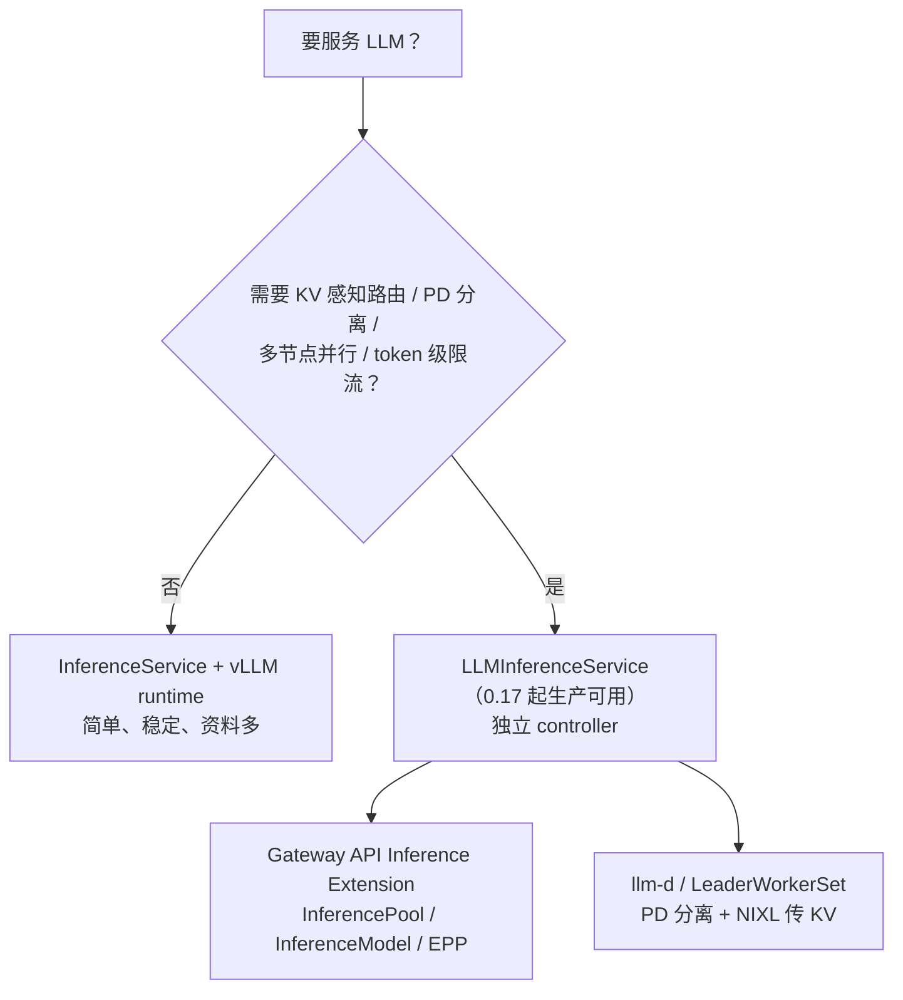

| 能力 | 属于哪层 | 说明 |
|---|---|---|
| `LLMInferenceService` | 平台层（LLM 专用 CRD） | 独立 controller、OpenAI 兼容协议；面向分布式推理与多节点并行 |
| **Gateway API Inference Extension** | **④路由层** | `InferencePool` / `InferenceModel` + **EPP（Endpoint Picker）**，按模型名、版本、副本负载与 KV 缓存亲和选副本，而不是简单轮询；2026-04 GA（核对日期 2026-11，以官方为准，连 [[03-服务与网络]] Gateway API） |
| KV cache 感知路由 | 路由层 | prefix-aware 调度 + LMCache / CPU 分层 offload；命中率直接决定 TTFT |
| PD 分离 / llm-d | 路由+引擎编排 | prefill 与 decode 分池、NIXL 传 KV、LWS 管多节点；**vLLM 官方标 experimental 且不提升总吞吐**（连 [[03-vLLM]] §六），只有规模上来才回本 |
| LoRA / 多模型共享 | 平台层 | 0.19 起静态 LoRA adapter + 按 model 名路由；共享基座而非「一模型一卡」 |
| WVA（Workload Variant Autoscaler） | 容量层 | 按异构硬件成本感知选卡型与副本（进阶，连 [[AI Infra]] §4.2） |

**模型感知路由为什么不是普通轮询**：

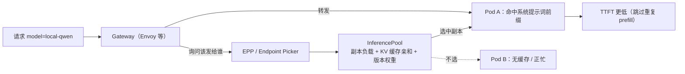


> 📌 **选型分界**：单个 LLM、只要一个稳定 OpenAI 兼容端点 → `InferenceService` 足够；需要「按 KV 命中率路由 / 多节点 TP/EP / PD 分离 / token 级限流 / 分布式调度」→ 才上 `LLMInferenceService` + Gateway Inference Extension（详见 [[05-推理网关与路由]]）。**后者是 ④路由层的复杂度，不是 KServe 的必选项。**
>
> ⚠️ 别把 `LLMInferenceService` 当成「InferenceService 的新版本」：它是**另一套 CRD + 另一条 reconcile 路径**，API 仍在快速迭代（几乎每个小版本有调整），接进自动化系统要预留跟进预算。

---

## 七、可观测与状态检查

| 层 | 指标 | 用途 |
|---|---|---|
| KServe 控制器 | `InferenceService` Ready / status conditions、reconcile 失败事件 | 「为什么没起来」第一现场 |
| 平台 | 请求量 / 延迟 / 错误率、副本数、冷启动次数 | 容量与 SLO |
| 引擎 | `vllm:gpu_cache_usage_perc`、排队数、preemption、TTFT/TPOT | 真正决定体验的指标（连 [[03-vLLM]] §七） |
| GPU | DCGM 利用率/显存/XID | 资源层（连 [[01-GPU Operator]] §七） |

**排障决策树**（按 Reconcile 链路逐段判定）：

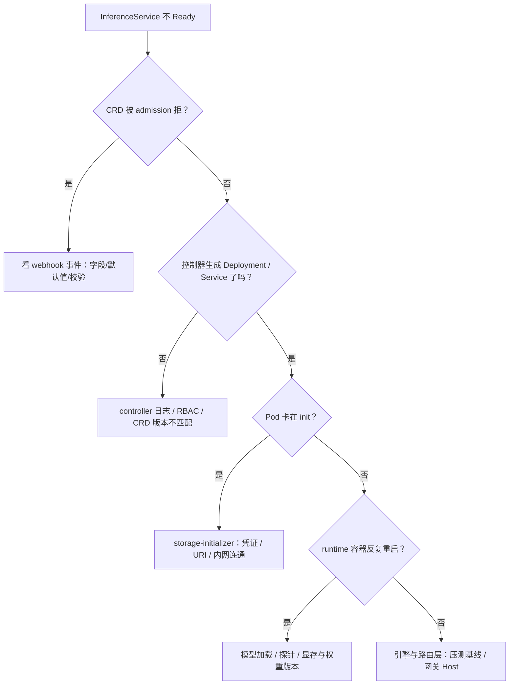

```bash
# 排障顺序：CRD → 控制器生成的对象 → Pod → 引擎
kubectl get isvc -n ai-serving                       # READY / URL / 条件
kubectl describe isvc qwen3-8b -n ai-serving | tail -30
kubectl get deploy,svc,hpa -n ai-serving | grep qwen3
kubectl logs -n ai-serving <pod> -c storage-initializer   # 权重拉取
kubectl logs -n ai-serving <pod> -c kserve-container      # runtime 加载
kubectl get events -n ai-serving --sort-by=.lastTimestamp | tail -20
```

> 📌 **压测基线**：与 [[03-vLLM]] 共用一套压测（固定并发扫点、P50/P95/P99 TTFT + TPOT + tokens/s），升级 KServe / runtime 镜像前后各跑一次（方法论见 [[06-推理服务工程]]）。**KServe 只改变编排，不该改变引擎基线**——如果压测变了，先怀疑 runtime 镜像或资源配额被改，而不是先归因到控制器。

---

## 八、安装依赖、升级与回滚

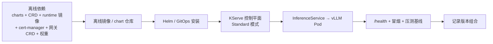

**最小形态清单**（明确「砍掉什么」）：

| 必需 | 可暂缓 |
|---|---|
| KServe CRD + controller（Standard 模式） | Knative Serving |
| **cert-manager**（webhook 证书） | Istio / 完整服务网格 |
| Gateway API CRDs（推荐，用于 HTTPRoute） | llm-d / PD 分离 / EPP |
| 内置或自定义 vLLM `ClusterServingRuntime` | ModelMesh（已归档） |
| 内网权重 PVC / OCI + 内网 runtime 镜像 | KEDA 缩零 |
| Helm / GitOps 声明式安装 + 版本矩阵 | 公网模型仓库与遥测 |

```bash
# 示意：0.20 口径，实际版本/依赖以仓库 hack/setup/kserve-deps.env 为准
helm install kserve-crd oci://ghcr.io/kserve/charts/kserve-crd --version <pinned>
helm install kserve oci://ghcr.io/kserve/charts/kserve-resources --version <pinned> \
  --set kserve.controller.deploymentMode=Standard
kubectl apply --server-side -f kserve-cluster-resources.yaml   # CRD 太大，client-side apply 会失败
```

> ⚠️ **四条安装与升级铁律**：
> 1. **锁死兼容矩阵**：KServe ↔ K8s（0.20 要求较新 K8s）↔ cert-manager（1.15+）↔ Knative/Istio/Gateway API ↔ runtime 镜像 ↔ 引擎版本；官方文档不同页面给的 Gateway API 版本都可能不一致，以仓库依赖文件为准。
> 2. **Helm 升级看迁移说明**：0.17 拆 chart 后跨版本 `helm upgrade` 会失败，别照旧脚本跑。
> 3. **权重不出网**：`storageUri` 用 `pvc://` 或内网 OCI，storage-initializer 的凭证走 Secret；禁用公网 HF 拉取（连 [[03-vLLM]] §8.2）。
> 4. **升级窗口**：控制平面升级会影响全部 InferenceService，先在小规模命名空间灰度，回滚时 CRD 与 controller 要一起回退（连 [[08-集群运维]] 变更管理）。

---

## 九、选型对比与「何时不用」

| 方案 | 定位 | 相对 KServe |
|---|---|---|
| **裸 vLLM Deployment** | 单模型、最少依赖 | 模型少时首选；缺灰度/统一协议/多模型管理 |
| **KServe** | K8s 原生、框架中立、CNCF 治理 | 综合分最高，代价是装配与版本矩阵 |
| Seldon Core | 推理流水线、模型监控更成熟 | 流水线/漂移检测场景更强 |
| BentoML | Python 开发者体验、打包 | 开发体验好，K8s 原生度低 |
| Ray Serve | 组合灵活、Python 编排 | 灵活但自成体系，与 K8s 声明式风格不同 |
| llm-d / NVIDIA Dynamo | ④路由层 / 分布式推理编排 | **不是 KServe 的竞品**，可与 LLMInferenceService 配合 |

> ⚠️ **何时不用 KServe**：模型 ≤ 3 个、没有专职平台团队、集群里没有 Gateway API / cert-manager 体系、或只是要尽快提供一个本地推理端点。此时引入 KServe 得到的只是证书与 CRD 的排障工作量。

---

## 十、演进与口径（避免写完就过时）

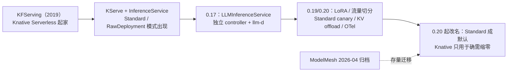

| 事实 | 口径（2026-11 核对） |
|---|---|
| 部署模式 | 0.20 起 `Standard`（原 RawDeployment）为默认，`Knative`（原 Serverless）用于缩零；旧值自动归一化 |
| ModelMesh | 仓库 2026-04 归档，新项目不用；高密度多模型改看多 LoRA / 模型名路由 |
| LLMInferenceService | 0.17（2026-03）生产可用，独立 controller；API 仍快速演进 |
| Gateway API Inference Extension | `InferencePool` / `InferenceModel` + EPP，2026-04 GA（核对日期 2026-11，以官方 release 为准） |
| 依赖 | cert-manager 必需；Knative / Istio / KEDA / llm-d 按模式可选；**版本矩阵必须锁** |
| 冷启动 | Standard 常驻、Knative 缩零分钟级；LocalModelCache 只缓解权重拉取，不消除编译与图捕获 |

> ⚠️ **写给未来的自己**：升级前先跑 `kubectl get crd | grep serving.kserve.io`、读目标版本 release notes 的 breaking changes、在测试集群压一遍基线。KServe 的**模式名与 Helm chart 结构**是最容易从旧教程抄错的两处。

---

## 十一、面试高频问答 🎯

**Q1：KServe 解决什么问题？不解决什么？**
把模型上线从手写 Deployment/Service/HPA/Ingress 变成声明一个 `InferenceService`，统一 runtime 选择、权重拉取、协议、灰度与伸缩，让平台团队与模型团队解耦。不解决推理吞吐（[[03-vLLM]]）、GPU 供给（[[01-GPU Operator]]）、模型训练、模型仓库与准确率。

**Q2：一个 InferenceService 从 apply 到 Ready 发生了什么？**
admission webhook 注入默认值并校验 → controller watch 到并按 `modelFormat` 选 `ClusterServingRuntime` → 创建 Deployment/Service/HPA/路由 → Pod 里 storage-initializer init container 按 `storageUri` 拉权重到共享卷 → runtime 容器加载模型过 readiness → controller 写 `status.url` 与 `conditions.Ready=True`。这是标准 Reconcile 循环（连 [[07-API 与 Watch 机制]]）。

**Q3：InferenceService 的 predictor / transformer / explainer 各是什么？**
`predictor` 必需，跑模型服务；`transformer` 可选，做前后处理与协议转换，让 runtime 镜像保持纯粹、逻辑可独立更新；`explainer` 可选，输出可解释性结果。每多一个组件就多一跳网络与故障点。

**Q4：ServingRuntime 和 ClusterServingRuntime 区别？为什么要有这层？**
前者命名空间级、后者集群级，都是「模型格式 → 容器镜像 + Pod 规格」的模板。平台团队统一维护 runtime（镜像、探针、资源默认值），模型团队只声明模型 URI 与规格，改 runtime 不动业务清单——是平台层解耦的关键。

**Q5：2026 年 KServe 部署模式改名改了什么？为什么？**
`Serverless`→`Knative`、`RawDeployment`→`Standard`，且 **Standard 成为默认**。原因是对 LLM 而言 scale-to-zero 的分钟级冷启动是负债，官方推荐生产 LLM 用常驻 Pod 的 Standard，Knative 只留给大量低频小模型与开发环境。旧值 deprecated 但自动归一化，照旧教程抄容易配错。

**Q6：模型数量少、没有专职平台团队时，KServe 怎么部署？**
Standard 模式 + 内置 vLLM runtime + 权重 PVC + minReplicas≥1，不装 Knative/Istio/llm-d，不开缩零。最小依赖只有 CRD/controller、cert-manager、Gateway API CRDs（推荐）、runtime 镜像与权重，由 Helm / GitOps 声明式安装。KServe 此时本身都可能偏重，先评估裸 vLLM 是否够用。

**Q7：为什么不能用 CPU 指标给 LLM 服务扩缩容？**
推理饱和取决于并发、队列深度、KV cache 使用率、TTFT/TPOT，CPU 常常不高但 GPU 已排队或显存吃紧。用 KEDA 接引擎自定义指标（连 [[03-vLLM]] §七）；且交互场景要保证最小副本，别追求缩零。

**Q8：canary 怎么做？为什么必须配评测门禁？**
InferenceService 支持 canary 版本与流量百分比（0.20 起 Standard 模式也支持，LLMInferenceService 有独立流量切分 API）。模型版本切换和代码发布一样有风险，但「能启动」不代表质量没退化，要有回归质量集 + P95/P99 延迟基线，达标再放量；回滚时**引擎镜像与模型权重必须成对**。

**Q9：什么时候该用 LLMInferenceService 而不是 InferenceService？**
它俩不是新旧关系，是两条 CRD 与两条 reconcile 路径。单模型、只要稳定 OpenAI 兼容端点 → InferenceService；需要 KV 感知路由、PD 分离、多节点 TP/EP、token 级限流、分布式调度 → LLMInferenceService + Gateway Inference Extension。后者 API 迭代快，接自动化要留跟进成本。

**Q10：Gateway API Inference Extension 的 InferencePool / EPP 解决什么？**
普通网关只会轮询，而 LLM 请求成本差异极大（长 prompt、KV 命中率不同）。EPP（Endpoint Picker）按模型名、版本、副本负载与 KV 缓存亲和挑选副本，让「有缓存的副本优先接同一会话」，直接降 TTFT。它属于④路由层，不是 KServe 内建能力。

**Q11：ModelMesh 还能用吗？**
仓库 2026-04 已归档，新项目不要选。高密度多模型改走共享基座 + 多 LoRA / 按 model 名路由（0.19+）与模型名路由网关。存量用户要规划迁移。

**Q12：KServe 安装与升级最容易踩的三个坑？**
① 版本矩阵没锁（KServe/K8s/cert-manager/Gateway API/Knative/runtime 互相约束，官方文档不同页给的 Gateway API 版本都可能不一致）；② 0.17 拆 Helm chart 后从 0.16 直接 `helm upgrade` 失败；③ `InferenceService` CRD 太大，`kubectl apply` 必须用 `--server-side`。

**Q13：滚动更新时怎么保证在途流式请求不丢？**
0.19 起 vLLM drain 支持先停接新请求再等在途生成完成；K8s 侧配 `terminationGracePeriodSeconds` ≥ 最长生成时长、`preStop` 配合、startupProbe 覆盖分钟级加载，滚动更新控制 `maxSurge` 避免 GPU 双份显存（连 [[03-vLLM]] §8.1）。

**Q14：和 Seldon / BentoML / Ray Serve / llm-d 怎么分？**
Seldon 流水线与监控成熟、BentoML Python 开发体验好、Ray Serve 组合灵活但自成体系、llm-d 是④路由与分布式推理编排（可与 KServe 配合，不是竞品）。选 KServe 的理由是 **K8s 原生 + 框架中立 + CNCF 治理 + LLM 专项能力**；模型数少时这些都抵不过「裸 vLLM 简单」。

---

## 十二、关联

- 上游 → [[AI 工程]]、[[AI Infra]]（分层地图 §1 ③平台层 / §3 组件分工）、[[Kubernetes]]
- 资源与引擎 → [[01-GPU Operator]]、[[03-vLLM]]、[[04-Triton]]、[[LLM 推理基础]]
- 机制 → [[07-API 与 Watch 机制]]（Reconcile / webhook）、[[05-调度与资源管理]]（HPA/KEDA）、[[02-工作负载资源]]（探针与优雅退出）、[[03-服务与网络]]（Ingress / Gateway API）、[[04-存储]]（权重 PVC）、[[06-配置与安全]]（RBAC / Secret）
- 工程 → [[09-生态与工具]]、[[cert-manager]]、[[08-集群运维]]（变更与回滚）
- 观测 → [[02-可观测性]]、[[06-推理服务工程]]（指标与 SLO 口径）
- 路由与网关 → [[05-推理网关与路由]]；上层 → [[RAG 与知识库]]、[[AI 工程]]
