---
tags:
  - ai
  - infra
  - vllm
  - inference
  - 面试
created: 2026-11-14
updated: 2026-11-15
status: 已整理
---

# ⚡ vLLM

> 面向面试：**把模型权重变成高吞吐、可流式、OpenAI 兼容的 API**——AI Infra 的②引擎层。

**全文主线**：一个请求从 HTTP 进来到 token 流出去，要穿过 **API 前端 → EngineCore 调度 → KV cache 分页管理 → GPU 执行 → 流式回包** 五段。vLLM 的全部优化，都是围绕两件事：**显存别浪费**（PagedAttention / 分页 KV / 量化）和 **GPU 别空转**（continuous batching / 统一 token 预算 / 前缀复用）。

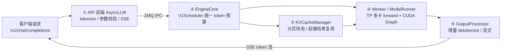

> 📌 **一句话定位**：vLLM 只管**引擎层**——模型怎么加载、KV cache 怎么放、请求怎么组批、token 怎么吐。GPU 驱动与设备交给 [[01-GPU Operator]]，服务灰度与多模型编排交给 [[02-KServe]]，网关交给 [[05-推理网关与路由]]、SLO 与容量交给 [[06-推理服务工程]]，**不要越层归因**。
>
> ⚠️ **版本口径（2026-11 核对）**：vLLM 迭代极快，参数默认值、指标名、特性成熟度都会变。本文所有参数标注「用 `vllm serve --help` 与启动日志核对」；**实际环境一律以镜像 tag + `--help` + `/metrics` 实测为准**（连 [[08-集群运维]]）。

---

## 一、先纠正一个高频混淆：V0/V1 不是发行版本号

| 概念 | 含义 |
|---|---|
| **V0 / V1** | **引擎架构代号**。V0 = 早期单进程 `LLMEngine / AsyncLLMEngine`；V1 = 多进程 `AsyncLLM + EngineCore` |
| **发行版本号** | vLLM 的 release 版本（0.8.x / 0.2x / 0.3x…），**与 V0/V1 无关**；2026 年发行版仍是 `0.x` 系列 |
| 演进 | V1 引擎自 **0.8.0** 起成为默认，V0 引擎路径随后被移除；`VLLM_USE_V1=0` 只是当年的短期退路，新版本不再可用 |

> ⚠️ 网上「v1.0 发布、V0 移除」的说法把**引擎代号**和**版本号**混为一谈。旧资料里的 `LLMEngine / BlockManager / --use-v2-block-manager / --num-scheduler-steps` 都是 V0 时代的东西，照抄会静默失效或降级（连 §十 演进）。

---

## 二、V1 架构：为什么把前端和调度拆成两个进程

### 2.1 拆分的动因（面试必答的 why）

GPU 越快，**CPU 侧开销越成为瓶颈**：tokenize / detokenize、HTTP 解析、流式输出、Python 对象构造都是 CPU 密集活。V0 里这些和 GPU 调度循环挤在同一个进程，高并发时前端处理会把 GPU 拖到空闲——**GPU 利用率图上却看不出原因**。V1 的三项关键改动：

1. **进程隔离**：API 前端（`AsyncLLM`）与调度执行（`EngineCore`）分进程，ZMQ IPC 通信，CPU 工作不进 GPU 主循环；故障也隔离（引擎崩了 API 进程还能返回错误）。
2. **统一 token 预算**：调度器不再区分 prefill / decode 阶段，只有一个 `max_num_batched_tokens` 预算，每步给各请求分配 `{request_id: num_tokens}`；chunked prefill、prefix caching、投机解码在同一套循环里表达。
3. **Persistent Batch + 零开销前缀缓存**：worker 侧缓存输入张量，每步只传 diff；`KVCacheManager` 用内容哈希做块级复用，默认开启。

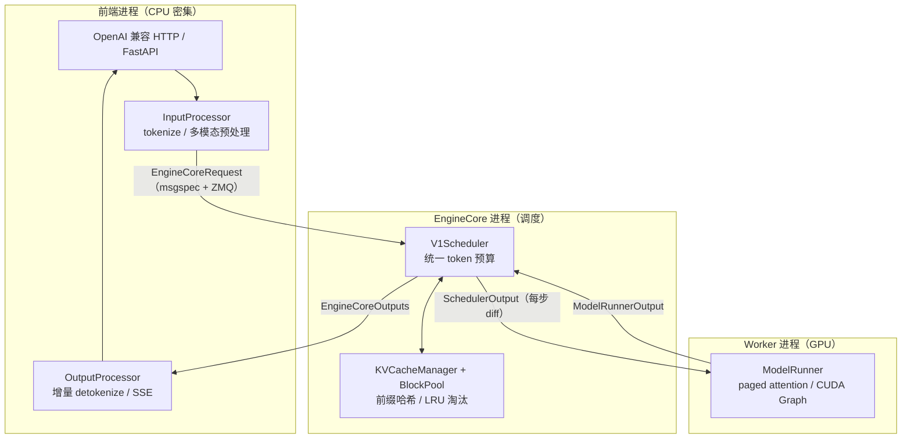

### 2.2 一次请求的完整生命周期

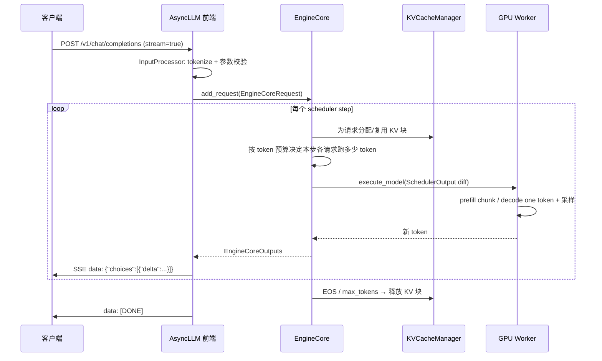

> 📌 **图里的两个 phase 差异**（推理性能的地基）：**prefill 计算密集**（一次并行处理整段 prompt，决定 TTFT），**decode 访存密集**（每步每序列只读一个 token、却要读整段 KV cache，决定 TPOT）。所以长 prompt 会挤占 token 预算拖慢别人的 decode —— chunked prefill 就是为此存在。
>
> ⚠️ **preemption 默认重算**：KV 块不够时 V1 默认抢占最低优先级请求并**重算**（而非换出到 CPU），表现为 P99 延迟尖刺。看到 `preemption` 指标上涨，说明并发超出了 KV 容量，不是 GPU 算力不够。

---

## 三、显存、PagedAttention 与调度三个旋钮

### 3.1 PagedAttention：把 KV cache 当虚拟内存管

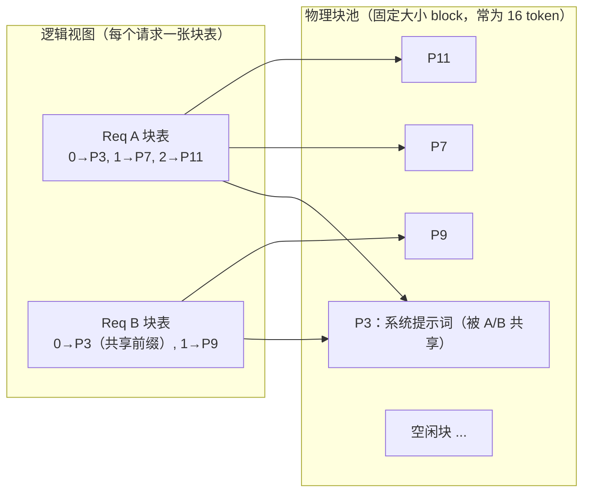

- 每个序列一张 **block table**（逻辑位置 → 物理块），按需分配、结束即回收 → 几乎消除内部碎片。
- 相同前缀可**共享物理块**（copy-on-write），前缀缓存因此是分页机制的天然副产品。
- 块可被淘汰/重算，这就是 preemption 的实现基础。

### 3.2 显存预算：启动日志里的那行数字才是真相

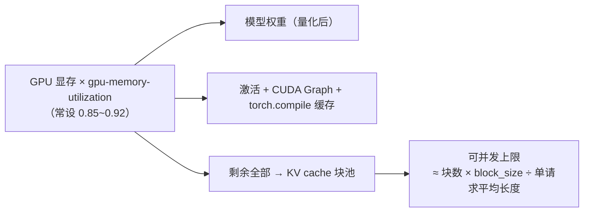

> 📌 vLLM 启动时会 **profile 一次 forward**，从允许显存里扣掉权重与峰值激活，然后在日志里打印「可用 KV cache blocks / GPU 与可支持的最大并发」——**这行日志就是你的真实容量**，比任何公式都准（公式推导见 [[LLM 推理基础]]）。

**四个参数怎么互相牵制**：

| 参数 | 控制什么 | 调错的后果 |
|---|---|---|
| `--gpu-memory-utilization` | vLLM 可占用显存比例（默认约 0.9，**以 `--help` 为准**） | 太高 → 峰值 OOM；太低 → KV 池小、并发上不去 |
| `--max-model-len` | 单请求最大上下文 | **直接按最坏情况预留 KV**；照模型卡写 128K 而业务只用 8K，等于白扔一大半并发 |
| `--max-num-seqs` | 单步并发序列上限 | 太大 → 每个请求分到的算力变薄，P99 TTFT 恶化 |
| `--max-num-batched-tokens` | 每步 token 预算（prefill chunk 与 decode 共用） | 太大 → 吞吐高但新请求排队久；太小 → GPU 喂不饱 |

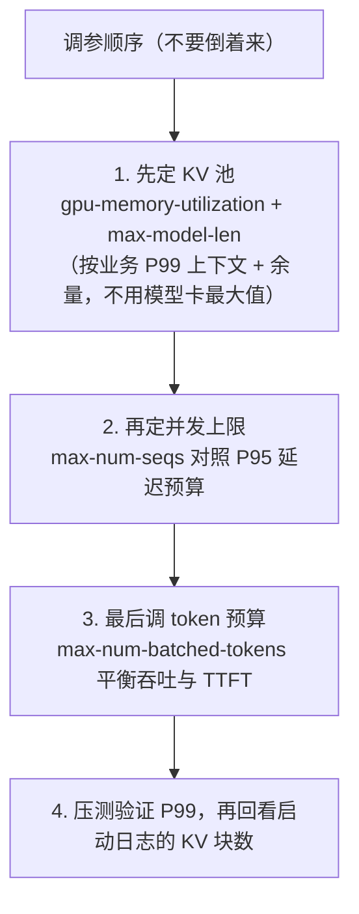

> 📌 **参数反推**：给定模型 + 卡数 + 目标并发 → 先算权重显存（参数量 × 每参数字节 ÷ TP）→ 剩余显存决定 KV 块数 → 块数 × block_size ÷ 业务平均上下文 = 可并发量 → 反推 `max-model-len` 该压到多少、`gpu-memory-utilization` 该留多少余量。**并发不够时先砍上下文长度，而不是先加卡**（通用容量公式见 [[LLM 推理基础]]、[[06-推理服务工程]]）。
>
> ⚠️ `--enable-prefix-caching` / `--enable-chunked-prefill` 在 V1 已是**默认行为**（不同版本默认值有变化），写命令前用 `--help` 和启动日志确认是否生效；`--enforce-eager` 只用于调试，会关掉 CUDA Graph、明显掉吞吐。

### 3.3 Continuous Batching：迭代级而非请求级

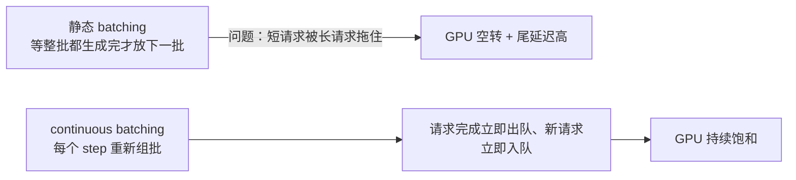

prefill 与 decode 混在同一步调度（V1 统一 token 预算），一个长 prompt 被切成 chunk 与别人的 decode token 交错执行，避免「一条 32K 的 RAG 请求让所有在线对话卡顿」。

---

## 四、吞吐与延迟优化：按收益排序

| 手段 | 解决什么 | 代价 / 注意 |
|---|---|---|
| **prefix caching** | 系统提示词、few-shot、RAG 公共文档、多轮对话的重复 prefill | 命中率取决于流量形状；缓存块受 LRU 淘汰，重启/换副本即冷 |
| **chunked prefill** | 长 prompt 阻塞 decode 造成的 TPOT 尖刺 | token 预算切太小会增加调度次数 |
| **量化**（AWQ / GPTQ / FP8 / INT8 / GGUF / KV cache fp8） | 权重显存与 KV 显存 | FP8 需 Hopper 及以上；INT4 有精度损失，**必须做业务质量回归**；`--kv-cache-dtype fp8` 约可把 KV 减半换并发 |
| **投机解码**（draft model / n-gram / MTP 等） | 低并发下 decode 逐 token 的串行瓶颈 | 高负载时验证开销可能反噬吞吐；要用自己的流量测 |
| **CUDA Graph + torch.compile** | decode 步大量小 kernel 的 launch 开销 | **冷启动变慢**：编译 + 图捕获要分钟级，缓存要持久化 |
| **多 LoRA** | 共享基座承载多业务 adapter | adapter 切换与调度开销，需测 |

> ⚠️ **冷启动 = 权重加载 + torch.compile + CUDA Graph 捕获**，大模型常是分钟级。这条直接决定：① K8s 必须配 `startupProbe`（§八）；② **scale-from-zero 不能照搬 Web 服务的伸缩思路**（连 [[AI Infra]] §4.2）；③ 编译缓存（`VLLM_CACHE_ROOT`）不挂持久卷，每个新 Pod 都要重付一次代价。
>
> 📌 **优化顺序**：先测出瓶颈是 TTFT（prefill/排队）还是 TPOT（decode/带宽），再选手段。**不要一上来就量化**——量化省的是显存，如果瓶颈在排队，吞吐不会变好。

---

## 五、服务化接口：OpenAI 兼容 API 与流式输出

### 5.1 OpenAI 兼容 API 与 SSE 流式

`vllm serve` 暴露 `/v1/chat/completions`、`/v1/completions`、`/v1/models` 等 OpenAI 兼容端点；客户端**只换 base_url / api_key / model 名**（`--served-model-name` 决定对外名字，换权重版本时客户端不用改）。

```bash
vllm serve /models/qwen3-8b \
  --served-model-name local-qwen \
  --host 0.0.0.0 --port 8000 \
  --tensor-parallel-size 1 \
  --gpu-memory-utilization 0.90 \
  --max-model-len 8192 \
  --max-num-seqs 64 \
  --api-key "$VLLM_API_KEY"
```

```python
from openai import OpenAI
client = OpenAI(base_url="http://vllm-api:8000/v1", api_key="...")
stream = client.chat.completions.create(
    model="local-qwen",
    messages=[{"role": "user", "content": "用三句话解释 PagedAttention"}],
    stream=True,
)
for chunk in stream:
    if chunk.choices and chunk.choices[0].delta.content:
        print(chunk.choices[0].delta.content, end="", flush=True)
```

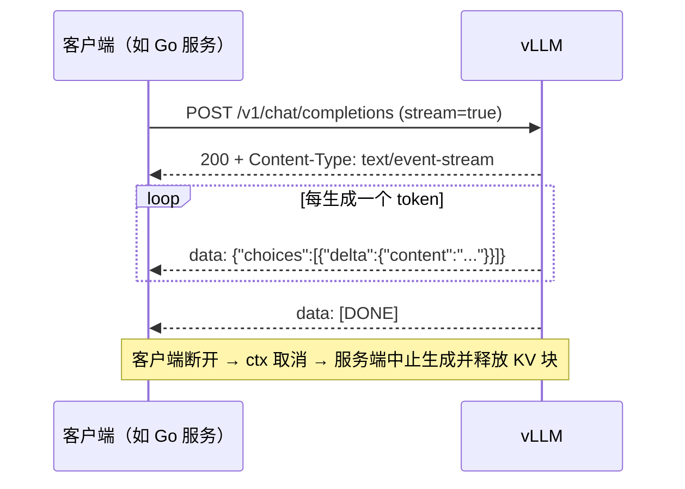

> 📌 SSE 客户端要点（连 [[03-Web 与 RPC]]）：设置足够长的读超时（生成可能几十秒）、处理 `[DONE]`、客户端断开时要主动关闭响应体让服务端感知取消；Go 侧用 `context` 贯穿，避免 goroutine 与连接泄漏（连 [[02-并发编程]]）。流式响应**必须逐段 Flush**，且反向代理不能缓冲。

**API 层的三种扩展能力都是「同一份基座上的分支」**：

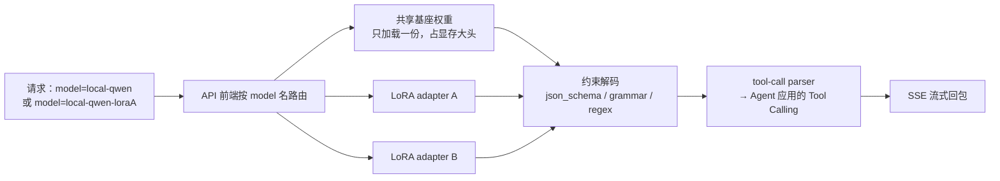

### 5.2 结构化输出、工具调用、多 LoRA

- **结构化输出**：`response_format={"type":"json_schema", ...}` / grammar / regex，后端用 xgrammar、guidance 一类约束解码库；**grammar 编译时间会算进 TTFT**，大枚举/深嵌套 schema 要实测。
- **工具调用**：需要按模型族指定 `--tool-call-parser`（不同模型的 tool call 格式不同），与客户端的 Tool Calling 消费逻辑对齐；parser 选错表现为「工具调用被当普通文本吐出来」。
- **多 LoRA**：`--enable-lora` + 注册 adapter，按 `model` 名路由到不同 adapter，共享一份基座权重，避免「一业务一卡」。
- **限流与配额**：`--max-num-seqs` 是引擎内并发上限；超出后请求排队。生产要在网关层做租户级限流与排队上限，并给出明确的 429/503 语义（见 [[05-推理网关与路由]] §七）。

---

## 六、并行与分布式：显存不够时的决策顺序

| 并行方式 | 切什么 | 通信 | 适用 |
|---|---|---|---|
| **TP（Tensor Parallel）** | 单层权重矩阵切到多卡，每步都要 all-reduce | **NVLink / 高带宽**，对延迟极敏感 | 单机多卡、模型放不进单卡 |
| **PP（Pipeline Parallel）** | 按层切分，流水传递激活 | 点到点、量小 | 跨节点、无 NVLink 时常优于 TP |
| **DP（Data Parallel）** | 复制整模型，分流请求 | 几乎无 | 模型能放进单卡，只是要扩吞吐 |
| **EP（Expert Parallel）** | MoE 的专家分散到不同卡 | all-to-all | MoE 大模型 |
| **CP（Context Parallel）** | 超长序列切分 | 跨卡 attention 通信 | 长上下文专项 |

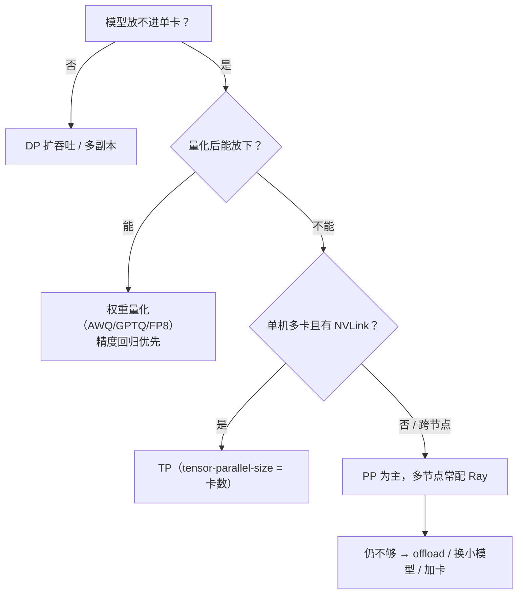

> ⚠️ **PD 分离（prefill/decode 分池）要澄清两点**（很容易被营销材料带偏）：① vLLM 官方文档把它标为 **experimental**，并明确「**不提升总吞吐**」，目标是分别调 TTFT 与 TPOT、控制尾延迟；② 它需要 KV 传输通道（NIXL / LMCache / Mooncake 一类 connector）与专门的编排，属于**④路由层进阶**（详见 [[05-推理网关与路由]]），不是起步阶段的必选项。
>
> 📌 跨节点通信走 NCCL/RDMA；多节点部署通常用 Ray 做 backend（llm-d / Dynamo 属编排层而非引擎，见 [[05-推理网关与路由]]）。

---

## 七、可观测与压测

### 7.1 指标比「GPU 利用率」有用得多

`/metrics`（Prometheus）常见指标族（**名字随版本变化，以现场 `/metrics` 为准**）：

| 类别 | 代表指标 | 说明 |
|---|---|---|
| KV cache | `vllm:gpu_cache_usage_perc`、prefix cache 命中/查询计数 | 接近 1 = 显存吃紧、即将 preemption |
| 队列 | `vllm:num_requests_waiting` / `num_requests_running` | 排队深度是扩容的第一信号 |
| 抢占 | `vllm:num_preemptions_total` | 上涨 = 并发超 KV 容量，P99 要炸 |
| 吞吐 | `vllm:generation_tokens_total`、prompt tokens | tokens/s 与输入/输出分开看 |
| 延迟 | TTFT / TPOT(ITL) / E2E 直方图 | **看 P95/P99，不看均值** |

```promql
# 排队请求数持续 > 0 → 容量不足或调度预算太小
vllm:num_requests_waiting > 0
# KV cache 长期接近饱和 → 该扩显存/砍上下文/降并发
vllm:gpu_cache_usage_perc > 0.9
```

> 📌 **四大延迟指标**：**TTFT**（首 token，交互体验）、**TPOT/ITL**（每 token 间隔，流式顺滑度）、**E2E**（总时长）、**tokens/s**（总吞吐）。它们互相冲突：拉大 batch 提吞吐但 TTFT 变差。SLO 要按「交互式 vs 批处理」分开定，并用 P99 而非均值（统一口径见 [[06-推理服务工程]]、[[02-可观测性]]）。

### 7.2 压测基线（升级前后必须能对照）

```bash
# 固定并发扫点：1 / 8 / 16 / 32 / 64 ...，每个点跑同一份业务分布
vllm bench serve \
  --backend openai-chat \
  --base-url http://127.0.0.1:8000 \
  --endpoint /v1/chat/completions \
  --model local-qwen \
  --dataset-name sharegpt --dataset-path /data/sharegpt.json \
  --num-prompts 500 --max-concurrency 32 --request-rate 20
# 也可用 NVIDIA genai-perf；关键是用「生产日志回放的真实长度分布」，不是均匀长度的合成集
```

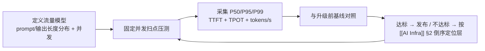

> ⚠️ **过载保护**：队列上限、优先级、租户限流、超时与 429 语义要在网关层做；引擎内 `max-num-seqs` 只是最后一道。没有排队上限的服务，在流量尖峰下会「全部请求一起变慢」而不是「部分快速失败」。

---

## 八、K8s 部署与离线运行

**K8s 上的部署关系**（先看清有哪些外部依赖，再写清单）：

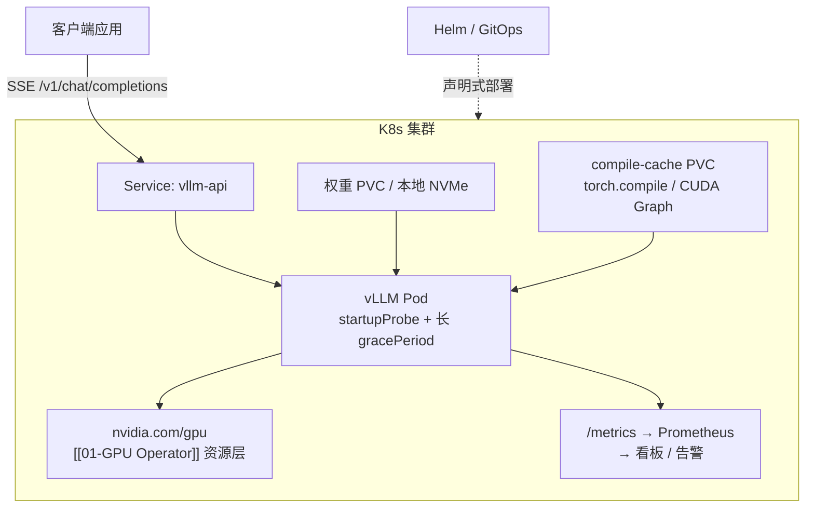

### 8.1 部署清单要点

```yaml
# 示意：字段以现场镜像与 K8s 版本为准，权重路径来自镜像仓库 / PVC
apiVersion: apps/v1
kind: Deployment
metadata:
  name: vllm-api            # ⚠️ 官方曾提示：Service/资源别命名为 vllm，
                            #    易与 VLLM_ 前缀环境变量注入冲突
spec:
  replicas: 1
  strategy:
    type: RollingUpdate
    rollingUpdate:
      maxSurge: 0           # 大模型滚动更新时新旧 Pod 共存 = 双倍显存，先别浪
      maxUnavailable: 1
  template:
    spec:
      terminationGracePeriodSeconds: 120   # 给在途流式请求留出排空时间
      containers:
      - name: engine
        image: registry.example.com/vllm-openai:pinned
        args: ["--model", "/models/qwen3-8b", "--served-model-name", "local-qwen",
               "--max-model-len", "8192", "--gpu-memory-utilization", "0.90"]
        env:
        - name: HF_HUB_OFFLINE
          value: "1"
        - name: VLLM_NO_USAGE_STATS
          value: "1"
        volumeMounts:
        - { name: models, mountPath: /models, readOnly: true }
        - { name: compile-cache, mountPath: /root/.cache/vllm }
        resources:
          limits:
            nvidia.com/gpu: 1     # 或 DRA ResourceClaim（连 [[01-GPU Operator]]）
        startupProbe:             # 分钟级加载：必须有，否则 liveness 会误杀
          httpGet: { path: /health, port: 8000 }
          failureThreshold: 120
          periodSeconds: 5
        readinessProbe:
          httpGet: { path: /health, port: 8000 }
          periodSeconds: 5
        livenessProbe:            # 放宽，只兜底彻底卡死
          httpGet: { path: /health, port: 8000 }
          failureThreshold: 6
          periodSeconds: 30
      volumes:
      - { name: models, persistentVolumeClaim: { claimName: model-weights } }
      - { name: compile-cache, persistentVolumeClaim: { claimName: vllm-compile-cache } }
```

> 📌 **四个 K8s 特有坑**：① **startupProbe 必须配**（否则模型还没加载完就被 liveness 重启，永远起不来）；② 滚动更新 `maxSurge: 0` 避免双份显存；③ `terminationGracePeriodSeconds` 要覆盖最长在途生成（连 [[02-工作负载资源]] 优雅退出）；④ **不要按 CPU 扩缩**，用排队深度 / KV 使用率等自定义指标（KEDA），并接受 scale-from-zero 的分钟级冷启动代价。

### 8.2 air-gap 离线：清单、开关与验证

| 类别 | 必须预置 | 最易漏 |
|---|---|---|
| 引擎 | `vllm-openai` 镜像（含 CUDA / 驱动库匹配） | 与节点驱动的 CUDA 最低版本矩阵（连 [[01-GPU Operator]] §3.3） |
| 模型 | 权重分片、**config.json、tokenizer、special_tokens_map.json、generation_config.json**、`auto_map` 引用的 `modeling_*.py` | 只同步权重 → 启动报缺 tokenizer / 配置 |
| 缓存 | `VLLM_CACHE_ROOT`（torch.compile / CUDA Graph 缓存） | 不持久化则每次重启重编，冷启动翻倍 |
| 校验 | 全量 SHA-256 清单、固定 `--revision` + `--tokenizer-revision` | tokenizer 漂移会悄悄改变 token 数 |
| 辅助模型 | embedding / rerank 权重（[[RAG 与知识库]]） | 离线部署最常见的漏项 |

```bash
# 联网侧：按固定 revision 下载 → 校验 → 介质/内网同步
hf download Qwen/Qwen3-8B --revision <commit> --local-dir /export/qwen3-8b
sha256sum /export/qwen3-8b/* > manifest.sha256

# 离线集群侧：全部走本地路径 + 离线开关
export HF_HUB_OFFLINE=1 TRANSFORMERS_OFFLINE=1 VLLM_NO_USAGE_STATS=1
export VLLM_CACHE_ROOT=/cache/vllm
vllm serve /models/qwen3-8b --served-model-name local-qwen \
  --revision <commit> --tokenizer-revision <commit>

# 验证：容器 --network none 启动并成功应答 → 证明没有隐藏外网依赖
```

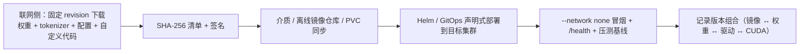

> ⚠️ **三条铁律**：
> 1. **环境变量只降噪，网络策略才是隔离保证**——设默认拒绝出向，只放行客户端到服务端口。
> 2. `--trust-remote-code` 会执行模型仓库里的任意 Python，**默认关闭**；确需开启必须固定 revision + 审读 `.py` + 校验哈希。
> 3. **回滚时镜像与权重必须成对**；只回滚引擎镜像而权重格式已变，服务照样起不来（通用约束见 [[06-推理服务工程]]、[[09-生态与工具]]）。

### 8.3 异构算力后端

昇腾路线（vLLM-Ascend / MindIE + CANN）大致对应：驱动固件 ↔ NPU runtime ↔ 设备插件 ↔ 引擎后端；差异集中在**算子适配、量化格式、模型覆盖度**上，不能假设「NVIDIA 上调通的参数照搬就能跑」。工程上应把资源名、runtimeClass、健康检查命令抽成配置（连 [[01-GPU Operator]] §9.2、[[06-推理服务工程]]）。

---

## 九、选型对比：避免无脑上 vLLM

| 引擎 | 强项 | 何时选它 |
|---|---|---|
| **vLLM** | 模型/硬件覆盖最广、社区最大、OpenAI 兼容、V1 架构成熟 | **默认起点**，尤其单个模型的 OpenAI 兼容服务 |
| **SGLang** | RadixAttention 前缀树、结构化输出与共享长前缀的 Agent 流量 | 实测前缀命中率高、Agent 多轮同系统提示词的场景 |
| **TensorRT-LLM** | NVIDIA 卡上的极致吞吐与低精度格式 | 全 NVIDIA 栈、模型集固定、愿意付编译与调优成本 |
| **llama.cpp / Ollama** | CPU/边缘/单机开发，零运维 | 笔记本、demo、无 GPU 的轻量场景 |
| **Triton + TensorRT-LLM** | 非 LLM 模型（embedding / rerank / CV） | [[04-Triton]]，不是 LLM 主链路 |

> 📌 **引擎层 vs 平台层**：[[02-KServe]] 提供 `InferenceService` CRD、灰度、弹性、多模型管理；起步阶段**裸 Deployment + vLLM** 更省事，只有「模型数量上量 + 需要统一灰度」才值得引入控制器与 Knative/Istio 依赖（连 [[AI Infra]] §3）。
>
> ⚠️ **何时不用 vLLM**：超小模型 / 纯 CPU / 极低并发（进程与编译开销不划算）、需要深度定制 kernel、或只是本地调试。别为了「技术栈统一」给边缘节点也塞一套引擎。

---

## 十、演进与版本口径

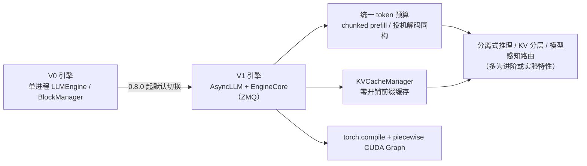

| 事实 | 口径（2026-11 核对） |
|---|---|
| V1 引擎 | 自 0.8.0 起默认，V0 引擎路径已移除；V0/V1 是**架构代号**，发行版仍是 0.x |
| 参数默认值 | `--gpu-memory-utilization` 约 0.9、`--max-num-seqs` / `--max-num-batched-tokens` / prefix caching / chunked prefill 的默认值**随版本变化**，一律用 `--help` + 启动日志确认 |
| PD 分离 | vLLM 标为 experimental，官方明确「不提升总吞吐」；KV connector（NIXL / LMCache / Mooncake 等）属生态件 |
| 量化格式 | FP8 需 Hopper+；INT4（AWQ/GPTQ）、GGUF、KV cache fp8 的可用 kernel 随 GPU 代际与版本变化，查官方兼容矩阵 |
| 生态 | TGI 已进入维护模式；llm-d / NVIDIA Dynamo 属**编排层**（调度与 KV 感知路由），不是 vLLM 的替代品 |

> ⚠️ **写给未来的自己**：升级引擎前跑三件事——`vllm serve --help` 对比参数、压测基线对照 P99、`/metrics` 核对指标名是否改名。**AI Infra 是本篇最容易过时的一节**，实际环境一律以镜像 tag 实测为准。

---

## 十一、面试高频问答 🎯

**Q1：vLLM 解决的两个核心问题是什么？**
显存浪费与 GPU 空转：PagedAttention 把 KV cache 分页，消除内部碎片、支持前缀共享；continuous batching 每步动态组批，避免等最慢请求。二者共同把并发与吞吐拉上去。

**Q2：V1 架构为什么把前端与 EngineCore 拆进程？**
GPU 越快，CPU 侧（tokenize / detokenize / HTTP / SSE / Python 对象）越容易成为瓶颈，V0 里它们和 GPU 调度循环同进程，高并发把 GPU 拖空。V1 用 `AsyncLLM`（前端）+ `EngineCore`（调度执行）多进程 + ZMQ IPC 隔离 CPU 工作，同时获得故障隔离；另配统一 token 预算调度、Persistent Batch、默认前缀缓存。

**Q3：「V0 在 v1.0 移除」这句话错在哪？**
V0/V1 是**引擎架构代号**，不是 vLLM 发行版本号；发行版至今仍是 0.x。正确说法是：V1 引擎自 0.8.0 起默认，V0 引擎路径随后移除，`VLLM_USE_V1=0` 只是过渡期退路。

**Q4：一个请求从 HTTP 到 SSE 回包经过哪些组件？**
InputProcessor（tokenize/多模态）→ `EngineCoreRequest`（msgspec + ZMQ）→ V1Scheduler 按 token 预算调度 → KVCacheManager 分配/复用块 → ModelRunner 执行 forward 与采样 → `EngineCoreOutputs` 回前端 → OutputProcessor 增量 detokenize → SSE 逐 token 推送 → `[DONE]` 并释放 KV 块。

**Q5：prefill 和 decode 的瓶颈有什么不同？为什么需要 chunked prefill？**
prefill 并行处理整段 prompt，计算密集、决定 TTFT；decode 每步每序列只出一个 token 却要读整段 KV，访存带宽密集、决定 TPOT。长 prompt 不切块会独占一步的 token 预算，让同批 decode 请求卡顿；chunked prefill 把 prefill 切块与 decode 交错，稳住尾延迟。

**Q6：四个关键参数怎么调？顺序是什么？**
`gpu-memory-utilization` 定显存上限、`max-model-len` 按业务 P99 上下文（不是模型卡最大值）定单请求 KV 预留、`max-num-seqs` 定并发、`max-num-batched-tokens` 定每步 token 预算。顺序：**先 KV 池容量 → 再并发 → 再 token 预算 → 压测验证 P99**，并以启动日志打印的 KV 块数为真实容量。

**Q7：KV 块不够会怎样？`gpu_cache_usage_perc` 接近 1 说明什么？**
调度器抢占低优先级请求，V1 默认**重算**（不是换出），表现为 P99 延迟尖刺与 `num_preemptions_total` 上涨。这是并发超出 KV 容量，不是算力不足；对策是砍上下文、降并发、量化 KV cache 或加显存。

**Q8：量化一定能提吞吐吗？FP8 有什么前提？**
不一定。量化省的是显存（可换更大并发），若瓶颈在排队或 prefill 计算，吞吐未必改善；INT4 还有精度损失，必须做业务质量回归。`--kv-cache-dtype fp8` 约可减半 KV 显存；权重 FP8 需 Hopper 及以上硬件与对应 kernel 支持。

**Q9：TTFT / TPOT / E2E / tokens·s⁻¹ 为什么必须看 P99？**
它们彼此冲突（大 batch 提吞吐但 TTFT 变差），均值会掩盖长尾：交互式场景用户感知的是最慢那批请求。SLO 要按交互式与批处理分开定，并用压测扫并发画 P50/P95/P99 曲线。

**Q10：显存放不下模型，决策顺序是什么？**
量化（先做质量回归）→ 单机多卡 TP（有 NVLink）或跨节点 PP（无 NVLink 时通常更优）→ CPU/offload（牺牲延迟）→ 换小模型或加卡。MoE 模型另考虑 EP；超长上下文考虑 CP。多节点一般用 Ray 做 backend。

**Q11：PD 分离值得上吗？**
只在「大模型 + 长序列 + 高并发 + 需要分别控 TTFT/TPOT 尾延迟」时才可能回本。vLLM 官方标为 experimental 且明确**不提升总吞吐**，还需 KV 传输 connector 与编排层支持；起步阶段不做（见 [[05-推理网关与路由]]）。

**Q12：K8s 部署大模型服务最容易踩的四个坑？**
① 没配 `startupProbe`（模型加载分钟级被 liveness 误杀，反复重启）；② 滚动更新 `maxSurge` 非 0 导致新旧 Pod 双份显存 OOM；③ `terminationGracePeriodSeconds` 太短，流式请求被硬切；④ 按 CPU 做 HPA、或 scale-from-zero 忽略编译与图捕获的冷启动代价。

**Q13：离线（air-gap）环境部署要准备什么？怎么证明确实离线？**
镜像 + 权重 + tokenizer + 全部配置与自定义代码 + torch.compile 缓存，全量 SHA-256 清单、固定 `--revision` 与 `--tokenizer-revision`；设 `HF_HUB_OFFLINE=1` / `TRANSFORMERS_OFFLINE=1` / `VLLM_NO_USAGE_STATS=1`，模型用本地路径 + `--served-model-name`。**证明方法**：容器 `--network none` 启动并成功应答；同时防火墙默认拒绝出向——环境变量只降噪，隔离靠网络。

**Q14：什么时候不该用 vLLM？vLLM 与 KServe 什么关系？**
超小模型、纯 CPU、极低并发、要定制 kernel 或本地调试时不划算。vLLM 是②引擎层（跑模型、管 KV、吐 token），KServe 是③平台层（InferenceService CRD、灰度、弹性、多模型）；起步阶段裸 Deployment + vLLM 足够，模型数量与灰度需求上量后才引入 KServe。

---

## 十二、关联

- 原理上游 → [[LLM 推理基础]]（KV Cache 公式 / 显存估算 / 采样 / 许可证）、[[AI Infra]]（分层地图 §2/§4）
- 资源层 → [[01-GPU Operator]]（驱动 / CDI / MIG / DCGM / 版本矩阵）
- 平台与辅助模型 → [[02-KServe]]、[[04-Triton]]；路由与 SLO → [[AI Infra]] §4.1/§4.4
- 上层 → [[05-推理网关与路由]]、[[RAG 与知识库]]（embedding/rerank）、[[AI 工程]]
- 客户端实现 → [[03-Web 与 RPC]]（SSE/长连接/超时重试）、[[02-并发编程]]（context 取消与 goroutine 泄漏）
- 部署 → [[02-工作负载资源]]（探针与优雅退出）、[[04-存储]]（权重 PVC）、[[05-调度与资源管理]]（GPU 污点与配额）、[[09-生态与工具]]（镜像仓库）
- 工程 → [[06-推理服务工程]]（离线与容量）、[[AI 工程]]
