---
tags:
  - ai
  - infra
  - inference
  - nvidia
  - 面试
created: 2026-11-14
updated: 2026-11-15
status: 已整理
---

# ⚙️ Triton

> 面向面试：**一个服务器，多种框架，一套协议与指标**——AI Infra ②引擎层里负责「非 LLM 的那一半」。

**全文主线**：Triton 自己**不算模型**，它是「请求调度 + 模型仓库 + backend 插件」的服务器外壳——HTTP/gRPC 请求进来 → 按模型的 **scheduler** 决定要不要组批 → 交给对应 **backend** 在 GPU/CPU 上执行 → 输出回包，全程由 `config.pbtxt` 声明。理解 Triton = 理解**「配置驱动的调度」**，而不是某个模型怎么算。

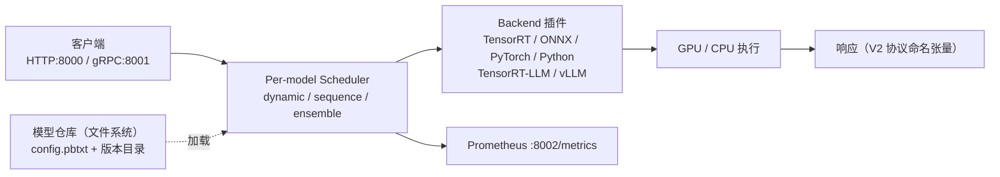

> 📌 **一句话定位**：LLM 生成 → [[03-vLLM]]；**embedding / rerank / CV / ASR / 多框架管线 → Triton**；多模型服务的灰度与 CRD → [[02-KServe]]；GPU 从哪来 → [[01-GPU Operator]]。混淆这四层是排障时最常见的误判。
>
> ⚠️ **版本口径（2026-11 核对）**：Triton 迭代快、品牌也在变。本文所有参数名与后端能力都标注了「以现场镜像与目标版本文档为准」；实际环境一律以 `tritonserver --version`、镜像 tag、`/v2/health/ready` 实测为准（连 [[08-集群运维]]）。

---

## 一、定位：先把「不是 LLM 主链路」讲清楚

| 维度 | Triton | vLLM |
|---|---|---|
| 设计目标 | **多种框架、多种模型类型**统一服务 | 把 **LLM 生成**这一件事做到极致 |
| 核心机制 | dynamic batching、instance group、ensemble、backend 插件 | PagedAttention、continuous batching、KV cache 分页 |
| 调度粒度 | 请求级组批（等几毫秒凑一个 batch） | **迭代级**（每个 decode step 重组批） |
| 状态 | 无状态模型默认；有状态用 sequence batcher + correlation ID | 天然有状态（KV cache 随会话增长） |
| 协议 | Open Inference Protocol **V2**（命名张量）+ 较新版本的 OpenAI 兼容前端 | OpenAI 兼容 API（SSE 流式） |
| 适用 | embedding / rerank / 图像 / 语音 / 科学模型 / 混合管线 | chat / completion / 流式生成 |

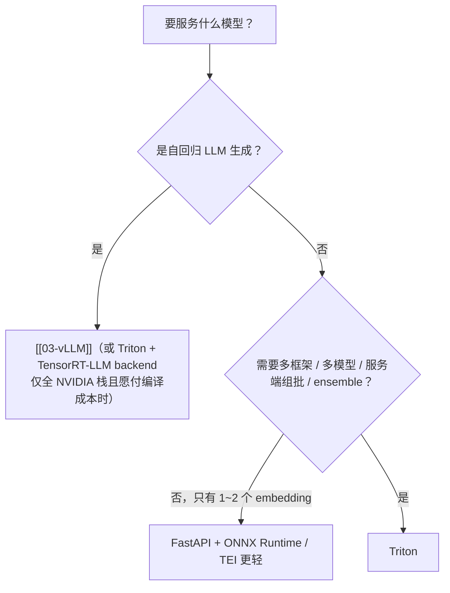

> ⚠️ **2026 品牌口径**：NVIDIA 把 Triton 纳入 **Dynamo** 平台，市场材料里出现「**Dynamo-Triton**（formerly NVIDIA Triton Inference Server）」；但官方文档、`nvcr.io/nvidia/tritonserver` 镜像、`tritonserver` 二进制仍叫 Triton。**生成式/多节点 LLM 的新项目官方指向 NVIDIA Dynamo**（编排层，跑 vLLM / SGLang / TensorRT-LLM 作引擎，连 [[03-vLLM]] §六）；**Triton 仍是非生成式多框架服务的正确选择**。别把「品牌改名」误解成「Triton 被废弃」。
>
> 📌 **定位结论**：RAG 链路里的 embedding / rerank 这类辅助模型是 Triton 的主场；自回归生成主模型走 [[03-vLLM]]。Triton 的价值在「一张卡上把几个小模型统一管理」，模型数少时是过度设计。

---

## 二、命名与事实口径（容易抄错的地方）

| 事实 | 口径（2026-11 核对） |
|---|---|
| 端口 | **8000** HTTP/REST、**8001** gRPC、**8002** Prometheus metrics（经典三端口，以容器端口映射为准） |
| 协议 | KServe **Open Inference Protocol V2**：`POST /v2/models/<name>/infer`，命名张量；较新版本另提供 OpenAI 兼容前端（`/v1/chat/completions`），以现场镜像为准 |
| 健康 | `/v2/health/ready`、`/v2/health/live`（K8s 探针直接用） |
| 动态 batching 字段 | **`max_queue_delay_microseconds`**（不是 `max_queue_delay_us`；后者只是社区简写） |
| Backend 现状 | TensorRT / ONNX Runtime / PyTorch(libtorch) / Python / C++ 自定义 / **TensorRT-LLM** / **vLLM** 等；**TensorFlow backend 已弃用**，新项目不要选 |
| 模型控制模式 | `NONE`（默认，启动全加载）/ `POLL`（轮询仓库，**生产不推荐，有竞态**）/ `EXPLICIT`（API 显式 load/unload） |
| 与 KServe 关系 | KServe 常用 Triton 作 `ClusterServingRuntime`；KServe 管 CRD 与灰度，Triton 管单 Pod 内的调度与 backend（连 [[02-KServe]] §三） |

> ⚠️ **Triton 自己不生成 token**：生成发生在 backend。所以「Triton + vLLM backend」≈ 独立 vLLM 再加一层协议与调度开销（高 QPS 下响应打包开销更明显）；「Triton + TensorRT-LLM backend」才可能在 NVIDIA 卡上拿到额外收益，代价是编译流水线。

---

## 三、架构：一个请求从端点到 GPU

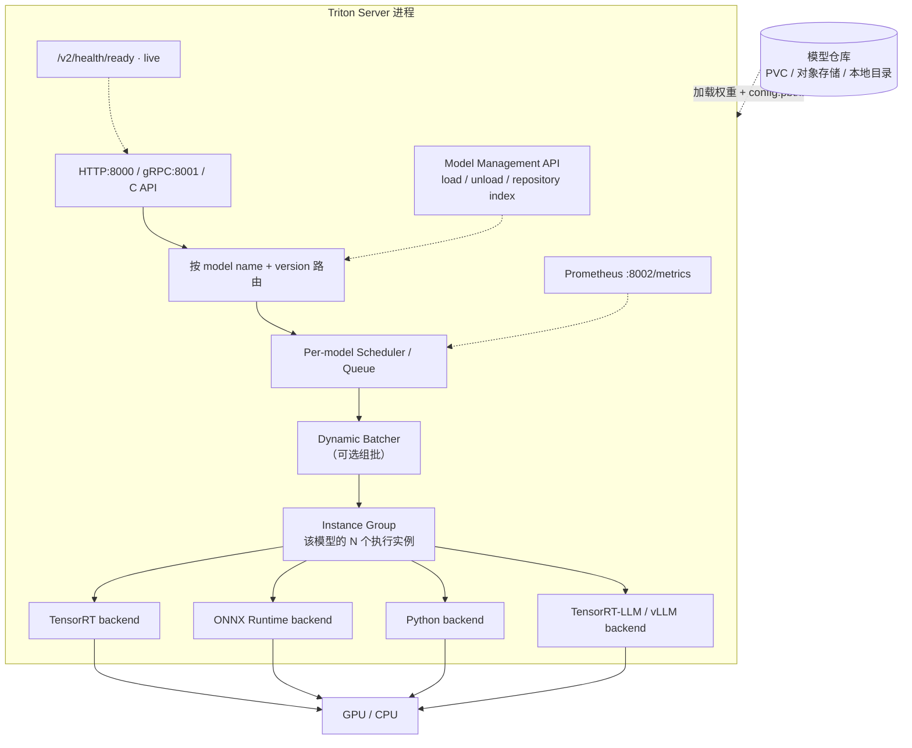

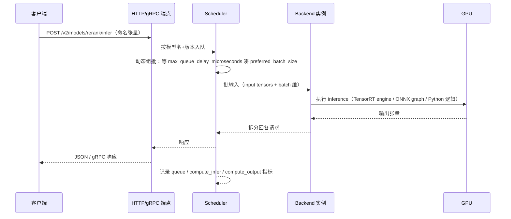

> 📌 **请求链路**：端点 → 按模型名与版本路由 → scheduler 组批 → backend 实例 → GPU → 拆分响应 → 指标。**Concurrent Model Execution** 是 Triton 的关键能力：多个模型/同一模型的多个实例可并行上 GPU；但**默认同一模型的多个请求是串行执行的**，要靠 `instance_group` 开并行（下一节讲代价）。

---

## 四、模型仓库与 config.pbtxt（部署契约）

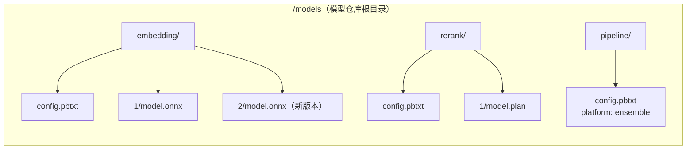

- 目录约定：**`<model>/config.pbtxt` + `<model>/<数字版本>/model.<ext>`**；版本目录必须是纯数字，`version_policy` 决定启用哪些版本。
- `config.pbtxt` 是 **Protobuf 文本格式**，是模型与服务器之间的契约：张量名、数据类型、shape 必须与客户端和模型文件一致，否则**模型根本不会加载**。

```protobuf
# /models/embedding/config.pbtxt（示意，字段以现场版本文档为准）
name: "embedding"
platform: "onnxruntime_onnx"          # 或 backend: "..."，取决于后端
max_batch_size: 32                    # 0 = 不支持 batching；用动态 batch 维必须显式设置
input [
  { name: "input_ids" data_type: TYPE_INT64 dims: [ -1 ] }   # dims 不含 batch 维
]
output [
  { name: "embedding" data_type: TYPE_FP32 dims: [ 768 ] }
]
dynamic_batching {
  preferred_batch_size: [ 8, 16 ]
  max_queue_delay_microseconds: 2000
}
instance_group [ { kind: KIND_GPU count: 2 gpus: [ 0 ] } ]   # 该卡上 2 个并行实例
version_policy { latest { num_versions: 2 } }
# model_warmup [ ... ]   # 按官方字段填预热样本，削首请求抖动
```

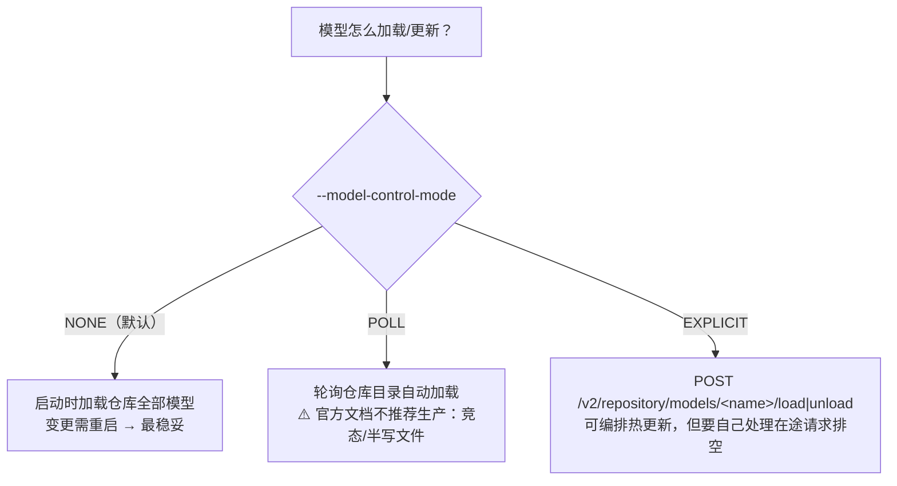

> ⚠️ **五个高频 config 错误**（都是「模型加载失败」的头号原因）：
> 1. `platform` / `backend` 取值大小写或名称不匹配（如写成 `onnx` 而不是 `onnxruntime_onnx`）；
> 2. `dims` 里**混进了 batch 维**（Triton 会自动加 batch 维）；
> 3. 用了动态 batch 却没设 `max_batch_size`；
> 4. `instance_group` 指定 `KIND_GPU` 却没写 `gpus: [0]`，报含糊的配置错误；
> 5. Tensor 名 / dtype 与客户端不一致，请求在进入 backend 前就被拒。
>
> 📌 **加载新版本时存量请求**：Triton 会等旧版本实例上的在途请求完成再卸载；但 `POLL` 模式下「目录写了一半」会被读到，所以生产用 `NONE`（重启发布）或 `EXPLICIT`（显式 load/unload + 自己编排排空），别用自动轮询。

---

## 五、调度与调参：性能的主战场

### 5.1 Dynamic Batching：拿延迟换吞吐

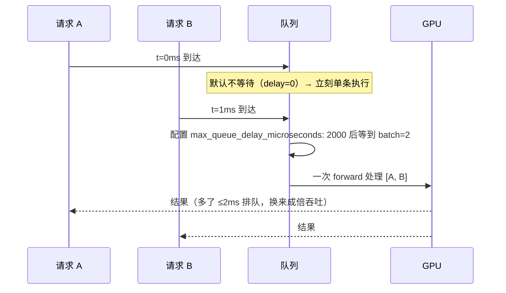

| 参数 | 作用 | 调错的后果 |
|---|---|---|
| `max_batch_size` | 单批上限 | 太大 → 显存/延迟；太小 → 组不出批 |
| `preferred_batch_size` | 优先凑到的批大小 | 与真实并发不匹配形同虚设 |
| `max_queue_delay_microseconds` | 最多等多久凑批 | **默认 0（不等待）**；设太大 → P99 尾延迟直接等于这个等待 |
| `instance_group.count` | 同卡并行实例数 | 每多一个实例**复制一份权重**，显存翻倍、kernel 竞争 |
| `rate_limiter` / 优先级 | 资源约束与请求分级 | 多模型共置时防止一个模型吃满 |
| `response_cache` | 缓存推理结果 | **只对确定性、输入可哈希且重复率高的请求有效**；生成式/含随机性均无意义 |

**instance_group 为什么是「显存换并发」**：

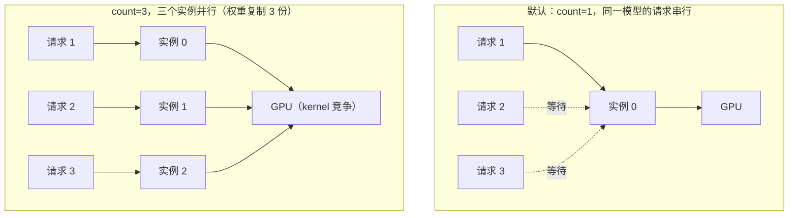


> 📌 **典型排障：embedding P99 超标但 GPU 利用率很低，按这个顺序查**：
> ① 是不是 `max_queue_delay_microseconds` 设太大（请求在等凑批，GPU 当然闲）→ 调小或按流量分档；② `preferred_batch_size` 是否远超真实并发，导致每个请求都等满队列；③ `instance_group.count` 太少（默认 1，同模型请求串行）→ 加 1~2 个实例并测显存；④ 是不是 **Python backend 的前后处理**成了 CPU 瓶颈（看 `compute_input`/`compute_output` 指标）；⑤ 最后才怀疑模型本身与 GPU 型号。**先定 SLO，再用 perf_analyzer 扫点，别拍脑袋调参。**
>
> ⚠️ **sequence batching ≠ LLM 的 continuous batching**：前者用于有状态模型，客户端必须给同一序列的所有请求带相同 **correlation ID** 并标记 start/end，Triton 保证路由到同一实例；后者是引擎在每个 decode step 动态重组批。两者只是名字像，机制完全不同（连 [[03-vLLM]] §三）。

---

## 六、模型管线与编排

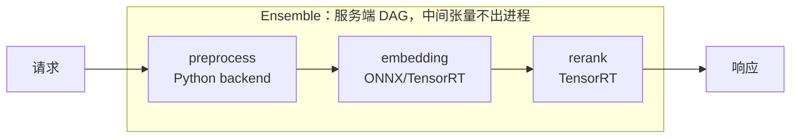

| 方式 | 实现 | 适用 |
|---|---|---|
| **Ensemble** | `config.pbtxt` 里 `platform: "ensemble"` + `ensemble_scheduling.step` 连成 DAG | 固定的前后处理 + 推理链，中间张量在服务器内传递、无网络跳 |
| **BLS（Business Logic Scripting）** | Python backend 里用 `pb_utils.InferenceRequest` 调用其他模型 | 需要条件分支、循环、动态调用，Ensemble 表达不了时 |
| 应用层编排 | Go/Python 服务编排 | 涉及数据库、审批、重试补偿、长任务——**不要塞进 Triton** |

> ⚠️ Ensemble 不是工作流引擎。把数据库事务、复杂重试、人工环节全塞进 Python backend，会做出一个「模型服务单体」，故障域和发布节奏全被绑死（连 [[06-中间件]] 的错误分类与工作流取舍）。

**RAG 辅助模型链路**（Triton 的典型位置）：


> 📌 **多模型共置资源规划**：几个小模型共卡能省成本，但权重各占一份显存、实例组互相争 kernel。生产建议给它们单独一张卡或用 **MIG 做硬件隔离**（连 [[01-GPU Operator]] §六），别用时间切片承载有 SLO 的辅助模型。

---

## 七、加速与转换链

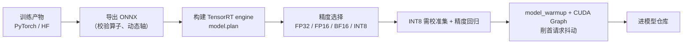

> ⚠️ **可移植性陷阱**：**TensorRT engine 与 GPU 架构 + TensorRT/CUDA 版本强绑定**——在 A100 + TRT 10 上编译的 `model.plan`，拿到 H100 或不同镜像版本上**可能直接加载失败**。必须**按目标环境重建引擎并锁定版本组合**，或退回 ONNX Runtime backend 换可移植性（通用约束见 [[06-推理服务工程]]）。
>
> 📌 **LLM 走 Triton 的两条路径**：
> - **TensorRT-LLM backend**：先把模型编译成引擎，in-flight batching + NVIDIA 卡上极致性能；代价是编译流水线、模型迭代慢、锁 NVIDIA 生态。
> - **vLLM backend**：通过 `model.json` 传 vLLM 引擎参数，开发快；但性能≈独立 vLLM + 一层封装开销，一般没有理由为一个 LLM 单独上 Triton。
>
> 结论：**先用 vLLM 验证模型与流量，只有当模型稳定、高流量、且实测收益能覆盖编译成本时，才考虑迁到 TensorRT-LLM 路线**（连 [[03-vLLM]] §九）。

---

## 八、可观测、测试与性能验证

| 指标族（`:8002/metrics`） | 说明 |
|---|---|
| 请求计数 / 成功失败 | 按模型与版本分开 |
| **queue time** | 排队等待组批的时间——调 `max_queue_delay_microseconds` 的直接依据 |
| **compute_input / compute_infer / compute_output** | 拆开前后处理、真正推理、输出打包，定位瓶颈在哪一段 |
| GPU 利用率 / 显存 | 与 DCGM 对照（连 [[01-GPU Operator]] §七） |

```bash
# 先定 SLO，再用官方工具扫点，别直接改生产配置
perf_analyzer -m embedding -u localhost:8001 -i grpc \
  --concurrency-range 1:32 --input-data ./real_traffic.json
# 自动扫 config（batch size / instance count / delay）
model-analyzer profile -m /models --profile-models embedding --output-model-repository-path ./out
curl -s localhost:8000/v2/health/ready            # K8s readiness
curl -s localhost:8000/v2/models/embedding        # 模型状态
```

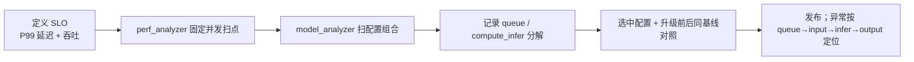

**按指标拆延迟的排障决策树**：

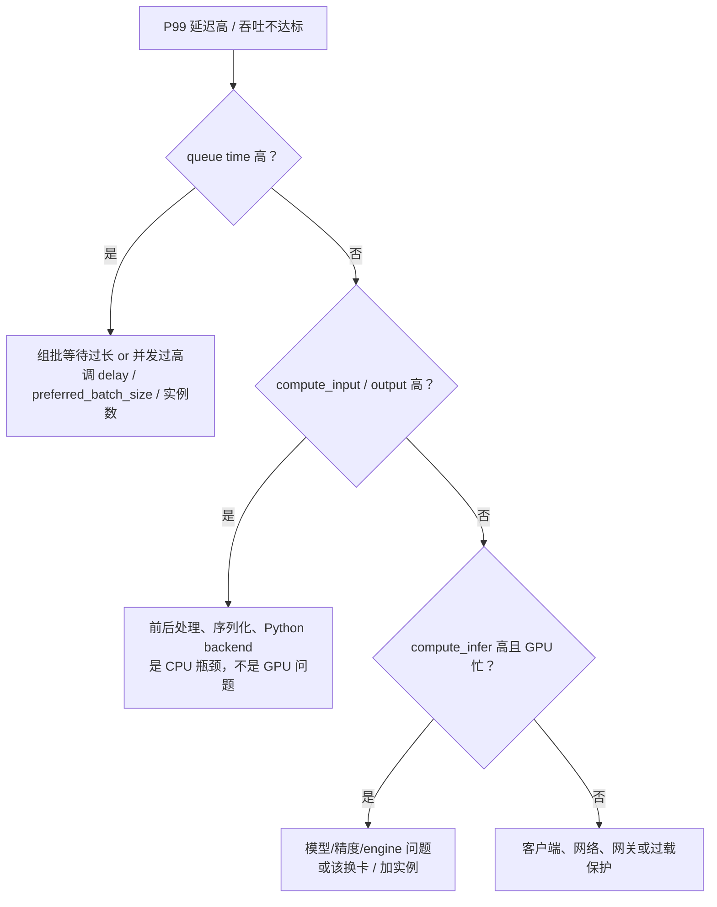

**常见故障速查**：

| 现象 | 根因 | 排查 |
|---|---|---|
| 模型未加载 / `UNAVAILABLE` | config.pbtxt 字段错、张量不匹配、engine 与 GPU/版本不兼容 | `tritonserver` 启动日志 + `/v2/models/<name>` |
| 显存不足 | `instance_group.count` 过大、同卡模型太多、TRT workspace 大 | 减实例、用 MIG 隔离、换小精度 |
| 动态 batching 反而变慢 | 低流量下白等 `max_queue_delay_microseconds` | 降 delay 或按流量分档；低并发直接关组批 |
| P99 高但 GPU 闲 | 排队 / CPU 前后处理 / 客户端序列化 | 看 queue 与 compute_input 指标（§五顺序） |
| 滚动更新丢请求 | 没等旧实例在途请求排空 | `/v2/health/ready` + preStop + 足够 gracePeriod（连 [[02-工作负载资源]]） |

---

## 九、K8s 部署与离线运行

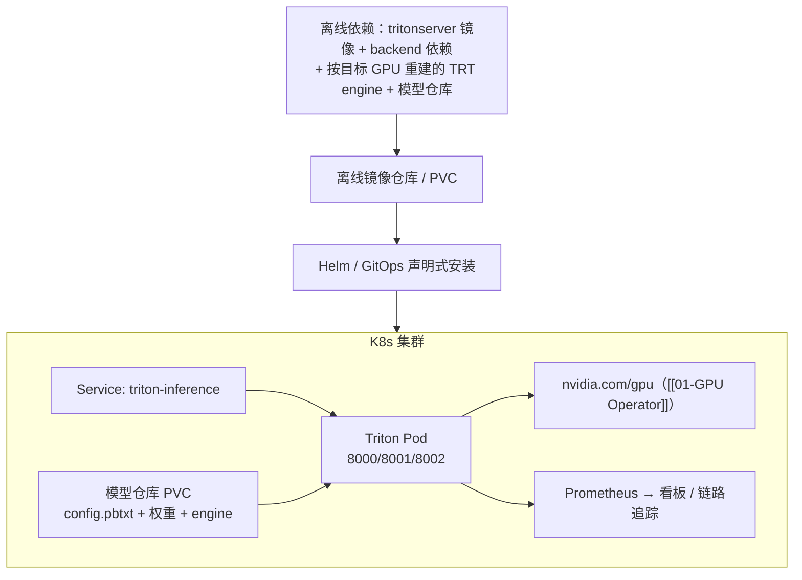

```yaml
# 示意：字段以现场镜像与 K8s 版本为准
args: ["tritonserver", "--model-repository=/models",
       "--model-control-mode=explicit", "--allow-grpc=true", "--allow-http=true"]
ports: [{ containerPort: 8000 }, { containerPort: 8001 }, { containerPort: 8002 }]
readinessProbe: { httpGet: { path: /v2/health/ready, port: 8000 } }
livenessProbe:  { httpGet: { path: /v2/health/live,  port: 8000 } }
resources: { limits: { nvidia.com/gpu: 1 } }
volumeMounts: [{ name: models, mountPath: /models, readOnly: true }]
```

> ⚠️ **部署四条**：① 离线依赖备齐 **server 镜像 + 各 backend 依赖 + 模型文件 + 按目标 GPU 重建的 TRT engine**，缺一个就加载失败；② 模型仓库只读挂载，`EXPLICIT` 模式发布，避免扫描半成品；③ **8000/8001/8002 不要暴露到公网**，TLS、鉴权、租户配额、请求大小限制放网关/服务网格（连 [[03-Web 与 RPC]]）；④ **Python backend 会让模型仓库变成可执行代码**——模型目录视同供应链材料，必须校验来源与哈希（连 [[07-工程实践]]、[[06-推理服务工程]] 供应链安全）。
>
> 📌 **与 LLM 引擎共卡规划**：主模型显存吃满，辅助模型别挤同一张卡；优先分离卡或 MIG 分区（连 [[01-GPU Operator]] §六）。**异构算力**（如昇腾）没有 Triton 的直接对应栈，embedding 一般改由 vLLM-Ascend / MindIE 或 ONNX Runtime + 自写服务承载，算子与量化格式差异要实测。

---

## 十、选型与演进

| 场景 | 选择 | 理由 |
|---|---|---|
| 单个 LLM 生成 | **[[03-vLLM]]** | 更短路径、KV/continuous batching 更深 |
| 多框架 + 多模型 + 服务端组批/ensemble | **Triton** | 一套协议、指标、版本管理 |
| 全 NVIDIA 栈、模型稳定高流量、要极致性能 | Triton + TensorRT-LLM / 直接 TensorRT-LLM | 收益能覆盖编译成本才划算 |
| 只有 1~2 个 embedding 模型 | FastAPI + ONNX Runtime / TEI | Triton 的配置与运维成本不回本 |
| 需要 CRD / 灰度 / 多模型平台化 | [[02-KServe]]（可挂 Triton runtime） | 平台层能力，与 Triton 互补 |
| 多节点分布式 LLM / PD 分离 | NVIDIA Dynamo / llm-d | **④路由与编排层**，不是 Triton 替代品 |

> ⚠️ **社区方向**：2026 年 NVIDIA 把生成式叙事收敛到 **Dynamo**（编排层）+ vLLM/SGLang/TensorRT-LLM（引擎层）；Triton 稳在「非生成式多框架服务」。另外 embedding 这类能力正被 vLLM/SGLang 的 `/embeddings` 端点与专用服务（TEI 等）分流——**辅助模型是否统一到 LLM 引擎，是后续值得观察的方向**，但当前多框架管线仍是 Triton 的护城河。

---

## 十一、面试高频问答 🎯

**Q1：Triton 和 vLLM 的本质区别？**
Triton 是**多框架通用推理服务器**（模型仓库 + 按模型调度 + backend 插件 + 请求级 dynamic batching），目标是统一服务异构模型；vLLM 是 **LLM 专用引擎**（PagedAttention + 迭代级 continuous batching + KV cache 分页），目标是把 token 生成做到极致。Triton 自己不生成 token，生成发生在 backend。

**Q2：2026 年 Triton 被 Dynamo 取代了吗？**
没有。NVIDIA 把 Triton 纳入 Dynamo 品牌（市场材料称 Dynamo-Triton），并把**生成式/多节点 LLM 的新项目**指向 Dynamo 编排层；但文档、镜像、二进制仍是 Triton，它仍是**非生成式多框架服务**的正确选择。品牌改名 ≠ 项目废弃。

**Q3：一个请求从 HTTP 端点到 GPU 经过什么？**
HTTP/gRPC → 按模型名+版本路由 → per-model scheduler/queue → dynamic batcher 按 `max_queue_delay_microseconds` 凑批 → instance group 选一个执行实例 → backend（TensorRT/ONNX/Python…）→ GPU → 拆分响应 → 记录 queue/compute_infer 等指标。

**Q4：模型仓库的目录约定是什么？config.pbtxt 为什么必须写对？**
`<model>/config.pbtxt` + `<model>/<数字版本>/model.<ext>`，版本目录纯数字，`version_policy` 控制启用哪些。config.pbtxt 是模型与服务器的契约（张量名/dtype/shape/backend/调度），写错 Triton 连加载都不尝试，直接 `UNAVAILABLE`。

**Q5：动态 batching 默认会等待凑批吗？**
不会。默认 `max_queue_delay_microseconds` 为 0，请求来了立刻单条执行；必须显式配置等待时间才会形成批。这正是「低流量下开了 batching 反而变慢」的根因。

**Q6：embedding 服务 P99 超标但 GPU 利用率很低，怎么调？**
按 §五顺序：先查排队等待（queue delay / preferred batch size 是否与真实并发匹配）→ 再看 `instance_group.count` 是否太少导致串行 → 再看 Python 前后处理的 CPU 瓶颈（compute_input/output）→ 最后才怀疑模型与卡。**先定 SLO，用 perf_analyzer/model_analyzer 扫点验证**。

**Q7：instance_group 加实例一定更好吗？**
不一定。每个实例复制一份权重，显存随实例数增长，且多实例在同一 GPU 上争 kernel；小模型、CPU 前后处理重的场景收益大，大模型反而容易 OOM。用 Model Analyzer 实测找拐点。

**Q8：sequence batching 和 LLM 的 continuous batching 有什么区别？**
sequence batching 是有状态模型用：客户端用相同 correlation ID + start/end 标记序列，Triton 保证同一序列路由到同一实例以维护状态；continuous batching 是 LLM 引擎在每个 decode step 动态重组批。名字像，机制与层级都不同。

**Q9：Ensemble 和 BLS 怎么选？**
Ensemble 是 `config.pbtxt` 里声明的固定 DAG，中间张量不出进程、开销最低；BLS 是 Python backend 里用 `pb_utils.InferenceRequest` 调用其他模型，支持条件分支与动态编排。两者都只做**推理链**，涉及数据库、审批、补偿的业务流程放应用层，别做成模型服务单体。

**Q10：TensorRT 引擎为什么不能跨环境直接拷？**
engine 与 **GPU 架构 + TensorRT/CUDA 版本**强绑定，换卡型或镜像就可能加载失败。必须按目标环境重建并锁定版本组合；要可移植性就用 ONNX Runtime backend 换一点性能。

**Q11：Triton 的指标怎么定位瓶颈？**
把延迟拆成 `queue`（等组批）、`compute_input`（前处理/反序列化）、`compute_infer`（真正推理）、`compute_output`（后处理/打包）。queue 大调 batching、input/output 大查 Python backend 与客户端序列化、infer 大才看模型与 GPU。

**Q12：三种 model control mode 怎么选？**
`NONE` 启动全加载、变更靠重启，最稳妥；`POLL` 轮询目录，官方文档因竞态与半写文件风险不推荐生产；`EXPLICIT` 通过 repository API 显式 load/unload，适合需要热更新的场景，但要自己编排在途请求排空。

**Q13：Triton 部署的安全与离线要点？**
镜像 + backend 依赖 + 模型 + 按目标 GPU 重建的 engine 全部内网化，模型仓库只读挂载；8000/8001/8002 不对公网，TLS/鉴权放网关；**启用 Python backend 后模型目录等于可执行代码**，必须校验来源与哈希。

**Q14：什么时候不该上 Triton？**
只有 1~2 个 embedding 模型（FastAPI + ONNX Runtime / TEI 更轻）、只有单个 LLM（vLLM 更直接）、团队没有 GPU 运维能力、或需要硬件可移植性（Triton 最优路径锁 NVIDIA）。Triton 的价值要「多框架 + 多模型 + 统一指标与版本」才回本。

---

## 十二、关联

- 上游 → [[AI 工程]]、[[AI Infra]]（分层地图 §1 ②引擎层 / §4 横切主题）、[[Kubernetes]]
- 兄弟 → [[03-vLLM]]（LLM 主链路）、[[02-KServe]]（平台层，可挂 Triton runtime）、[[01-GPU Operator]]（资源层与 MIG）
- 上层 → [[RAG 与知识库]]（embedding / rerank）、[[05-推理网关与路由]]、[[LLM 推理基础]]
- 机制对照 → [[03-vLLM]]（continuous batching / KV cache）、[[05-调度与资源管理]]（HPA/QoS）、[[02-工作负载资源]]（探针与优雅退出）、[[07-API 与 Watch 机制]]（声明式配置与 reconcile）
- 观测 → [[02-可观测性]]、[[06-推理服务工程]]（指标与 SLO 口径）
- 工程 → [[09-生态与工具]]、[[08-集群运维]]（变更与回滚）、[[07-工程实践]]（供应链安全）、[[06-推理服务工程]]
