---
tags:
  - ai
  - infra
  - gateway
  - routing
  - k8s
  - 面试
created: 2026-11-15
updated: 2026-11-15
status: 已整理
---

# 🧭 推理网关与路由

> 面向面试：**把请求送到「对的模型、对的副本」**——AI Infra 的④路由层，位于③平台层之上、引擎之外，管的是流量怎么分配，不管模型怎么算。

**全文主线**：普通 L7 网关假设「请求成本相近、副本无状态、响应短」，而 LLM 推理恰好三条都不满足——**一个 32K prompt 与一个 10 token 请求的成本差几个数量级、副本上有 KV cache 这种软状态、响应是可能持续几十秒的 SSE 流**。所以路由层必须知道引擎的内部状态，才能既压低 TTFT 又不浪费算力。整个领域可以收敛成一条因果链：

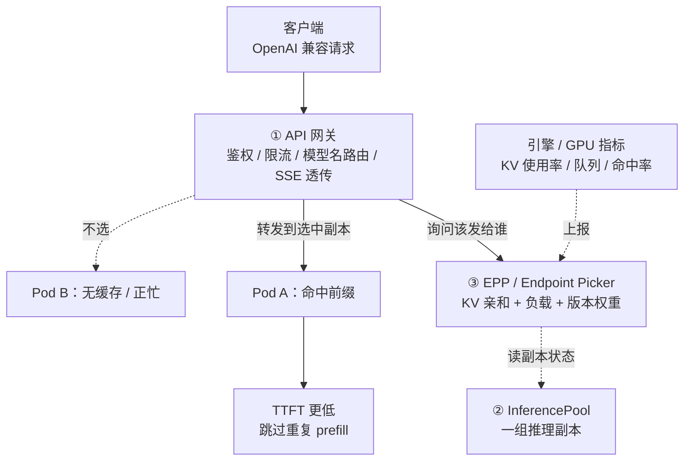

> 📌 **一句话定位**：①资源层 [[01-GPU Operator]] 让 K8s 认得卡，②引擎层 [[03-vLLM]] / [[04-Triton]] 把权重变成 token，③平台层 [[02-KServe]] 把服务变成 CRD，**④路由层决定「这一条请求落到哪个副本」**。它不改变单次推理的算力消耗，只改变**请求与副本的匹配质量**——所以路由优化的上限，取决于引擎暴露了多少状态。
>
> ⚠️ **版本口径（2026-11 核对）**：路由层是 2026 年演进最快的 AI Infra 子域，CRD 名、API 版本、实现项目都在变。本文所有版本号都标注适用语境；**实际环境以 `kubectl get crd | grep inference`、官方 release notes、`kubectl explain inferencepool` 实测为准**，不要把笔记里的版本号当作事实依据。

---

## 一、为什么普通网关不够：三个被打破的假设

Web 服务的 L7 负载均衡（Nginx / Envoy / Service）建立在三条隐含假设上，LLM 推理把它们全打破了：

| 假设 | Web 服务 | LLM 推理 | 后果 |
|---|---|---|---|
| **请求成本相近** | 一次 HTTP 请求几毫秒、成本近似 | prompt 长度、生成长度、KV 命中率差异巨大，单次成本可差 2~3 个数量级 | 轮询导致副本间负载严重不均，长请求堆在一个副本上 |
| **副本无状态** | 任意副本等价 | 副本内存里有 **KV cache**（prefix caching / 多轮会话），命中可跳过 prefill | 把同一会话换到别的副本 = 白白重算一遍 prompt |
| **响应短且无状态** | 请求结束即释放 | SSE 流式生成可持续数十秒，连接中途占用副本的并发槽与 KV 块 | 连接级指标（并发连接数）无法反映真实负载 |

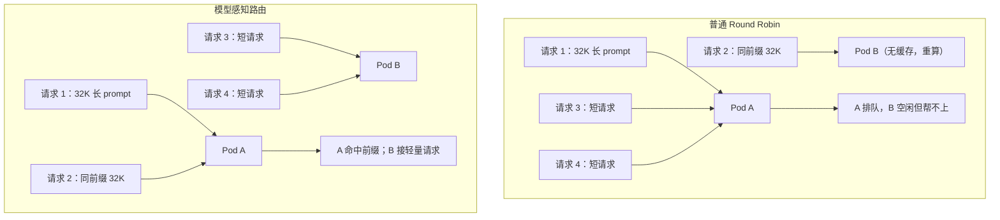

> 📌 **核心推论**：LLM 路由的目标函数不是「请求数均匀」，而是**「总 goodput 最大 + P99 TTFT 达标」**。副本的负载要用「待处理 token 数 / KV 块占用 / 队列深度」衡量，不能用 QPS 或连接数（连 [[06-推理服务工程]] §1）。

---

## 二、API 网关层：统一入口与协议治理

路由层最外圈是 **OpenAI 兼容 API 网关**。它不参与选副本，但承担所有「入口侧」职责：

| 职责 | 说明 | 做错的后果 |
|---|---|---|
| **协议统一** | 对外 `/v1/chat/completions`、`/v1/embeddings`、`/v1/models`，屏蔽后端 vLLM / Triton / SGLang 差异 | 客户端绑死引擎，换引擎要改代码 |
| **模型名路由** | 按 `model` 字段映射到后端服务 / LoRA adapter / 版本 | 权重升级后客户端必须跟着改 |
| **鉴权与租户隔离** | API key → 租户 → 配额与可访问模型列表 | 越权访问、成本无法归属 |
| **token 级限流** | 按输入+输出 token 计量，而非按请求数 | 一个长请求打满整个租户配额；或反过来被打穿 |
| **流式透传** | SSE / chunked 逐段转发，**禁止缓冲** | 首 token 被网关攒到最后，交互式体验全毁 |
| **错误语义** | 429（限流/排队满）、503（后端不可用）、超时与取消传播 | 客户端无限重试放大雪崩 |

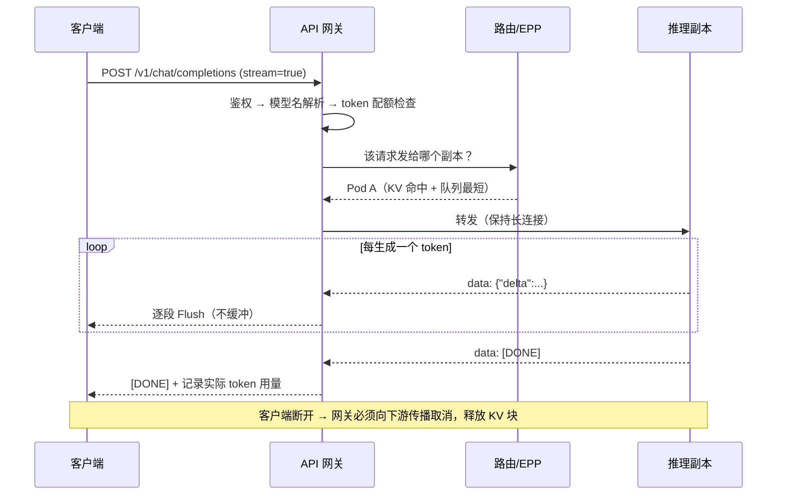

> ⚠️ **两个高频坑**：① 反向代理默认开启响应缓冲（如 Nginx `proxy_buffering on`），SSE 会退化成「一次性返回」；② 客户端断开后网关若不传播取消，服务端会继续把整段生成跑完，白占 KV 块与并发槽（连 [[03-Web 与 RPC]] 长连接与取消语义）。
>
> 📌 **网关与 KServe 的边界**：[[02-KServe]] 的 `InferenceService` 负责**声明服务**（生成 Deployment/Service/路由规则），网关负责**运行时把请求送进去**。KServe 0.17 起的 `LLMInferenceService` 之所以要接 Gateway API Inference Extension，正是因为原生 Service 的轮询不具备模型感知能力（连 [[02-KServe]] §六）。

---

## 三、Gateway API Inference Extension：把「模型感知」做成 K8s 标准

### 3.1 两个 CRD + 一个决策进程

**Gateway API Inference Extension** 是 K8s SIG Network 主导的标准扩展（2026-04 GA，v1.5.0 一线，以官方 release 为准），核心是三个对象：

| 对象 | 作用域 | 职责 |
|---|---|---|
| `InferencePool` | 命名空间 | 一组**提供同一模型/服务**的推理 Pod（按 label selector 圈定），并声明如何读取副本指标 |
| `InferenceModel` | 命名空间 | **逻辑模型名 → 某个 InferencePool + 版本权重**（canary、LoRA adapter 名、临界性） |
| **EPP**（Endpoint Picker） | 独立 Deployment | 外部决策进程：网关通过 ext_proc 询问它，它按策略从 Pool 里挑一个具体 endpoint |

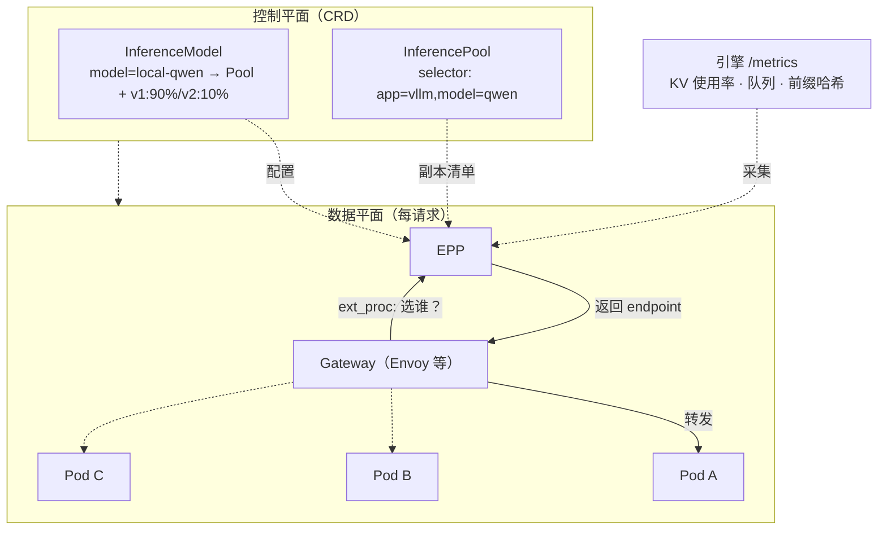

> 📌 **为什么不让网关自己算**：Envoy 的负载均衡器拿不到引擎内部状态（KV cache 命中、等待队列、已分配 KV 块）。EPP 作为独立进程，可以订阅多个指标源、跑复杂打分策略，并且**升级路由算法不用改网关配置**。代价是多一次 ext_proc 调用（通常在亚毫秒级）与一个需要 HA 的新组件。

### 3.2 EPP 的决策流程

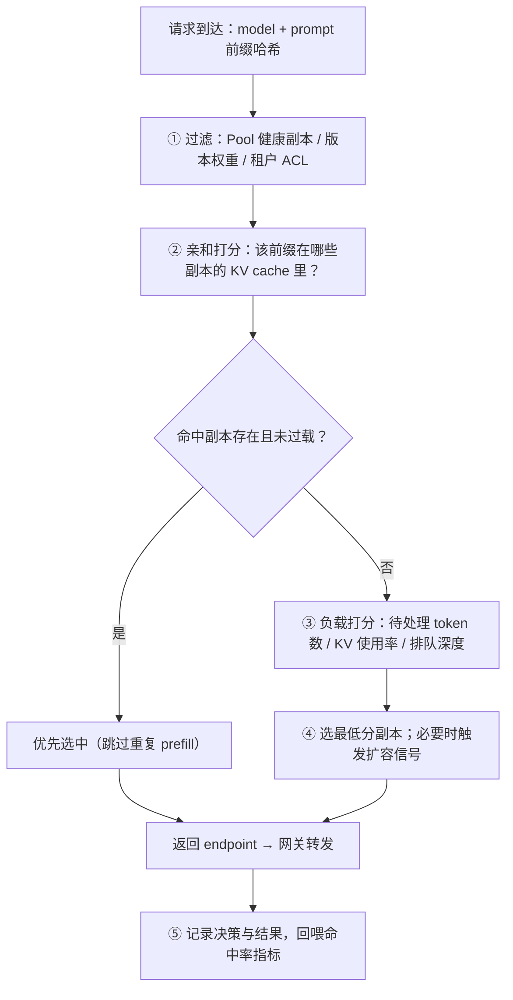

打分时要**同时**考虑亲和与负载，只看一边都会翻车：

- 只认 KV 亲和 → 所有同前缀请求全压到同一个副本，热点副本排队爆炸；
- 只看最少负载 → 前缀缓存命中率归零，TTFT 全面劣化。

> ⚠️ **KV 亲和是软亲和，不是会话绑定**：KV 块会被 LRU 淘汰，副本也可能重启。路由必须能在「亲和副本不可用」时优雅退化到按负载选择，而不是把请求卡住或报错。

---

## 四、KV Cache 感知路由：命中率决定 TTFT

### 4.1 为什么命中率这么值钱

prefill 是**计算密集**、耗时随 prompt 长度线性增长；命中前缀缓存后，这部分直接跳过，TTFT 可以从秒级降到毫秒级。所以「把请求送到已有该前缀的副本」是路由层收益最大的一招。

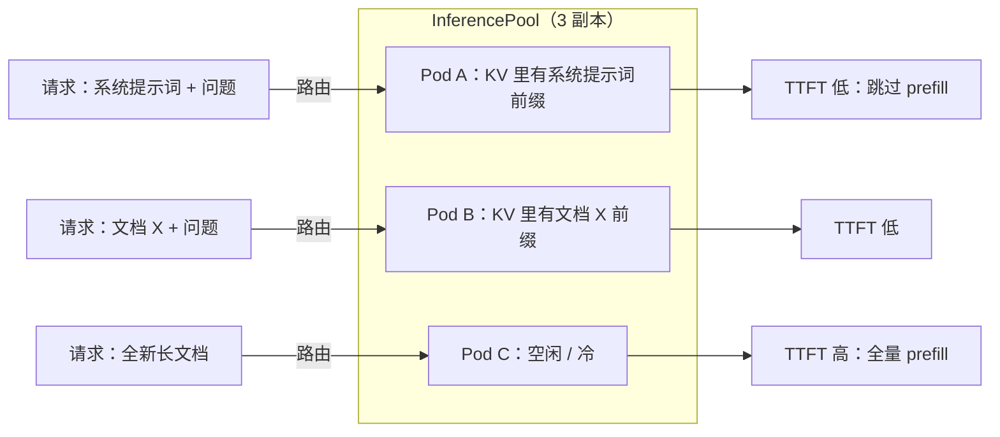

实现方式分两类，别混为一谈：

| 方式 | 原理 | 代价 |
|---|---|---|
| **前缀哈希上报** | 引擎把已缓存块的哈希前缀暴露给路由层，EPP 按请求 prompt 的哈希前缀匹配副本 | 需要引擎侧支持暴露缓存索引；哈希粒度与块大小相关 |
| **会话/租户粘性** | 按 session ID / API key 做一致性哈希，让同一会话尽量落同一副本 | 实现简单，但只是「近似」命中——多轮对话有效，跨请求共享系统提示词无效 |

> 📌 **前缀缓存命中率是可观测的一等指标**：要单独采集「命中 / 未命中」计数与命中后的 TTFT 差值。命中率突然下跌，优先查三件事：副本被重建、流量前缀分布变了、KV 块被抢占淘汰（连 [[03-vLLM]] §三 / §七）。

### 4.2 KV Cache 分层与跨副本传输

单副本显存放不下所有前缀时，会出现「KV cache 分层」：

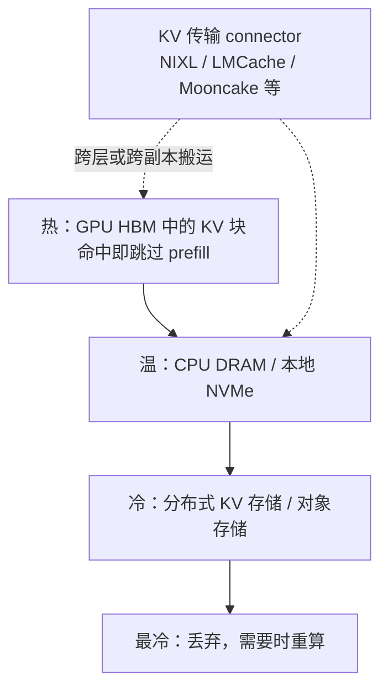

| 主题 | 说明 |
|---|---|
| **CPU / SSD offload** | 把不活跃的 KV 块换出到主机内存或 NVMe，换入有 PCIe 带宽成本；适合「多轮会话间隔长」的流量 |
| **分布式 KV 池** | 多个副本共享一份 KV 存储，任一副本都能命中；需要 RDMA/高带宽网络，否则搬运比 prefill 还慢 |
| **PD 分离的 KV 传输** | prefill 池算完的 KV 要送到 decode 池，这是 PD 分离能否成立的关键路径（§五） |
| **一致性** | 前缀哈希基于内容，块是**只读共享 + copy-on-write**，跨副本搬运不需要失效协议 |

> ⚠️ **分层不是免费的**：offload 省的是显存，代价是换入带宽；一次 32K 上下文的 KV 可能有数 GB，通过 PCIe 搬运的时间未必比重算 prefill 短。**先测命中率与搬运耗时，再决定要不要分层**（连 [[LLM 推理基础]] KV Cache 显存公式）。

---

## 五、PD 分离：把 prefill 与 decode 拆到不同 GPU 池

### 5.1 动机：两阶段的资源特征相反

| 阶段 | 特征 | 瓶颈 | 关键指标 |
|---|---|---|---|
| **prefill** | 一次并行处理整段 prompt，算力密集 | GPU 算力（FLOPs） | TTFT |
| **decode** | 每步每序列只出 1 token，却要读整段 KV | 显存带宽 / 容量 | TPOT / ITL |

同一个副本里两阶段混跑会互相干扰：长 prompt 的 prefill 占满 token 预算，同批 decode 请求卡顿。把两阶段拆到不同 GPU 池，就能**各自定并行度、批量、卡型与伸缩策略**。

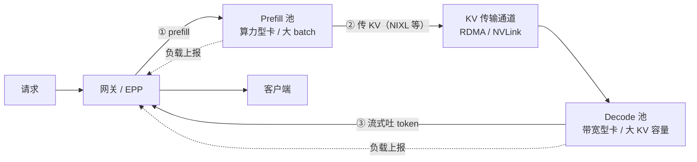

### 5.2 收益边界（面试最容易被营销材料带偏的一题）

> ⚠️ **必须澄清两点**：① vLLM 官方把 PD 分离标为 **experimental**，并明确「**不提升总吞吐**」；它的价值是**分别控制 TTFT 与 TPOT 的尾延迟**、让两阶段各自伸缩，不是「免费提速」。② 它引入了一条新的关键路径——**KV 从 prefill 池传到 decode 池**，传输延迟会直接加进 TTFT；跨节点没有 RDMA 时，很可能得不偿失。

因此需要同时满足才可能回本：**大模型 + 长序列 + 高并发 + 需要分别控 TTFT/TPOT 的 SLO + 有高带宽 KV 通道**。小规模单模型场景，chunked prefill 已经能解决大部分尾延迟问题（连 [[03-vLLM]] §六）。

**编排层项目**（属④路由/编排层，不是引擎替代品）：

| 项目 | 定位 |
|---|---|
| **llm-d** | CNCF Sandbox（2026-03 口径），基于 Gateway API Inference Extension 做 KV 感知路由与 PD 分离编排 |
| **NVIDIA Dynamo** | NVIDIA 的生成式推理编排框架，跑 vLLM / SGLang / TensorRT-LLM 作引擎；也承载了 Triton 的品牌叙事（连 [[04-Triton]] §一） |
| **LeaderWorkerSet（LWS）** | K8s 工作负载 API，管理多节点并行的一组 Pod（TP/PP 跨节点时成组调度） |
| **Kueue** | 队列与配额层，为 prefill/decode 池分别做 gang scheduling（连 [[01-GPU Operator]] §五） |

> 📌 **层次别混**：PD 分离是**路由/编排决策**，vLLM 是**执行引擎**，NIXL/LMCache 是**KV 传输通道**，LWS 是**Pod 成组编排**，Kueue 是**排队与配额**。面试里把这些说成同一层的东西，是最常见的概念错误。

---

## 六、灰度、多模型与多租户

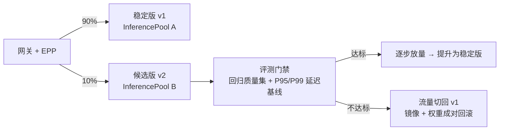

- **版本权重**：`InferenceModel` 里声明 v1/v2 的流量比例，EPP 在过滤阶段生效；比在 Deployment 层做 canary 更贴近「按模型版本」的语义（连 [[02-KServe]] §五 的 `InferenceService` canary 是另一种实现）。
- **多模型 / LoRA**：按 `model` 名映射到不同 Pool 或同一基座的不同 adapter；共享基座避免「一模型一卡」（连 [[03-vLLM]] §五）。
- **多租户**：namespace + ResourceQuota + RBAC 界定谁能改路由规则；网关层做租户级 token 配额与优先级，引擎层 `--max-num-seqs` 只是最后一道兜底。
- **会话粘性**：多轮对话要尽量落同一副本以复用 KV；但必须是**软粘性**（§3.2），副本重建后能自动退化。

> ⚠️ **回滚必须成对**：引擎镜像与权重版本（以及 config/tokenizer）是一个整体。只回滚路由权重、或只换引擎镜像而权重格式已变，服务照样起不来（连 [[06-推理服务工程]] §6）。

---

## 七、过载保护：让「部分快速失败」优于「全部一起变慢」

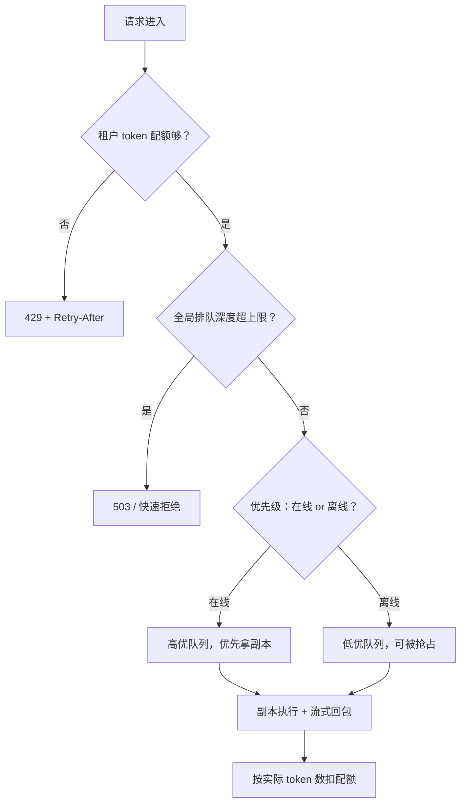

| 机制 | 粒度 | 说明 |
|---|---|---|
| **准入控制（admission）** | 请求级 | 队列超过上限直接拒绝，避免所有请求一起排队变慢 |
| **token 级限流** | 输入 + 输出 token | 比 QPS 更贴近成本；需引擎回传实际用量 |
| **优先级队列** | 租户 / 业务 | 在线交互优先于离线批处理；低优请求可被抢占 |
| **排队上限 + 超时** | 请求级 | 队里等太久不如早点失败；超时必须向下游传播取消 |
| **背压到扩容** | 集群级 | 队列深度与 KV 使用率作为 KEDA 自定义指标触发扩容（连 [[06-推理服务工程]] §4） |

> 📌 **没有排队上限的服务，在流量尖峰下是「全部请求一起变慢」而不是「部分快速失败」**——P99 会整体崩掉，且客户端重试进一步放大负载。这是推理服务过载保护的第一原则。

---

## 八、可观测：路由层该看什么

| 层 | 关键指标 | 用途 |
|---|---|---|
| 网关 | QPS、按 model/租户的错误率、429/503 比例、SSE 首字节时间 | 入口健康与配额是否合理 |
| **EPP** | **前缀命中率**、亲和退化次数、决策耗时、各副本被选中的分布 | 路由策略是否真的生效 |
| 引擎 | `num_requests_waiting`、`gpu_cache_usage_perc`、preemption、TTFT/TPOT | 副本真实负载（连 [[03-vLLM]] §七） |
| GPU | DCGM 利用率 / 显存 / XID | 资源层（连 [[01-GPU Operator]] §七） |

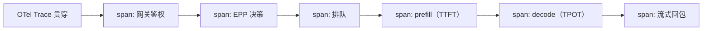

> ⚠️ **排障顺序**：先确认「路由有没有指错版本」（④）→ 再看「副本是不是真的过载」（②）→ 最后才怀疑「GPU 不够」（①）。跳过路由层直接看 GPU 利用率，是误判的高发路径（连 [[AI Infra]] §2 的倒序链路）。

---

## 九、选型与演进

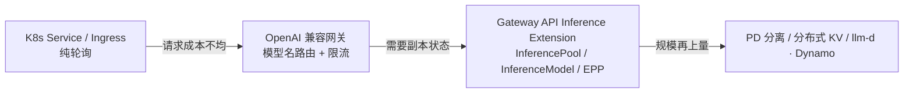

| 阶段 | 适用 | 代价 |
|---|---|---|
| Service / Ingress | 单副本、开发验证 | 无模型感知，多副本即失效 |
| API 网关 + 一致性哈希 | 几个副本、会话粘性够用 | 命中率是「近似」的，跨请求公共前缀无法复用 |
| Gateway API Inference Extension | 多副本、多版本、需要 KV 感知与灰度 | 引入 EPP 组件、Gateway API CRDs、实现依赖 |
| PD 分离 / 分布式 KV | 大模型、长序列、高并发、SLO 分离 | experimental、KV 传输成本、运维复杂度显著上升 |

**事实口径（2026-11 核对，以官方 release 为准）**：

| 事实 | 口径 |
|---|---|
| Gateway API Inference Extension | 2026-04 GA（v1.5.0 一线）；`InferencePool` / `InferenceModel` + EPP，Envoy AI Gateway / Agentgateway / Istio 等实现 |
| KServe 0.17+ | `LLMInferenceService` 生产可用、独立 controller、KV 感知路由与 PD 分离能力（连 [[02-KServe]] §二） |
| vLLM PD 分离 | 官方标 **experimental**，明确「**不提升总吞吐**」；KV connector 属生态组件 |
| llm-d | CNCF Sandbox（2026-03 口径），基于 Inference Extension 做分布式推理编排 |
| ModelMesh | 仓库 2026-04 归档，新项目不选（连 [[02-KServe]] §二） |

> ⚠️ **别把 `LLMInferenceService` 当成 `InferenceService` 的新版本**：它是另一套 CRD + 另一条 reconcile 路径，API 迭代很快。同样，别把 llm-d / Dynamo 当成 KServe 或 vLLM 的竞品——它们位于**编排层**，消费下层引擎。

---

## 十、面试高频问答 🎯

**Q1：为什么 LLM 推理不能直接用 Round Robin？**
三条假设被打破：请求成本差异可达数量级（长 prompt vs 短请求）、副本带 KV cache 软状态（命中可跳过 prefill）、响应是长连接流式。轮询会把贵请求撒到无缓存副本、造成副本间负载不均，TTFT 与 goodput 同时劣化。要用「待处理 token 数 / KV 块占用 / 队列深度」衡量负载，并叠加前缀亲和。

**Q2：Gateway API Inference Extension 的三个核心对象是什么？**
`InferencePool`（一组提供同一模型的 Pod + 指标来源）、`InferenceModel`（逻辑模型名 → Pool + 版本权重 / 临界性）、**EPP**（独立决策进程，网关通过 ext_proc 询问它选哪个 endpoint）。EPP 独立出来是因为网关本身拿不到引擎内部的 KV 命中与队列状态。

**Q3：EPP 打分为什么必须同时考虑 KV 亲和与副本负载？**
只认亲和会把所有同前缀请求压到同一副本，形成热点；只看负载会让前缀缓存命中率归零，TTFT 全面劣化。正确做法是「先按亲和过滤/加权，再用负载做最终选择」，并在亲和副本过载时优雅退化。

**Q4：KV 亲和为什么是软亲和而不是会话绑定？**
KV 块会被 LRU 淘汰，副本也会重启或扩缩容，亲和关系随时可能失效。路由必须能在亲和副本不可用时退化到按负载选择，而不是卡住请求或报错。会话粘性（一致性哈希）只是它的一个低成本近似。

**Q5：KV cache 分层（CPU/SSD offload）一定划算吗？**
不一定。offload 省的是显存，代价是 PCIe/网络换入带宽；一次长上下文的 KV 可能有数 GB，搬运时间未必比重算 prefill 短。要先测命中率、块大小与搬运耗时，再决定是否分层；分布式 KV 池还额外要求 RDMA 级网络。

**Q6：PD 分离解决什么？vLLM 为什么说它「不提升总吞吐」？**
prefill 计算密集、decode 访存密集，拆池后可分别定卡型、批量与伸缩策略，从而**分别控制 TTFT 与 TPOT 尾延迟**。但它只是把同样的计算换了个地方做，还额外引入 KV 传输开销，所以总吞吐不升反可能降；官方标为 experimental，收益只在「大模型 + 长序列 + 高并发 + 有高带宽 KV 通道」时成立。

**Q7：PD 分离的关键路径在哪？**
prefill 池算完的 KV 必须传给 decode 池（NIXL / LMCache / Mooncake 一类 connector），这段传输延迟直接计入 TTFT。跨节点没有 RDMA/NVLink 时，传输可能吃掉全部收益。

**Q8：llm-d、NVIDIA Dynamo、vLLM、KServe 怎么分层？**
vLLM / SGLang / TensorRT-LLM 是②引擎层；KServe 是③平台层（声明式 CRD 与灰度）；llm-d / Dynamo 是④路由与编排层（KV 感知路由、PD 分离、多节点编排）；LWS 管多节点 Pod 成组，Kueue 管排队与配额。它们互补，不是竞品。

**Q9：API 网关为什么必须禁止缓冲 SSE？**
流式生成是逐 token 推送，网关一旦缓冲攒批，首 token 会等到整段生成完才到客户端，TTFT 彻底失去意义；客户端断开时还要向下游传播取消，否则服务端会继续跑完，白占 KV 块与并发槽。

**Q10：为什么推理服务要按 token 而不是 QPS 限流？**
单次请求成本随 prompt 长度与生成长度变化几个数量级，QPS 无法反映真实资源消耗。按输入+输出 token 计量才能公平分摊配额；通常还要配合排队上限与优先级，让过载时「部分快速失败」而不是「全部一起变慢」。

**Q11：`InferenceModel` 的版本权重和 KServe `InferenceService` 的 canary 有什么区别？**
前者是④路由层的声明：逻辑模型名映射到不同 Pool / 版本比例，由 EPP 在每请求决策时生效；后者是③平台层的声明：控制器 reconcile 出两套 Deployment 并配置流量切分。二者可以叠加，但层级不同，排查时要先分清是哪一层在切流量。

**Q12：前缀缓存命中率突然下跌，怎么查？**
① 副本是否被重建/扩缩（缓存随进程消失）；② 流量前缀分布是否变化（系统提示词改版、新业务接入）；③ KV 块是否被抢占淘汰（看 `num_preemptions_total` 与 `gpu_cache_usage_perc`）；④ EPP 是否退化了亲和策略（看亲和退化次数与决策耗时）。

**Q13：路由层该监控哪些指标？**
网关侧 QPS / 429·503 比例 / SSE 首字节；EPP 侧**前缀命中率、亲和退化次数、决策耗时、副本选择分布**；引擎侧排队数、KV 使用率、抢占次数、TTFT/TPOT；GPU 侧 DCGM 指标。用 OTel 把「鉴权 → EPP 决策 → 排队 → prefill → decode → 回包」串成一条 trace。

**Q14：什么时候不该上 Gateway API Inference Extension / PD 分离？**
单副本或模型数很少时，Service + 一个 OpenAI 兼容网关就够；引入 EPP 意味着多一个要 HA 的组件、Gateway API CRDs 与实现依赖。PD 分离更是只在「两阶段 SLO 需要分别控制 + 有高带宽 KV 通道 + 规模足够」时才可能回本。判断标准是**编排收益能否覆盖运维成本**。

---

## 十一、关联

- 上游 → [[AI 工程]]、[[AI Infra]]（分层地图 §1 ④路由层 / §2 请求链路）、[[Kubernetes]]、[[03-服务与网络]]（Ingress / Gateway API）
- 平台层 → [[02-KServe]]（`LLMInferenceService` / canary / `ClusterServingRuntime`）
- 引擎层 → [[03-vLLM]]（prefix caching / KV 分页 / PD 分离 / 指标）、[[04-Triton]]（辅助模型路由）
- 资源层 → [[01-GPU Operator]]（MIG / Kueue / DCGM）、[[LLM 推理基础]]（KV Cache 与 prefill/decode 原理）
- 横切 → [[06-推理服务工程]]（指标体系与 SLO、压测与容量、过载保护、模型资产、离线与异构环境）、[[02-可观测性]]、[[05-调度与资源管理]]
- 客户端 → [[03-Web 与 RPC]]（SSE / 长连接 / 超时重试与取消传播）
