---
tags:
  - ai
  - infra
  - sre
  - observability
  - capacity
  - 面试
created: 2026-11-15
updated: 2026-11-15
status: 已整理
---

# 📐 推理服务工程

> 面向面试：**把「能跑」变成「可度量、可规划、可升级、可回滚」**——AI Infra 的⑤横切层，不属于任何一个组件，却决定服务能不能上生产。

**全文主线**：四个组件篇回答「怎么用」，本篇回答「怎么判断用得对不对」。逻辑是一条闭环：**先定义指标与 SLO → 用压测测出容量基线 → 由基线推出容量规划与弹性策略 → 用版本与灰度管理变更 → 用离线与异构约束兜住环境差异**。跳过任何一环，上线后就只能靠猜。

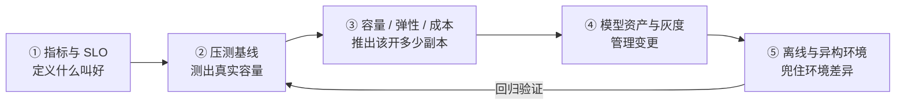

> 📌 **一句话定位**：[[01-GPU Operator]] 管资源、[[03-vLLM]] / [[04-Triton]] 管引擎、[[02-KServe]] 管编排、[[05-推理网关与路由]] 管流量，**本篇管「跨这些层的统一口径」**——指标怎么定义、容量怎么算、变更怎么回滚、环境差异怎么收敛。四篇组件笔记里各自零散出现的「压测」「指标」「灰度」，在这里收敛成一套方法。
>
> ⚠️ **口径说明**：本文的公式与阈值是**推演方法**，不是放之四海皆准的常数。真实容量必须以压测基线为准（§2），指标名随引擎版本变化，以现场 `/metrics` 实测为准。

---

## 一、指标体系与 SLO：先定义「什么叫好」

### 1.1 四个延迟指标，互相冲突

| 指标 | 定义 | 由什么决定 | 面向谁 |
|---|---|---|---|
| **TTFT** | 首 token 到达时间 | 排队 + prefill 计算 + 前缀命中 | 交互式体验 |
| **TPOT / ITL** | 每 token 间隔 | decode 步的访存带宽、batch 大小 | 流式顺滑度 |
| **E2E** | 请求总时长 | TTFT + TPOT × 输出长度 | 批处理 / 任务型 |
| **tokens·s⁻¹** | 总吞吐 | batch、KV 容量、GPU 算力 | 容量与成本 |

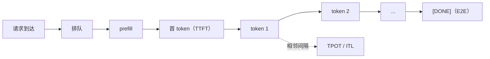

> ⚠️ **它们彼此冲突**：拉大 batch 能提吞吐，但每个请求的 TTFT 与 TPOT 都会变差；chunked prefill 稳住 TPOT，却可能略增 prefill 调度次数。**SLO 必须按「交互式 vs 批处理」分开定**，且**看 P95/P99，不看均值**——均值会掩盖长尾，而用户感知的正是最慢那批请求。

### 1.2 四层指标地图（别只看 GPU 利用率）

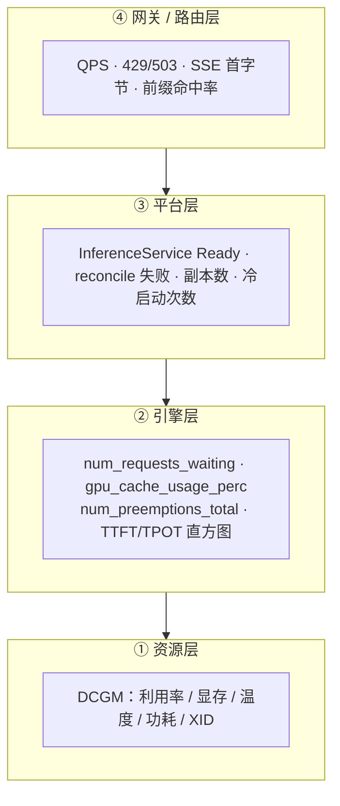

| 层 | 代表指标 | 「饱和」的正确信号 |
|---|---|---|
| 引擎 | `vllm:num_requests_waiting`、KV cache 使用率、preemption | **排队数持续 > 0**、KV 接近饱和、抢占上涨 |
| GPU | `DCGM_FI_DEV_GPU_UTIL` / `FB_USED` / `XID_ERRORS` | 显存吃紧、XID 报错 |
| 平台 | Ready 条件、副本数、冷启动次数 | 控制器 reconcile 失败、频繁冷启动 |
| 网关 | 错误率、429、SSE 首字节、命中率 | 限流比例上升、命中率下跌 |

> ⚠️ **`GPU_UTIL = 100%` 不代表算力跑满**：它统计的是「采样周期内至少有一个 kernel 在跑」的时间占比，一个只占 1 个 SM 的小 kernel 也能把它拉满。判断是否饱和要**综合** SM/显存带宽利用率、吞吐（tokens/s）、队列深度（连 [[01-GPU Operator]] §七）。同理，**CPU 不高不代表推理不饱和**——GPU 可能已排队、KV 已吃紧。

### 1.3 goodput 与 SLO 定义

> 📌 **goodput（有效吞吐）**：单位时间内**满足 SLO** 的完成请求数（或 token 数）。只数 tokens/s 会把「一堆超时/被抢占的请求」也算成产出。定义 SLO 时把约束写全，例如：`交互式：P99 TTFT < 2s 且 P99 TPOT < 50ms`；`批处理：goodput ≥ X tokens/s，允许 E2E 分钟级`。

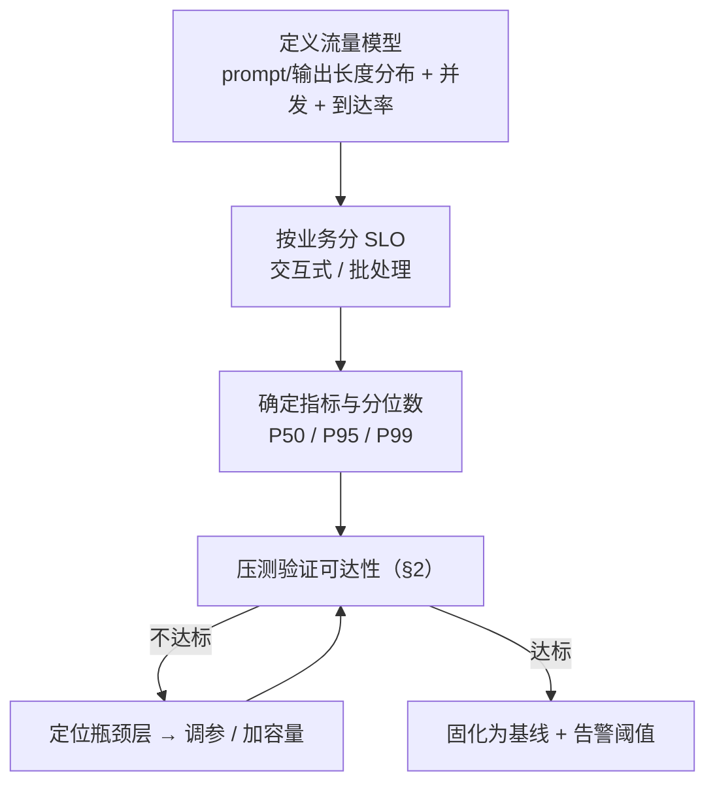

---

## 二、压测基线：唯一可信的容量来源

### 2.1 为什么公式不能替代压测

显存估算公式（连 [[LLM 推理基础]]）能算出「理论上能放多少 KV 块」，但算不出：真实 prompt 长度分布、前缀命中率、preemption 频率、Python 前后处理开销、CUDA Graph 捕获后的实际峰值显存。**vLLM 启动日志里打印的「可用 KV cache blocks」才是真实容量**。

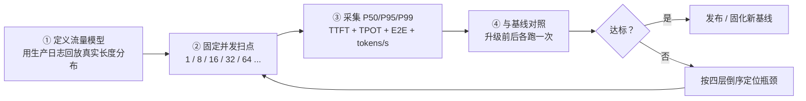

### 2.2 工具与要点

| 工具 | 适用 | 关键点 |
|---|---|---|
| `vllm bench serve` | LLM 引擎 | `--backend openai-chat`、固定 `--dataset-path`、`--max-concurrency` 扫点、`--request-rate` 控制到达率 |
| `genai-perf`（NVIDIA） | LLM 引擎 | 输出 TTFT / ITL / tokens/s 的完整分位数报告 |
| `perf_analyzer` / `model_analyzer` | [[04-Triton]] 非 LLM 模型 | 前者扫并发，后者自动扫 `batch size / instance count / queue delay` 配置组合 |
| 自定义回放 | 全链路 | 用真实 prompt/输出长度分布，别用均匀长度的合成集 |

```bash
# 固定并发扫点：每个点跑同一份业务分布，输出分位数
vllm bench serve \
  --backend openai-chat \
  --base-url http://127.0.0.1:8000 \
  --endpoint /v1/chat/completions \
  --model local-qwen \
  --dataset-name sharegpt --dataset-path /data/traffic.json \
  --num-prompts 500 --max-concurrency 32 --request-rate 20
```

> ⚠️ **三条压测纪律**：① **同一份流量模型**才能横向比较，换数据集等于换题；② 每个并发点要跑够时长，让 KV cache 达到稳态（刚启动时命中率偏低）；③ **升级前后各跑一次**——参数默认值、kernel、指标名都会随版本变化，旧基线不能直接复用。
>
> 📌 **KServe 只改变编排，不该改变引擎基线**：升级控制器/runtime 镜像后压测结果变了，先怀疑 runtime 镜像或资源配额被改，而不是先归因到控制器（连 [[02-KServe]] §七）。

---

## 三、容量规划：从显存反推并发

### 3.1 显存预算的拆分

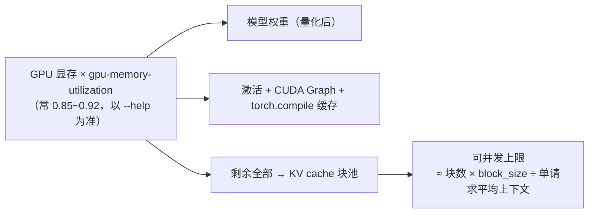

**KV Cache 显存公式**（连 [[LLM 推理基础]]）：

```
每 token KV 字节 = 2 (K+V) × layers × kv_heads × head_dim × dtype_bytes
单请求 KV = 每 token KV 字节 × 上下文长度
总 KV 容量 = GPU 显存 × util − 权重 − 激活/图缓存
可并发 ≈ 总 KV 容量 ÷ 单请求 KV
```

> 📌 **GQA / MQA 为什么省显存**：`kv_heads` 远小于 `query_heads`，KV cache 直接按 kv_heads 缩放；这也是长上下文模型几乎都用 GQA/MLA 的原因。

### 3.2 反推参数的顺序（不要倒着来）

| 步骤 | 决定什么 | 依据 |
|---|---|---|
| 1 | `--max-model-len`、`--gpu-memory-utilization` → **KV 池大小** | 按业务 **P99 上下文长度** + 余量，不照抄模型卡的 128K 最大值 |
| 2 | `--max-num-seqs` → **并发上限** | 对照 P95 延迟预算与 KV 块数 |
| 3 | `--max-num-batched-tokens` → **每步 token 预算** | 平衡吞吐与 TTFT，配合 chunked prefill |
| 4 | 压测验证 P99，回看启动日志的 KV 块数 | 以实测为最终容量 |

> ⚠️ **并发不够时先砍上下文长度，而不是先加卡**：`--max-model-len` 按最坏情况预留 KV，把 128K 压到业务实际需要的 8K，能直接释放一大半并发空间。加卡是最后手段，且 TP 会引入 all-reduce 通信开销（连 [[03-vLLM]] §六）。

### 3.3 整卡 / MIG / 时间切片的取舍

| 方式 | 隔离性 | 显存限额 | 适用 |
|---|---|---|---|
| 整卡 | 完全 | 全卡 | LLM 主模型、SLO 服务 |
| MIG | **硬件级**（算力/显存/故障域） | 每实例固定 | 多个小模型共卡且需要可预测延迟 |
| 时间切片 | **无** | 无 | 仅开发/测试、可信低优负载 |
| MPS | 协作式 | 按比例 | 实验性，需客户端配合 |

> ⚠️ 时间切片是「虚假复制」——调度器以为有 N 张卡，底层只有 1 张，一个 Pod OOM 会连坐其余 Pod。**有 SLO 的服务禁止只用时间切片**（连 [[01-GPU Operator]] §六）。

---

## 四、弹性伸缩与成本

### 4.1 为什么不能用 CPU 做扩缩信号

推理饱和看的是**并发、队列深度、KV cache 使用率、TTFT/TPOT**；CPU 常常不高但 GPU 已排队。HPA 开箱只支持 CPU/内存，接自定义/外部指标需要 metrics adapter；实践中通常用 **KEDA** 把 `num_requests_waiting`、`gpu_cache_usage_perc`、TTFT 这类引擎指标接成扩缩信号（KEDA 也可驱动 scale-from-zero）。

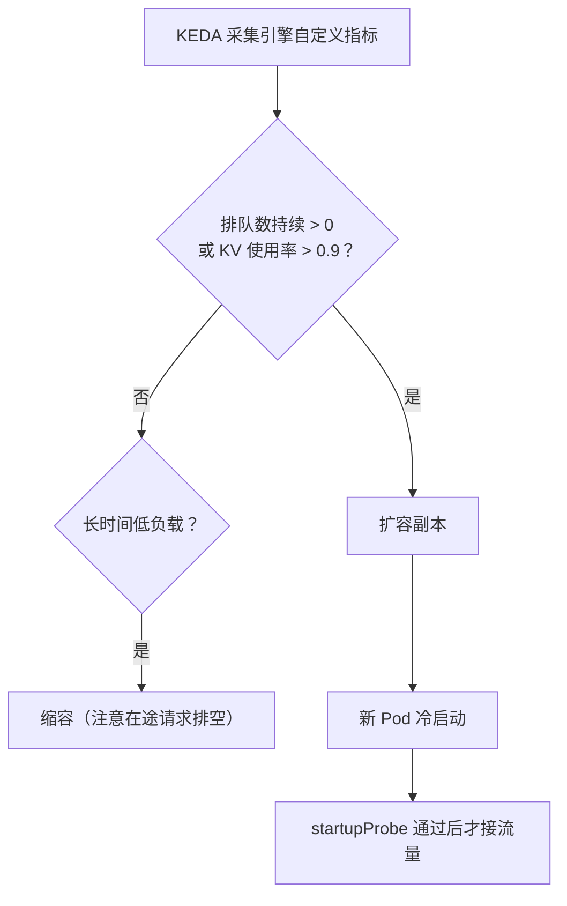

> ⚠️ **scale-from-zero 的分钟级代价**：冷启动 = 权重加载 + `torch.compile` + CUDA Graph 捕获，大模型常是分钟级；Knative 缩零后首个请求要独自承担全部代价，交互式 SLO 直接崩。这也是 [[02-KServe]] 0.20 起推荐生产 LLM 用常驻 Pod 的 **Standard 模式** 的根本原因。编译缓存（`VLLM_CACHE_ROOT`）应挂持久卷，否则每个新 Pod 都要重付一次。

### 4.2 成本模型

| 项 | 说明 |
|---|---|
| **每百万 token 成本** | GPU 单价 ÷ (goodput × 时长)，是衡量优化收益的统一尺度 |
| **GPU 利用率目标** | 未优化集群实测常仅 15–30%；提升手段是混跑、错峰、共享而非单纯加卡 |
| **批处理错峰** | 离线评测/压测放低峰，在线保 `guaranteed` 配额（连 [[01-GPU Operator]] §五 Kueue） |
| **量化与共享** | 权重量化 / KV fp8 换并发，MIG 切分承载小模型，都是「降单位成本」而非「提单次性能」 |

> 📌 **成本优化的顺序**：先测 goodput 基线 → 找瓶颈层（§1.2 四层）→ 再选手段。**别一上来就量化**：量化省的是显存，若瓶颈在排队或 prefill 计算，吞吐不会变好，还白白引入精度回归风险。

---

## 五、模型资产、版本与灰度

### 5.1 权重仓库与分发

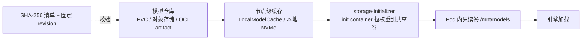

| 主题 | 要点 |
|---|---|
| **存储介质** | PVC（低延迟、共享只读）、对象存储（弹性）、OCI artifact（与镜像同一套分发） |
| **加载加速** | 节点级缓存 / 本地 NVMe，把大模型冷启动从十几分钟降到分钟级；共享只读卷避免每副本一份拷贝 |
| **完整性** | 权重 + `config.json` + `tokenizer*` + `generation_config.json` + `auto_map` 引用的 `.py`；**只同步权重必报缺文件** |
| **漂移控制** | 固定 `--revision` 与 `--tokenizer-revision`；tokenizer 漂移会悄悄改变 token 数 |

### 5.2 灰度与回滚

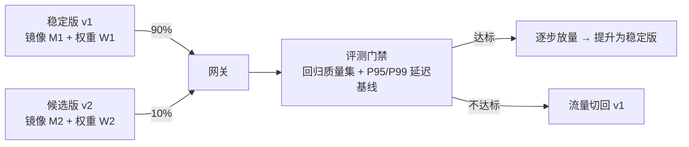

> ⚠️ **回滚必须成对**：引擎镜像与权重版本（含 config / tokenizer）是一个整体，只回一个照样起不来。这是推理服务与无状态 Web 服务在变更管理上最大的差异。
>
> 📌 **评测门禁不是「能启动」**：模型上线要跑**回归质量集**（准确率/格式合规）+ **P95/P99 延迟基线**，两者都达标才放量。量化、换卡型、换引擎版本都要重跑质量回归。

### 5.3 多模型与 LoRA 热切换

| 方式 | 原理 | 代价 |
|---|---|---|
| 一模型一副本 | 各自加载完整基座 | 显存随模型数线性增长，最浪费 |
| **共享基座 + 多 LoRA** | 基座只加载一份，按 `model` 名路由到不同 adapter | adapter 切换与调度开销，需实测 |
| 模型名路由 | 网关 / EPP 按 `model` 字段映射 Pool 或 adapter | 需维护逻辑名到物理版本的映射（连 [[05-推理网关与路由]] §六） |

---

## 六、供应链安全

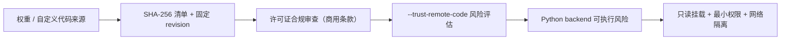

| 风险 | 说明 | 缓解 |
|---|---|---|
| 权重篡改 | 下载源或介质被替换 | 全量 SHA-256 清单、固定 revision、到场校验 |
| **`--trust-remote-code`** | 会执行模型仓库里的任意 Python | **默认关闭**；确需开启必须固定 revision + 审读 `.py` + 校验哈希 |
| Python / 自定义 backend | 模型目录等价于可执行代码（连 [[04-Triton]] §九） | 视同供应链材料，校验来源与哈希，只读挂载 |
| 许可证 | 开源模型商用条款差异大 | 上线前审查模型卡与研究/商用限制 |
| 出网遥测 | 引擎/库默认上报用量、拉公网资源 | `HF_HUB_OFFLINE=1`、`TRANSFORMERS_OFFLINE=1`、`VLLM_NO_USAGE_STATS=1`；**真正的隔离靠网络策略默认拒绝出向，环境变量只降噪** |

---

## 七、离线与异构环境：环境差异的通用约束

> 这一节讲的是**无外网（air-gap）与异构算力环境的技术约束**，属于任何离线部署都要面对的通用工程问题，与具体用哪个工具分发无关。

### 7.1 air-gap 依赖清单

| 类别 | 内容 | 最易漏 |
|---|---|---|
| 引擎与平台 | `vllm-openai` / `tritonserver` / KServe controller 与 CRD、cert-manager、网关 CRD | 组件间版本约束未整体锁定 |
| GPU 栈 | 驱动 container 镜像、预编译模块包、kernel-headers 编译镜像、container toolkit、device plugin、GFD/NFD、DCGM | **目标节点内核版本**不在预编译列表；Secure Boot 模块签名 |
| 模型 | 权重分片、config、tokenizer、`generation_config`、自定义 `.py`、**embedding / rerank 辅助模型** | 只同步权重；漏掉辅助模型 |
| 编译缓存 | `VLLM_CACHE_ROOT`（torch.compile / CUDA Graph） | 不持久化则每次重启重编，冷启动翻倍 |
| 校验 | CUDA sample 镜像、压测脚本与业务分布数据 | 没有冒烟负载就无法验证链路 |

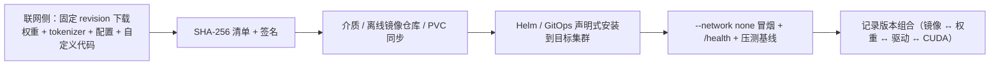

> ⚠️ **证明真的离线的方法**：容器 `--network none` 启动并成功应答。**防火墙/网络策略默认拒绝出向才是隔离保证**，环境变量只是降噪。
>
> 📌 **TensorRT engine 的强绑定**：`model.plan` 与 **GPU 架构 + TensorRT/CUDA 版本**绑定，在 A100 + TRT 10 上编译的引擎拿到 H100 或不同镜像上可能直接加载失败。要么按目标环境重建，要么退回 ONNX Runtime backend 换可移植性（连 [[04-Triton]] §七）。

### 7.2 版本兼容矩阵

```
GPU 型号 → 驱动分支 → 内核版本 → CUDA 运行时 → Container Toolkit
        → device plugin / GFD / DCGM → K8s 版本 → containerd 版本
        → 引擎镜像（编译时链接的 CUDA） → 模型权重所需算力
```

> ⚠️ **CUDA 兼容的方向性**：驱动要**足够新**才能支撑容器里的 CUDA 运行时（每个 CUDA 版本有最低驱动版本）；较新驱动可向后兼容旧 CUDA，反过来不行。这是「同一镜像在 A 集群能跑、B 集群报 `CUDA driver version is insufficient`」的头号原因。这份矩阵必须**整体锁定**，不要让不同集群滚动到互不兼容的组合。

### 7.3 异构算力与多架构

| 维度 | NVIDIA 栈 | 昇腾（Ascend）类比 |
|---|---|---|
| 驱动/固件 | `nvidia.ko` + NVML | CANN + Ascend 固件 |
| 设备注入 | CDI / NVIDIA Container Toolkit | Ascend Docker Runtime |
| 资源上报 | device plugin `nvidia.com/gpu` | Ascend Device Plugin（`huawei.com/Ascend910` 类资源名） |
| 观测 | DCGM / `nvidia-smi` | `npu-smi` / DCMI |
| 引擎 | vLLM / Triton | MindIE / vLLM-Ascend |

> 📌 **抽象层在哪**：CDI、device plugin / DRA、K8s 扩展资源这些**机制是通用的**；差异集中在「驱动 + 设备插件 + 引擎后端」三处，加上**算子适配、量化格式、模型覆盖度**。工程上把「资源名、runtimeClass、节点标签、健康检查命令」抽成配置，而不是在每份清单里写死厂商名（连 [[01-GPU Operator]] §九）。
>
> ⚠️ **多架构（amd64/arm64）**：驱动容器、引擎镜像、DCGM 是否都有对应架构的 manifest，是多架构部署前必须验证的矩阵项（连 [[07-工程实践]] 交叉编译）。不能假设「NVIDIA 上调通的参数照搬到异构后端就能跑」。

### 7.4 链路追踪贯穿

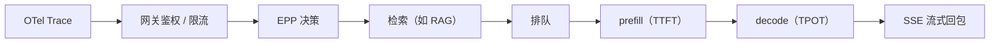

> 📌 有了全链路 span，才能回答「P99 慢在哪一段」：是排队、prefill、decode、检索还是网关；没有它，只能在四层指标之间猜（连 [[02-可观测性]]）。

---

## 八、面试高频问答 🎯

**Q1：TTFT / TPOT / E2E / tokens·s⁻¹ 为什么必须看 P99？**
它们彼此冲突（大 batch 提吞吐但 TTFT 变差），均值会掩盖长尾，而用户感知的正是最慢那批请求。SLO 要按「交互式 vs 批处理」分开定，用压测扫并发画 P50/P95/P99 曲线，并引入 goodput（满足 SLO 的有效吞吐）而不是裸 tokens/s。

**Q2：`GPU_UTIL = 100%` 是不是算力跑满了？CPU 不高是不是就没瓶颈？**
都不是。GPU_UTIL 是「采样周期内至少有一个 kernel 在跑」的时间占比，单个 SM 的小 kernel 也能拉满；CPU 不高时 GPU 可能已排队、KV 已吃紧。判断饱和要看 SM/显存带宽利用率、tokens/s、队列深度、KV 使用率与抢占次数一起看。

**Q3：为什么推理服务不能用 CPU 指标做 HPA？**
推理饱和取决于并发、队列深度、KV cache 使用率与 TTFT/TPOT，和 CPU 相关性弱。HPA 开箱只有 CPU/内存指标，接自定义指标需 metrics adapter；实践上用 KEDA 把引擎指标（`num_requests_waiting`、`gpu_cache_usage_perc`、TTFT）接成扩缩信号，并保证最小副本，避免 scale-from-zero 的分钟级冷启动。

**Q4：压测为什么不能用合成均匀长度的数据？**
真实流量里 prompt/输出长度分布、前缀命中率、多轮会话结构决定了 KV 块占用与 preemption 频率；均匀合成集会算出虚高的容量。要用生产日志回放的长度分布，固定并发扫点、跑到 KV 稳态，升级前后各跑一次做对照。

**Q5：给定模型与卡数，怎么反推并发？先调哪个参数？**
先算权重显存（参数量 × 每参数字节 ÷ TP），剩余显存扣掉激活与 CUDA Graph 后得到 KV 块池；块数 × block_size ÷ 业务平均上下文 = 可并发量。顺序是**先定 KV 池（`max-model-len` 按 P99 上下文而非模型卡最大值）→ 再定并发 → 再调 token 预算 → 压测验证 P99**。并发不够先砍上下文，不要先加卡。

**Q6：`--max-model-len` 照模型卡写 128K 有什么问题？**
它按最坏情况预留 KV，业务只用 8K 时等于白扔一大半并发空间。应按业务 P99 上下文加余量设置，并以 vLLM 启动日志打印的「可用 KV cache blocks」为真实容量。

**Q7：为什么回滚时镜像与权重必须成对？**
引擎镜像（含算子/CUDA/解析逻辑）与权重格式、config、tokenizer 是一个整体，只回一个会出现加载失败或静默的行为变化。这是推理服务与无状态服务在变更管理上的核心差异；灰度还要配「回归质量集 + 延迟基线」双门禁。

**Q8：模型上线为什么要评测门禁，不能只验证「能启动」？**
换权重、量化、换卡型都可能保住服务可用性却悄悄降低输出质量或拖慢 P99。门禁要同时跑质量回归集与 P95/P99 延迟基线，达标才放量。

**Q9：air-gap 离线部署最常漏什么？**
只同步权重分片，漏掉 tokenizer / config / generation_config / `auto_map` 引用的自定义 `.py`；漏掉 embedding 与 rerank 辅助模型；漏掉 torch.compile / CUDA Graph 编译缓存（导致每次重启重编）；以及没有 CUDA sample 冒烟负载，无法验证链路。

**Q10：怎么证明一个服务真的不依赖外网？**
容器 `--network none` 启动并成功应答，同时网络策略默认拒绝出向。`HF_HUB_OFFLINE=1` / `VLLM_NO_USAGE_STATS=1` 这类环境变量只降噪，不是隔离保证。

**Q11：TensorRT engine 为什么不能跨环境直接拷？**
engine 与 GPU 架构 + TensorRT/CUDA 版本强绑定，换卡型或镜像就可能加载失败。要么按目标环境重建并锁定版本组合，要么退回 ONNX Runtime backend 用可移植性换一点性能。

**Q12：CUDA 兼容为什么有方向性？**
驱动要足够新才能支撑容器里的 CUDA 运行时（每个 CUDA 版本有最低驱动版本），较新驱动向后兼容旧 CUDA，反过来不行。这解释了「同一引擎镜像在 A 集群能跑、B 集群报 `CUDA driver version is insufficient`」。

**Q13：异构算力适配的通用抽象在哪？**
CDI、device plugin / DRA、K8s 扩展资源机制通用；差异集中在驱动、设备插件、引擎后端三处，以及算子与量化格式。把资源名、runtimeClass、节点标签、健康检查命令抽成配置，别在清单里写死厂商名。

**Q14：成本优化为什么不能一上来就量化？**
量化省的是显存（可换更大并发），若瓶颈在排队或 prefill 计算，吞吐不会改善，还引入精度回归风险。正确顺序是先测 goodput 基线 → 按四层指标定位瓶颈 → 再选手段（调 batch/chunked prefill/前缀缓存/错峰/MIG/量化）。

---

## 九、关联

- 上游 → [[AI 工程]]、[[AI Infra]]（分层地图 §1 ⑤横切能力域 / §2 请求链路）、[[Kubernetes]]、[[02-可观测性]]
- 指标来源 → [[03-vLLM]]（§七 指标与压测）、[[04-Triton]]（§八 queue / compute_* 分解）、[[01-GPU Operator]]（§七 DCGM）、[[02-KServe]]（§七 控制器状态）
- 路由与限流 → [[05-推理网关与路由]]（§七 过载保护 / §八 可观测）
- 容量原理 → [[LLM 推理基础]]（KV Cache 公式 / 显存估算）、[[01-GPU Operator]]（§五 Kueue / §六 MIG 取舍）、[[05-调度与资源管理]]（HPA / PDB / QoS）
- 变更与追踪 → [[02-KServe]]（§五 灰度与优雅退出）、[[08-集群运维]]（变更与回滚）、[[02-工作负载资源]]（探针与优雅退出）
- 环境与供应链 → [[09-生态与工具]]（镜像仓库）、[[07-工程实践]]（多架构与供应链安全）、[[04-存储]]（权重 PVC）
