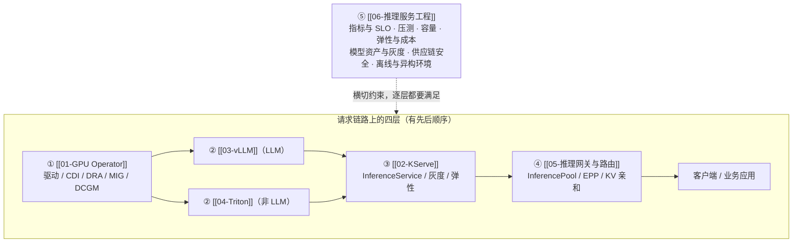
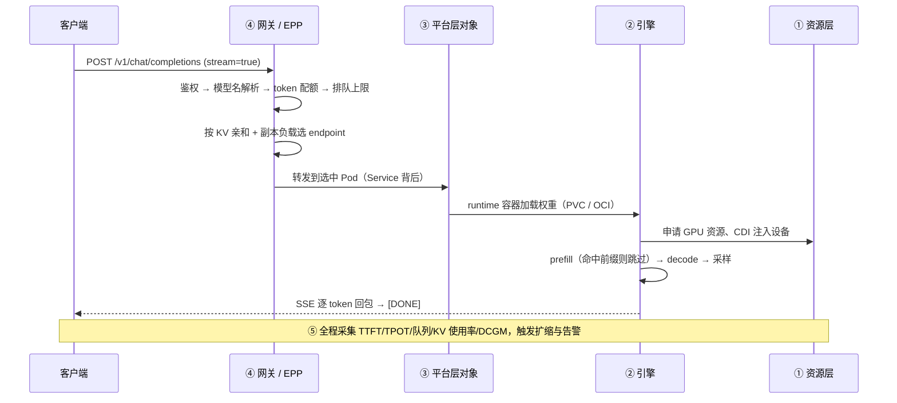

---
tags:
  - ai
  - infra
  - gpu
  - moc
created: 2026-11-14
updated: 2026-11-15
status: 已整理
---

# 🏗️ AI Infra

> **本文件是板块索引**：给出 AI Infra 的分层知识地图、一条贯穿全栈的请求链路，以及六篇大笔记之间的依赖关系。具体机制与面试问答在各篇内，不在本文件展开。

## 一、知识地图：四层链路 + 一个横切能力域

只按「GPU Operator / vLLM / KServe / Triton」四个组件来学，会漏掉两件事：**请求怎么被送到对的副本**（路由层），以及**服务怎么被度量、规划、升级、兜住环境差异**（横切能力域）。后者决定「能不能上生产」。



| 层 | 职责 | 核心知识点 | 落地笔记 |
|---|---|---|---|
| ① 资源层 | 让 K8s 认识并调度 GPU | 驱动容器、ClusterPolicy、CDI、device plugin / DRA、MIG / 时间切片、Kueue、DCGM / XID | [[01-GPU Operator]] |
| ② 引擎层 | 把权重变成高吞吐 API | vLLM V1、PagedAttention、KV cache、continuous batching、量化与并行；Triton backend / dynamic batching / ensemble | [[03-vLLM]] · [[04-Triton]] |
| ③ 平台层 | 把「服务」变成可声明对象 | InferenceService / ServingRuntime、Standard 与 Knative 模式、canary、`LLMInferenceService` | [[02-KServe]] |
| ④ 路由层 | 把请求送到对的模型与副本 | OpenAI 兼容网关、Gateway API Inference Extension / EPP、KV cache 感知路由、PD 分离、限流与过载保护 | [[05-推理网关与路由]] |
| ⑤ 横切能力域 | 不占链路上的一跳，但决定能否上生产 | 指标与 SLO、压测基线、容量与弹性、成本模型、模型资产与灰度、供应链安全、离线与异构环境 | [[06-推理服务工程]] |

> 📌 **为什么要分「层」和「域」**：①~④ 是一条请求真实穿过的路径，越层归因就会误判；⑤ 不产生一次转发，却给每一层定义「什么叫达标」。很多生产问题（P99 突然变差、升级后吞吐掉一半）答案在⑤，而不在任何组件的日志里。
>
> ⚠️ **常见混淆**：认为「上了 KServe 就有灰度与弹性」等于「有了 SLO 保障」——前者是③的编排能力，后者要靠⑤的指标定义、压测基线与评测门禁，二者不能互相替代。

---

## 二、一条请求链路（把五层串成因果）



链路分步：

1. ① 资源层已让节点上报 `nvidia.com/gpu` 或 DRA `ResourceClaim`，Pod 创建时由容器运行时按 CDI spec 注入设备。
2. 模型权重从仓库挂进 Pod（PVC / OCI artifact），引擎镜像来自镜像仓库。
3. ③ 平台层声明 `InferenceService`，控制器 reconcile 出 Deployment + Service + HPA。
4. ④ 网关按 `model` 字段、副本负载与 KV 缓存亲和选副本，而不是简单轮询。
5. ② 引擎的 EngineCore 按统一 token 预算做 continuous batching，KV 命中则跳过重复 prefill。
6. token 流经 SSE 回到客户端；TTFT / TPOT / 吞吐被⑤采集。
7. ⑤ 的队列深度与 KV 使用率触发 KEDA/HPA 扩缩；容量或真故障由此区分。
8. 新模型版本走 canary + 评测门禁，异常按「镜像 + 权重」成对回滚。

> 📌 **排障顺序就是这条链路倒着走**：先确认 ① 有没有卡 → ② 引擎起没起 → ③ CRD 是否 Ready → ④ 路由是否指错版本 → ⑤ 是容量问题还是真故障。**跳过层直接看引擎日志是最常见的误判来源**。

---

## 三、组件分工与选型心智

| 场景 | 选择 | 理由 / 边界 |
|---|---|---|
| LLM 生成主链路 | **[[03-vLLM]]** | 吞吐与显存优化最深；OpenAI 兼容 API 让客户端零改造 |
| embedding / rerank / CV / ASR / 多框架管线 | **[[04-Triton]]** | 多 backend + dynamic batching + ensemble；非生成式模型的主场 |
| 单模型、最少依赖 | **裸 vLLM Deployment** | 不引入控制器 / 证书 / 网关链；平台层收益要模型数上量才回本 |
| 多模型、需要灰度与统一协议 | **[[02-KServe]]** | 优先 **Standard 模式**（旧名 `RawDeployment`，0.20 起改名且成为默认），避免 Knative + Istio 的装配成本 |
| 多副本、需要 KV 感知路由 / 多版本流量 | **④ [[05-推理网关与路由]]** | Gateway API Inference Extension + EPP；普通 Service 轮询不具备模型感知 |
| 超大模型 / 高并发长序列 / 分离 TTFT 与 TPOT | **PD 分离（llm-d / Dynamo）** | 进阶方向，vLLM 标 experimental 且**不提升总吞吐**；见 [[05-推理网关与路由]] §五 |
| 定义 SLO / 算容量 / 管版本 / 离线环境 | **⑤ [[06-推理服务工程]]** | 跨组件统一口径，不属于任何单一层 |

> ⚠️ **最小可用组合 = ①资源层 + ②引擎层 + 权重存储**。③④⑤ 都是「模型数量、团队规模、SLO 要求上来之后」的增量，不是准入门槛。判断标准是**新增能力带来的收益能否覆盖其装配与运维成本**。

---

## 四、横切主题索引（⑤ 的能力清单）

> 这些主题**不属于任何一个组件**，却决定服务能否上生产。全部收敛在 [[06-推理服务工程]]，路由相关部分在 [[05-推理网关与路由]]。下表是「遇到问题该翻哪一节」的导航。

### 4.1 可观测与 SLO → [[06-推理服务工程]] §1

- 四大指标 TTFT / TPOT(ITL) / E2E / tokens·s⁻¹ 的冲突关系；为什么均值会掩盖长尾、必须看 P99
- 四层指标地图：网关 → 平台 → 引擎（`num_requests_waiting`、`gpu_cache_usage_perc`、preemption）→ GPU（DCGM）
- `GPU_UTIL = 100%` 不等于算力跑满；goodput 与「交互式 / 批处理」分开定 SLO
- OTel 全链路 span：鉴权 → EPP 决策 → 排队 → prefill → decode → 回包（网关侧指标见 [[05-推理网关与路由]] §八）

### 4.2 容量、弹性与成本 → [[06-推理服务工程]] §2~§4

- 压测方法论：`vllm bench serve` / `genai-perf` / `perf_analyzer`，固定并发扫点输出 P50/P95/P99，升级前后对照
- 显存预算与 KV Cache 公式：权重 + 激活/图缓存 + KV 块池；由块数反推可并发量（公式见 [[LLM 推理基础]]）
- 参数反推顺序：先 KV 池 → 再并发 → 再 token 预算 → 压测验证
- 整卡 / MIG / 时间切片 / MPS 取舍矩阵（硬件细节见 [[01-GPU Operator]] §六）
- KEDA + 自定义指标；**scale-from-zero 的分钟级冷启动**（权重加载 + torch.compile + CUDA Graph 捕获）
- Kueue 配额、gang scheduling 与公平份额（见 [[01-GPU Operator]] §五）；每百万 token 成本与利用率目标

### 4.3 模型资产与生命周期 → [[06-推理服务工程]] §5~§6

- 权重仓库（PVC / 对象存储 / OCI artifact）、节点级缓存与加载加速、共享只读卷
- 版本命名、canary 流量切分、**评测门禁**（回归质量集 + P95/P99 延迟基线）、镜像与权重**成对回滚**
- 共享基座 + 多 LoRA adapter 热切换，避免「一模型一卡」（引擎侧见 [[03-vLLM]] §五，路由侧见 [[05-推理网关与路由]] §六）
- 供应链安全：SHA-256 清单、固定 revision、`--trust-remote-code` 与 Python backend 的可执行风险、许可证合规

### 4.4 网关与路由 → [[05-推理网关与路由]]

- OpenAI 兼容 API 网关、SSE 禁止缓冲、token 级限流与 429/503 语义（§二）
- Gateway API Inference Extension：`InferencePool` / `InferenceModel` + **EPP**，2026-04 GA（§三）
- 前缀哈希与 KV cache 感知路由、软亲和与负载打分的平衡（§三 / §四）
- KV cache 分层（CPU / NVMe / 分布式池）与 NIXL / LMCache / Mooncake 传输（§四）
- PD 分离、llm-d / NVIDIA Dynamo / LeaderWorkerSet 的层次划分（§五）；过载保护与优先级队列（§七）

### 4.5 离线环境与异构算力 → [[06-推理服务工程]] §7

> 这是**无外网与异构算力环境的技术约束**，属于通用工程知识，与具体用哪个工具分发无关。

- air-gap 依赖清单：组件镜像 / 驱动与预编译模块 / 权重 + tokenizer + config + 自定义代码 / 编译缓存 / 冒烟负载
- 隐藏外网出口：`HF_HUB_OFFLINE=1`、`TRANSFORMERS_OFFLINE=1`、`VLLM_NO_USAGE_STATS=1`；**隔离靠网络策略默认拒绝出向，环境变量只降噪**
- 版本兼容矩阵：驱动 ↔ CUDA ↔ 内核 ↔ containerd ↔ K8s ↔ 引擎镜像 ↔ 模型权重；CUDA 兼容的方向性
- TensorRT engine 与 GPU 架构 / TRT / CUDA 版本强绑定（见 [[04-Triton]] §七）
- 异构算力（昇腾 + CANN 类比）与多架构 amd64/arm64 manifest（见 [[01-GPU Operator]] §九、[[03-vLLM]] §8.3、[[07-工程实践]]）

---

## 五、知识边界（避免与相邻板块重复）

| 主题 | 归属 |
|---|---|
| KV Cache 公式、显存估算、prefill/decode 原理、采样参数、模型许可证 | [[LLM 推理基础]]（原理层，不讲部署） |
| embedding / 向量库 / chunking / 混合检索 / 检索评测 | [[RAG 与知识库]] |
| Agent Loop、Tool Calling、MCP、AIOps 方法论 | [[Pi-agent]]（Agent 应用层） |
| K8s 调度 / PDB / HPA / 存储 / NetworkPolicy 的通用机制 | [[05-调度与资源管理]] · [[04-存储]] · [[03-服务与网络]] · [[02-工作负载资源]]（本板块只讲 AI 特化部分） |
| Watch / Reconcile / Admission 通用机制 | [[07-API 与 Watch 机制]] |
| 观测三支柱与告警通用机制 | [[02-可观测性]] |
| 镜像仓库、Helm / GitOps、集群变更与回滚的通用做法 | [[09-生态与工具]] · [[08-集群运维]] |
| 交叉编译、多架构构建、供应链安全 | [[07-工程实践]] |
| 「为什么」在组件篇 §一/§二，「怎么调」在组件篇 §三/§四，「怎么验收」在 [[06-推理服务工程]] | — |

---

## 六、学习路线（按依赖，不是按编号）

```
0. [[LLM 推理基础]]                  ← 原理前置：不懂显存估算装不对模型
1. [[01-GPU Operator]]（① 资源层）       ← 先让 K8s 认得 GPU
2. [[03-vLLM]]（② 引擎层）              ← 最小可用组合：一个 OpenAI 兼容端点
   ├─ [[06-推理服务工程]] §1 指标与 SLO   ← 跑通后立刻补，否则无法判断好坏
   ├─ [[06-推理服务工程]] §2~§4 压测与容量 ← 才知道该开多少副本
   └─ [[06-推理服务工程]] §7 离线环境     ← 无外网场景的前置约束
3. [[04-Triton]]（辅助模型）/ [[02-KServe]]（多模型平台化）
4. [[05-推理网关与路由]]（④ 路由层）      ← 副本数上量、需要 KV 感知与灰度后
5. PD 分离 / 分布式 KV / 成本优化     ← 规模再上量后的进阶
```

> 📌 **两条主线要并行**：一条是「请求怎么走」（①→②→③→④），一条是「怎么判断走得对」（⑤）。只学前者能跑起来，学完后者才能扛住生产流量与面试追问。

---

## 七、事实与版本口径（2026-11 核对，写笔记时按此校准）

- **vLLM V1 是当前架构**：V1 引擎自 0.8.0 起默认、V0 引擎路径随后移除；不要再按 `LLMEngine / BlockManager` 的 V0 结构写。⚠️ **V0/V1 是引擎架构代号，不是发行版本号**（发行版至今仍是 `0.x`），「v1.0 发布移除 V0」是错误表述。详见 [[03-vLLM]] §一。
- **KServe**：2025 下半年被 CNCF 接受为 incubating（具体月份各资料口径不一，以 CNCF 项目页为准）；`LLMInferenceService` 在 0.17（2026-03）生产可用；**ModelMesh 仓库 2026-04 已归档**；**0.20 起部署模式改名 `Serverless→Knative`、`RawDeployment→Standard`，且 Standard 成为默认**（旧教程全用旧名，详见 [[02-KServe]] §二）。
- **GPU Operator**：v25.10+ 默认走 **CDI** 注入、不再默认使用 nvidia runtime class；DRA 路径（`GPUCluster`）有 K8s / 驱动最低版本要求；**DRA 核心 API 在 K8s 1.34 GA**，但驱动侧动态 MIG、共享容量等多为 alpha 且默认关闭。
- **Gateway API Inference Extension**：2026-04 GA（v1.5.0 一线），`InferencePool` / `InferenceModel` + EPP；实现有 Envoy AI Gateway / Agentgateway / Istio 等。
- **Triton 与 LLM**：LLM 主链路已被 vLLM / SGLang 占据；Triton 定位是**非生成式多框架服务**（embedding/rerank/CV/ASR）与 TensorRT-LLM 路线，不要写成「LLM 推理的主流选项」。2026 年 NVIDIA 把它纳入 **Dynamo-Triton** 品牌、生成式多节点 LLM 主推 Dynamo 编排层，但文档/镜像/二进制仍叫 Triton（详见 [[04-Triton]] §一/§二）；TensorFlow backend 已弃用。
- **PD 分离**：vLLM 官方标 experimental 且明确「不提升总吞吐」，收益在分别控 TTFT/TPOT 尾延迟。

> ⚠️ 以上均为**快速演进领域**，引用时标注「核对日期 + 适用版本」；实际能力以现场 `kubectl explain` / 组件 `--version` / 官方 release notes 实测为准，不拿笔记里的版本号当依据。

---

## 八、关联

- 上游 → [[AI 工程]]、[[Kubernetes]]、[[01-架构与组件]]、[[云原生]]
- 本板块六篇 → [[01-GPU Operator]]、[[03-vLLM]]、[[04-Triton]]、[[02-KServe]]、[[05-推理网关与路由]]、[[06-推理服务工程]]
- 原理与相邻板块 → [[LLM 推理基础]]、[[RAG 与知识库]]、[[Pi-agent]]、[[Go 开发]]
- 通用机制 → [[07-API 与 Watch 机制]]、[[05-调度与资源管理]]、[[03-服务与网络]]、[[02-可观测性]]、[[09-生态与工具]]、[[08-集群运维]]、[[07-工程实践]]
