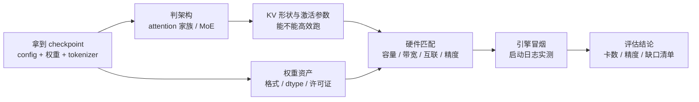
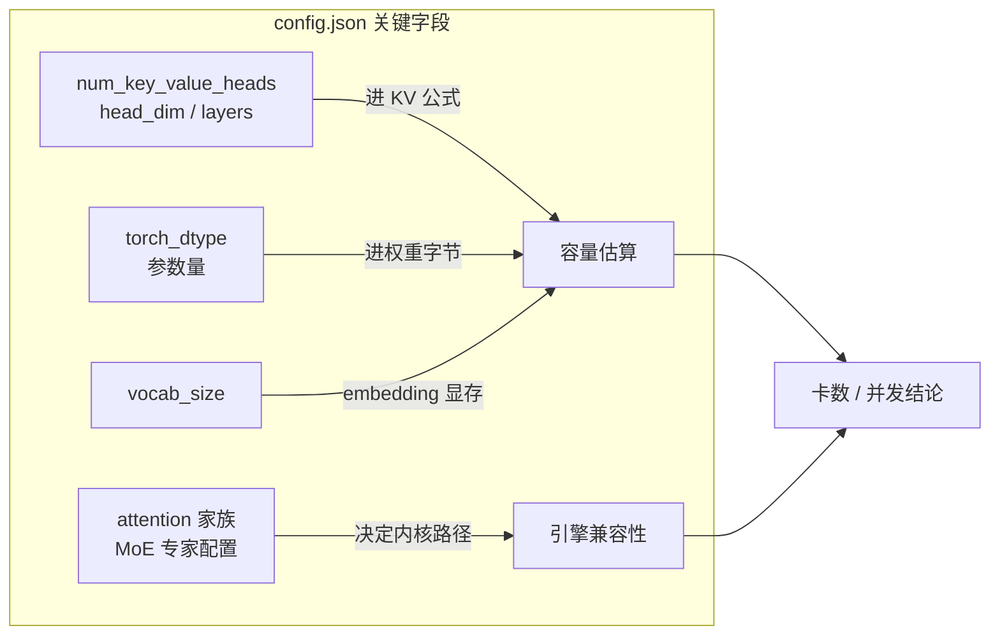
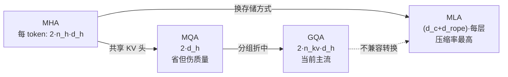
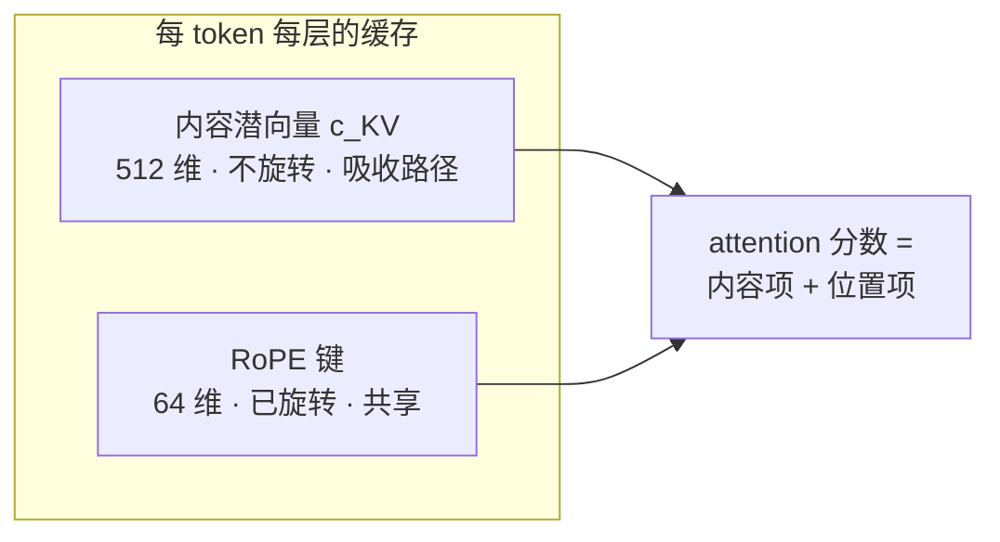
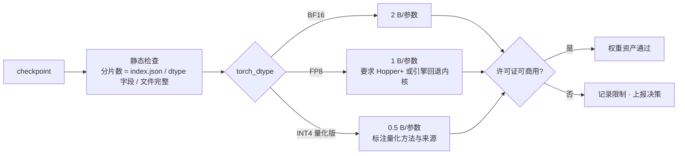
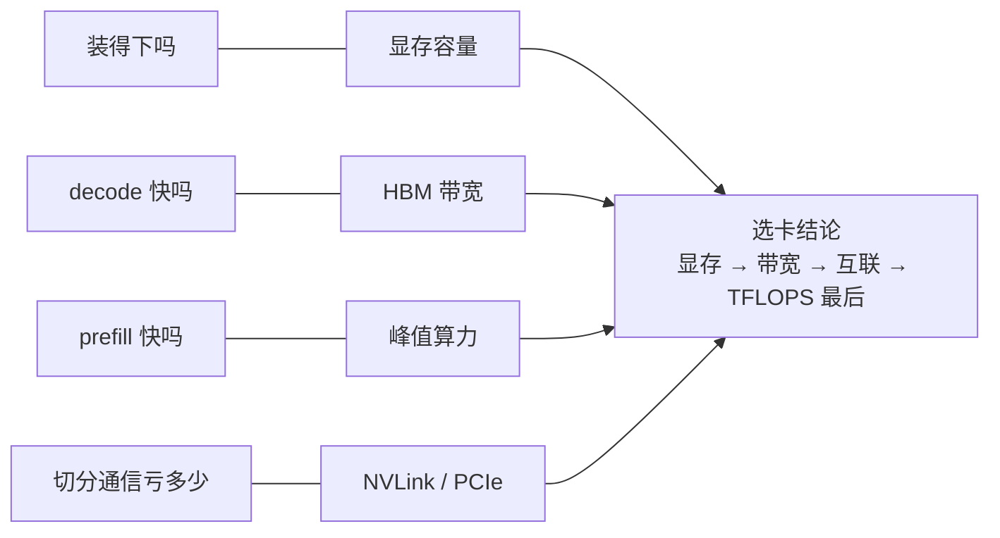
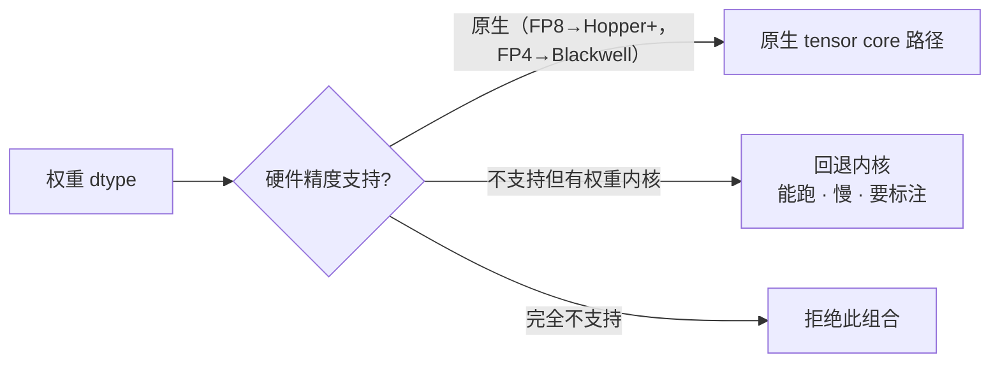

---
tags:
  - ai
  - llm
  - inference
  - onboarding
  - 面试
created: 2026-11-15
updated: 2026-11-15
status: 已整理
---

# 📦 模型接入与硬件评估

> **面向面试 / 面向工程**：拿到一个新发布的模型 checkpoint，能在半天内给出四个数字结论——能不能跑、要几张什么卡、用什么精度、还缺哪些适配——并说清每个结论的依据。
>
> **本篇不写什么**：显存公式推导与并发反推在 [[02-生成过程与显存账本]]；指标口径、Roofline 与诊断在 [[03-性能指标与瓶颈诊断]]；量化精度怎么验证、并行方案怎么选在 [[04-优化选型与工程验证]]。本篇负责评估流程的**前半段**：读模型、读硬件、下结论。

**全文主线**：config 字段决定 attention 家族与 KV 形状 → attention 家族与 MoE 决定「每 token 的字节」和「每 token 的计算量」→ 权重格式与 dtype 决定权重显存 → 权重显存 + KV 字节 + 硬件规格决定卡数与精度 → 最后把这一切收口成一份可复现的评估结论。



> 📌 **评估的输出不是「支持」两个字**，而是一份数字清单：参数怎么读、KV 每 token 多少字节、权重多少 GB、单卡还是多卡、TP 取多少、精度选什么、依赖哪个引擎版本、还缺什么算子。每个判断都要有数字和出处。

---

## 一、这一篇要解决什么问题

模型发布到可用之间隔着一次「接入评估」。岗位 JD 原话通常是「分析模型结构与权重，完成算子、并行策略、量化和框架适配，推动模型从发布到生产上线」。拆成四个必须回答的问题：

| 问题 | 需要查什么 | 常见错误 |
|---|---|---|
| **能不能跑？** | attention 家族、引擎版本支持、kernel 依赖 | 只看参数量，忽略 MLA / MoE 这类结构依赖 |
| **要几张什么卡？** | 权重字节 + KV 字节 + 显存预算（引用 [[02-生成过程与显存账本]]） | 只算权重，或用 TFLOPS 反推卡数 |
| **用什么精度？** | 权重 dtype、硬件精度支持、精度损失可接受度 | FP8 checkpoint 拿到 Ampere 上跑不动 |
| **缺哪些适配？** | 算子覆盖、chat template、tokenizer、格式转换 | 上线后才发现模板错配导致胡言乱语 |

> ⚠️ 接入评估是**一次有固定产出的工程任务**，不是「试一试能不能跑起来」。试跑通过只是最后一项冒烟，前四步的静态分析决定了冒烟该用什么配置。

---

## 二、读模型卡与 config：哪些字段直接进公式

一个 checkpoint 的 `config.json` 是最可靠的事实来源，模型卡宣传可能省略关键项，config 不会。接入第一步是把下面这些字段抄进评估表：

| 字段 | 含义 | 直接决定什么 |
|---|---|---|
| `num_hidden_layers` | 层数 L | KV 公式、权重显存 |
| `hidden_size` | 隐层维度 | 权重形状、TP 切分 |
| `num_attention_heads` | Q 头数 | attention 计算量、TP 上限 |
| **`num_key_value_heads`** | **KV 头数** | **KV 公式的核心变量**；缺省 = Q 头数（MHA） |
| `head_dim` | 每头维度 | KV 字节、权重形状 |
| `intermediate_size` | FFN 宽度 | 权重大头（FFN 通常占 2/3 以上参数） |
| `vocab_size` | 词表大小 | embedding / lm_head 显存 |
| `max_position_embeddings` | 训练时位置上限 | ≠ 实际可生成上限，外推看 `rope_scaling` |
| `torch_dtype` | 权重精度 | 每参数字节数 |
| MoE 专属：`n_routed_experts` / `num_experts_per_tok` / `n_shared_experts` | 专家数 / top-k / 共享专家 | 总参数显存 vs 激活参数速度 |



> 📌 **最容易读错的一个字段**：`num_key_value_heads`。看到 `num_attention_heads: 32` 就套 KV 公式，遇到 GQA 模型（KV 头只有 8）会把 KV 显存**高估 4 倍**；反过来遇到 MHA 模型（该字段缺省）又容易漏配。字段缺省时默认等于 Q 头数，这是 config 的约定，不是笔误。

> ⚠️ `max_position_embeddings` 只是**训练时见过的位置数**。能否生成更长序列取决于 `rope_scaling` 配置与评测验证，评估时把「上下文上限」当成一个**要验收的结论**，而不是 config 里抄来的数字。

---

## 三、Attention 家族与资源影响

### 3.1 一条主线：所有变体都在压缩「KV 字节数」

MHA → MQA → GQA → MLA 的演进，统一视角是**每 token 每层要缓存的字节数在下降**：

| 家族 | 每 token 每层缓存 | 代表 | 权衡 |
|---|---|---|---|
| MHA | `2 × n_heads × head_dim` | Llama-2-7B、GPT-2 | 质量基线，KV 最贵 |
| MQA | `2 × head_dim`（全头共享 1 组） | 早期 PaLM、Falcon | KV 最省，质量损失明显 |
| GQA | `2 × n_kv_heads × head_dim`（n_kv_heads < n_heads） | Llama-3 全系、Qwen2/3 | 折中，已成为 8B~70B 级默认 |
| MLA | `(d_c + d_rope)`（压缩潜向量 + 解耦 RoPE 键） | DeepSeek-V2/V3/R1 | 压缩率最高且质量对齐 MHA，但内核与接入复杂 |



> 📌 GQA 到 MLA **不是等价变换**：GQA 可以由 MHA 均值池化近似得到，MLA 是低秩压缩结构，MHA/GQA checkpoint **无法转换成 MLA**——见到 MLA 模型只能原样部署。这就是为什么 MLA 属于「架构兼容性」问题而不只是「省显存技巧」。

### 3.2 MLA 为什么必须解耦 RoPE

MLA 把每层的 K/V 投影成一个共享的低秩潜向量缓存（DeepSeek-V3：`d_c = 512`），推理时用**矩阵吸收**把上投影权重折进 Q 侧与 O 侧，直接在潜空间算 attention——K/V 全程不物化。问题在 RoPE：它是**依赖绝对位置差的旋转**，插在上投影矩阵之间会破坏吸收（矩阵乘法不对易，`W_Qᵀ · R · W_UK` 无法预合并）。DeepSeek 的解法：

- **内容通道**：潜向量 512 维，不旋转、被缓存——吸收路径照常工作；
- **位置通道**：额外一个 64 维的小 RoPE 键，单独旋转、单独缓存、跨头共享。

每 token 每层缓存 **576 个元素**，61 层 × BF16 ≈ **70 KiB/token**，对比 Llama-3.1-405B 的 504 KiB/token 差出 7 倍以上。



> 📌 **接入 MLA 模型前的三问**：① 引擎版本支持吗（vLLM 自 v0.7.1 起支持 MLA，以 changelog 为准）；② 内核走的是**吸收路径**吗——朴素实现每步都从潜向量重物化 K/V，省的显存全变成浪费的带宽；③ 有没有 FlashMLA 级别的高效内核。三问任一不过，评估结论就是「暂缓接入」，而不是「跑起来了就行」。

### 3.3 MoE：另一条独立的轴

Attention 家族压的是 **KV 字节**，MoE 稀疏化压的是**每 token 计算量**——两条轴正交，一个模型可以只有其一（Llama-3 是 GQA 稠密），也可以两者都有（DeepSeek-V3）。

**MoE 对接入的核心影响一句话**：**显存按总参数算，速度按激活参数算**。

| 模型 | 总参 / 激活 | 专家数 | top-k | 共享专家 | 接入要点 |
|---|---|---|---|---|---|
| Mixtral 8x7B | 47B / 13B | 8 | 2 | 0 | 专家少，TP 即可覆盖 |
| gpt-oss-120b | 117B / 5.1B | 128 | 4 | 0 | MXFP4 量化后**单张 80G 卡可放** |
| Qwen3-235B-A22B | 235B / 22B | 128 | 8 | 0 | 多卡起步，专家分布决定 EP/TP 配比 |
| DeepSeek-V3 | 671B / 37B | 256 | 8 | 1 | FP8 发布；单 token 部署最多跨 4 节点 |
| Kimi K2 | 1.04T / 32B | 384 | 8 | 1 | 必须专家并行 + 大规模互联 |
| GLM-4.5 | 355B / 32B | 160 | 8 | 1 | 同上量级 |

> 📌 **激活比例是接入评估的关键读数**：gpt-oss-120b 激活不到总参 5%（快），但 117B 总参决定显存下限；DeepSeek-V3 激活 5.5%，但 671B 总参把它推向多节点。**「这模型 37B 所以两张卡」是典型错误**——37B 只是速度，671B 才是显存。

> ⚠️ MoE 还有部署侧连锁问题：专家负载不均（热点专家所在卡先饱和）、路由器要求 all-to-all 通信、ep_size 与 tp_size 的配比——这些属于**并行方案选型**，落地细节在 [[04-优化选型与工程验证]]；接入评估阶段只需把「总参 / 激活 / 专家数 / top-k」四个数抄进结论。

---

## 四、权重资产与精度

### 4.1 格式：引擎吃哪种「包装」

| 格式 | 是什么 | 接入视角 |
|---|---|---|
| **safetensors** | 分片张量 + JSON 索引，mmap 加载，无 pickle 风险 | **事实标准**；检查分片数与 `model.safetensors.index.json` 一致 |
| PyTorch `.bin` | `torch.save` 序列化，pickle 机制 | 能转尽转；加载即执行任意代码，不可信来源要隔离处理 |
| **GGUF** | llama.cpp 单文件格式，常带量化变体 | 量化版质量差异大，评估时要标注量化方法与来源 |
| AWQ / GPTQ 检查点 | 校准后的 INT4/INT8 权重 | 引擎支持因量化方案而异；**精度验收**在 [[04-优化选型与工程验证]] |
| FP8 checkpoint | DeepSeek-V3 等原生 FP8 发布 | 有硬件前提（见 §六），不是任意卡都能加载 |

### 4.2 dtype 与权重显存速算

**权重显存 ≈ 参数量 × 每参数字节**，这是接入评估里唯一需要背的乘法：

| dtype | 每参数字节 | 70B 权重 | 671B（DeepSeek-V3） |
|---|---|---|---|
| FP32 | 4 B | 280 GB | —（不会用 FP32 部署） |
| BF16 / FP16 | 2 B | 140 GB | ≈ 1.34 TB |
| FP8 / INT8 | 1 B | 70 GB | ≈ 670 GB |
| INT4 / FP4 | 0.5 B | ≈ 38 GB | ≈ 340 GB |

> ⚠️ 0.5 B/参数是 INT4 的**理论下界**，实际量化产物还带 scale / zero-point 元数据（有效位约 4.5 bit 上下），70B 实测常见约 38 GB 而非 35 GB；拿理论值做容量规划会偏乐观。



### 4.3 许可证是接入评估的硬门槛

| 许可证 | 代表模型 | 商用要点 |
|---|---|---|
| Apache-2.0 | Qwen3 主线、Mistral、gpt-oss | 基本无附加条件 |
| MIT | DeepSeek 全系、GLM-4 | 宽松 |
| Llama Community License | Llama 全系 | 附加可接受使用政策与 **7 亿月活需另行授权**条款 |
| 自定义 / 研究用途 | 部分新模型 | **逐条读**，以模型卡为准 |

> ⚠️ 许可证没有技术工作量，但它是**一票否决项**：评估结论里必须显式写出许可证类型与商用判断，不能默认「开源 = 随便用」。

---

## 五、Tokenizer 与 chat template：只讲工程影响

这一节刻意不展开 BPE 算法与位置编码数学——它们不改变接入结论。但对服务有直接影响的四件事必须查：

**① token 数与上下文换算**。`max-model-len`、KV 公式、计费口径全都以 **token** 为单位，而业务方只理解「字」。常见量级：中文 1 token ≈ 1~2 个汉字、英文 1 token ≈ 0.75 个词——**因 tokenizer 而异，差 30% 很正常**。正确做法：用模型自带 tokenizer 对代表性业务语料实测平均 token/字比，把这个比值写进评估结论，供后续容量换算使用（公式见 [[02-生成过程与显存账本]] §七）。

**② chat template 错配是最隐蔽的质量事故**。template 里的控制符（如 `<|im_start|>`、`<|begin_of_thought|>`）是训练时见过的特殊 token；错配后模型可能出现复读、角色错乱、无限续写。评估动作：

```text
检查清单（tokenizer / template）：
□ 用模型自带 tokenizer 实测业务语料的 token/字比
□ 确认推理框架的 template 与官方一致（diff 一下 jinja 模板）
□ special token 不出现在用户输入侧（输入消毒）
□ 采样参数走引擎默认值先冒烟，再调优
```

**③ 影响服务行为的输出参数**。这些参数决定压测口径，必须在评估时定初值：

| 参数 | 影响什么 | 接入时的注意点 |
|---|---|---|
| `temperature` / `top_p` / `top_k` | 采样分布 | 默认值随模型发布（有的推荐 0.6/0.95），先照官方 |
| `stop` / `max_tokens` | 输出长度分布 | **直接决定压测的 TPOT 口径**（见 [[03-性能指标与瓶颈诊断]] §二） |
| `seed` | 可复现性 | 压测与回归测试固定 seed，线上关闭 |
| logprobs / 约束解码（JSON Schema） | 结构化输出 | 约束解码有额外开销，用到才开 |

> 📌 **评估新模型必须带着它的 tokenizer 与 template 原样测**。用自家旧的 prompt 模板去测新模型，得出「质量不行」的结论，八成是模板错配而不是模型问题。

---

## 六、GPU 规格与精度-硬件-引擎兼容矩阵

### 6.1 规格表：四个维度各自约束什么

主流数据中心卡（SXM/OAM 形态，厂家 datasheet 口径）：

| 卡 | 显存 | HBM 带宽 | FP8（dense） | FP4 | NVLink | TDP |
|---|---|---|---|---|---|---|
| A100 80G | 80 GB HBM2e | ≈ 2 TB/s | — | — | 600 GB/s | 400 W |
| H100 SXM | 80 GB HBM3 | 3.35 TB/s | ≈ 2 PFLOPS | — | 900 GB/s | 700 W |
| H200 SXM | **141 GB HBM3e** | 4.8 TB/s | ≈ 2 PFLOPS（同 H100） | — | 900 GB/s | 700 W |
| B200 | **192 GB HBM3e** | 8 TB/s | ≈ 4.5 PFLOPS | ≈ 9 PFLOPS（原生） | 1.8 TB/s | 1000 W |
| MI300X（AMD） | 192 GB HBM3 | 5.3 TB/s | 支持 | — | Infinity Fabric | 750 W |
| MI325X（AMD） | 256 GB HBM3e | 6 TB/s | 支持 | — | Infinity Fabric | 1000 W |

| 维度 | 约束什么 | 一句话 |
|---|---|---|
| **显存容量** | 能不能装下：权重 + KV 池 + 激活 | 第一约束，装不下一切免谈 |
| **HBM 带宽** | decode 速度（判据一：decode 带宽受限） | 决定单请求上界与批处理吞吐 |
| **峰值算力** | prefill 速度 | 只在计算受限段起作用 |
| **互联带宽** | TP / EP 的通信开销 | PCIe ≈ 64 GB/s（Gen5 x16）远低于 NVLink，跨卡切分前先看互联 |



> 📌 **选卡优先级：显存 → 带宽 → 互联 → TFLOPS 最后**。H200 与 H100 算力完全相同，只是显存 80→141 GB——对 70B+ 推理这就是「同功耗下免升级机柜的换卡理由」。TFLOPS 排最后，因为 decode 段根本吃不满它。

> ⚠️ **为什么 TFLOPS 换算不出 tokens/s**：decode 每 token 只做一次小矩阵乘，算术强度极低，是带宽受限；上界 ≈ HBM 带宽 ÷ 权重字节。例：8B BF16（16 GB 权重）在 H100 上的单请求 decode 上界 ≈ 3.35 TB/s ÷ 16 GB ≈ **209 token/s**，实际还要扣 KV 读取与开销。拿 2 PFLOPS 去除以「每 token FLOPs」会算出一个高一个数量级的假数字。

### 6.2 精度-硬件绑定：FP8 不是想跑就能跑

| 精度 | 硬件前提 | 说明 |
|---|---|---|
| INT8 / INT4 权重 | Ampere 起普遍可用 | 多为 weight-only，内核软件实现空间大 |
| **FP8** | **Ada（L40S）及 Hopper 起原生** | FP8 checkpoint 加载到 Ampere 只能靠软件回退内核（如 marlin 类），速度显著变差——评估时要写明「需要 Hopper+」 |
| **FP4 / MXFP4** | **Blackwell（B200/GB200）原生** | gpt-oss-120b 用 MXFP4 塞进单张 80G 卡是 Blackwell 时代的典型案例；老卡上只能用预量化的 INT4 等价物 |



**国产与异构算力的定位**：接入评估多一个「算子库覆盖」前置项——CUDA 生态的 kernel 不直接可用，需确认目标平台的算子支持与引擎移植版（昇腾、寒武纪等生态适配的部署面见 [[01-GPU Operator]] 的异构设备小节）。结论写法相同：支持哪些精度、哪些算子缺位、预期性能折损。

---

## 七、落地结论：一次上架评估的输出

评估按固定顺序走查，每一步产出可复查的数字：


**评估结论单模板**（每一行都要有数字）：

| 项 | 示例写法（以 DeepSeek-V3 为例） |
|---|---|
| 架构 | MLA（d_c=512 + RoPE 64）+ MoE（256 专家 top-8）；引擎需 vLLM ≥ 支持 MLA 的版本 |
| 权重 | FP8 checkpoint，约 670 GB；许可证 MIT |
| KV 成本 | ≈ 70 KiB/token（BF16 缓存口径） |
| 硬件 | FP8 → 需 Hopper+；8×H200（141 GB）可容纳权重 + KV 池 |
| 通信 | 每 token 部署最多跨 4 节点（技术报告口径），互联按 NVLink 域规划 |
| 缺口 | 无官方 INT4 版；若需 INT4 属量化选型任务 → [[04-优化选型与工程验证]] |
| 冒烟 | 启动日志读取项 → [[02-生成过程与显存账本]] §八 |

> 📌 **结论单里每一条都能追溯**：数字来自 config、datasheet、技术报告或实测日志，写明出处。这份单子是后续所有工作的基线——卡数变了、精度变了，改的就是这张表。

---

## 八、本篇边界与常见误判收口

**边界**：
- 显存公式推导、TP 头切分、并发反推、启动日志逐行解读 → [[02-生成过程与显存账本]]
- 指标口径、Roofline 全推导、profiling 工具 → [[03-性能指标与瓶颈诊断]]
- 量化方案怎么选、精度怎么验收、EP/TP 怎么配 → [[04-优化选型与工程验证]]
- 引擎调度器与参数体系 → [[03-vLLM]] · [[04-Triton]]
- 服务化、灰度、多模型路由 → [[02-KServe]] · [[05-推理网关与路由]]

**高频误判收口**：

| 误判 | 正确认知 |
|---|---|
| 拿 `num_attention_heads` 套 KV 公式 | 用 `num_key_value_heads`（GQA 下小得多） |
| 拿激活参数估显存 | MoE 显存按**总参数**算，激活参数只决定速度 |
| MLA 套 GQA 的 KV 公式 | MLA 缓存 `(d_c + d_rope)` 潜向量，形状完全不同 |
| FP8 checkpoint 任意卡可跑 | FP8 原生需 Ada/Hopper+，老卡只能回退内核且显著变慢 |
| TFLOPS ÷ 每 token FLOPs = tokens/s | decode 带宽受限，上界 = 带宽 ÷ 权重字节 |
| 用 max_position_embeddings 当服务上限 | 训练位置数 ≠ 可生成上限，外推要实测验收 |
| 「开源」默认可商用 | 许可证逐个看，Llama 类有附加条款 |

---

## 九、面试高频问答 🎯

**Q1：接到一个新模型，你的评估流程是什么？**
固定六步：① config 判架构（attention 家族 / MoE / 上下文配置）→ ② 权重资产（格式、dtype、分片完整性、许可证）→ ③ 容量计算（权重字节 + 每 token KV 字节 → 卡数）→ ④ 引擎冒烟（启动日志实测）→ ⑤ 质量验收（官方 template + 基准集）→ ⑥ 性能压测。每步产出数字与出处，最后汇成结论单。

**Q2：GQA、MQA、MLA 三者本质区别？**
统一视角是压缩 KV 缓存：MQA 全头共享 1 组 KV（省但伤质量）；GQA 分组共享（折中，当前主流）；MLA 换了存储方式——把 K/V 低秩压缩成一个潜向量缓存，推理时用矩阵吸收直接在潜空间算 attention，压缩率最高且质量对齐 MHA。GQA→MLA 不可转换，必须模型原生支持。

**Q3：MLA 为什么需要解耦 RoPE？**
MLA 的加速核心是吸收：上投影权重折进 Q/O 侧、K/V 不物化。RoPE 是位置相关的旋转，插在投影之间矩阵乘法不对易、吸收失效。解法是把键拆成不旋转的内容通道（进潜向量缓存）和 64 维已旋转的位置通道（单独缓存），attention 分数为两项之和。

**Q4：MLA 模型接入要额外查什么？**
三件事：引擎版本支持（vLLM ≥ 0.7.1，以 changelog 为准）；内核是否走吸收路径（朴素实现每步重物化 K/V，显存省了带宽白费）；有无 FlashMLA 级高效内核。任一不满足就写「暂缓接入」。

**Q5：MoE 模型「37B 激活」为什么不能用来算显存？**
显存按**总参数**算（专家权重全部驻留显存），激活参数只决定每 token 计算量与速度。DeepSeek-V3 激活 37B 但总参 671B——显存下限约 670 GB（FP8），是它的总参而不是激活参数决定的。

**Q6：MoE 模型部署还有哪些连锁问题？**
专家负载不均（热点专家卡先饱和）、路由 all-to-all 通信、EP 与 TP 配比、专家放置策略。接入评估阶段只需记录总参 / 激活 / 专家数 / top-k 四个数；方案选型见 [[04-优化选型与工程验证]]。

**Q7：FP8 checkpoint 部署到 A100 会怎样？**
A100（Ampere）无原生 FP8 tensor core，只能走软件回退内核，能跑但速度显著劣化。评估结论要写「FP8 原生路径需 Ada/Hopper+」；要么换卡，要么用引擎的回退内核并标注性能折损。

**Q8：70B 模型在不同精度下权重多大？**
BF16 140 GB、FP8/INT8 70 GB、INT4 约 38 GB（参数量 × 每参数字节）。再叠加 KV 池与激活开销才算总需求——只算权重就下「单卡能放」的结论是常见错误（KV 与预算见 [[02-生成过程与显存账本]]）。

**Q9：为什么 H200 对 70B+ 推理是「无痛升级」？**
H200 与 H100 同 die、同算力（FP8 ≈ 2 PFLOPS）、同 700W 功耗，只把显存从 80 GB HBM3 升到 141 GB HBM3e、带宽 3.35→4.8 TB/s。对容量受限的 70B+ 场景，这等于同机柜同功耗下多出 76% 显存——不需要改造供电散热。

**Q10：TFLOPS 能换算成 tokens/s 吗？为什么？**
不能。decode 是带宽受限（判据一），上界 ≈ HBM 带宽 ÷ 权重字节：8B BF16 在 H100 上 ≈ 3.35 TB/s ÷ 16 GB ≈ 209 token/s；而用 2 PFLOPS 算出的数字会高一个数量级。TFLOPS 只在 prefill 这类计算受限段有意义。

**Q11：选卡时四个硬件维度的优先级？**
显存（装得下）→ HBM 带宽（decode 快）→ 互联（TP/EP 通信代价）→ TFLOPS 最后。PCIe（Gen5 x16 ≈ 64 GB/s）与 NVLink（900 GB/s~1.8 TB/s）差一个数量级以上，跨卡切分前必须先看互联。

**Q12：chat template 错配会出现什么现象？怎么查？**
复读、角色错乱、无限续写、输出混入控制符。查法：diff 推理框架的 jinja 模板与官方发布；确认 special token 不出现在用户输入侧；用官方模板冒烟后再谈调优。这是接入评估里最隐蔽的质量事故。

**Q13：`max_position_embeddings` 是这个模型能生成的最大长度吗？**
不完全是。它是训练时见过的位置数；能否生成更长取决于 rope_scaling 配置与实测。服务上限应以压测验收为准，且生产上通常按业务 P99 压 `max-model-len`（见 [[02-生成过程与显存账本]] §七）。

**Q14：评估结论单里必须有哪些行？**
架构兼容（含引擎版本下限）、权重资产（格式/dtype/许可证）、KV 每 token 字节、硬件结论（卡数/精度/互联）、性能缺口（缺的算子或格式）、冒烟与验收记录。核心原则：**每一行都有数字与出处**，可复查、可增量更新。

---

## 十、关联

- 索引 → [[LLM 推理基础]]（岗位调研结论 §1、知识地图 §3、事实口径 §7）
- 同板块 → [[02-生成过程与显存账本]]（容量公式与本篇结论衔接）、[[03-性能指标与瓶颈诊断]]（判据二与压测口径）、[[04-优化选型与工程验证]]（量化与并行的选型验证）
- 引擎落地 → [[03-vLLM]]（MLA 支持、启动参数）、[[04-Triton]]（非 LLM 路线的模型接入）
- 资源与交付 → [[01-GPU Operator]]（设备拓扑、MIG、异构算力）、[[06-推理服务工程]]（模型资产与版本管理）、[[05-推理网关与路由]]（模型路由）
- 上游 → [[AI Infra]]（分层地图 §2 / §4）、[[AI 工程]]
