---
tags:
  - ai
  - llm
  - inference
  - capacity
  - 面试
created: 2026-11-15
updated: 2026-11-15
status: 已整理
---

# 📐 生成过程与显存账本

> **面向面试**：给定模型、卡数与业务上下文长度，能算出要几张卡、能撑多少并发、`max-model-len` 该压到多少，并说清公式为什么只是上界。
>
> **本篇不写引擎实现**：PagedAttention 的块管理器、调度器、V1 架构在 [[03-vLLM]]；压测方法、SLO 与成本模型在 [[06-推理服务工程]]；指标口径与 profiling 工具在 [[03-性能指标与瓶颈诊断]]。本篇只负责把「模型 + 硬件 + 并发」变成**能算的数**。

**全文主线**：一条 token 的生成方式决定了必须缓存 K/V → 缓存的张量形状决定了每 token 的字节数 → 字节数乘以序列长度与并发决定了显存 → 显存预算反推并发与上下文上限 → 而真实容量由引擎启动时的实测决定。**每一步都是下一步的输入，中间任何一环用错符号，结论会差几倍。**

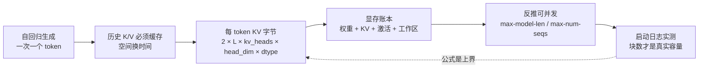

> 📌 **先记住三个数**：Llama-3-70B（BF16）**320 KiB/token**、8B GQA 模型 **128 KiB/token**、Llama-2-7B（MHA/FP16）**512 KiB/token**。面试里绝大多数容量题，都是在这三个数上乘上下文长度与并发。

---

## 一、这一篇要解决哪四个工程问题

上线或调优一个推理服务时，绕不开四个必须给出数字的问题：

| 问题 | 需要的计算 | 常见错误 |
|---|---|---|
| 这个模型要几张卡？ | 权重显存 ÷ 单卡可用显存，再决定 TP | 只算权重，忘了激活与 KV 池 |
| 能撑多少并发？ | KV 池容量 ÷ 每请求平均上下文 | 用 `max-model-len` 当平均长度，把并发算小几倍 |
| `max-model-len` 设多少？ | 业务 P99 上下文 + 余量 | 照抄模型卡的 128K，让单个长请求吃光 KV 池 |
| 并发一上去延迟就崩，是哪里的问题？ | 判断瓶颈在 KV 容量、带宽还是调度 | 一律归因为「算力不够」，盲目加卡 |

> ⚠️ 这四个问题的答案**不是查表查出来的**，而是同一个显存账本的不同切面。本篇把它拆成：生成机制（§二、§三）→ 公式（§四、§五）→ 账本（§六）→ 反推（§七）→ 实测（§八、§九）。

---

## 二、自回归生成与两阶段：瓶颈倒置（判据一）

### 2.1 一次请求的计算生命周期

LLM 的输出是逐 token 生成的：每一步把新 token 追加到序列末尾，再跑一次前向得到下一个 token，直到 EOS 或长度上限。数学上是 `p(x) = ∏ p(x_t | x_<t)`。这个串行依赖带来两个计算特征**完全不同**的阶段。

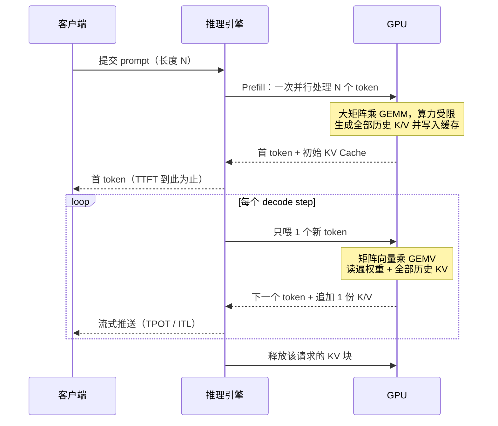

| | **Prefill（预填充）** | **Decode（逐 token 解码）** |
|---|---|---|
| 输入形状 | 整个 prompt，N 个 token 并行 | 每序列 1 个 token |
| kernel 形态 | 大 GEMM（矩阵×矩阵） | GEMV（矩阵×向量） |
| 算术强度 | 高，Tensor Core 接近饱和 | 极低，每读 1 字节权重只算很少 FLOPs |
| 典型瓶颈 | **算力受限**（compute-bound） | **显存带宽受限**（memory-bound） |
| 产出的 KV | 一次写出 N 份 K/V | 每步追加 1 份 K/V |
| 主要用户指标 | **TTFT**（首 token 延迟） | **TPOT / ITL**（吐字速度） |
| 成本来源 | 与 prompt 长度成正比 | 与输出长度成正比 |

> 📌 **判据一（瓶颈倒置）**：同样的权重、同样的卡、同样的模型，两个阶段卡在不同的物理资源上。因此所有优化本质上只做两件事之一：**降低 Prefill 的计算量**，或**减少 Decode 的访存量**。这也是输入与输出定价不同、以及 prefill/decode 可以分离部署（PD 分离）的根本原因。

### 2.2 为什么 decode 是带宽受限

decode 每一步要把模型权重从 HBM 读进片上缓存，只为了算一个 token；权重是固定成本，与 batch 无关。设模型参数量 P、每参数 b 字节、batch = B，则一次的浮点运算约 `2·B·P` FLOPs，权重读取约 `2·P` 字节，于是：

```
算术强度 ≈ 2·B·P / 2·P = B   (FLOPs/byte，忽略 KV cache 与中间读写)
```

`B=1` 时只有 1~2 FLOPs/byte，而现代 GPU 的拐点（峰值算力 ÷ 显存带宽）在**百量级** FLOPs/byte——差了两个数量级，Tensor Core 大量空转。

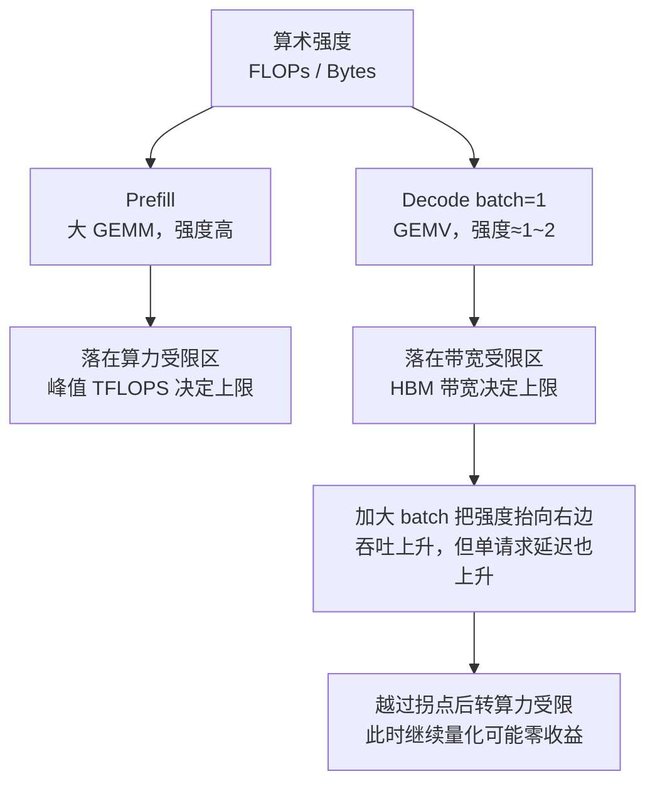

> ⚠️ 「decode 永远带宽受限」是错的。batch 增大把权重读取摊薄，算术强度上升，越过拐点后会转为算力受限。**判断某个优化是否有效，先看当前落在 Roofline 的哪一侧**（判据二详见 [[03-性能指标与瓶颈诊断]]）。另一个常被忽略的点：上面的近似**没算 KV cache 的读取**，长上下文下 KV 访存可能成为主要成本。

---

## 三、KV Cache 的推导：为什么可以缓存、代价是什么

### 3.1 从 attention 公式推出来

第 t 步的注意力需要 `softmax(q_t · K_{1..t-1}^T / √d) · V_{1..t-1}`。关键在于两个事实：

1. **因果掩码**：位置 i 的表示只能看到 `1..i`，因此已经算出的第 i 个 token 的 K、V 只由它自己和它之前的输入决定，**后续追加任何 token 都不会改变它**。
2. **位置编码只依赖自身位置**：RoPE 作用在 q、k 上时按该 token 的绝对位置旋转；历史 token 的位置不会因新 token 加入而改变，所以它的 K 不需要重算。（这正是 MLA 必须把 RoPE 分出一个独立小维度「解耦」的原因——压缩潜向量与位置旋转不能混在一起，详见 [[01-模型接入与硬件评估]]。）

于是可以把每一层已经算出的 K、V 常驻显存，新 token 到来时只算自己的 K、V 并追加。

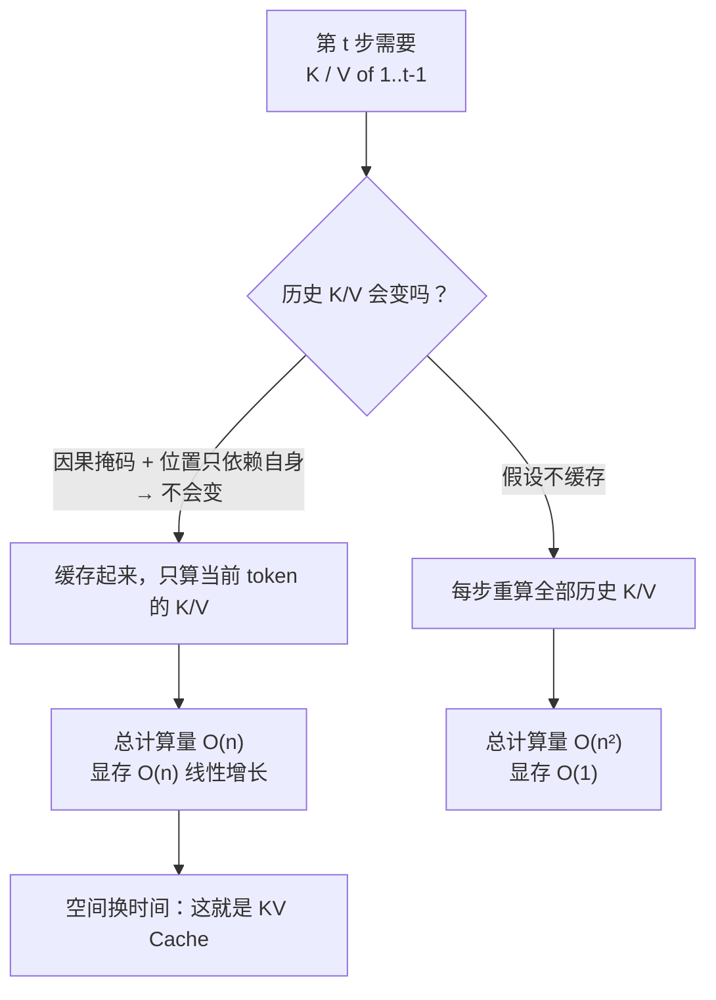

> 📌 **KV Cache 不改变数学结果**：它只是把重复计算的结果存下来，输出分布与不用缓存时一致（浮点累加顺序可能带来极小数值差异，但不是算法近似）。**它是无损优化**，和量化、剪枝、蒸馏这类有损压缩完全不同。

### 3.2 代价：显存随「token 数 × 层数」线性膨胀

缓存省掉了平方级重算，但同时成为推理服务里**最主要的动态显存占用**。它随三个量线性增长：**序列长度、并发序列数、层数**；此外还随 KV 头数与头维度线性增长。长上下文、高并发、深模型三者叠加时，KV cache 常常比权重还大。

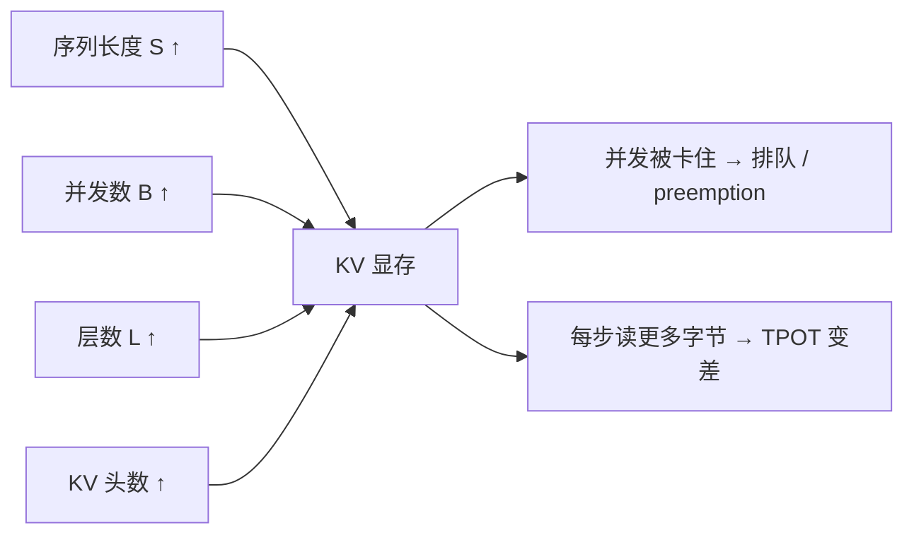

### 3.3 适用范围边界

KV Cache 成立的前提是「**自回归 + 历史不被改写**」。以下场景不要套用：

- **双向编码器**（BERT 类）：没有因果掩码，每个位置的表示依赖全部输入，缓存无意义。
- **输入被反复改写的编辑类任务**：前缀变了，后续所有 token 的 K/V 都要重算。
- **前缀不完全一致时的复用**：前缀缓存（prefix caching）要求 token 序列完全一致；system prompt 里塞时间戳、随机 ID、用户 ID，会让命中率归零（见 [[04-优化选型与工程验证]]）。
- **MLA / 线性注意力 / SSM 混合架构**：缓存的不是标准 K/V 张量，公式要换（§4.4）。

---

## 四、KV 显存公式：把每个符号讲透

### 4.1 标准公式

```
每 token KV 字节 = 2 (K+V) × L (layers) × H_kv (kv_heads) × D (head_dim) × bytes
单请求 KV       = 每 token KV 字节 × S (上下文长度)
总 KV           = 每 token KV 字节 × S × B (并发序列数)
```

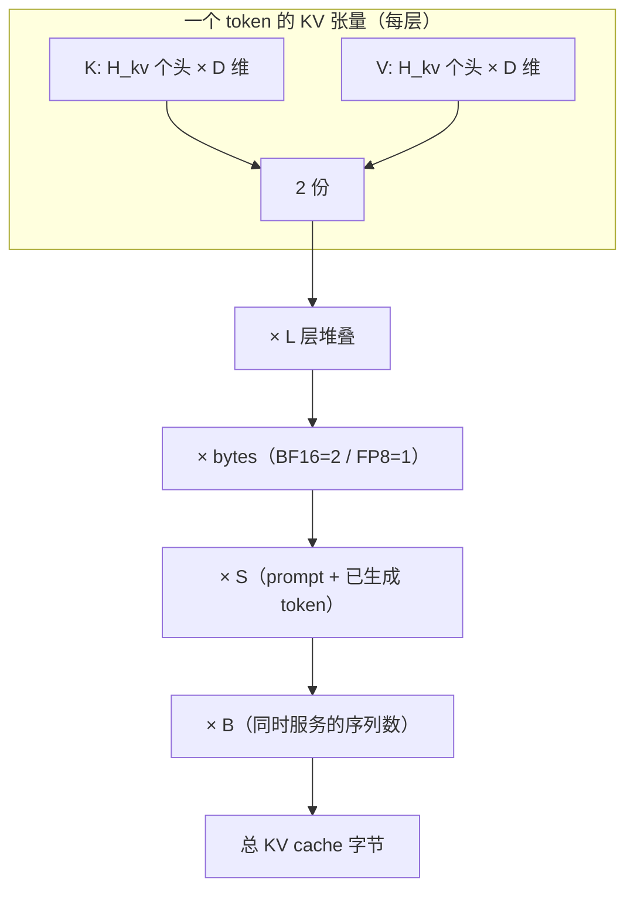

> ⚠️ 三个最高频的符号错误：
> 1. **`2` 是 K 和 V 两份张量**，不是「2 字节」也不是层数；精度字节要单独乘。
> 2. **`H_kv` 是 KV 头数，不是 Q 头数**。GQA 下 `H_kv` 常为 8，而 Q 头数可能是 64，用错直接差 8 倍。
> 3. **TP 下要用本地 KV 头数**，见 §五，用错差 TP 倍。

### 4.2 每 token 字节数速查（BF16，TP=1）

| 模型 | L | H_kv | D | 每 token KV | 4K 上下文单请求 | 32K 上下文单请求 |
|---|---|---|---|---|---|---|
| Llama-2-7B（MHA） | 32 | 32 | 128 | **512 KiB** | 2 GiB | 16 GiB |
| 8B GQA 模型 | 32 | 8 | 128 | **128 KiB** | 512 MiB | 4 GiB |
| Llama-3-70B（GQA） | 80 | 8 | 128 | **320 KiB** | 1.25 GiB | 10 GiB |
| Llama-3.1-405B（GQA） | 126 | 8 | 128 | **504 KiB** | 1.97 GiB | 15.75 GiB |

手算验证 70B：`2 × 80 × 8 × 128 × 2 = 327,680 B = 320 KiB`；4K 上下文 `320 KiB × 4096 = 1.25 GiB ≈ 1.34 GB`。

> 📌 **GQA 为什么是长上下文的前提**：把 MHA 的 32 个 KV 头压到 8 个，每 token 直接从 512 KiB 降到 128 KiB（4×）。同样 32K 上下文，MHA 单请求就要 16 GiB，GQA 只要 4 GiB——这不是「省一点显存」，而是决定了长上下文能不能按合理并发提供服务。

### 4.3 一个可复用的心算函数

```python
def kv_bytes_per_token(layers, kv_heads, head_dim, dtype_bytes=2, tp=1):
    """每 token、每卡（TP 后）的 KV 字节数。"""
    local_heads = max(1, kv_heads // tp)   # TP 下 KV 头切分，见 §五
    return 2 * layers * local_heads * head_dim * dtype_bytes

def estimate_capacity(gpu_gib, util, weights_gib_per_gpu, overhead_gib,
                      layers, kv_heads, head_dim, tp=1, avg_ctx=4096,
                      dtype_bytes=2, block_size=16):
    """粗算 KV 池可容纳的 token 数与平均并发（GiB 口径）。"""
    budget = gpu_gib * util - weights_gib_per_gpu - overhead_gib
    assert budget > 0, "权重和固定开销已超出显存预算"
    per_token = kv_bytes_per_token(layers, kv_heads, head_dim, dtype_bytes, tp)
    tokens = int(budget * 1024**3 // per_token)
    tokens -= tokens % block_size          # 按块对齐
    return {"kv_pool_gib": round(budget, 1), "bytes_per_token": per_token,
            "total_tokens": tokens, "concurrency": tokens // avg_ctx}

# 8B GQA，单卡 80G，BF16 权重 16 GiB，激活/图/框架预留 8 GiB
print(estimate_capacity(80, 0.90, 16, 8, 32, 8, 128))
# {'kv_pool_gib': 48.0, 'bytes_per_token': 131072,
#  'total_tokens': 393216, 'concurrency': 96}
```

> ⚠️ 这是**上界估算**，不是承诺值。真实容量由引擎启动时的实测决定（§八）；固定开销、CUDA Graph、碎片、Python 侧占用都会吃掉预算。

### 4.4 公式变体：别把 MLA 套进 GQA

| 架构 | KV 缓存的实际内容 | 公式怎么改 |
|---|---|---|
| MHA / MQA / GQA | 每层 K、V 张量 | 标准公式，只换 `H_kv` |
| **MLA**（DeepSeek-V2/V3） | 每层一个压缩潜向量 + 一个小的解耦 RoPE 键，**不分头** | 用 `(d_c + d_rope) × L × bytes`，例如 61 层、`d_c=512`、`d_rope=64`、BF16 → `576 × 61 × 2 = 70,272 B ≈ 69 KiB/token`。**不能套 `2 × H_kv × D`** |
| KV 量化（FP8 / INT8） | 同上，dtype 变 1 字节 | `bytes` 从 2 改 1，容量近似翻倍；需评估质量与硬件支持 |
| 混合架构（线性注意力 / SSM 层） | 部分层缓存的是状态而非 K/V | 只对全注意力层求和，状态层单独算 |

> 📌 MLA 的潜向量**不分头**，TP 组里每张卡都得存完整一份，因此「TP 越大、KV 越省」在 MLA 上不成立。这也是 DeepSeek 类模型常用注意力数据并行（DP Attention）而非单纯堆 TP 的原因，详见 §五与 [[04-优化选型与工程验证]]。

---

## 五、白板陷阱：TP 下的 KV 头切分与复制

这是容量估算里最容易错、也最能区分「背过公式」和「真懂」的一题。

### 5.1 规则

TP（张量并行）按**头**切分注意力：每张卡分到 `H_q / TP` 个 Q 头和 `H_kv / TP` 个 KV 头。但**头是不可再分的最小单位**，当 TP 超过 KV 头数时，引擎只能复制：

```
每卡 KV 头数 = max(1, H_kv // TP)
每个 KV 头的副本数 = max(1, TP // H_kv)
```

主流引擎的实现正是这个公式（vLLM 的 `get_num_kv_heads()` 即为 `max(1, total_num_kv_heads // tensor_parallel_size)`，MLA 路径在 decode 时按 MQA 处理返回 1）。

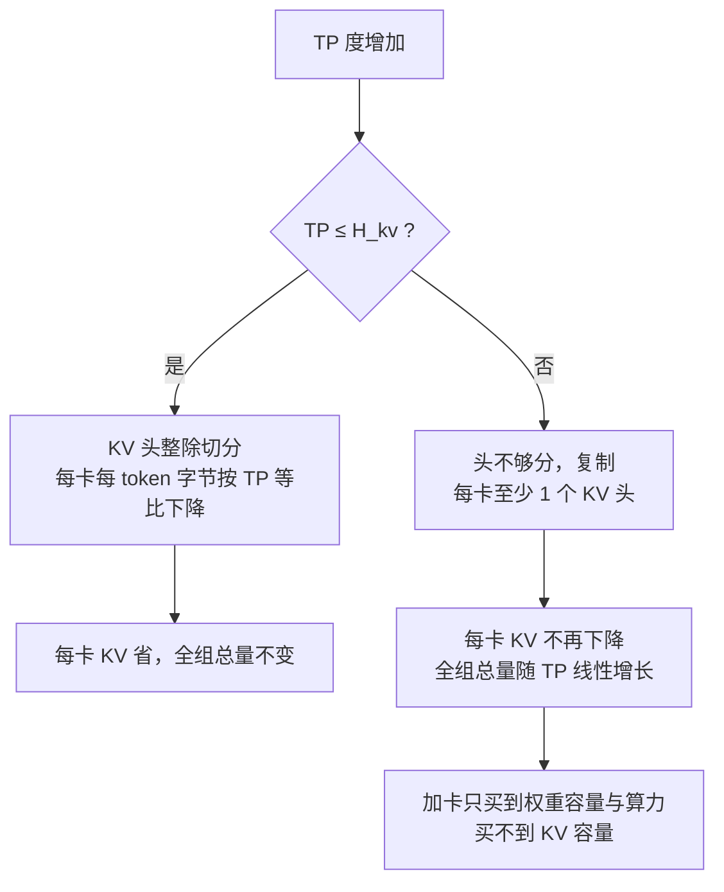

### 5.2 Llama-3-70B（8 KV 头）的 TP 对照表

| TP | 每卡 KV 头数 | 每卡每 token | 全组每 token | 说明 |
|---|---|---|---|---|
| 1 | 8 | 320 KiB | 320 KiB | 基线 |
| 2 | 4 | 160 KiB | 320 KiB | 等比切分 |
| 4 | 2 | 80 KiB | 320 KiB | 等比切分 |
| 8 | 1 | 40 KiB | 320 KiB | **切分上限** |
| 16 | 1（复制） | 40 KiB | **640 KiB** | 每个头存 2 份，全组翻倍 |

> 📌 **别再乘卡数**：`每卡每 token KV` 已经除以 TP，因此用「每卡剩余显存 ÷ 每卡每 token 字节」得到的 token 数，**就是整个 TP 组能容纳的逻辑 token 数**，不能再乘 TP。每个 token 的 KV 是分散在各卡上的一份分片，不是每卡各存一整份。

### 5.3 三个延伸结论

1. **TP 超过 KV 头数后，加卡的边际收益骤降**：每卡 KV 停在 40 KiB，权重继续摊薄、算力继续增加，但 KV 容量不变，且跨卡 AllReduce 成本上升。此时更合理的是用 **PP 按层切分**（每卡只缓存自己那几层的 KV，效果与 TP 切头类似但不复制），或换 FP8 KV。
2. **配置约束**：TP 通常要能整除 KV 头数、或是其倍数；例如 8 KV 头的模型上 TP=12 往往直接报错，而 TP=16 会「静默」浪费显存——后者更危险，因为没有报错，只有吞吐曲线变平。
3. **MLA 不适用切头**：见 §4.4，潜向量不分头，TP 组里每卡各存一份，堆 TP 反而制造大量重复缓存。

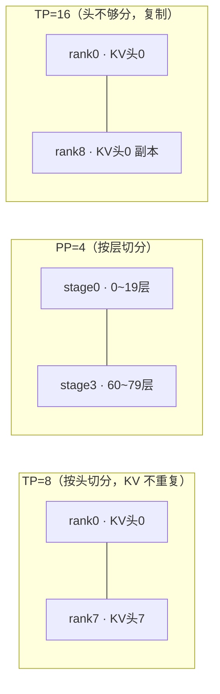

---

## 六、显存账本的四项构成

单卡显存不是「权重 + KV」两项，工程上至少四类：

| 类别 | 是否随并发变化 | 典型量级 | 说明 |
|---|---|---|---|
| **① 模型权重** | 固定 | 参数量 × 每参数字节 ÷ TP | BF16=2B、FP8/INT8=1B、INT4≈0.5B；embedding 与 lm_head 可能单独处理 |
| **② KV cache 块池** | **随并发与上下文线性增长** | 每 token 字节 × S × B | 唯一可被「上下文长度 / 并发数」直接调大的一项 |
| **③ 激活峰值** | 随 batch 与 token 预算变化 | 通常数 GiB | prefill 的中间张量、attention 临时缓冲；chunked prefill 可压峰值 |
| **④ 工作区与框架开销** | 固定 | 数 GiB | CUDA Graph 捕获、NCCL/cuBLAS handle、torch 缓存分配器、编译缓存、Python 侧 |

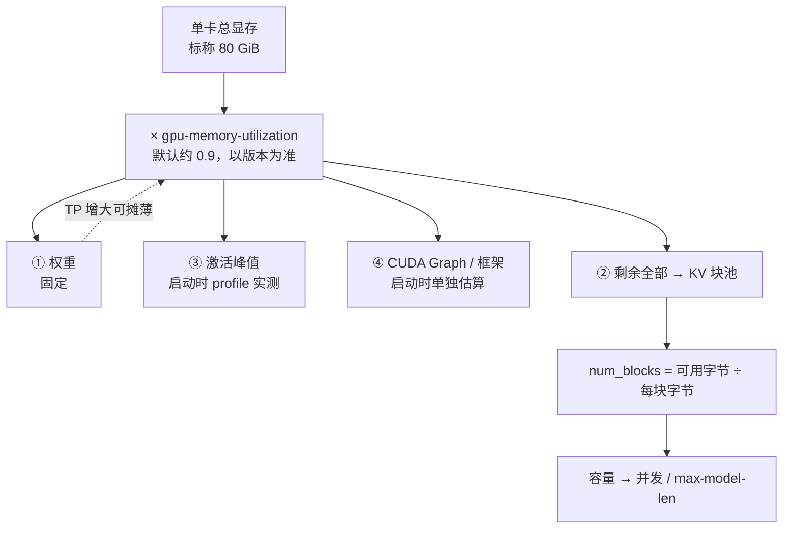

> 📌 **只有 KV 池是「可调的水池」**：权重由模型与精度定死，激活与框架开销由引擎和编译配置决定；服务能承载多少并发，几乎完全由剩下那块 KV 池决定。因此容量调优的本质是**在固定开销与 KV 池之间重新分配显存**。

> ⚠️ 常见误判：把 `gpu-memory-utilization` 调高就以为「模型变大/质量变好」。它只是把更多显存划给 KV 池，提高并发；调太低会因 KV 池不足触发 preemption，调太高则挤占 CUDA/NCCL 的账外开销导致 OOM。**它不影响模型质量，也不影响单请求速度。**

---

## 七、由预算反推并发与卡数

> ⚠️ **口径说明**：下面的心算把标称 `GB` 与 `GiB` 按同一数量级处理（工程估算惯例，两者相差约 7%），固定开销也按经验值取整。**目的是白板上快速给出数量级与判断依据，不是承诺精确容量**；精确值一律以启动日志与压测为准（§八）。表中与公式里用 KiB/GiB 时按 1024 进制，是精确值。

### 7.1 反推顺序（不要倒着来）

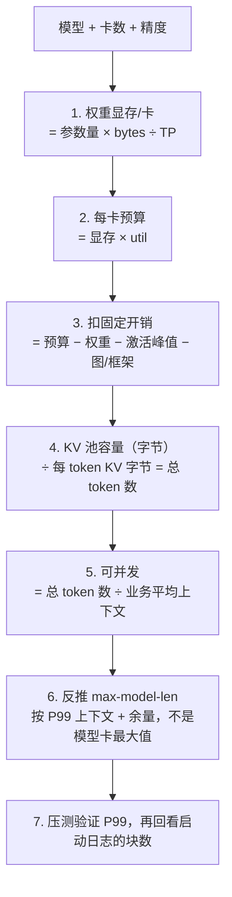

> 📌 **并发不够时，先砍上下文长度，而不是先加卡**：把 `max-model-len` 从 128K 压到业务 P99 的 16K，等于把单个请求可能占用的 KV 上限降 8 倍，往往比加卡有效得多（前提是按需分配块，见 §九）。这条结论在 [[03-vLLM]] 与 [[06-推理服务工程]] 里同样适用。

### 7.2 算例一：70B 放在 4 张 80G 卡上

```
权重：70e9 × 2 B = 140 GB，TP=4 → ≈ 35 GiB/卡（GB/GiB 按同数量级口径）
每卡预算：80 × 0.9 = 72 GiB
扣固定开销（激活峰值 + CUDA Graph + 框架，按 10 GiB 估）
KV 池：72 − 35 − 10 = 27 GiB/卡
每卡 KV 头数：8 // 4 = 2 → 每 token = 2×80×2×128×2 = 81,920 B = 80 KiB
总 token 容量：27 GiB ÷ 80 KiB ≈ 353,894 tokens（按块对齐）
平均 4K 上下文 → 约 86 并发
若全是 32K 长请求 → 约 10 并发
```

**答题要点**：先说 TP 至少 4（140 GB 权重 / 80 GB 卡 > 1，且要给 KV 留空间），再说明 TP 选 4 而不是 8 的理由（8 更省每卡 KV，但跨卡通信增加、单请求延迟未必更好）；最后强调 10 GiB 固定开销是估计值，**真实值看启动日志**。

### 7.3 算例二：8B 单卡、换 FP8 KV 后并发翻倍

```
每 token KV（BF16）= 2×32×8×128×2 = 128 KiB
KV 池 = 48 GiB → 393,216 tokens → 4K 平均上下文约 96 并发
换成 FP8 KV（1 B）→ 64 KiB/token → 786,432 tokens → 约 192 并发
```

> ⚠️ 数字翻倍的前提是**质量与硬件都支持**：FP8 KV 通常质量损失很小但不为零，且需要对应 kernel 与 GPU 架构；上线前要在自己的评测集上验证（见 [[04-优化选型与工程验证]]）。不能只看「显存省一半」就下结论。

### 7.4 容量、并发、上下文长度三者是同一个三角形

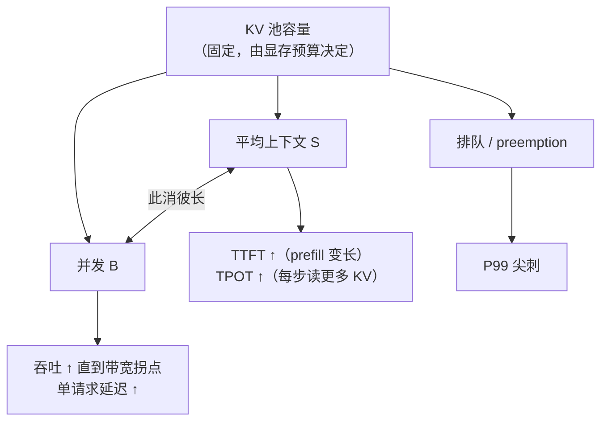

> 📌 三者不能同时要：`S ↑` 或 `B ↑` 都会吃掉同一块 KV 池；触顶后引擎开始 **preemption**（把序列换出到 CPU 或丢弃后重算），用户看到的是突然的延迟尖刺，而不是明确的报错。这是「公式算得出容量、算不出真实行为」最典型的例子。

---

## 八、从公式到真实容量：启动日志才是准的

### 8.1 引擎启动时做了什么

以 vLLM 为例（参数名与默认值随版本变化，以 `--help` 和官方文档为准），KV 池是**启动时一次性预分配**的：

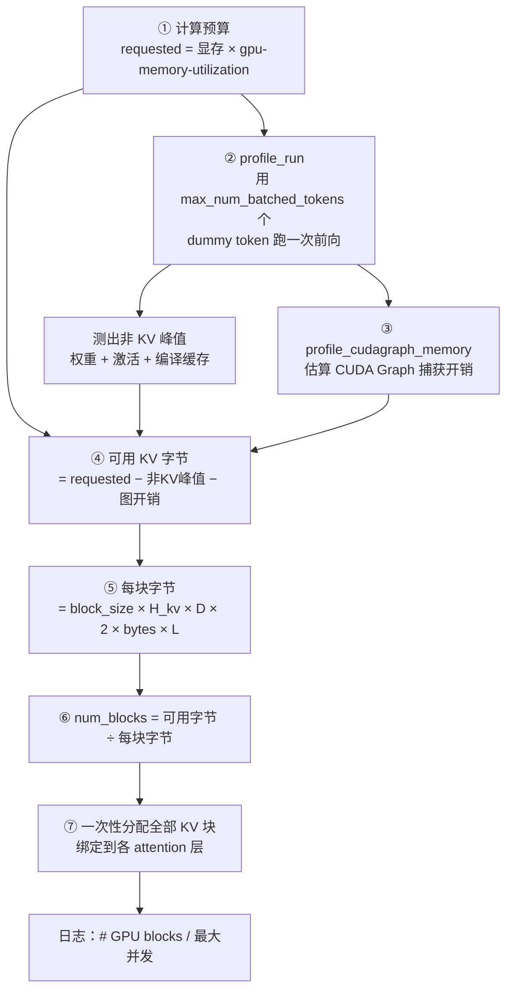

对应的计算式：

```
available_kv_cache_memory
  = total_memory × gpu_memory_utilization
    − model_weights − peak_activations − cudagraph_memory_estimate

page_size_bytes
  = block_size × H_kv × head_dim × 2 (K+V) × dtype_bytes × L

num_blocks = available_kv_cache_memory // page_size_bytes
```

> 📌 **那次 dummy forward 是关键**：引擎不靠公式猜激活峰值，而是真跑一次最大 batch 的前向去量。因此同一个模型换 `--max-num-batched-tokens`、开关 CUDA Graph、换精度，可用 KV 块数都会变。**这就是为什么手算只能是上界。**

### 8.2 该读日志里的哪几行

- `Model loading took X GiB` —— 权重实际占用。
- `Available KV cache memory: X GiB` —— 扣完固定开销后的真实 KV 预算。
- `# GPU blocks: N` —— 真实块数；`N × block_size` 就是 KV 池可容纳的 token 数。
- `Maximum concurrency for X tokens per request: Yx` —— 引擎按给定上下文直接算好的并发参考值。

### 8.3 公式与实际差在哪

| 手算漏掉的东西 | 后果 |
|---|---|
| CUDA Graph 捕获开销、torch 缓存分配器碎片、NCCL/cuBLAS handle | 实际 KV 池小于公式 |
| 激活峰值随 `max-num-batched-tokens` 变化 | 换 token 预算后容量变化 |
| 请求长度分布不均、块内碎片 | 可并发数低于 `总量 ÷ 平均长度` |
| 前缀缓存命中、preemption 重算 | 有效容量与瞬时波动 |
| 多模态输入的图像 token 峰值 | 启动时需额外预留 |

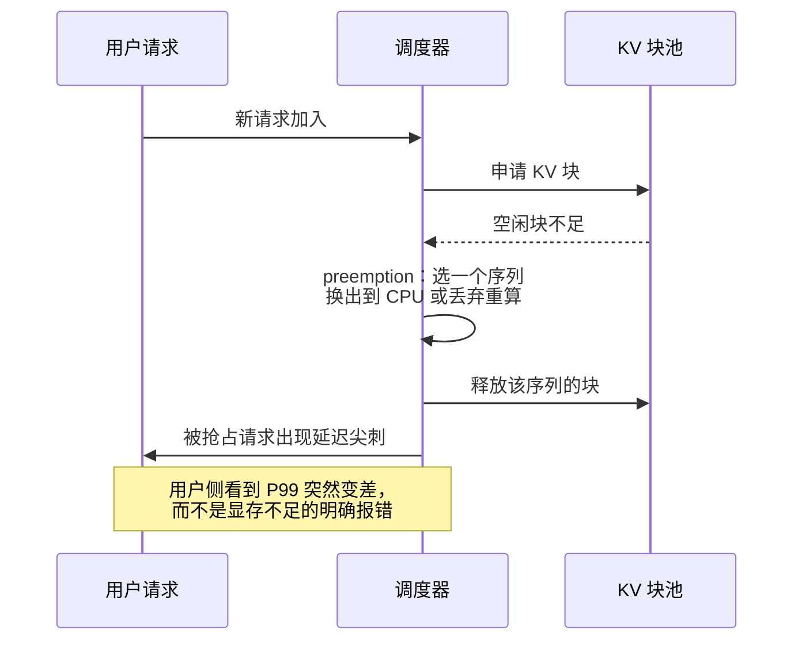

> 📌 **结论**：手算用于**选卡、定 TP、定 `max-model-len` 初值**；真实容量以启动日志为准，最终以压测的 P99 为准。三者是「估算 → 实测 → 验证」的关系，不能互相替代（压测方法论见 [[06-推理服务工程]]）。

---

## 九、PagedAttention 解决的是碎片，不是「显存不够」

这是 JD 与面经里最高频的送命题。早期实现按 `max_tokens` 为每个请求**预留一整段连续显存**，会带来三类浪费：

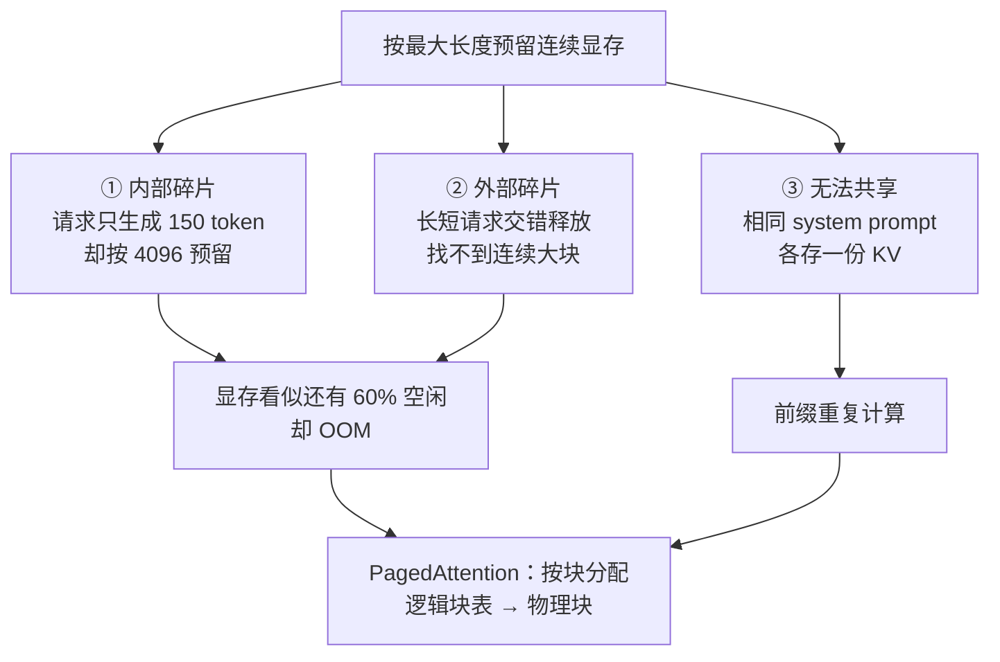

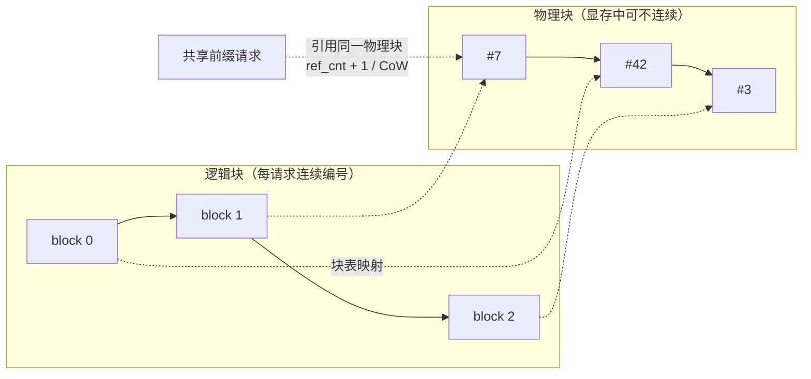

**它带来的收益是间接的**：碎片消除后，同样显存能容纳更多并发序列，于是 continuous batching 能把 batch 做得更大、吞吐上升。它不是让单个请求变快，也不是凭空造出显存。

**block_size 的两难**（常见 16 或 32 token，按引擎与版本核实）：

| block_size | 优点 | 代价 |
|---|---|---|
| 偏小 | 块内浪费少、前缀共享粒度细 | 块表条目多、地址计算与 kernel 索引开销大 |
| 偏大 | 块表小、访存更连续 | 最后一个块常常用不满，内部碎片变大、共享粒度粗 |

> 📌 一句话答题版：**PagedAttention 把 KV cache 从「按最大长度预留的连续数组」变成「按需分配的固定大小页 + 块表」，解决的是碎片化与无法共享；吞吐提升来自并发度提高这一间接效果。** 块池、引用计数、CoW、LRU 复用等实现细节在 [[03-vLLM]]，本篇不展开。

---

## 十、本篇边界与常见误判收口

| 误判 | 正确说法 |
|---|---|
| 「KV Cache 是一种压缩/近似，会影响输出质量」 | 无损，只缓存已算结果；量化、剪枝才是有损 |
| 「PagedAttention 解决显存不够」 | 解决碎片化与无法共享；显存不够要靠量化、TP/PP、砍上下文 |
| 「TP 越大，KV 越省」 | 超过 KV 头数后复制，每卡 KV 不再下降，全组反增；MLA 更不适用 |
| 「加了 batch，decode 还是带宽受限」 | 可能越过 Roofline 拐点转算力受限，此时继续量化收益很小 |
| 「上下文窗口 = 能用满的上下文」 | 窗口是上限；能否用满由 KV 池、TTFT 预算、有效注意力共同决定 |
| 「公式算出来能放 96 并发，就能跑 96 并发」 | 公式是上界；真实容量看启动日志，最终看 P99 |
| 「OOM 才会暴露容量问题」 | 更常见的是 KV 池触顶触发 preemption，表现为 P99 尖刺 |
| 「`max-model-len` 照抄模型卡最大值最保险」 |会让单个长请求吃光 KV 池，甚至启动时因「连一条最长序列都放不下」被拒 |

**本篇不讲的内容**：指标定义与口径陷阱、Roofline 与 profiling 工具链 → [[03-性能指标与瓶颈诊断]]；量化/并行/调度方案怎么选与怎么验 → [[04-优化选型与工程验证]]；模型卡怎么读、GPU 规格怎么选 → [[01-模型接入与硬件评估]]；引擎实现 → [[03-vLLM]]；压测与 SLO → [[06-推理服务工程]]。

---

## 十一、面试高频问答 🎯

**Q1：为什么 decode 是访存瓶颈，prefill 是算力瓶颈？**
prefill 一次并行处理整段 prompt，是大 GEMM，算术强度高、Tensor Core 接近饱和，时间由峰值算力决定；decode 每步每序列只算 1 个 token，却要把全部权重与历史 KV 从 HBM 读进来，算术强度约等于 batch（B=1 时仅 1~2 FLOPs/byte），远低于 GPU 拐点，时间由显存带宽决定。

**Q2：KV Cache 为什么能省计算？它改变输出吗？**
因果掩码 + 位置编码只依赖 token 自身位置，使已算出的历史 K/V 不会再变；缓存后每步只算新 token 的 K/V，把总计算量从 O(n²) 降到 O(n)。它不改变数学结果，是无损优化，代价是显存随 token 数线性增长。

**Q3：写出 KV cache 显存公式，并逐项解释。**
`每 token 字节 = 2 × L × H_kv × D × bytes`，总容量再乘 `S × B`。`2` 是 K 与 V 两份张量；`L` 层数；`H_kv` 是 **KV 头数**（GQA 下远小于 Q 头数）；`D` 头维度；`bytes` 精度（BF16=2、FP8=1）。常见错误是把 `2` 当 2 字节、用 `n_heads`、以及忘记 TP 切分。

**Q4：Llama-3-70B 在 BF16 下每 token 多少 KV？4K 上下文单请求呢？**
`2 × 80 × 8 × 128 × 2 = 327,680 B = 320 KiB/token`；4K 上下文约 `320 KiB × 4096 = 1.25 GiB`。32K 则约 10 GiB——这解释了长上下文下并发为何骤降。

**Q5：TP=4 时 70B 的 KV 怎么算？TP=16 呢？**
每卡 KV 头数 `max(1, 8 // TP)`：TP=4 → 2 头 → 80 KiB/token/卡；TP=8 → 1 头 → 40 KiB；TP=16 时头不够分，仍 1 头但被复制，每卡还是 40 KiB，**全组每 token 反增到 640 KiB**。忘记除 TP 会算成 4 倍偏差。

**Q6：GQA 为什么对长上下文是决定性的？**
把 KV 头数从 32 压到 8，每 token 从 512 KiB 降到 128 KiB。同样 32K 上下文，MHA 单请求 16 GiB、GQA 只需 4 GiB，直接决定能否按合理并发提供服务。MLA 更进一步，用不分头的压缩潜向量把每 token 压到约 69 KiB（DeepSeek-V3 量级）。

**Q7：MLA 能套 `2 × H_kv × D` 吗？为什么？**
不能。MLA 缓存的是每层一个压缩潜向量加一个小的解耦 RoPE 键，不分多头，公式是 `(d_c + d_rope) × L × bytes`。RoPE 必须解耦，是因为位置旋转会破坏低秩压缩所需的矩阵结合律；同时潜向量不分头，TP 组里每卡都得存完整一份，堆 TP 会制造大量重复缓存。

**Q8：单卡显存除了权重和 KV 还有哪些开销？**
激活峰值（prefill 中间张量、attention 缓冲）、CUDA Graph 捕获开销、NCCL/cuBLAS handle 与 torch 缓存分配器、编译缓存与 Python 侧占用。引擎启动时会跑一次 dummy forward 实测非 KV 峰值，再把剩余显存全部划给 KV 块池。

**Q9：给定 4 张 80G 卡部署 70B，怎么判断可并发量？**
权重 140 GB ÷ TP4 = 35 GB/卡；每卡预算 80×0.9 = 72 GiB；扣约 10 GiB 固定开销 → KV 池约 27 GiB；每卡每 token 80 KiB → 约 35 万 token；除以业务平均 4K 上下文 → 约 86 并发。最后强调固定开销是估计值，真实值看启动日志的 `# GPU blocks`。

**Q10：`max-model-len` 为什么不该照抄模型卡最大值？**
KV 块按需分配，设大本身不立刻浪费显存，但会允许单个超长请求占掉大半个 KV 池、挤压其他请求；甚至启动时若连一条最长序列都放不下，引擎会直接拒绝启动。应按业务 P99 上下文加余量设置，超长请求单独路由（见 [[05-推理网关与路由]]）。

**Q11：PagedAttention 到底解决什么？答「显存不够」错在哪？**
它解决的是按最大长度预留连续显存造成的内部碎片、外部碎片，以及相同前缀无法共享。显存总量没有变多，模型该放不下还是放不下；吞吐提升来自碎片消除后能容纳更多并发序列，是间接效果。显存不够要靠量化、TP/PP、砍上下文或加卡。

**Q12：block_size 取大取小各有什么代价？**
偏小则块内浪费少、前缀共享粒度细，但块表条目多、kernel 索引开销大；偏大则块表小、访存连续，但最后一块常用不满、内部碎片大、共享粒度粗。常见取 16 或 32，按引擎版本与模型核实。

**Q13：为什么手算的并发数总是偏乐观？**
漏掉了 CUDA Graph 捕获、缓存分配器碎片、NCCL/cuBLAS handle、随 token 预算变化的激活峰值，以及请求长度分布不均带来的块内浪费与 preemption。正确流程是「公式选卡 → 启动日志定容量 → 压测验证 P99」。

**Q14：并发一上去 P99 突然变差，但没有 OOM，最可能是什么？**
KV 池触顶触发 preemption：引擎把部分序列换出到 CPU 或丢弃后重算，用户看到的是延迟尖刺而非明确报错。排查顺序是看启动日志的块数与最大并发、引擎侧的 preemption / 换出计数、以及请求长度分布是否突然变长（指标口径与工具见 [[03-性能指标与瓶颈诊断]]）。

---

## 十二、关联

- 索引 → [[LLM 推理基础]]（岗位调研结论 §1、两个判据、事实口径 §7）
- 同板块 → [[01-模型接入与硬件评估]]（模型卡字段与 GPU 规格的出处）、[[03-性能指标与瓶颈诊断]]（Roofline 判据二、指标口径、profiling）、[[04-优化选型与工程验证]]（量化与并行方案怎么选怎么验）
- 引擎落地 → [[03-vLLM]]（块池、调度器、启动日志、参数反推）、[[04-Triton]]（非 LLM 路线的显存模型）
- 容量与 SLO → [[06-推理服务工程]]（压测、容量规划、成本）、[[05-推理网关与路由]]（KV 分层与长请求路由）
- 资源层 → [[01-GPU Operator]]（设备拓扑、MIG）、[[05-调度与资源管理]]（GPU 资源与配额）
- 上游 → [[AI Infra]]（分层地图 §2 / §4）、[[AI 工程]]
