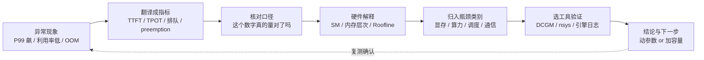
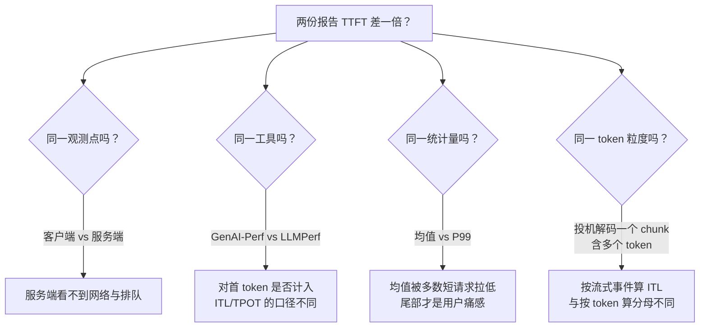
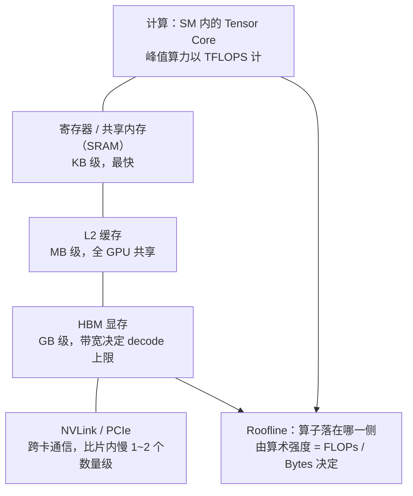
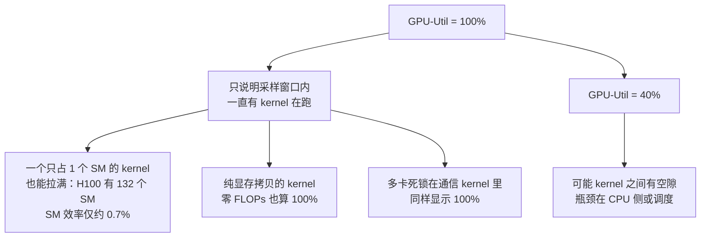
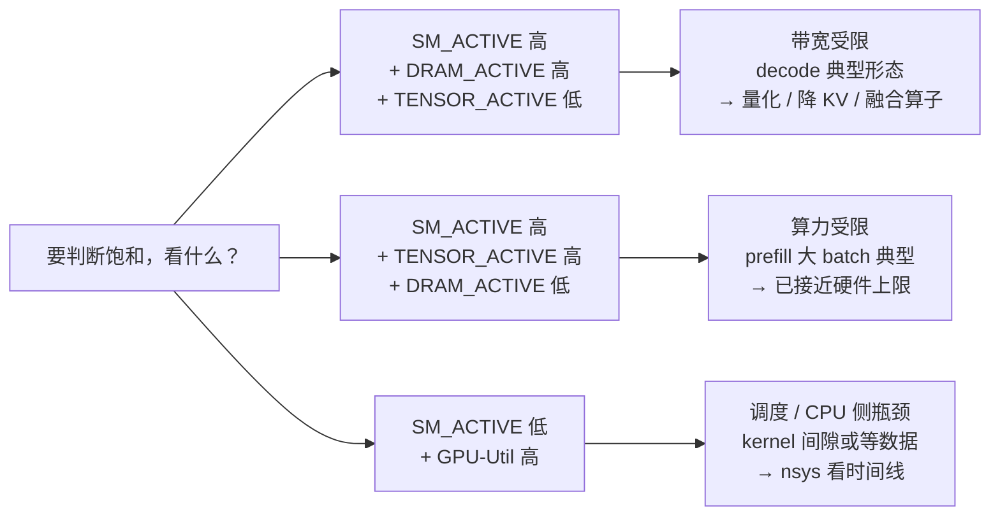
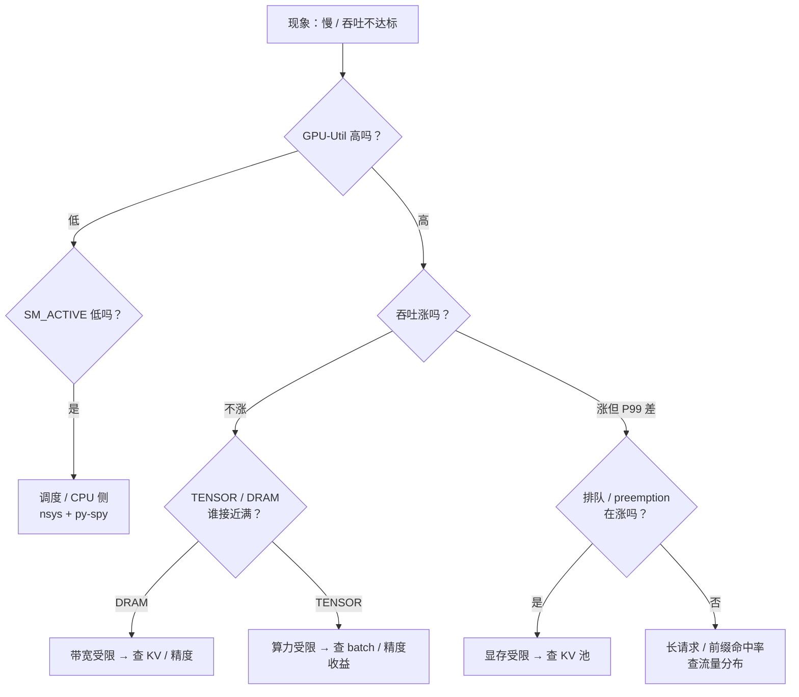
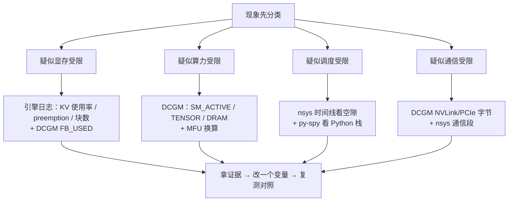
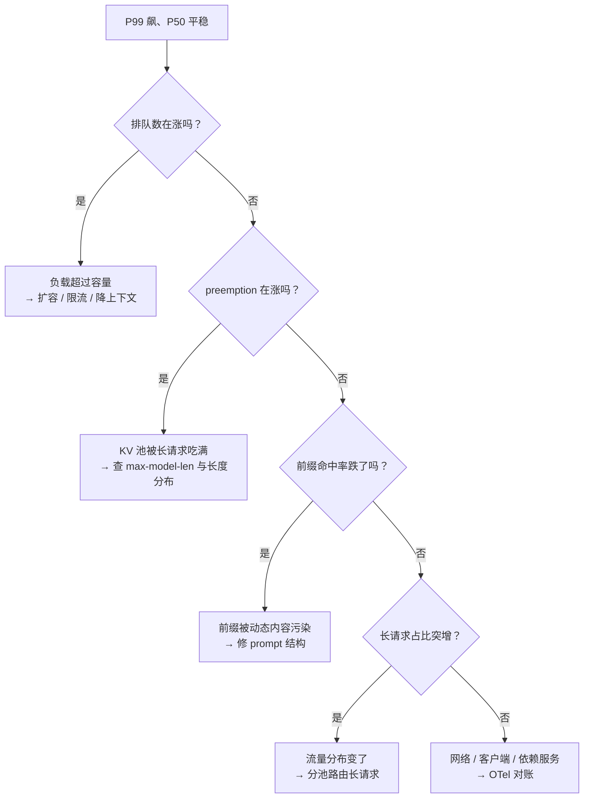
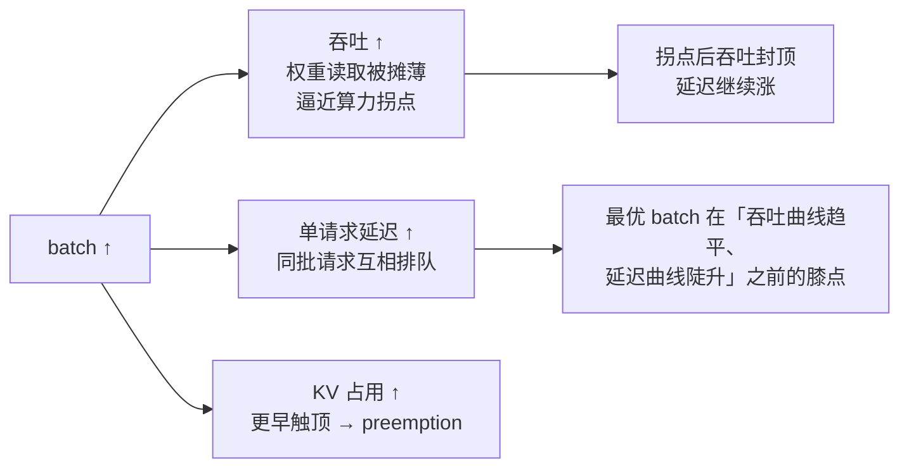
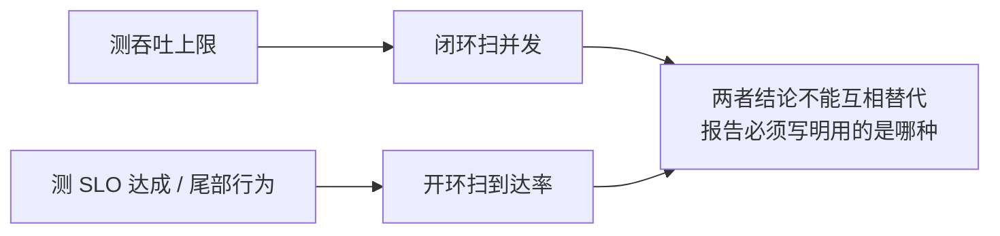

---
tags:
  - ai
  - llm
  - inference
  - profiling
  - 面试
created: 2026-11-15
updated: 2026-11-15
status: 已整理
---

# 🔬 性能指标与瓶颈诊断

> **面向面试**：给你一组异常数字（P99 飙了、GPU 利用率却不高、没有 OOM），能说出瓶颈属于哪一类、用什么工具验证、下一步动哪个参数。
>
> **与 [[06-推理服务工程]] 的分工**：那边从**运营视角**讲指标如何 SLO 化、压测方法、容量与成本；本篇从**诊断视角**讲每个数字的物理含义、读数陷阱的机理、GPU 为什么慢、用什么工具定位。两篇合起来才是「数字敏感」的完整能力。

**全文主线**：异常现象 → 把现象翻译成指标（§二）→ 判断数字是否可信（口径陷阱，§二）→ 用硬件知识解释为什么（§三）→ 归入瓶颈类别（§四）→ 选对工具验证（§五）→ 走排查路径给结论（§六）。**读数 → 解释 → 验证，缺任何一步都是猜。**



---

## 一、这一篇要解决什么问题

面试与生产中，90% 的「性能问题」呈现为以下四种之一：

| 现象 | 表面解读（常错） | 本篇的归因框架 |
|---|---|---|
| P99 突然变差，均值没变 | 「服务变慢了」 | 长尾来自排队、preemption 或长请求突增（§六.1） |
| GPU 利用率 100%，但吞吐没涨 | 「算力跑满了」 | GPU-Util 只量「有没有 kernel 在跑」，不量算力（§三.3） |
| GPU 利用率很低，延迟却很高 | 「卡不行」 | 多半瓶颈在 CPU 侧或调度，GPU 在等（§六.2） |
| 没有 OOM，但并发上不去 | 「容量够了呀」 | KV 池触顶触发 preemption，表现为尖刺而非报错（§六.4） |

> 📌 诊断的本质是**排除法 + 证据链**：先分类（显存 / 算力 / 调度 / 通信），再用对应工具拿出证据，最后复测确认。跳过分类直接调参，是调参侠；跳过验证直接下结论，是玄学。

---

## 二、指标体系：每个数字的物理含义与精确公式

### 2.1 延迟与吞吐指标

以客户端观测为准（含网络与排队，这才是用户体感），设请求在 `t_send` 发出、`t_i` 为第 i 个流式 token 到达时刻、输出共 O 个 token：

```
TTFT = t_1 − t_send                      首 token 延迟
E2E  = t_O − t_send                      端到端延迟
TPOT = (E2E − TTFT) / (O − 1)            每 token 平均耗时（O > 1 才有定义）
ITL  = t_i − t_{i-1}，i = 2..O           相邻 token 间隔的分布
吞吐  = 完成请求数 / 时间，或输出 token 数 / 时间
```

| 指标 | 反映哪个阶段 | 主要由什么决定 | 典型 SLO |
|---|---|---|---|
| TTFT | 排队 + tokenize + **prefill** + 网络 | prompt 长度、batch 竞争、排队深度 | 交互式 200ms~2s |
| TPOT / ITL | **decode** | 显存带宽、batch、上下文长度 | 30~100ms/token |
| E2E | TTFT + (O−1)×TPOT | 输出长度放大 decode 成本 | 按业务 |
| tokens/s | 系统产能 | batch、算力、调度 | 容量指标 |
| goodput | **满足 SLO 的**产出 | 以上全部 | 质量加权吞吐 |

> 📌 **吞吐是容量指标，不是体验指标**：并发上去后 tokens/s 一直涨、单个请求的 TPOT 也在涨，两者同时为真。报告必须同时给出吞吐与分位数延迟，只报吞吐的压测没有意义（SLO 化与冲突分析在 [[06-推理服务工程]] §一）。

### 2.2 口径陷阱：数字对不上，先查定义



五个最容易踩的口径坑：

1. **TTFT ≠ prefill 时间**：它是客户端观测值，包含排队、网络、tokenize、批处理等待。prefill 只占其中一段。
2. **TPOT 在单 token 输出时无定义**（分母 O−1 = 0）；`O=2` 时它等于一个 ITL，噪声极大。短输出请求的 TPOT 要单独分组看。
3. **ITL 与 TPOT 不是一回事**：TPOT 是每请求的平均，ITL 是逐 token 间隔的分布。平均能掩盖长尾——一次 500ms 的卡顿会被 99 个 20ms 摊平。**报分位数（P50/P95/P99），别只报均值。**
4. **工具口径不一致**：不同压测工具对「首 token 延迟是否计入 ITL/TPOT」处理不同（例如 GenAI-Perf 与 LLMPerf 口径就不一致）。**引用任何数值必须标注工具、版本与公式**，否则两份报告不可比。
5. **投机解码改变 token 粒度**：一次流式事件可能携带多个 token，按「流式事件间隔」算的 ITL 与按「token 时间戳」算的分母不同，直接对比会失真。

### 2.3 从时间戳算指标（可运行）

```python
def request_metrics(send_ts, token_ts):
    """从一次请求的客户端时间戳序列算指标（单位：秒）。"""
    n = len(token_ts)
    assert n >= 1, "至少要有一个 token 时间戳"
    ttft = token_ts[0] - send_ts
    e2e = token_ts[-1] - send_ts
    tpot = (e2e - ttft) / (n - 1) if n > 1 else None   # O=1 时无定义
    itl = [b - a for a, b in zip(token_ts, token_ts[1:])]
    return {"ttft": round(ttft, 3), "e2e": round(e2e, 3),
            "tpot": None if tpot is None else round(tpot, 4),
            "itl_max": None if not itl else round(max(itl), 4)}

# 一次流式请求：0s 发出，0.4s 收到首 token，
# 之后每约 50ms 一个 token，共 12 个
ts = [0.40 + 0.05 * i for i in range(12)]
print(request_metrics(0.0, ts))
# {'ttft': 0.4, 'e2e': 0.95, 'tpot': 0.05, 'itl_max': 0.05}
```

> 📌 注意 `itl_max`：如果真实流量里它是 0.5 而不是 0.05，说明中途有卡顿（preemption / 长 prefill 抢占），均值 `tpot=0.05` 完全看不出来。**这就是为什么 ITL 分布比 TPOT 均值更有诊断价值。**

---

## 三、GPU 体系结构：读懂数字的硬件前提

### 3.1 SM、warp 与内存层次

GPU 的算力由大量 **SM（流式多处理器）** 提供，每个 SM 同时驻留多个 **warp**（一组 32 线程，同一指令锁步执行）；warp 在等待数据时会切换，用并发隐藏访存延迟。显存是三级层次：



> 📌 decode 慢的本质在层次结构里：权重与 KV 都在 HBM，每 token 都要整体过一遍带宽；prefill 的大矩阵乘能摊薄读取、留在片上，所以快。**FlashAttention 与算子融合的全部意义，就是少写一遍 HBM、多留在 SRAM/L2**（判据公式见 §3.2，优化落点见 [[04-优化选型与工程验证]]）。

### 3.2 Roofline：判断优化是否有效的唯一公式（判据二）

```
算术强度 AI = FLOPs / Bytes（从 HBM 读写的字节）
可达性能   = min(峰值算力, AI × 显存带宽)
拐点      = 峰值算力 ÷ 显存带宽   （BF16 稠密口径，按卡规格算；
                              A100 80GB 约百五十 FLOPs/byte，H100 约三百）
```

| 算子 | 算术强度 | 落点 | 瓶颈 |
|---|---|---|---|
| prefill 大 GEMM | 高 | 算力受限区 | TFLOPS |
| decode GEMV（batch=1） | ≈1~2 | 深度带宽受限区 | HBM 带宽 |
| decode 大 batch | ≈B，逼近拐点 | 过渡区 | 混合 |
| 元素级 / 归一化等小算子 | 极低 | 带宽受限区 | HBM 带宽 |

> 📌 两个直接推论：**① batch 增大把权重读取摊薄，decode 从带宽受限滑向算力受限**——越过拐点后继续量化可能零收益，因为瓶颈已不是字节而是 FLOPs；**② 给「带宽受限区」的算子提算力（换更高 TFLOPS 的卡）没用**，给「算力受限区」的算子降精度才有用。判断当前落在哪一侧，靠 §3.4 的 DCGM 计数器。

### 3.3 为什么 `nvidia-smi` 的 GPU-Util 会骗人

NVIDIA 官方定义：*GPU-Util 是「过去一个采样周期内至少有一个 kernel 在执行」的时间占比*，采样周期约 1/6~1 秒。它回答「**卡忙不忙**」，不回答「**算力用了多少**」。



> ⚠️ **结论：GPU-Util 是必要非充分信号**。高不一定好（可能在空转），低也不一定浪费（可能 kernel 间隙等数据）。判断饱和必须换用 DCGM 的 profiling 计数器，并且**综合**吞吐、队列深度一起看——`GPU_UTIL=100%` 而吞吐不涨，恰恰说明算力没有跑满。

### 3.4 DCGM profiling 指标精读

| 计数器 | 官方定义 | 怎么读 |
|---|---|---|
| `PROF_SM_ACTIVE` | SM 上**至少 1 个 warp 被分配**的周期占比（全 SM 均值） | ≥0.8 是高效利用的**必要非充分**条件；<0.5 大概率低效。**等待内存的 warp 也算 active**，所以它高不代表在算 |
| `PROF_SM_OCCUPANCY` | 驻留 warp 数 ÷ 理论最大驻留数 | 衡量延迟隐藏能力；过高不一定更好（可能挤占寄存器导致溢出） |
| `PROF_PIPE_TENSOR_ACTIVE` | Tensor（HMMA）流水线活跃周期占比 | 最接近「算力真的在干活」；prefill 应显著高于 decode |
| `PROF_DRAM_ACTIVE` | 显存接口活跃周期占比 | 接近 1 说明顶到带宽上限 → 带宽受限证据 |
| `PROF_PCIE_TX/RX_BYTES`、NVLink | 跨卡字节数 | 多卡通信是否成为瓶颈的证据 |



> 📌 还有一个更高层的口径：**MFU（模型 FLOPs 利用率）= 观测吞吐 ÷ 峰值算力对应的理论吞吐**。训练里常见 30%~50%，推理 decode 阶段通常更低。它把「硬件计数器」和「业务产出」连了起来，是横向比较不同引擎/配置时最公平的单一数字。

---

## 四、瓶颈三分法：显存 / 算力 / 调度

JD 里的原话是「能独立定位推理瓶颈（显存瓶颈 / 算力瓶颈 / 调度瓶颈）」。三类的现象、证据与对策：

| 瓶颈 | 典型现象 | 证据（用什么确认） | 对策方向 |
|---|---|---|---|
| **显存受限** | 并发上不去、preemption 上涨、P99 尖刺、KV 使用率贴顶 | 引擎日志 KV blocks 与使用率、preemption 计数、`FB_USED` 贴近上限 | 砍 `max-model-len`、KV 量化、TP/PP 加卡、prefix caching |
| **算力受限** | batch 大或 prefill 重时吞吐封顶、SM_ACTIVE 与 TENSOR_ACTIVE 双高、加卡才涨 | DCGM 计数器、Roofline 判断 | 提高算术强度（融合/更大 batch）、更高算力、降低精度 |
| **调度受限** | GPU 利用率低但延迟高、kernel 间隙大、CPU 单核满、IPC/序列化忙 | nsys 时间线看空隙、py-spy/cProfile 看 Python、引擎 token 预算 | 调大 token 预算、前端与引擎分进程、减少 CPU 工作 |
| **通信受限**（多卡补充项） | 多卡吞吐远低于单卡线性外推、各卡等待对齐 | NVLink/PCIe 字节、NCCL 耗时、nsys 时间线里的通信段 | 优化并行切分、NVLink 拓扑、减少跨节点 |



> 📌 这张决策树就是「三分法」的可执行版。注意第一步用的是 GPU-Util（粗筛「忙不忙」），后续全部换 DCGM 计数器（细查「忙在什么上」）——两层口径不要混用。

---

## 五、诊断工具链：什么现象用什么工具

| 工具 | 观察层次 | 回答什么问题 | 何时用 |
|---|---|---|---|
| `nvidia-smi` / `dmon` | 秒级快照 | 卡忙不忙、显存占了多少、温度功耗 | 第一眼粗筛；瞬时值抖动大，看趋势要连续采样 |
| **DCGM exporter** / `dcgmi dmon` | 持续监控 + 硬件计数器 | SM_ACTIVE / OCCUPANCY / TENSOR / DRAM_ACTIVE、XID 错误、NVLink/PCIe | 生产监控与瓶颈分类的主要证据源 |
| **Nsight Systems（nsys）** | 全局时间线 | 时间花在哪：CPU-GPU 重叠、kernel 间隙、同步与通信等待 | 「利用率低但慢」首选；看调度空隙 |
| **Nsight Compute（ncu）** | 单 kernel 深挖 | 该 kernel 的算术强度、内存效率、occupancy | kernel/算子优化（专项岗方向） |
| **PyTorch Profiler** | 算子级 | 哪个 op 慢、CPU-GPU 重叠、显存分配 | 模型侧优化、对照实验 |
| `perf` / `cProfile` / `py-spy` | CPU 与 Python 进程 | tokenize/detokenize、序列化、GIL、单核热点 | 疑似调度瓶颈时的 CPU 侧证据 |
| **引擎日志与指标**（vLLM 等） | 调度层 | 排队数、preemption、KV 使用率、前缀命中率、各阶段耗时 | 容量与调度问题的第一证据 |
| **OTel tracing** | 端到端分阶段 | 鉴权 → 排队 → prefill → decode → 回包各段耗时 | 全链路归因，网关到引擎对账 |



> ⚠️ 两条纪律：**一次只改一个变量**，否则无法归因；**先固定负载再对比**（模型、精度、并发、长度分布、引擎版本、硬件全都要钉死），否则任何「优化了 30%」都不可信。可复现实验的完整方法在 [[04-优化选型与工程验证]] §七。

---

## 六、从现象到归因：六条高频排查路径

### 6.1 P99 突然变差，均值正常



> 📌 P99 与均值分离的本质是**长尾来自少数请求**：一条 32K 的长 prompt 的 prefill 能把同批 decode 的 ITL 顶出尖刺（chunked prefill 缓解，见 [[04-优化选型与工程验证]]）。先看分布，再看均值。

### 6.2 GPU 利用率低，延迟却高

第一步先别怀疑卡：`GPU-Util` 低 + 延迟高的组合，多数是 **GPU 在等**，而不是 GPU 慢。

1. `nsys` 抓一段时间线：看 kernel 之间的空隙。
2. 空隙期 CPU 在干什么：`py-spy` / `cProfile` 看 tokenize、detokenize、序列化、调度循环是否单核打满。
3. 检查引擎的 token 预算（如 `max-num-batched-tokens`）是否过小、前端与引擎是否同进程互抢（V1 架构为此拆进程，见 [[03-vLLM]]）。
4. 多模态输入还要查图像预处理是否在主线程阻塞。

### 6.3 OOM：先分启动时还是运行时

- **启动时**：预算公式不够（权重 + 激活 + 图开销 > 显存 × util）。对策：降 `gpu-memory-utilization` 是反方向——正确做法是加卡（提 TP）、换更低精度、或压 `max-num-batched-tokens` 减小激活峰值。
- **运行时**：KV 按需分配触顶 + 激活突增（多模态图像 token 尖峰）。对策：限并发、限上下文、预留峰值余量。
- 两者共同点：先看是哪一类 allocator 报的 OOM（torch 缓存分配器报的可能是碎片，`PYTORCH_CUDA_ALLOC_CONF` 可缓解）。

### 6.4 没有 OOM，但并发上不去 → preemption

KV 池触顶时引擎会抢占（换出或重算），表现为延迟尖刺。证据链：启动日志的块数与「最大并发」参考值 → 运行时 KV 使用率贴顶 → preemption 计数上涨 → P99 尖刺。对策按性价比排序：**砍上下文长度 → KV 量化 → prefix caching 提高有效容量 → 加卡**（公式与容量账见 [[02-生成过程与显存账本]] §七）。

### 6.5 前缀缓存命中率归零

命中要求前缀 token **完全一致**。常见污染源：system prompt 里塞时间戳、随机 ID、用户 ID、逐请求变化的少样本示例。排查：先看命中率曲线何时跌 → diff 该时段的 prompt → 把动态内容挪到后缀。命中归零不仅浪费显存，还让 TTFT 虚高（缓存本可跳过的 prefill 全部重算）。

### 6.6 多卡吞吐远低于线性外推

排查顺序：通信占比（nsys 时间线里的 NCCL 段）→ 拓扑（是否跨 NVLink 域、PCIe 直连）→ 是否触到 TP 上限（KV 头复制，见 [[02-生成过程与显存账本]] §五）→ 慢卡与热降频（DCGM 温度/功耗/时钟，XID 错误码）→ 集合通信库与驱动版本一致性。慢卡还有一个隐蔽表现：**AllReduce 让所有卡等最慢的一张**，单看某张卡的利用率会误判。

---

## 七、延迟-吞吐权衡与读数边界

### 7.1 batch 的两端



> 📌 **没有「越大越好」的 batch**：吞吐曲线终会趋平（算力拐点），延迟曲线持续上升，膝点附近才是工程上的甜点。判定膝点不是拍脑袋，是固定其他变量扫 batch、画两条曲线。

### 7.2 开环与闭环：压测方式决定你能看见什么

| | 闭环（固定并发） | 开环（固定到达率） |
|---|---|---|
| 模式 | N 个客户端各发完再发下一条 | 按 Poisson 到达率持续发，不等回复 |
| 隐含公式 | 吞吐 × 平均延迟 ≈ 并发（Little's Law） | 到达率超过容量 → 队列增长 |
| 能看见 | 峰值吞吐上限 | **排队延迟与 SLO 违约**（尾部真实暴露） |
| 看不见 | 服务变慢时客户端自动减速，尾部被「背压」藏住 | 不适合直接测吞吐上限 |



> 📌 **读数前的三个卫生习惯**：① warmup 排除在测量窗口外（JIT 编译、CUDA Graph 捕获、冷缓存都发生在头几十秒）；② 记录 ISL/OSL（输入/输出长度）分布——固定 1024/256 的合成负载只测了一个角落，真实流量是分布；③ 警惕前缀缓存污染，同一 prompt 反复打会让 TTFT 虚低（§6.5）。压测的完整方案设计与 SLO 定义在 [[06-推理服务工程]] §二，本篇只保证「读数本身是干净的」。

---

## 八、本篇边界与误判收口

| 误判 | 正确说法 |
|---|---|
| 「GPU-Util 100% = 算力跑满」 | 只量「有没有 kernel 在跑」；单 SM kernel、纯拷贝、通信死锁都能拉满 |
| 「SM_ACTIVE 高 = 在算」 | 等待内存的 warp 也算 active；要结合 TENSOR/DRAM_ACTIVE 与吞吐 |
| 「TPOT 就是 ITL」 | TPOT 是每请求平均，ITL 是分布；均值掩盖长尾 |
| 「TTFT = prefill 时间」 | 客户端观测值，含排队、网络、tokenize |
| 「两个工具的数字差一倍，必有一个错」 | 先查口径：观测点、首 token 计入、token 粒度、统计量 |
| 「吞吐高就是好」 | 吞吐是容量指标；不满足 SLO 的产出是 goodput 里的零 |
| 「慢就是算力不够」 | 先三分法分类：显存 / 算力 / 调度 / 通信，再对症下药 |
| 「开环闭环随便选一个」 | 闭环测吞吐上限，开环测尾部与 SLO；报告必须写明 |

**本篇不讲的内容**：显存公式与容量反推 → [[02-生成过程与显存账本]]；优化方案怎么选与怎么验 → [[04-优化选型与工程验证]]；压测方案、SLO 定义、容量规划与成本模型 → [[06-推理服务工程]]；监控告警平台搭建 → [[02-可观测性]]；引擎内部的调度器实现 → [[03-vLLM]]。

---

## 九、面试高频问答 🎯

**Q1：TTFT、TPOT、ITL、E2E 各自定义与关系？**
TTFT = 首 token 到达 − 请求发出（客户端口径，含排队/网络/tokenize/prefill）；TPOT = (E2E − TTFT)/(输出 token 数 − 1)，是每请求平均；ITL 是相邻 token 间隔的分布；E2E ≈ TTFT + (O−1)×TPOT。TPOT 在 O=1 时无定义，短输出要单独分组。

**Q2：为什么必须报 P99 而不是均值？**
LLM 服务的延迟分布是重尾的：多数请求很快，少数长请求或被抢占的请求撑起尾部，而用户投诉的就是尾部。均值会被大多数快请求拉低，完全掩盖尾部的卡顿。ITL 分布同理——一次 500ms 卡顿会被 99 个 20ms 摊平。

**Q3：GPU-Util 100% 说明什么？不说明什么？**
只说明采样周期内一直有 kernel 在执行（NVIDIA 定义为「至少一个 kernel 在跑」的时间占比，周期 1/6~1 秒）。不说明算力饱和：一个只占 1 个 SM 的 kernel（H100 上 SM 效率约 0.7%）、纯显存拷贝、甚至死锁在通信 kernel 里都能显示 100%。它是必要非充分信号。

**Q4：判断 GPU 是否真的饱和，看哪几个计数器？**
DCGM profiling：`SM_ACTIVE`（≥0.8 是必要非充分）、`SM_OCCUPANCY`（延迟隐藏能力）、`PIPE_TENSOR_ACTIVE`（Tensor Core 真的在算）、`DRAM_ACTIVE`（是否顶到带宽）。组合判读：SM 高 + DRAM 高 + Tensor 低 → 带宽受限；SM 高 + Tensor 高 → 算力受限；SM 低 + GPU-Util 高 → 调度/CPU 侧。

**Q5：decode 慢，怎么确认是带宽受限？**
看 `DRAM_ACTIVE` 接近 1、`TENSOR_ACTIVE` 低；换算 MFU 远低于峰值；加大 batch 若吞吐明显上涨则证实有算力余量（还在带宽受限区），若吞吐不涨则已到拐点转算力受限。对应的优化方向分别是降精度/降 KV/融合算子，与加 batch/换卡。

**Q6：Roofline 拐点怎么算？有什么用？**
拐点 = 峰值算力 ÷ 显存带宽（BF16 稠密口径，A100 约百五十、H100 约三百 FLOPs/byte，以规格为准）。把算子的算术强度（FLOPs/Bytes）放上去：低于拐点是带宽受限，降精度省的字节直接变成速度；高于拐点是算力受限，降精度只剩质量损失没有速度收益。**这是判断「量化有没有用」的唯一公式。**

**Q7：P99 突然变差但均值正常，排查顺序？**
先看排队数（负载超容量）→ preemption 计数（KV 池被长请求吃满）→ 前缀命中率（动态内容污染）→ 请求长度分布（长请求占比突增）→ 网络/依赖（OTel 对账）。本质是长尾来自少数请求，先看分布再动配置。

**Q8：GPU 利用率很低但延迟很高，问题在哪？**
大概率 GPU 在等而不是算得慢：nsys 时间线看 kernel 空隙，空隙期用 py-spy/cProfile 查 CPU 侧（tokenize/detokenize/序列化/GIL），并检查 token 预算是否过小、前端与引擎是否同进程互抢。多模态还要查图像预处理阻塞。

**Q9：两个压测工具报的 TPOT 差了一倍，谁错了？**
不一定有人错：先对口径——观测点（客户端 vs 服务端）、首 token 是否计入 ITL/TPOT（GenAI-Perf 与 LLMPerf 口径就不同）、token 粒度（投机解码一个 chunk 多 token）、统计量（均值 vs 分位数）。引用数值必须标注工具、版本与公式，否则不可比。

**Q10：开环和闭环压测的区别？各自能测出什么？**
闭环固定并发（每客户端发完再发），吞吐×延迟≈并发（Little's Law），适合测吞吐上限；开环固定到达率，服务慢时队列增长，能暴露排队延迟与 SLO 违约。闭环会因客户端「背压」藏住尾部，开环不适合测吞吐峰值。报告必须写明用的是哪种。

**Q11：没有 OOM 但并发上不去，最可能是什么？**
KV 池触顶触发 preemption（换出或重算），表现为 P99 尖刺。证据链：启动日志块数与最大并发参考值 → KV 使用率贴顶 → preemption 上涨。对策按性价比：砍 `max-model-len` → KV 量化 → prefix caching → 加卡。

**Q12：前缀缓存命中率突然归零，查什么？**
前缀必须 token 完全一致才命中。diff 命中率下跌时段的 prompt，常见污染源是 system prompt 里的时间戳、随机 ID、用户 ID、逐请求变化的少样本示例；把动态内容挪到后缀即可恢复。命中归零还会让 TTFT 虚高。

**Q13：MFU 是什么？为什么推理的 MFU 天然比训练低？**
MFU = 观测吞吐 ÷ 峰值算力对应的理论吞吐，把硬件计数器和业务产出连起来。decode 每 token 只算一点 FLOPs 却要读全部权重与 KV，算术强度极低、远低于拐点，所以 decode 主导的推理负载 MFU 天然低于训练的大 GEMM。比较引擎/配置时它是较公平的单一指标。

**Q14：多卡吞吐远低于单卡线性外推，排查顺序？**
nsys 看 NCCL 通信段占比 → 拓扑（跨 NVLink 域 / PCIe）→ TP 是否超过 KV 头数（复制陷阱）→ DCGM 温度/时钟/XID 找慢卡与降频 → 驱动与通信库版本一致性。注意 AllReduce 会同步所有卡，单看某张卡的利用率会误判。

---

## 十、关联

- 索引 → [[LLM 推理基础]]（岗位调研结论 §1、两个判据、事实口径 §7）
- 同板块 → [[01-模型接入与硬件评估]]（模型卡与 GPU 规格）、[[02-生成过程与显存账本]]（KV 公式与容量、判据一）、[[04-优化选型与工程验证]]（优化矩阵、可复现实验）
- 判据衔接 → [[02-生成过程与显存账本]]（瓶颈倒置）→ 本篇（Roofline 判据二与三分法）→ [[04-优化选型与工程验证]]（按瓶颈选方案）
- 引擎与网关 → [[03-vLLM]]（调度指标、日志）、[[05-推理网关与路由]]（排队与过载）
- 运营闭环 → [[06-推理服务工程]]（SLO 化、压测方法、容量与成本）、[[02-可观测性]]（监控平台）、[[01-GPU Operator]]（DCGM / XID）
- 上游 → [[AI Infra]]（分层地图）、[[AI 工程]]
