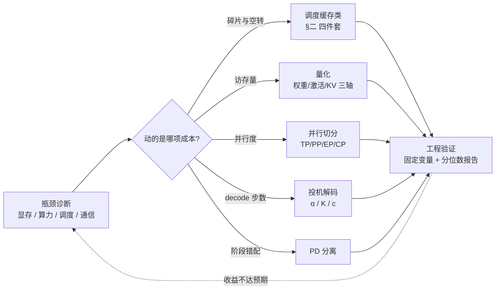
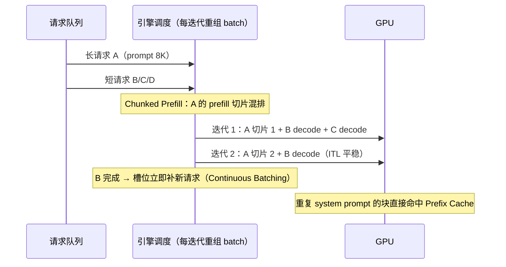
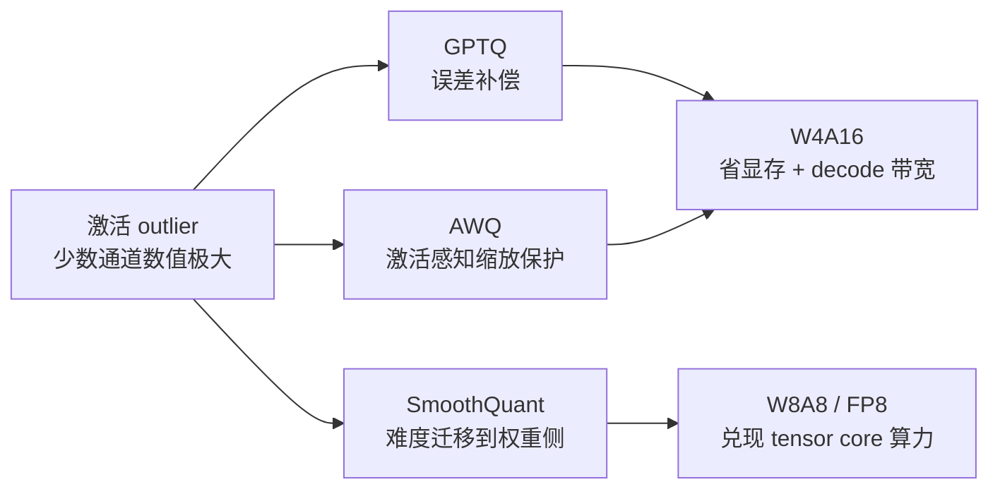
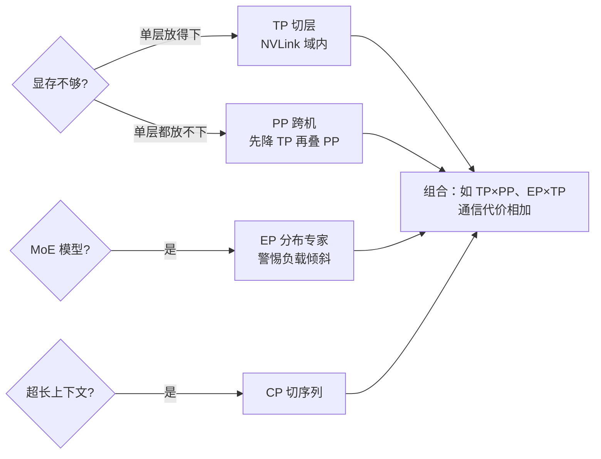
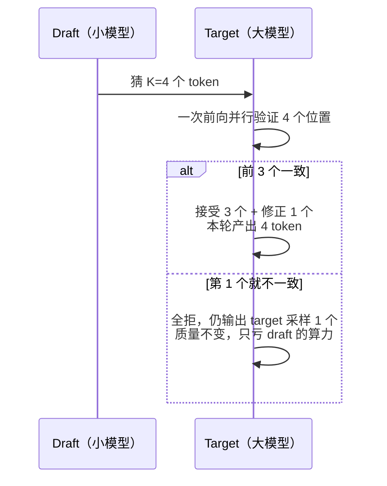

---
tags:
  - ai
  - llm
  - inference
  - optimization
  - 面试
created: 2026-11-15
updated: 2026-11-15
status: 已整理
---

# ⚙️ 优化选型与工程验证

> **面向面试 / 面向工程**：为给定负载选优化方案并证明收益——JD 出现频次最高的一块，且几乎都要求「有可量化的优化成果，能讲清**做了什么、为什么有效、收益多少**」。
>
> **组织原则**：按「改变了哪一项成本」归类，不按技术名词罗列；每项给适用前提与代价。引擎具体参数在 [[03-vLLM]]，网关路由与 PD 部署形态在 [[05-推理网关与路由]]，压测定容量与 SLO 在 [[06-推理服务工程]]——本篇只回答「**选什么、为什么、怎么证明**」。

**全文主线**：先诊断出瓶颈（三分法，判据在 [[03-性能指标与瓶颈诊断]]）→ 选「动的是这个瓶颈」的优化类别（§一矩阵）→ 各类别内部的取舍与陷阱（§二~§六）→ 用可复现实验证明收益（§七）。**跳过诊断直接选药，是优化工作最大的浪费来源。**



> 📌 **无损与有损的分界先立住**：Continuous Batching、PagedAttention、Prefix Caching、Chunked Prefill、FlashAttention、投机解码（拒绝采样保证输出分布不变）、PD 分离都是**数学无损**；量化（FP8 起算近似无损、INT4 起明确有损）是**有损**。面试里「投机解码会不会降低质量」的正确答案是：**算法上不会**（验收不通过也输出 target 采样结果），但工程上会改变延迟分布与显存占用。

---

## 一、优化矩阵：先问「动的是哪一项成本」

所有推理优化只做六件事之一：

| 改变的成本 | 代表技术 | 无损? | 一句话 |
|---|---|---|---|
| **减少重复计算** | Prefix / Prompt Caching | ✅ | 重复前缀的 KV 算一次用 N 次 |
| **提高算术强度** | FlashAttention、算子融合、FP8/INT8 计算 | ✅（FlashAttention 数学等价） | 让每个从 HBM 读来的字节做更多乘加 |
| **减少访存量** | 权重/激活/KV 量化、GQA/MLA（架构侧） | 权重 INT4 ❌，FP8 近似 | decode 的每一 token 都要过一遍权重与 KV |
| **减少碎片与空转** | PagedAttention、Continuous Batching、Chunked Prefill | ✅ | 显存碎片与 batch 空转是纯浪费 |
| **减少 decode 步数** | 投机解码（draft-verify） | ✅（分布等价） | 一步验多个 token |
| **拆分异构阶段** | PD 分离 | ✅ | prefill 与 decode 特征不同，分池部署 |

> ⚠️ **「这个优化为什么有效」必须落到这张表的某一行**。说不出动的是哪项成本，就说不清收益边界——这也是面试区分「背过名词」和「做过优化」的地方。

---

## 二、调度与缓存类：零精度损失的四件套

### 2.1 Continuous Batching：解决空转，不是让单请求变快

静态 batch 里长短请求混合，短请求完成后**整批等最长那个**，GPU 大量空转。Continuous batching 把调度粒度从「整个请求」缩到「一次迭代」：每步重新组 batch，完成的槽位立刻补新请求。**它提升的是吞吐与 GPU 利用率；单请求的延迟不会因此变快**（甚至可能因排队略变慢）。

### 2.2 PagedAttention：解决碎片，不是「显存不够」

按 `max-model-len` 预留连续显存造成三类浪费：内部碎片（最后一块用不满）、外部碎片（空洞连不成连续空间）、以及相同前缀无法共享。分页块管理消除前两类、开启第三类的共享能力。**显存总量没有变多**——模型放不下还是放不下（容量账见 [[02-生成过程与显存账本]] §九）。

### 2.3 Prefix Caching：命中率决定收益

重复前缀（system prompt、few-shot、多轮历史）的 KV 块算一次、复用 N 次，直接砍掉那部分 prefill 时间与计算量。收益完全由**真实流量的命中率**决定：

```text
命中率归零的常见原因（工程教训）：
□ system prompt 里塞了时间戳 / 请求 ID / 随机数 → 前缀逐字节不同，块全部失效
□ 每次请求改写措辞（同义但不同 token 序列）
□ 块边界没对齐（前缀差异出现在第一个 block 内）
□ 缓存被大流量冲掉（容量有限，命中窗口比预期小）
```

> 📌 **收益判据**：先在真实流量上测命中率（引擎日志有 prefix cache hit 统计）。命中率 < 20% 时这项优化接近无收益；命中率高的 agent / 多轮 / 固定模板场景能砍掉大半 TTFT。**面向路由层的 KV 感知调度见 [[05-推理网关与路由]] §四**，这里只讲引擎侧机制。

### 2.4 Chunked Prefill：消除 ITL 尖刺

长 prompt 的 prefill 是一次大矩阵乘，会把同批 decode 的步进**阻塞几百毫秒**——表现为 ITL / TPOT 尖刺、流式输出卡顿。Chunked prefill 把长 prefill 切成小块，与 decode 混排迭代。代价是 prefill 总时长略增，换来的是 decode 侧延迟平稳。

**四件套对比**：

| 技术 | 解决什么 | 不解决什么 | 代价 | 收益判据 |
|---|---|---|---|---|
| Continuous Batching | 长短混合下的 batch 空转 | 单请求延迟 | 调度开销微小 | 吞吐 / GPU 利用率 |
| PagedAttention | 显存碎片 + 前缀不可共享 | 显存总量 | 块表索引开销 | 可容纳并发数 |
| Prefix Caching | 重复前缀的重复计算 | 无重复前缀的流量 | 缓存占用显存 | **真实命中率** |
| Chunked Prefill | 长 prefill 阻塞 decode | prefill 本身速度 | prefill 略变慢 | ITL / TPOT 尾部 |



---

## 三、量化选型与精度验证

### 3.1 三个独立轴

**权重 / 激活 / KV cache 是三个独立决策**，可任意组合（如 W4A16 + FP8 KV）。术语：`W4A16` = 权重 4 bit、激活 16 bit（只压显存与带宽）；`W8A8` = 两者都 8 bit（能真正吃到 INT8/FP8 tensor core 的算力加速）。

| 轴 | 影响什么 | 典型选项 |
|---|---|---|
| 权重 | 权重显存 + decode 带宽（访存大头） | BF16 / FP8 / INT4（GPTQ、AWQ） |
| 激活 | 计算受限段的算力兑现 | FP16 / INT8（SmoothQuant）/ FP8 |
| KV cache | **并发容量与长上下文显存** | FP8（`--kv-cache-dtype fp8`）/ INT8 |

### 3.2 outlier 是大模型量化的核心难题，三种解法三本账

激活分布里有少数数值极大的通道（outlier），per-tensor 量化时 scale 被它们撑大、正常值全被压到同一格点。三种主流 PTQ 方法对应三种处理：

| 方法 | 思路 | 定位 | 代价 |
|---|---|---|---|
| **GPTQ** | 逐列量化 + 用近似二阶（Hessian）信息把取整误差补偿到未量化列 | 权重 4bit 主力，理论性最强 | 量化慢（小时级）、对校准集敏感 |
| **AWQ** | 「激活大的通道对应权重更重要」，等价缩放保护 salient 通道 | 权重 4bit 生产首选（MLSys 2024 最佳论文） | 需校准数据；kernel 要配套 |
| **SmoothQuant** | 数学等价变换 `Y=(X·diag(s)⁻¹)(diag(s)·W)` 把激活量化难度迁给权重 | **W8A8** 的关键（激活也进 INT8 才有算力收益） | 迁移过度伤权重精度；需 Q/DQ 融合内核 |



> 📌 **INT4 必须 group-wise**（如 128 组一个 scale）：4 bit 只有 16 个格点，粗粒度 scale 会把小值全部压扁；group 化的 scale/zero 元数据把有效位宽抬到约 4.25 bit——这就是 [[01-模型接入与硬件评估]] 里「70B INT4 实测 38 GB 而非 35 GB」的原因。

> 📌 **从瓶颈倒推选型**：装不下 → W4A16；decode 慢（带宽受限）→ weight-only + 高效内核（Marlin 类）；prefill / 大 batch 计算受限 → W8A8 / FP8；长上下文并发被 KV 卡住 → **KV 量化**（独立轴，直接抬最大并发）。_FP8 在 Hopper+ 上是质量-收益比最好的默认档；FP4/NVFP4 是 Blackwell 专属。_

### 3.3 精度验证体系（JD 明确：会选、会验，不需要自研算法）

量化质量的验收**不是看 perplexity**——短文本 PPL 正常的 INT4 模型，可能在数学、代码、长上下文、工具调用上明显退化。验收框架：

```text
量化精度验收清单：
□ 任务分桶：数学 / 代码 / 长上下文 / 多轮 / 工具调用 / 拒答安全，逐桶对比 BF16 基线
□ 固定输入对齐：固定 token 序列、模型 revision、seed，逐层对比 logits 排名（不只 MSE）
□ 校准集与验收集分离：校准数据不能混入验收，避免自证
□ 元数据留档：校准集 hash、group size、量化轴、kernel 版本——出问题可回溯回滚
□ kernel 确认：量化文件小 ≠ 快，内核回退慢路径时先换 kernel 而不是降位宽
```

> ⚠️ **工具链口径**：AutoAWQ 已弃用（指向 vLLM 的 LLM Compressor）、AutoGPTQ 已无人维护（指向 GPTQModel），选型时以引擎当前支持的量化方案为准，不要照搬旧教程的库名。

---

## 四、并行与通信

### 4.1 四种切分：切什么、通什么

| 方式 | 切什么 | 通信原语 | 何时用 |
|---|---|---|---|
| **TP**（张量并行） | 单层内部（权重矩阵按行/列切） | **AllReduce，每层 2 次** | 推理侧主力；依赖 NVLink 域 |
| **PP**（流水线并行） | 按层切（整段层到一张卡） | 点对点传激活 | 跨机（NVLink 域外）；有流水线气泡 |
| **EP**（专家并行） | MoE 专家分布到不同卡 | **All-to-All** | MoE 模型；配合负载均衡 |
| **CP**（上下文并行） | 序列维度切 | 注意力分块通信 | 超长上下文 |
| **DP**（数据并行/多副本） | **整组复制**（以 TP 组为副本单位，不切模型） | 无前向内通信，靠负载均衡分发请求 | 显存已装下、瓶颈是并发承载量时**水平扩吞吐**的第一手段 |

> 📌 **DP 是唯一「加卡不加通信」的扩展方式**：TP/PP/EP 在一次前向里都要通信，DP 只是多一个相同副本、由网关按负载分发请求，吞吐近似线性增长，代价是整组显存成本翻倍。决策顺序：先 TP/PP 解决「装得下」，装得下但并发不够 → 加 DP 副本；MoE 与 MLA 还常用「注意力 DP + 专家 TP」的混合布局（MLA 潜向量不分头、TP 会制造重复缓存，见 [[02-生成过程与显存账本]] §4.4）。



### 4.2 TP=2 / 4 / 8 的取舍

TP 加大，每个请求的计算与显存压力分散，**单请求 decode 延迟改善但收益递减**；同时 AllReduce 次数不变、每步通信量随卡数增加，通信开销占比上升。决策要素：

1. **显存**：TP=2 权重减半、TP=4 减到 1/4——先满足装得下；
2. **KV 头数**：`n_kv_heads ≥ TP` 才是干净切分（复制陷阱见 [[02-生成过程与显存账本]] §五）；
3. **互联**：TP=8 要求 8 卡同 NVLink 域；跨机走 RDMA 时 TP 通信代价急剧上升，应转 PP；
4. **单请求延迟 vs 吞吐**：TP 越大批处理效率越低——高吞吐场景别把 TP 拉满。

> 📌 **经验顺序**：能 TP=2 不 TP=4，能 TP=4 不 TP=8；跨机优先 PP 而不是跨机 TP。具体到 vLLM 的 `tensor-parallel-size` / `pipeline-parallel-size` 配合见 [[03-vLLM]] §六。

---

## 五、解码加速与阶段拆分

### 5.1 投机解码：用富余算力买步数

小 draft 模型（或草稿头）一次猜 K 个 token，target 模型**一次前向并行验证**，接受最长一致前缀。关键性质：**拒绝采样保证输出分布与 target 完全一致**——被拒绝也至少产出 1 个正确 token，质量无损。

**加速 ≈ f(α, K, c)**：接受率 α、猜测长度 K、draft 相对成本 c。典型 α=0.7、K=4、c=0.1 时约 2×。

| 方案 | 接受率量级 | 额外开销 | 备注 |
|---|---|---|---|
| 独立 draft 模型 | 中 | 第二个模型的显存与 KV | 需同 tokenizer、易与 target 版本脱钩 |
| Medusa | 60~70% | target 挂多个预测头 | 部署简单 |
| **EAGLE-3** | 70~78% | 轻量草稿头（吃 target 隐层特征） | 2025 起通用模型的主力方案 |
| **MTP**（DeepSeek-V3/V4） | 85~90% | 无（训练时自带） | 需模型原生训练；约 1.8× |
| N-gram / prompt lookup | 视任务 | 零 | 输出大量复制输入时（摘要、改写）效果好 |



**什么时候更慢**（面试送命题）：

- **大 batch**：验证「近乎免费」的前提是 decode 段算力富余；batch 大到算力饱和后，每个被拒 token 都在抢别人的算力——投机解码从延迟工具变成吞吐毒药（新一代引擎做**自适应验证长度**，按负载收缩）；
- **低接受率流量**：高温创作、OOD 输入、代码冷门 API——α 掉到 0.5 以下大概率净负收益；
- **draft 太大**：7B 配 70B，c 不再是小量；
- **MoE 模型**：一次验证 K 个 token 可能命中 K 组不同专家，多读数倍的专家权重，「验证免费」前提被破坏。

> 📌 **判断句式**：先在**真实流量**上测 α 与批大小分布，再决定开不开。上线后持续记录逐请求接受率——这是少数能「开了反而变慢」的优化。

### 5.2 PD 分离：把两种计算特征放到不同的池

Prefill 计算受限（大矩阵乘）、decode 带宽受限（判据一）——混部时互相拖累：prefill 挤占 decode 的步进（ITL 尖刺），decode 池又拉低 prefill 的算力利用。PD 分离把两阶段放不同 GPU 池，各自独立扩缩。**代价是 KV 跨节点传输**（prefill 完成后要把 KV 搬到 decode 实例，长上下文下这本身就是几十 GB 级），只在高并发、长 prefill 场景值得；小规模部署用 Chunked Prefill 混排通常就够了。部署形态与网关侧调度见 [[05-推理网关与路由]] §五。

---

## 六、长上下文 / MoE / 多模态的工程边界

这一节**点到为止**——三类负载不改变判据，只改变参数规模：

| 负载 | 对判据的影响 | 优化落点 |
|---|---|---|
| **长上下文** | KV 随长度线性膨胀（并发被 KV 池卡住）、prefill 计算量随长度平方级增长 | KV 量化 / GQA-MLA 架构 / Prefix Caching / CP；容量反推见 [[02-生成过程与显存账本]] |
| **MoE** | 显存按总参、速度按激活参；专家负载倾斜；All-to-All 通信 | EP + 负载均衡 / 专家放置；口径见 [[01-模型接入与硬件评估]] §3.3 |
| **VLM / 多模态** | 图像转成大量 token 进 prefill（首 token 延迟变大）；投机解码对「看图才能写的 token」接受率低 | 视觉 token 数是 TTFT 主导项；draft 需含视觉信息或用 n-gram 类 |

> ⚠️ 换负载类型后**必须重测判据**：同一个 8B 模型，短对话是带宽受限，128K 长文档可能变成 KV 容量受限——优化方案随之完全不同。

---

## 七、怎么证明有效

### 7.1 固定变量：优化实验的第一纪律

每次只改一个变量，其余全部锁死：

```text
固定变量清单：
□ 模型与 revision（同一 checkpoint hash）
□ 精度与量化配置（含 KV dtype）
□ 硬件与拓扑（同型号卡、同 NVLink/PCIe 拓扑）
□ 引擎版本与关键参数（batch 策略、块大小、TP/EP 配置）
□ 负载画像（请求长度分布、并发曲线、输入输出比）
□ 随机性（固定 seed / 温度；采样类优化固定后重验）
```

### 7.2 实验 hygiene

- **warmup 后再测**：首轮有编译、缓存填充、CUDA Graph 捕获；丢掉前 N 轮；
- **闭环压测为主**：开环（固定 RPS 打）测的是排队行为，闭环（固定并发）测的是服务能力——口径混用结论不可比（详见 [[06-推理服务工程]] §二）；
- **重复多次、报分位数**：p50 无信息量，对比 p95/p99 与分布形状；报均值必须附方差；
- **对照组同时跑**：环境波动（同宿主机邻居负载）会伪装成优化收益。

### 7.3 报告模板：做了什么 / 为什么有效 / 收益多少 / 代价是什么

| 项 | 示例写法（Prefix Caching 实验） |
|---|---|
| 做了什么 | 开启引擎 prefix caching，system prompt 固定为字节级一致的模板 |
| 为什么有效 | 固定前缀占 prompt 的 85%，缓存命中后跳过对应 prefill 计算（动的是「重复计算」） |
| 收益多少 | 真实流量命中率 78%；TTFT p50 从 1.9s → 0.6s，吞吐 +35%（8×H100，40 并发，输入均值 3.2K token） |
| 代价 | KV 缓存占用约 12 GB 显存池；命中率依赖模板纪律（prompt 动态字段必须放后缀） |
| 适用前提 | 重复前缀型负载；随机化字段的流量无收益 |

> 📌 **收益必须带条件**：「吞吐提升 2×」没有负载与命中率条件就没有信息量。面试与复盘的加分句式是「**在 X 负载、Y 前提下，收益 Z；前提不成立时退化为 W**」。这也是把「做了什么 / 为什么有效 / 收益多少」三问回答完整的唯一方式。

---

## 八、本篇边界与误判收口

**边界**：
- 引擎参数与调度器实现 → [[03-vLLM]] · [[04-Triton]]
- KV 感知路由、PD 的部署与网关形态 → [[05-推理网关与路由]]
- 压测方法论、SLO、容量与成本 → [[06-推理服务工程]]
- 显存公式与指标定义 → [[02-生成过程与显存账本]] · [[03-性能指标与瓶颈诊断]]

**高频误判收口**：

| 误判 | 正确认知 |
|---|---|
| PagedAttention「让显存变多」 | 只消除碎片，总量不变 |
| Continuous Batching「单请求变快」 | 只提吞吐，单请求延迟可能不变或略差 |
| 投机解码「有损」 | 拒绝采样分布等价，质量无损；但大 batch / 低 α 下会**变慢** |
| 量化只看 perplexity | 短文本 PPL 正常 ≠ 数学/代码/长上下文不掉分，按任务分桶验 |
| W4A16「算力也翻倍」 | 只省显存与带宽；要算力收益得 W8A8 / FP8 且有配套内核 |
| 量化文件小 = 推理快 | 无配套高效内核会回退慢路径；先确认 kernel 再谈收益 |
| TP 越大越好 | AllReduce 通信占比上升；跨机 TP 代价急剧上升，应转 PP |
| Prefix Caching「开了就有收益」 | 收益 = 真实命中率；前缀里塞动态字段直接归零 |
| PD 分离「一定更快」 | 代价是 KV 跨节点传输；长 prefill 高并发才值得 |
| 只改一个变量就出报告 | 环境波动、引擎参数、负载分布都是隐藏变量；固定清单 + 分位数报告 |

---

## 九、面试高频问答 🎯

**Q1：给你一个慢的推理服务，优化思路是什么？**
先诊断后选药：用指标与 profiling 定瓶颈类型（显存/算力/调度/通信，见 [[03-性能指标与瓶颈诊断]]）→ 查优化矩阵选「动的是这个瓶颈」的手段 → 小规模实验固定变量验证收益 → 带条件写结论。跳过诊断直接堆优化是最大的浪费。

**Q2：Continuous Batching 到底解决什么？说「让请求变快」错在哪？**
解决静态 batch 在长短请求混合下的空转：调度粒度缩到迭代级，完成即补位。它提升吞吐与利用率；单请求延迟不变甚至因排队略差。

**Q3：PagedAttention 答「解决显存不够」为什么是错的？**
它消除按最大长度连续预留造成的内部/外部碎片，并使前缀共享成为可能；显存总量没有增加，模型放不下照样放不下。吞吐提升是碎片消除后容纳更多并发的间接效果。

**Q4：Prefix Caching 命中率突然归零，可能是什么？**
前缀里出现逐字节变化的字段（时间戳/请求 ID）、措辞被改写、块边界未对齐、缓存容量被冲掉。修复靠模板纪律：动态内容全部放前缀之后。

**Q5：投机解码会不会影响输出质量？**
算法上不会：拒绝采样保证输出分布与 target 一致，被拒也至少产出 1 个正确 token。真正要担心的是**变慢**：大 batch（验证不再免费）、低接受率流量（高温/OOD）、draft 太大、MoE 专家集扩散。上线前测真实流量的 α。

**Q6：投机解码在什么负载下是净负收益？**
batch 大到算力饱和、α < 0.5（高温创作、冷门代码）、draft 成本比过高、MoE 模型一次验证命中多组专家。此时每个被拒 token 都在消耗其他请求的算力。

**Q7：量化为什么难？outlier 是什么问题？**
激活分布里少数通道数值极大，per-tensor scale 被撑大、正常值压到同一格点。三种解法：GPTQ 用二阶信息补偿误差；AWQ 用激活统计保护 salient 通道；SmoothQuant 把难度数学等价地迁移给权重（W8A8 的前提）。

**Q8：W4A16 和 W8A8 各适合什么场景？**
W4A16 只压权重：省显存与 decode 带宽（带宽受限的 decode 主场）。W8A8 激活也进 INT8/FP8：真正吃到 tensor core 算力，适合 prefill 与大 batch 的计算受限段。瓶颈在哪就选哪个。

**Q9：KV cache 量化为什么是独立决策？**
KV 是长上下文/高并发下的显存大头（可能超过权重），量化它直接抬最大并发，且与权重量化正交组合（W4A16 + FP8 KV 同时省两轴）。质量曲线独立，需单独验收长上下文任务。

**Q10：TP 加到 8 一定更快吗？**
不一定。单请求延迟改善但收益递减，AllReduce 通信占比随卡数上升；跨机走 RDMA 时应改 PP。还要满足 `n_kv_heads ≥ TP`，否则触发 KV 头复制（见 [[02-生成过程与显存账本]] §五）。

**Q11：MoE 部署的特殊通信是什么？**
All-to-All：每个 token 的隐状态要送到它选中的专家所在卡。配合负载均衡（热点专家倾斜会让单卡先饱和）；DeepSeek-V3 单 token 部署最多跨 4 节点，互联按 NVLink 域规划。

**Q12：怎么写一个可信的优化报告？**
固定变量清单（模型/精度/硬件/引擎/负载/seed）→ warmup 后闭环压测 → 重复多次报 p95/p99 → 按模板写四段：做了什么、为什么有效（落到动了哪项成本）、收益多少（带负载条件）、代价与适用前提。

**Q13：为什么压测时 prefix caching 的收益远高于线上？**
压测脚本常重复同一 prompt，命中率虚高到接近 100%；真实流量带随机字段命中率低得多。收益评估必须用脱敏后的真实长度分布与前缀结构回放。

**Q14：PD 分离什么时候值得上？**
高并发 + 长 prefill（prefill 挤压 decode 导致 ITL 尖刺、或 prefill 池算力被 decode 拖低）时值得；代价是 KV 跨节点传输（长上下文下几十 GB 级）。小规模用 Chunked Prefill 混排通常已够。

---

## 十、关联

- 索引 → [[LLM 推理基础]]（岗位调研结论 §1、两个判据、事实口径 §7）
- 同板块 → [[01-模型接入与硬件评估]]（精度-硬件绑定、MoE 口径）、[[02-生成过程与显存账本]]（瓶颈倒置判据一、TP 头切分）、[[03-性能指标与瓶颈诊断]]（Roofline 判据二、瓶颈三分法、profiling）
- 引擎与网关 → [[03-vLLM]]（参数落地）、[[04-Triton]]、[[05-推理网关与路由]]（KV 感知路由、PD 部署形态）、[[06-推理服务工程]]（压测、SLO、成本）
- 上游 → [[AI Infra]]（分层地图 §2 / §4）、[[AI 工程]]
