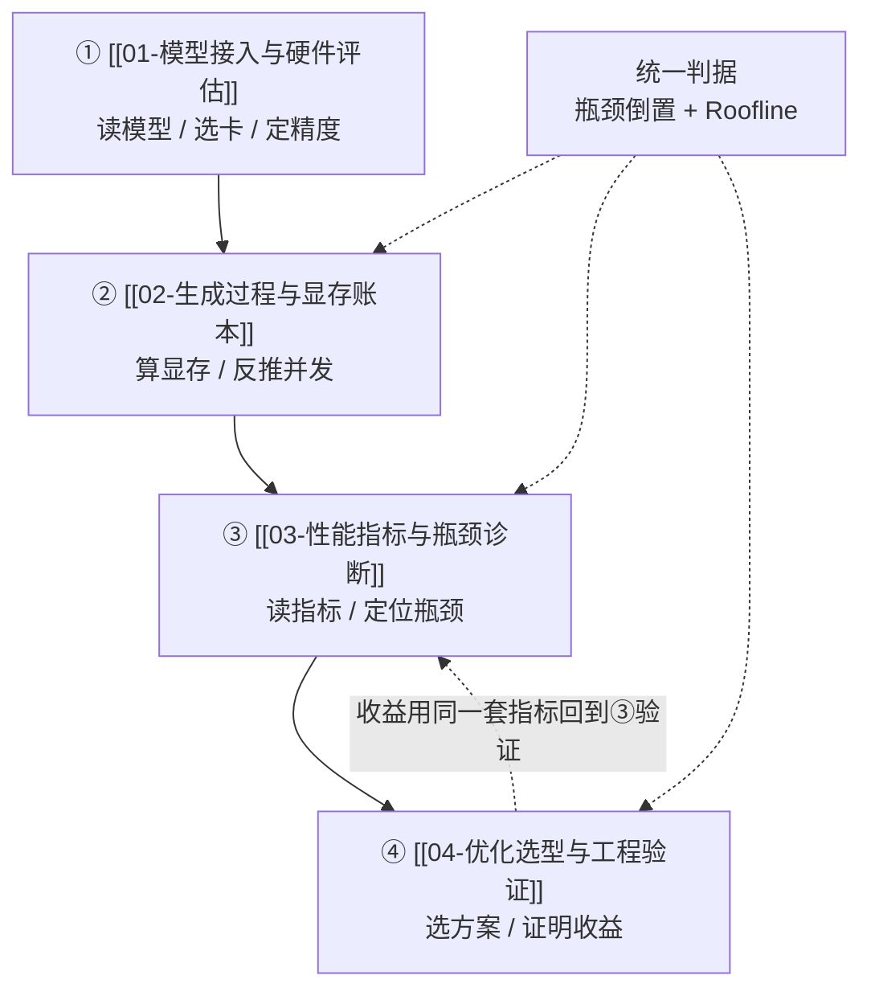

---
tags:
  - ai
  - llm
  - inference
  - moc
created: 2026-11-14
updated: 2026-11-15
status: 索引
---

# 🧠 LLM 推理基础

> **本文件是板块索引**：先给出招聘岗位调研结论，再据此定知识地图、两条判据、四篇笔记的分类依据与章节归属，以及写正文时要守住的事实口径。本篇不展开知识点。
>
> **板块定位**：AI 工程板块的**第一性原理层**，但选题以「推理工程师日常工作用得到什么」为准，而不是按学科完整性铺开。不懂这一层，[[03-vLLM]] 的每个参数、[[06-推理服务工程]] 的每个容量结论都只是背下来的配置项。

## 一、岗位调研结论（本次重组的依据）

> 2026-11-15 检索 BOSS 直聘、猎聘、百度招聘、牛客与高校就业网（清昴智能、百川、阿里、字节、华为、百度、群核、智元、青云等）、以及英文 Inference Engineer JD，交叉约 20~25 份 2025Q4–2026Q4 的真实岗位描述；另参考大厂面试题库与 AI Infra 技能路线图做校准。

**JD 里反复出现的能力要求，以及在本板块的落点**：

| 高频要求 | 落点 |
|---|---|
| Transformer 推理全链路：两阶段特征差异、KV Cache、Attention 家族（MHA/GQA/MQA/MLA）、MoE | ① · ② |
| KV Cache 显存公式与容量估算；**TP 下 `n_kv_heads / TP`** 的白板陷阱 | ② |
| 指标与数字敏感性：tokens/s、TTFT、TPOT/ITL、SLA、GPU 利用率、单位 token 成本 | ③ |
| Roofline、GPU 内存层次、显存/算力/调度**瓶颈三分法** | ③ |
| Nsight Systems/Compute、PyTorch Profiler、DCGM/nvidia-smi；可复现性能报告、故障复盘 | ③ · ④ |
| 优化矩阵：Continuous Batching、PagedAttention、Prefix Cache、Chunked Prefill、投机解码、PD 分离 | ④ |
| 量化选型与精度验证（FP8/INT4/AWQ/GPTQ）；**「不需要自研量化算法」但要能设计验证体系** | ① · ④ |
| 并行与通信：TP/PP/EP/CP/DP、NCCL/HCCL、NVLink/RDMA、TP 度取舍 | ④ |
| 新模型 Day-0 上架：分析模型结构与权重、算子/格式/并行适配 | ① |
| 服务化（热加载、扩缩容、限流、灰度、负载均衡） | **不属本板块** → [[02-KServe]] · [[05-推理网关与路由]] · [[06-推理服务工程]] |
| 算子开发（CUDA/Triton/CUTLASS）、国产算力适配、多模态/DiT | 专项岗方向，**本板块只作定位说明**，不展开 |

> 📌 招聘方真正在筛的能力，可以概括成一句话：**不看 benchmark，也能从 Roofline 和 KV Cache 公式推出瓶颈在哪，并且用数据证明优化收益**。多份 JD 明确要求「能讲清做了什么、为什么有效、收益多少」「数据驱动、可复现实验」。因此本板块把「算得清、读得准、选得对、验得了」作为组织主线。

### 本次相对上一版骨架的重构

| 变化 | 理由 |
|---|---|
| 取消「输入表示与 Token 化」独立篇，压成 ① 的一节 | JD 几乎不考 BPE 算法、位置编码外推、线性注意力/SSM；但 token 估算、chat template 错配确实影响服务，保留**工程影响**部分 |
| 「模型结构」与「硬件规格」合并为 ① 模型接入与硬件评估 | 二者本就是「新模型 Day-0 上架评估」这一个完整任务，拆开割裂 |
| **新增** ③ 性能指标与瓶颈诊断 | 招聘 JD 里最刚性的工程能力（指标口径 + Roofline + Profiler 工具链 + 线上排障），上一版完全缺失 |
| ④ 从「优化技术罗列」改为「优化选型与工程验证」 | JD 要求会选、会验、能讲清收益，而不是背技术名词 |
| 篇数 5 → **4** | 按真实工作任务数定篇，不凑数 |

## 二、板块定位与三条硬边界

| 要回答的问题 | 归属 |
|---|---|
| 一个模型能不能跑、要几张卡、显存怎么算、瓶颈在哪、优化怎么选怎么验 | **本板块（原理 + 工程判断，4 篇）** |
| 这些约束如何被工程实现（PagedAttention 数据结构、调度器、引擎） | [[03-vLLM]] · [[04-Triton]] |
| 服务怎么变成声明对象、灰度与弹性 | [[02-KServe]] |
| 请求路由、KV 感知调度、限流与过载保护 | [[05-推理网关与路由]] |
| 压测方法论、SLO、容量规划、成本模型、供应链安全 | [[06-推理服务工程]] |
| GPU 驱动 / 设备插件 / MIG / DRA / 集群调度 | [[01-GPU Operator]] |

> 📌 **「结合工程需要」不等于「掺项目场景」**：选题以岗位实际任务为准（算显存、读指标、选量化、做验证），讲的是**通用工程实践**；不把知识点包进任何具体平台、客户现场或交付流程。这是全库统一原则。
> 📌 另两条硬边界：**不写训练**（SFT/RLHF/DPO/LoRA 属训练与对齐）；**不重复 [[06-推理服务工程]]**（本板块只给指标的物理定义与读数边界，不给压测方法论与 SLO 设定）。

## 三、知识地图：四项工作任务 + 两条横切判据

四篇不是学科章节，而是**一次上线/调优会依次做的四件事**：拿到模型先评估能不能跑（①）→ 算清能承载多少并发（②）→ 上线后读懂指标、定位瓶颈（③）→ 选优化方案并用数据证明收益（④），收益再回到 ③ 的指标体系验证。

> 📌 **判据一（瓶颈倒置，落在 ②）**：Prefill 大矩阵乘、计算受限；Decode 单 token 却要读遍权重与 KV Cache、显存带宽受限。所有优化本质上只做「降 Prefill 计算量」或「降 Decode 访存量」之一。
> 📌 **判据二（Roofline，落在 ③）**：算术强度 = FLOPs / Bytes；把算子放进带宽受限或算力受限区域，就能预判优化是否生效。batch 越过拐点转为算力受限后，继续量化可能**零收益**。
> 📌 两条判据横跨 ②③④，不单独成篇——它们是贯穿全篇的判断方法，不是一类独立技术组件。

## 四、四篇笔记清单与章节归属

| 篇 | 对应的岗位任务 | 要产出的结论 | 状态 |
|---|---|---|---|
| ① [[01-模型接入与硬件评估]] | 新模型 Day-0 支持 / 上架评估 | 能不能跑、几张什么卡、什么精度、还缺哪些适配 | ✅ 已整理（8 图 / 14 问） |
| ② [[02-生成过程与显存账本]] | 容量估算 / 并发规划 / 参数反推 | 显存账、可并发量、`max-model-len`、卡数 | ✅ 已整理（15 图 / 14 问） |
| ③ [[03-性能指标与瓶颈诊断]] | 读指标 / profiling / 线上排障 / 性能报告 | 从异常数字推到瓶颈类型与验证手段 | ✅ 已整理（10 图 / 14 问） |
| ④ [[04-优化选型与工程验证]] | 选优化方案并证明收益 | 选什么、为什么有效、收益多少 | ✅ 已整理（5 图 / 14 问） |

**各篇章节与结论锚点**（写正文时要高亮的那句话）：

| 篇 | 章节 | 结论锚点 |
|---|---|---|
| ① | 读 config / Attention 家族与资源影响 / 权重资产与精度 / tokenizer 与模板 / 输出参数 / GPU 规格与兼容矩阵 / 上架评估结论 | 架构决定可并发量；**TFLOPS 不能换算 tokens/s** |
| ② | 两阶段（判据一）/ KV 推导与数学等价 / KV 公式与白板陷阱 / 显存四项 / 反推并发与卡数 / 公式到真实容量 | **装得下 ≠ 跑得动**；公式是上界，引擎启动日志才是真实容量 |
| ③ | 指标体系 / 口径与读数陷阱 / GPU 体系结构与 Roofline（判据二）/ 瓶颈三分法 / 诊断工具链 / 从现象到归因 / 延迟-吞吐权衡 | **吞吐是容量指标，不是体验指标**；别把所有慢都归成「算力不够」 |
| ④ | 优化矩阵按瓶颈归类 / 调度与缓存类 / 量化选型与精度验证 / 并行与通信 / 解码加速与阶段拆分 / 长上下文与 MoE 边界 / 怎么证明有效 | 每项优化都要回答「**动的是计算量、访存量、步数还是并行度**」；**收益必须可复现** |

## 五、外部引用锚点对照（防止写正文时漏掉）

库内六篇已整理笔记共 19 处反向指向 `[[LLM 推理基础]]`，写正文时必须让下列内容**有明确篇目可落**：

| 引用方 | 明确索取的内容 | 承接篇 |
|---|---|---|
| [[03-vLLM]]（§显存 / 关联） | KV Cache 公式、权重显存估算、参数反推并发的推导 | ② |
| [[06-推理服务工程]]（§容量 / 关联） | 显存估算公式、KV Cache 公式 | ② |
| [[05-推理网关与路由]]（§KV 分层 / 关联） | prefill/decode 原理、KV Cache 显存公式 | ② |
| [[01-GPU Operator]] / [[02-KServe]] / [[04-Triton]] | 显存估算、原理上游 | ② · ① |
| [[AI Infra]]（§分层地图 / 学习路线） | KV Cache 公式、显存估算、prefill/decode 原理、**采样参数**、**模型许可证** | ② / ①（采样与许可证） |
| [[RAG 与知识库]] | 上下文窗口与 token 成本 | ① |
| [[AI 工程]]（学习路线） | 「不懂显存估算装不对模型」 | ② |

> ✅ 四篇已全部整理完成，上表锚点均已落地；② 是全库引用最密集的一篇，19 处引用所需的 KV 公式、显存估算、参数反推在 ② §四~§八，**采样参数**与**模型许可证**在 ① §五与 §4.3。

## 六、面试锚点清单（题目级）

> 前 15 题来自原理推导，后 8 题直接取自 JD 与面经里的高频「送命题」。四篇正文完成后，每题的答案已分布在对应篇的问答区与正文锚点（题号 → 篇目：1~7 → ②，8~13 → ②③④，14~21 → ③④，22~23 → ②④）。

**计算与推导**
1. 给定层数 / 头数 / `n_kv_heads` / `d_head` / 精度 / 上下文 / 并发，算 KV cache 显存并判断卡数。
2. 同一模型从 GQA 换成 MLA，KV 公式怎么改、省多少。
3. **TP=4 时 KV 显存怎么算？** 为什么忘记除以 TP 会差数倍。
4. 由显存预算反推最大并发与 `max-model-len`；解释为何公式结果偏乐观。
5. 由显存带宽与每 token 访存量，估算单请求 decode 的 tokens/s 上界。
6. 手算一次 prefill 的 FLOPs 量级，说明为何它决定 TTFT。
7. 70B 模型放在 4 张 80G 卡上，给出权重 / KV / 激活的分配方案。

**辨析**
8. 为什么 decode 带宽受限而 prefill 算力受限？加 batch 会改变结论吗？
9. KV Cache 为什么不改变数学结果？什么场景下不适用？
10. 量化省的是显存、带宽还是算力？为什么 batch 大了以后继续量化可能没收益？
11. TTFT / TPOT / ITL / E2E / goodput 的定义边界；为什么 throughput 高不代表体验好？
12. 上下文窗口、有效上下文、位置外推三者区别。
13. 投机解码是「免费加速」吗？什么前提下保持输出分布不变？

**JD 送命题（答错即减分）**
14. **PagedAttention 到底解决什么？** 答「显存不够」或「KV Cache 太大」都是错的。
15. **Continuous Batching 解决什么？** 说不出静态 batch 在长度不均时空转就不合格。
16. **Prefix Caching 命中率为 0 的典型原因？** 前缀里塞时间戳 / 随机 ID / 用户 ID。
17. **降精度为什么不是无代价？** 质量退化先看难任务，平均分掩盖。
18. **Chunked Prefill 消除的是什么尖刺？** 长 prefill 抢占 decode 造成的 ITL 尾延迟。
19. **投机解码什么时候反而更慢？** acceptance rate 低、draft 开销大于收益。
20. **QPS 从 10 涨到 50、还是那张卡，先动哪个参数？** 先判断瓶颈在 prefill 还是 decode，而不是直接加卡。
21. 一个系统 GPU 利用率只有 40%，按「显存 / 算力 / 调度」三类给出排查路径。

**设计题**
22. 长上下文请求延迟飙升，指出瓶颈在哪一层，给出三个不同层级的优化及代价。
23. 为一个模型选精度与并行度，说明精度-硬件-引擎三者如何互相约束。

## 七、写正文时必须核对的事实口径（防知识性错误）

| 易错点 | 正确口径 |
|---|---|
| KV 公式里的 `2` | 是 **K 与 V 两份张量**，不是「2 字节」也不是层数；精度字节单独乘 |
| 头数与 TP | 用 `n_kv_heads`；**TP 切分后本地头数为 `n_kv_heads / TP`**，漏掉会差数倍 |
| MLA | 缓存压缩潜向量 + 解耦 RoPE 键，**不能套 GQA 公式** |
| PagedAttention | 解决的是**显存碎片化**（预留连续空间 + 变长申请释放造成的浪费），不是「显存不够」；吞吐提升来自同显存容纳更多并发序列，是**间接收益** |
| Continuous Batching | 解决静态 batch 等最慢请求完成造成的空转，不是让单个请求变快 |
| Prefix Caching | 要求前缀完全一致；动态内容会使命中率归零 |
| TPOT vs ITL | TPOT 是每请求平均 `(E2E−TTFT)/(输出 token 数−1)`；ITL 是逐 token 间隔分布；工具对首 token 是否计入口径不一致；单 token 输出下 TPOT 未定义 |
| goodput | 两种口径：观测窗口内满足 SLO 的吞吐，与 DistServe 式「每 GPU 满足 SLO 的最大请求率」；引用时写明 |
| 推测解码 | 严格验证下保持目标分布（无损）；draft 开销与接受率决定实际收益 |
| FP8 / FP4 支持 | 与 GPU 架构强绑定；不原生支持的硬件由引擎解包到 BF16，只剩显存收益、没有算力收益 |
| 并行 | FSDP / ZeRO 属训练侧；推理主力是 TP，MoE 用 EP，长序列用 CP |
| 版本口径 | 引擎版本、格式支持矩阵、模型许可证会变，写成「按版本核实的兼容表」而非写死结论 |

## 八、结构说明与写作顺序

- **分类依据**：按岗位实际工作任务分 4 篇，不按学科支柱凑数；每篇用「本篇边界」小节互斥。判断方法是：这一章能不能对应 JD 里的一句职责或一个白板题，不能就降级或删除。
- **依赖顺序**：① → ② → ③ → ④，④ 的收益回到 ③ 验证。**四篇全部完成**：①（14461 字 / 8 图 / 14 问）、②（19994 字 / 15 图 / 14 问）、③（15740 字 / 10 图 / 14 问）、④（12671 字 / 5 图 / 14 问），合计约 **6.3 万字 / 38 图 / 56 问**。
- **图表交付情况**（全部完成）：① 8 图（接入流程 / config 去向 / KV 压缩演进 / MLA 解耦 / MoE 双轴 / 权重 dtype 决策 / 精度-硬件绑定 / 评估 checklist）、② 15 图（两阶段 / KV 推导 / 公式分解 / TP 对照 / 显存分项 / 反推流程 / 启动链路 / 块表映射等）、③ 10 图（诊断闭环 / 指标时间轴 / 内存层次 / Roofline / GPU-Util 陷阱 / 三分法决策树 / 工具选择 / 排查路径）、④ 5 图（主线图 / 优化矩阵 / 量化三法 / 并行决策 / 混排时序）。索引保留本文件 1 张地图。
- **目录**：`02-LLM 推理基础/` 下现为 **1 索引 + 4 篇笔记**，序号在文件名上，与 `01-AI Infra` 扁平风格一致，目录不多余。
- 上一版 5 篇骨架已移入 Obsidian 回收站 `.trash/LLM推理基础-旧五篇骨架-20261115/`，可恢复。

## 九、调研依据

**招聘来源（本次重组的主要依据）**：BOSS 直聘、猎聘、百度招聘、牛客与高校就业网上的 AI Infra / 大模型推理工程师 JD（中科类脑、清昴智能、百川智能、阿里、字节跳动、百度 MaaS、华为、群核、智元、青云、南湖研究院、联通等），以及英文 Inference Engineer JD；另用 2026 面试题库、AI Inference Infrastructure Interview Prep、ML Systems Engineer Roadmap 校准面试形态。样本约 20~25 份，跨 2025Q4–2026Q4，属趋势归纳而非全市场普查。

**原理与分类法**：CMU《Large Language Model Systems》、Stanford CME295；Zhou et al. arXiv:2404.14294（数据/模型/系统三层）、Yuan et al. arXiv:2402.16363（四层 + Roofline + LLM-Viewer）、Li & Pan arXiv:2506.21901、Nguyen 2026 全栈四层；kipply《Transformer Inference Arithmetic》、Horace He《Making Deep Learning go Brrrr》、Lilian Weng 综述；FlashAttention / PagedAttention / Speculative Decoding / DistServe / GPTQ / AWQ 原始论文；vLLM、SGLang、TensorRT-LLM 文档与 GenAI-Perf / LLMPerf 指标口径。

## 十、关联

- 本板块四篇 → [[01-模型接入与硬件评估]] · [[02-生成过程与显存账本]] · [[03-性能指标与瓶颈诊断]] · [[04-优化选型与工程验证]]
- 上游 → [[AI 工程]] · [[AI Infra]]（分层知识地图 §2 / §4）
- 下游（原理落地）→ [[03-vLLM]] · [[04-Triton]] · [[02-KServe]] · [[05-推理网关与路由]] · [[06-推理服务工程]]
- 资源与观测 → [[01-GPU Operator]] · [[02-可观测性]] · [[Kubernetes]]
- 相邻板块 → [[RAG 与知识库]] · [[Pi-agent]]
