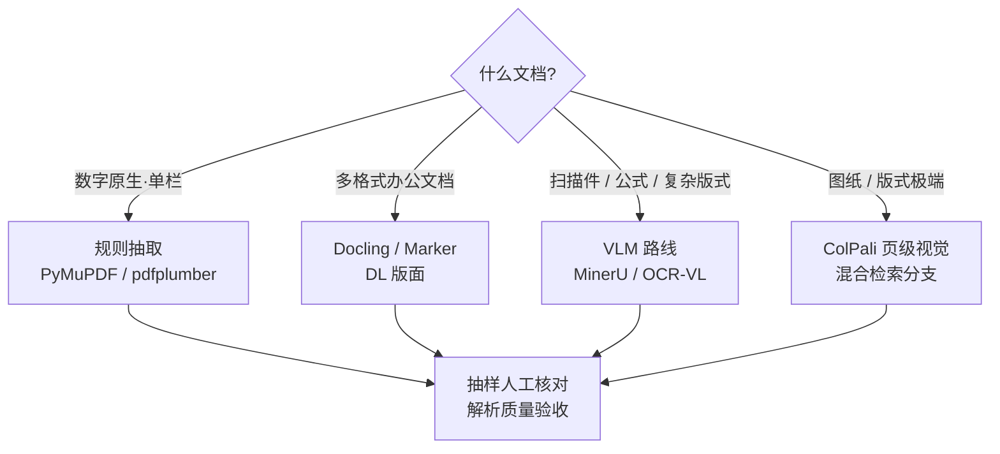
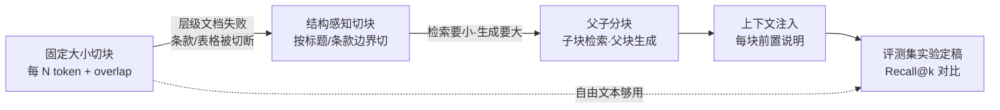
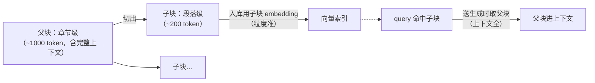
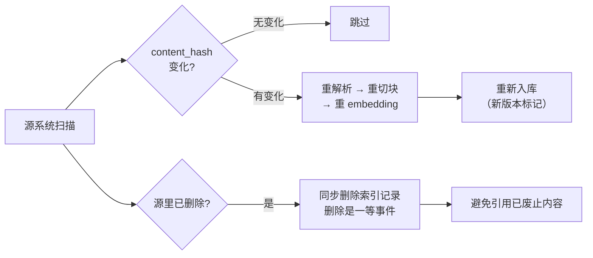

---
tags:
  - ai
  - rag
  - ingestion
  - 面试
created: 2026-11-15
updated: 2026-11-15
status: 已整理
---

# 🗂️ 知识入库与文档处理

> **面向面试 / 面向工程**：给定一批格式混杂的企业文档，能设计「解析 → 清洗 → 切块 → 元数据」的入库管道，指出每一步的质量风险，并用实验（而非拍脑袋）选定切块策略。
>
> **本篇不写什么**：Embedding 选型与向量索引在 [[02-检索链路与排序]]；权限模型与增量更新机制在 [[05-生产化与进阶模式]]（本篇负责把 ACL / 版本 / 哈希这些**字段**打好）；指标定义在 [[04-评估与迭代]]。

**全文主线**：企业文档的复杂度集中在「版式」而不是「语言」→ 解析质量是整条管道的源头（OCR 错了后面全错）→ 切块决定检索单元的粒度与上下文完整性 → 元数据决定检索期能不能过滤 → 清洗去重决定知识的新鲜与一致。**入库是一次性成本，入库错误会被检索反复放大——先治数据，再调检索，最后才轮到模型。**

> 📌 **先记住一句话**：RAG 失败的第一嫌疑人不是检索器，是入库。一个「公司上季度营收增长 3%」的块，丢了「哪家公司、哪个季度」，语义再近也检索不对——**切块与上下文丢失发生在入库时，症状却出现在检索与生成端。**

---

## 一、入库质量决定 RAG 上限

### 1.1 三类入库缺陷与它们的下游症状

| 入库缺陷 | 下游症状（看起来像别的问题） |
|---|---|
| 解析丢失 / OCR 错误 | 「检索不到」——答案根本不在索引里；扫描件乱码污染整批语料 |
| 切块切断语义 | 「召回不准」——相关块在但被切碎；表格问答全错 |
| 元数据缺失 | 「引用旧版」「越权召回」——没法按版本/权限过滤（→ [[05-生产化与进阶模式]]） |

> ⚠️ 这张表是排查的起点：线上答案质量下降时，**先确认答案是否真的进了索引**，再谈检索调优（分层定位法见 [[04-评估与迭代]] §四）。

### 1.2 成本视角：为什么先治数据

入库是**一次性**成本（每个文档处理一次），检索是**高频**行为（每次查询都要受影响）。一次解析错误影响的是「该文档的每一次检索」；一次 Prompt 调优只影响单次生成。把工程预算优先花在源头，是 RAG 与传统调参最大的思路差异。

### 1.3 RAG 与微调的分工：知识注入的两条路

「该补知识库还是该微调」不是二选一——两条路注入的是**不同性质的东西**：

| | RAG（知识放外部，检索期注入） | LLM 微调（知识进参数） |
|---|---|---|
| 适合注入 | 事实性知识：制度、手册、案例——**会更新、要溯源**的企业私有语料 | 行为与模式：输出风格、格式约定、领域话术、任务套路 |
| 知识更新 | 只改索引，增量更新即可（→ [[05-生产化与进阶模式]] §三） | 知识一变就要重训，旧知识还可能残留 |
| 可核查性 | 引用可溯源（→ [[03-生成控制与幻觉治理]] §三） | 不可溯源，「为什么这么答」在参数里 |
| 成本形态 | 一次入库管道 + 每次检索延迟 | 一次训练成本 + 每次推理零额外延迟 |

> 📌 **生产常见组合是互补而非二选一**：微调（或提示工程）管「怎么答」，RAG 管「知道什么」。纯靠微调注入事实性知识，会同时丢掉可更新性与可溯源——这两个恰恰是企业知识库的刚需。注意 **embedding 微调是另一件事**（检索侧的模型适配，→ [[02-检索链路与排序]] §2.3），别与 LLM 微调混为一谈。

---

## 二、文档解析：格式矩阵与版面恢复

### 2.1 格式难度矩阵

| 格式 | 难点 | 处理要点 |
|---|---|---|
| **数字原生 PDF**（有文字层） | 无阅读顺序概念——拿到的是「一堆带坐标的字形」 | 规则抽取即可起步；多栏、页眉页脚需版面识别 |
| **扫描件 PDF** | 无文字层，OCR 质量决定一切 | 中文必须用支持中文版面的 OCR；OCR 错误 = 在管道源头投毒 |
| **Word** | 相对好办 | 按标题层级映射成结构树 |
| **PPT** | 一句话常被拆到两页 | 按页切，每页标题 + 正文合并成一个语义块 |
| **Excel** | 表格不是自然语言 | **宽表转窄表**：每行数据结合表头转成一句有语义的描述文本；直接塞整表检索基本靠运气 |
| **HTML / Wiki** | 导航噪声、目录噪声 | 剥离导航区，保留正文与标题路径 |

### 2.2 四种解析范式（2026 年格局）

| 范式 | 代表 | 机制 | 适用 |
|---|---|---|---|
| **规则抽取** | PyMuPDF、pdfplumber | 直接读文字层 + 几何启发式，CPU 毫秒级 | 数字原生、单栏文档；无 OCR 能力 |
| **深度学习版面** | Docling、Marker | 检测标题/段落/表格/图区域，再重建结构 | 多栏报告、多格式办公文档 |
| **VLM 端到端** | MinerU、各家 OCR-VL | 视觉语言模型一次前向统一做检测/识别/表格/公式 | 扫描件、学术公式、复杂版式；速度慢、要 GPU |
| **页级视觉检索** | ColPali 类 | 不解析，整页渲染成视觉 patch 向量，late-interaction 检索 | 图纸、版式极端的页面；**绕过解析也绕过了文本检索**，向量存储成本极高 |

### 2.3 主流开源工具定位

| 工具 | 定位 | 注意 |
|---|---|---|
| **MinerU** | CJK / 表格 / 公式综合最强，VLM 后端 | GPU 门槛较高 |
| **Docling** | 企业级多格式统一（PDF/DOCX/PPTX/HTML），MIT 许可，可纯 CPU | 数字原生 PDF 上的 OCR 基准分数不是它强项——强项是稳定 schema 输出 |
| **Marker** | 吞吐冠军，Markdown 转换 | 权重许可证对商用有门槛 |
| **PaddleOCR 系** | 中文主场，Apache-2.0 | 许可证敏感企业的常见解 |
| PyMuPDF / pdfplumber | 规则抽取起步，成本最低 | 扫描件完全无用 |

> ⚠️ 工具版本与许可演进很快（VLM 端到端正在系统性替代级联流水线），**选型结论以官方仓库当前版本与许可证为准**——本表给的是定位框架，不是持久答案。

### 2.4 两个专项难题

- **阅读顺序重建**：多栏排版、图文穿插下，直接读文字层会得到「左右栏交错」的乱序文本——版面检测负责给区域排序，这一步决定两栏论文是「连贯段落」还是「胡言乱语」。
- **表格**：表格的失败模式是拆行拆列（一行被切成多块）。工程解法是「表格整体成块」或「宽表转窄表」，并把表头语义注入每行描述——表格问答质量几乎完全取决于这一步的处理方式。

> 📌 **解析验收不可省**：抽样人工核对（如每批抽 5% 看解析产物与原文对照），把「解析完整率」当作入库管道的 SLO。没有这一步，扫描件的 OCR 错误会在检索端表现为神秘的「召回不准」。

---

## 三、Chunking：从固定大小到结构感知

### 3.1 固定大小切块为什么必然失败

按固定 token 数（每 N 块加 10~20% 重叠）是最容易实现也最容易出错的切块：合同条款被拦腰切断、表格拆成两半、「第 4.2 条」和它的标题分家。它在自由文本（faq、短文）上够用，在**有层级结构的文档**（合同、手册、制度）上系统性失败。

### 3.2 大小与 overlap 的取舍

| | 块偏小 | 块偏大 |
|---|---|---|
| 检索精度 | 高（粒度细，命中准） | 低（混入无关内容） |
| 上下文完整性 | 差（跨块答案被切断） | 好 |
| token 成本 | 块数多、检索次数多 | 单块贵、噪声多 |

没有通用数字——**用固定评测集对比不同切块策略的 Recall@k 与答案正确率来选**（方法见 [[04-评估与迭代]]）。常见起点是每块几百 token、overlap 10~20%，但这是起点不是结论。

### 3.3 结构感知切块

有层级的文档按**结构边界**切：标题层级、条款编号、章节。关键是把「父级路径」保留下来（第几章第几节），这既是切块边界，也是 §四 元数据的输入。

### 3.4 父子分块（small-to-big）：检索与生成用不同的块

> 一条关键原则：**检索的最优表示 ≠ 生成的最优表示**。检索要块小（粒度准），生成要块大（上下文全）。父子分块同时满足两者：

### 3.5 上下文注入（Contextual Retrieval）：给每个块补回上下文

切块丢上下文的另一个解法：**入库前给每个块前置一小段（50~100 token）由 LLM 生成的说明**——这份文档是谁、哪一节、在讲什么。Anthropic 的公开实验数据（top-20 检索失败率）：

| 配置 | 失败率 | 相对基线 |
|---|---|---|
| 仅 embedding | 5.7% | 基线 |
| + 上下文注入 embedding | 3.7% | **↓ 35%** |
| + 上下文注入 embedding + BM25 | 2.9% | **↓ 49%** |
| 再加重排（top-150 → top-20） | 1.9% | **↓ 67%** |

> 📌 两个工程要点：① 注入的上下文要**同时进 embedding 和 BM25 索引**（不只是向量侧）；② 这是一次性入库成本（配合 prompt 缓存可以压得很低），但每个块多一次 LLM 调用——高价值文档先做，全量做之前先算成本。数字是 Anthropic 在其测试集上的口径，自己的语料要自己验。

---

## 四、元数据设计：检索期过滤的基础

切块产物不只是文本——**每个块必须携带结构化字段**，检索期的一切过滤（权限、版本、时间）都依赖它们（过滤机制见 [[05-生产化与进阶模式]] §二、§三）：

| 字段 | 内容 | 检索期用途 |
|---|---|---|
| `doc_id` / 来源 | 文档唯一 ID、源系统路径 | 溯源、去重 |
| **`version`** | 版本号 / 生效日期 | 「仅最新版生效」过滤——没有它，新旧版本混排必答错 |
| `ingested_at` | 入库时间 | 时效排序、新旧消歧 |
| **`section_path`** | 父级标题路径（章/节/条） | 定位、父子分块回溯 |
| `doc_type` | 手册 / 制度 / FAQ / 案例 | 路由与过滤 |
| **ACL 标签** | 部门 / 角色可见性 | 检索期权限过滤（字段在这里打，机制在 05） |
| `content_hash` | 内容哈希 | 变更检测、增量更新触发（为 05 打底） |

> 📌 **`version` 字段直接决定能不能答对「最新版」问题**：企业制度频繁修订，几十个版本全进索引后，没有版本过滤的系统必然引用过期参数。这是入库阶段投入产出比最高的一个字段。

---

## 五、清洗、去重与冲突处理

| 问题 | 检测 | 处理 |
|---|---|---|
| **过期文档** | 与源系统对账；生效日期字段 | 下线或版本标记，别让旧版参与检索 |
| **矛盾文档** | 同主题多文档语义冲突 | 人工裁决优先级，或元数据标注权威级 |
| **近重复** | MinHash / embedding 相似度聚类 | 合并或保留主版本，避免同主题块占满上下文 |
| **噪声内容** | 页眉页脚、水印、目录、免责声明 | 规则剔除（版面检测顺带解决） |

**内容哈希与变更检测**：入库时记录每块的 `content_hash`，定期扫描源系统——只有哈希变化的文档触发重解析、重切块、重向量化。这是增量更新的最低实现，完整机制（删除同步、重建窗口）见 [[05-生产化与进阶模式]] §三。

> 📌 **清洗的验收同样是抽样**：每批入库抽一定比例人工核对「解析完整、切块语义完整、元数据正确」，核对率不达标不放量。数据治理规则对 RAG 的影响远大于换一个更聪明的模型。

---

## 六、本篇边界与误判收口

**边界**：
- Embedding 模型选型、向量索引、混合检索 → [[02-检索链路与排序]]
- 权限过滤机制、增量更新与删除同步、重建窗口 → [[05-生产化与进阶模式]]（本篇只负责字段）
- Recall@k 实验方法与指标定义 → [[04-评估与迭代]]
- 检索与生成的失败归因 → [[04-评估与迭代]] §四（本篇给「答案是否进了索引」这个第一检查项）

**高频误判收口**：

| 误判 | 正确认知 |
|---|---|
| 「解析差不多就行，检索能兜底」 | 解析丢失 = 答案不在索引里，任何检索器都兜不了 |
| 固定大小切块 + 10% overlap 万能 | 层级文档（合同/手册）系统性失败；按结构切或父子分块 |
| chunk 大小有通用最优值 | 取决于文档结构与问题粒度；用评测集实验选 |
| 父子分块「多此一举」 | 检索最优表示 ≠ 生成最优表示；子块检索父块生成是生产标配思路 |
| 上下文注入只是「多写点 prompt」 | 是入库前的预处理（同时进向量与 BM25 索引），Anthropic 口径失败率 ↓ 35%~49% |
| 元数据可后补 | 权限/版本/哈希必须在切块时打上；检索期过滤依赖它们 |
| 表格直接切块入库 | 先「表格成块」或「宽表转窄表」+ 表头语义注入 |
| 清洗靠模型自己分辨 | 过期与矛盾文档在入库层治理；指望生成侧「自己判断」不可靠 |

---

## 七、面试高频问答 🎯

**Q1：RAG 上线后效果差，为什么先查入库再调检索？**
答案必须先进索引才可能被检索。解析丢失、切块切断语义、元数据缺失三类入库缺陷的症状（检索不到 / 召回不准 / 引用旧版）与检索器调优问题高度相似，但修法完全不同。第一检查项永远是「答案是否真的在索引里」，然后才按分层定位法往下查（[[04-评估与迭代]] §四）。

**Q2：扫描件 PDF 怎么处理？**
必须走 OCR + 版面识别（VLM 路线如 MinerU 类或中文 OCR 引擎），且中文要用支持中文版面的模型——通用英文 OCR 硬跑中文等于在源头投毒。OCR 质量决定后续所有环节，验收靠抽样人工核对解析产物。

**Q3：Excel 表格怎么进知识库？**
两个要点：表格整体成一个语义块（或按行拆），并把表头语义注入每行——「宽表转窄表」，把每行转成一句有语义的描述文本（如「产品 A 在 2024Q2 的营收为 X」）。直接把整表丢进索引，检索命中基本靠运气。

**Q4：chunk 大小怎么选？为什么没有通用数字？**
取决于文档结构与问题粒度：块偏小粒度准但丢上下文，块偏大上下文全但混噪声。正确方法是固定评测集，对比不同策略的 Recall@k 与答案正确率——几百 token + 10~20% overlap 只是起点。

**Q5：父子分块解决什么问题？**
「检索的最优表示 ≠ 生成的最优表示」：检索要小块（命中准），生成要大块（上下文全）。入库时用子块（段落级）做 embedding 与索引，命中后把父块（章节级）送进上下文——两头都拿到最优。

**Q6：Contextual Retrieval 是什么，收益多大？**
入库前给每个块前置 50~100 token 的 LLM 生成说明（文档是谁、哪一节），注入的上下文同时进 embedding 和 BM25 索引。Anthropic 公开口径：top-20 检索失败率 5.7% → 3.7%（仅 embedding，↓35%）→ 2.9%（加 BM25，↓49%）→ 1.9%（再加重排，↓67%）。成本是一次性的每块 LLM 调用，高价值文档优先。

**Q7：元数据至少要有哪些字段？**
来源 ID、**版本**、入库时间、父级标题路径、文档类型、ACL 权限标签、内容哈希。版本字段决定能不能答「最新版」问题；ACL 字段决定检索期权限过滤；哈希字段决定增量更新触发——三个字段都是在切块时打上，事后无法补。

**Q8：新旧版本文档全进了索引，AI 总引用旧版怎么办？**
根治靠版本元数据 + 检索期「仅最新版生效」过滤；配合入库时对过期版本下线。只靠 prompt 说「请用最新版」不可靠——检索根本没把新版排上来。

**Q9：近重复文档怎么处理？**
MinHash 或 embedding 相似度聚类检测，合并或保留主版本。不处理的后果是同主题多个近似块占满上下文，挤掉真正相关的内容（与 [[02-检索链路与排序]] §六的 MMR 去重是两道不同工序：入库时治理源头，检索时治理候选）。

**Q10：文档解析工具怎么选？**
按范式选：数字原生 PDF 起步用规则抽取（PyMuPDF 类，CPU 毫秒级）；多格式办公文档用深度学习版面（Docling / Marker，注意许可证）；扫描件、公式、复杂版式走 VLM 路线（MinerU 类，要 GPU）；图纸与版式极端页可加 ColPali 类页级视觉检索分支。工具版本演进快，以官方仓库为准，选型后必须抽样验收。

**Q11：多栏 PDF 直接抽文字层会怎样？**
文字层是「一堆带坐标的字形」，没有阅读顺序概念——两栏论文会左右交错成乱序文本。需要版面检测先给区域分类排序（标题/段落/表格/图），再重建阅读顺序。这正是规则抽取与深度学习版面解析的分界线。

**Q12：清洗阶段要处理哪些问题？**
四类：过期文档（对账 + 版本下线）、矛盾文档（同主题冲突人工裁决权威级）、近重复（MinHash / embedding 聚类合并）、噪声（页眉页脚水印目录，版面检测顺带剔除）。验收方式同为抽样人工核对。

**Q13：增量更新在入库层要预留什么？**
每块记录 `content_hash`，定期扫描源系统、哈希变化才触发重解析重入库；同时把删除当作一等事件同步（源删了索引没删 = 自信地答错）。完整机制（对账、重建窗口）见 [[05-生产化与进阶模式]] §三，入库层先把哈希和来源字段打好。

**Q14：为什么说「数据治理对 RAG 的影响大于换模型」？**
入库是全链路的源头且是一次性成本：解析与切块质量决定检索上限，元数据决定过滤能力，清洗决定知识一致性——这三件事没有一件能靠生成侧补救。实践共识是：先做一轮文档清洗与标准化，往往比调模型参数见效更大。

---

## 八、关联

- 索引 → [[RAG 与知识库]]（岗位调研结论 §1、知识地图 §3、事实口径 §7）
- 同板块 → [[02-检索链路与排序]]（切块产物进入索引）、[[03-生成控制与幻觉治理]]（上下文完整性影响忠实度）、[[04-评估与迭代]]（切块实验与 bad case 定位）、[[05-生产化与进阶模式]]（权限 / 版本 / 增量机制）
- 上下文与 token 口径 → [[01-模型接入与硬件评估]]（tokenizer）· [[LLM 推理基础]]（上下文窗口）
- 应用层 → [[Pi-agent]]
- 上游 → [[AI 工程]]
