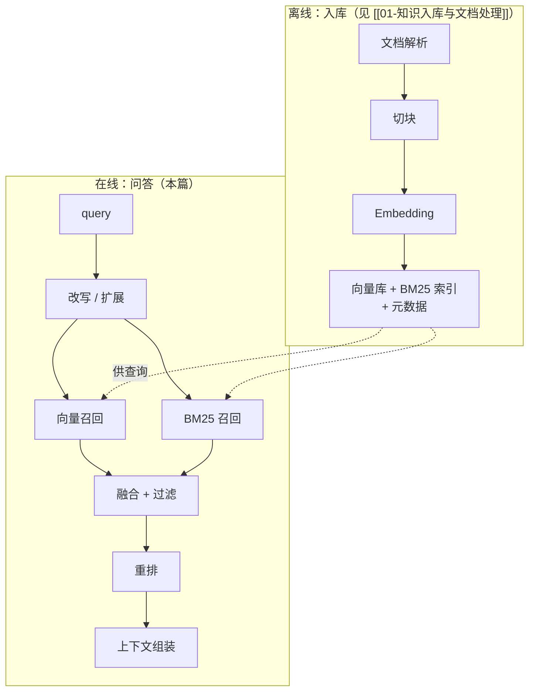
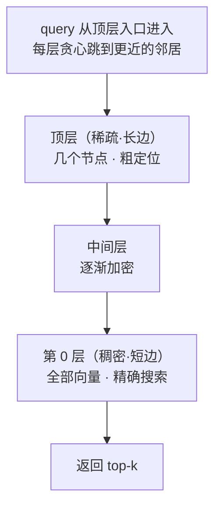
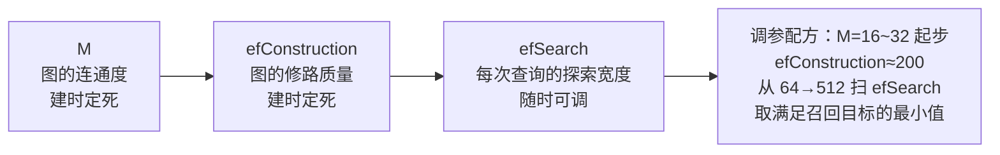
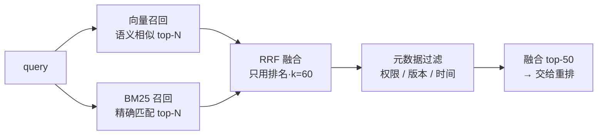
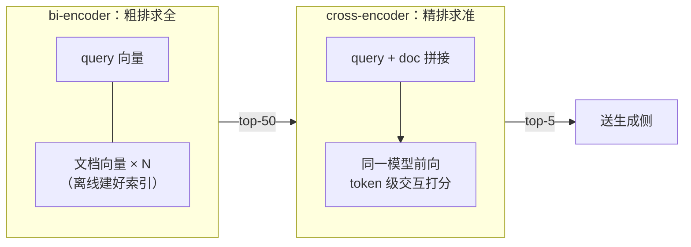

---
tags:
  - ai
  - rag
  - retrieval
  - 面试
created: 2026-11-15
updated: 2026-11-15
status: 已整理
---

# 🔍 检索链路与排序

> **面向面试 / 面向工程**：给定 query 分布与语料特征，能设计「召回 → 融合 → 重排 → 组装」四段链路，说清每一段解决什么、放弃什么、延迟花在哪，并用 Recall@k 实验证明选型。
>
> **本篇不写什么**：切块与解析在 [[01-知识入库与文档处理]]；生成侧约束与幻觉治理在 [[03-生成控制与幻觉治理]]；指标定义在 [[04-评估与迭代]]；权限过滤的模型设计在 [[05-生产化与进阶模式]]。本篇从「拿到用户 query」开始，到「组装好上下文」为止。

**全文主线**：query 的真实形态决定检索手段——语义改写型问题向量能接住，精确编号型问题只有 BM25 能接住 → 所以**默认上混合检索**，用 RRF 把两路结果融合 → 融合后的排序精度不够，交给 cross-encoder 重排 → 最后按 token 预算与位置摆放组装上下文。**每一段都在为下一段缩小候选集：粗排求全（高召回），精排求准（高精度）。**


> 📌 **先记住一组延迟量级**（单查询、本地方案，具体以实测为准）：embedding ≈ 10~50 ms、向量检索 ≈ 20~50 ms、BM25 ≈ 10~30 ms、**重排 ≈ 100~300 ms（常是检索侧最大头）**、LLM 生成百毫秒到秒级。优化延迟先看重排和生成，不要先抠向量库。

---

## 一、检索链路全景：为什么纯向量是教程基线

### 1.1 两条链路



### 1.2 纯向量检索的两个结构性缺陷

| 缺陷 | 例子 | 后果 |
|---|---|---|
| **语义相近 ≠ 答案正确** | 问「Invoice #8829」向量召回「Invoice #8828」——embedding 空间里它们几乎重合 | 相似度排序把错的排在前面 |
| **对精确 token 不敏感** | 错误码、产品型号、法条编号、缩写（INR、AF）在 embedding 里被「泛化」掉 | 关键词信号丢失，召回似是而非的内容 |

> 📌 这就是为什么面试里「怎么建 RAG」的回答如果只有「向量化后放向量库」会被判为教程级——**生产链路的默认形态是混合检索**。实践里混合几乎总是 ≥ dense-only，而额外代价很小（BM25 索引便宜）。

### 1.3 链路每段的失败模式与对策

| 环节 | 失败模式 | 对策（本篇章节） |
|---|---|---|
| query 理解 | 口语化、缩写、多跳 | 改写与扩展（§五） |
| 召回 | 精确匹配丢失 / 语义盲区 | 混合检索（§四） |
| 融合 | 两路分数不可比 | RRF（§四） |
| 排序 | 召回得多但次序乱 | cross-encoder 重排（§六） |
| 组装 | 关键信息被淹没 | lost-in-middle 对策（§七） |

> 📌 **框架与链路的定位**（对应 JD 里「LangChain / LlamaIndex」一栏）：框架是这条链路的**封装**——TextSplitter 对应 [[01-知识入库与文档处理]] 的切块，Retriever / VectorStore 对应本篇 §二~§四，Reranker 对应 §六。链路懂了，框架只是换一套 API；选框架时看它能否暴露各段的可配置点（能否插自选 reranker、能否自定义融合与过滤），而不是按框架教程搭 demo——**框架抽象满足不了的环节（如检索期权限过滤），还是要自己写**（→ [[05-生产化与进阶模式]] §二）。

---

## 二、Embedding 模型：原理与选型

### 2.1 bi-encoder 一句话原理

Embedding 模型把一段文本映射成一个固定维度向量，使「语义相近的文本对」在向量空间里距离更近。训练方式是对比学习（一句话版：拉近正样本对、推远负样本对——训练数学不展开）。**查询与文档分别独立编码**，因此文档向量可以离线算好建索引，在线只需编码 query——这是它能做到毫秒级检索的原因。

### 2.2 选型维度

| 维度 | 要问的问题 |
|---|---|
| 语言 | 中英混合语料要选多语模型（BGE-M3、multilingual-E5） |
| 领域 | 通用模型 vs 领域模型（医疗 MedCPT 类）；领域专名是否被训练语料覆盖 |
| 上下文长度 | 模型最大输入 token 数（切得再好超过上限也要截断） |
| 维度 | 768 / 1024 / 1536——影响索引内存与检索速度，与质量无单调关系 |
| 部署成本 | 本地 GPU/CPU 推理 vs API；延迟与数据出域约束 |
| 排序质量 | 同 corpus 上比 Recall@k，**用自己的评测集**，别只看 MTEB 榜单 |

> 📌 MTEB 是通用基准，**榜单名次与你的业务语料可以完全无关**。选型的正确流程：拿 2~3 个候选模型，在自建评测集上跑 Recall@k，再考虑成本。评测集怎么建见 [[04-评估与迭代]]。

### 2.3 微调与难负例

- **什么时候值得微调**：领域专名密集（医疗、法律、工业），通用模型在自建评测集上明显落后时。微调收益最大的部分往往不是「教它领域知识」，而是**难负例**——让模型学会区分「同领域但不对 answer」的样本（构造方法：同主题不同答案的 chunk、BM25 高分但人工判为不相关的样本）。
- **什么时候不值得**：通用问答、评测集上差距在噪声范围内——先调切块与混合检索，比微调 embedding 便宜且见效快。

### 2.4 多模态 embedding 的定位

CLIP 类模型对齐图文；**ColPali** 类方案直接用视觉模型对文档「页级」做向量表示，绕过解析——适合图纸、扫描页、版式复杂的表格页。属于进阶选项，接入前提是解析路线已经试过且不达标（边界见 [[05-生产化与进阶模式]] §五）。

---

## 三、向量数据库与索引：HNSW 讲透

### 3.1 HNSW 原理：分层图导航

HNSW（分层可导航小世界图）把所有向量组织成**多层图**：每个向量按指数分布随机分配最高层级——绝大多数只住在第 0 层，越往上越稀疏；上层是「高速公路」（节点少、边长），第 0 层是「本地道路」（全量、边短）。查询从顶层入口贪心跳向离 query 更近的邻居，走不动了就降一层继续，整体访问量约 O(log N)。



### 3.2 三个参数：谁管什么、能不能改

| 参数 | 控制什么 | 调大 → | 典型值 | 改动要重建吗 |
|---|---|---|---|---|
| **M** | 每节点每层最大边数（第 0 层常为 2M） | 召回与连通性 ↑，**内存线性 ↑**、构建变慢 | 16~32 | ✅ 要重建 |
| **efConstruction** | 建图时每个节点的候选池大小 | 图质量 ↑（可达召回上限更高），只影响构建时间 | 100~400 | ✅ 要重建 |
| **efSearch** | 查询时第 0 层候选池大小（**必须 ≥ k**） | 召回 ↑、延迟近似线性 ↑ | 64~512 | ❌ 每次查询都能改 |



> 📌 **调参优先级**：efSearch 是日常主旋钮（不用重建，可按负载逐查询调整）；efConstruction 建库时可以大方给足（只花构建时间）；M 慎重——改它意味着重建整个索引。若 efSearch 扫到 512 仍达不到召回目标，问题在图质量，回去重建（加 M 或 efConstruction）。
>
> ⚠️ 各家参数名不同但语义相同：pgvector `hnsw.ef_search`、Qdrant `hnsw_ef`、FAISS `efSearch`。另注意 **efSearch ≥ k 是硬约束**——候选池比 k 还小是算法上无解的。
>
> ⚠️ **删除是墓碑机制**：HNSW 删节点会在图上留洞，主流实现先打 tombstone 标记隐藏、再择机清理或重建；高频更新会缓慢劣化图质量（对应 [[05-生产化与进阶模式]] 的重建窗口策略）。**带过滤的检索**（只搜某部门）会剪掉图上的路径，朴素实现伤召回，主流向量库都做了 filter-aware 遍历——选型时要验证这个能力。

### 3.3 选型矩阵

| 方案 | 定位 | 什么时候选 |
|---|---|---|
| **pgvector** | Postgres 插件 | 关系数据本来就在 PG 里，不想多维护一套存储；量级中小 |
| **Qdrant** | 自建首选之一，过滤能力强、payload 索引成熟 | 需要重过滤（权限/版本）+ 高性能 |
| **Milvus** | 分布式、十亿级、组件化 | 超大规模、多副本、多租户大集群 |
| **Elasticsearch / OpenSearch** | 检索全家桶 | 本来就用 ES、BM25 是一等公民，混合检索一站式 |
| **FAISS** | 库不是数据库 | 嵌入应用进程、自己管持久化与过滤 |

> 📌 规模判据：HNSW 是**内存索引**——一千万条 768 维 FP32 向量仅向量本体就约 30 GB（加图开销还要多），数据 + 图装不进 RAM 时考虑 IVF+PQ（量化省内存）或 DiskANN（磁盘索引）。多数企业知识库到不了这个量级，**选型瓶颈通常在过滤能力和运维成本，不在召回算法**。

---

## 四、稀疏检索与混合融合

### 4.1 BM25 的不可替代性

BM25 是词频-逆文档频率（TF-IDF 家族）的改进版：词多次出现有增益但**饱和**（k₁ 控制），长文档按长度归一化（b 控制）。它不需要模型、索引便宜，且对**精确 token** 的匹配能力是 dense 检索结构上做不到的——错误码、型号、编号、缩写，BM25 一击即中。

### 4.2 RRF：跨检索器融合的标准答案

两路检索的**分值完全不可比**（BM25 分数无上界，cosine 相似度在 [-1,1]），不能直接加权平均。Reciprocal Rank Fusion 只用**排名**：

```
RRF(d) = Σ_i 1 / (k + rank_i(d))      # k 常取 60
```

每个文档在每路结果里的排名倒数相加：两路都靠前的文档得分高，单路第一名（k=60 时贡献 1/61）压不过双路前十（2 × 1/70 ≈ 0.029 > 0.016）——**RRF 天然奖励「双路共识」**。



> 📌 **alpha 加权融合需要评测集**：按分数加权的混合（如 `alpha·dense + (1−alpha)·sparse`）要先归一化分数再手调 alpha——没有评测集时手调权重没有依据，此时应直接用无参数的 RRF。这是「有评测集才手调权重」这条口径的出处。

---

## 五、Query 改写与扩展：不信任原始 query

用户口语化、缩写、指代、多跳——直接拿原始 query 检索是召回失败的高发源头。四种手段按代价排序：

| 手段 | 做什么 | 代价 | 适用 |
|---|---|---|---|
| **缩写展开 / 词典改写** | INR → 国际标准化比值；错误码 → 语义描述 | 几乎为零（规则表） | 有稳定领域词典时首选 |
| **多查询扩展** | 让 LLM 把一个问题改写成 3~5 个不同角度的查询，结果再融合 | 一次额外 LLM 调用 | 问题表述多样的场景 |
| **HyDE** | 让 LLM 先「假设一份答案文档」，用这份假设文档的向量去检索 | 一次额外 LLM 调用；假设错了会带偏 | query 与文档表述差异大的零样本场景 |
| **step-back** | 先问更抽象的上位问题（「这个条款属于哪类合同」）再检索 | 一次额外调用 | 细节问题需要背景知识时 |


> 📌 **改写有延迟代价**：多查询与 HyDE 各多一次 LLM 调用（百毫秒到秒级），上线前要算进延迟预算（见 [[05-生产化与进阶模式]] §四）。简单 query 直接透传，别为改写而改写。多轮对话的指代消解见 [[03-生成控制与幻觉治理]] §四。

---

## 六、重排：Cross-Encoder 精排

### 6.1 bi-encoder 与 cross-encoder 的结构差异

| | bi-encoder（检索模型） | cross-encoder（重排模型） |
|---|---|---|
| 编码方式 | query 与文档**独立**编码，余弦相似度 | query 与文档**拼接后过同一模型**，token 级注意力交互 |
| 能否预建索引 | ✅ 文档向量离线算好 | ❌ 每对 (query, doc) 一次前向 |
| 精度 | 粗排水平 | 显著更高（能看到细粒度匹配） |
| 速度 | 毫秒级、可全库检索 | 只能跑在**小候选集**上（top-50 级） |



> 📌 **重排的位置是结构性的**：它替换不了召回——对全语料跑 cross-encoder 等于放弃向量索引；它也必须在召回之后——召回负责「宁滥勿缺」（高 Recall@大 k），重排负责「优中选优」（高精度小 k）。常见配置：融合 top-50 → 重排 → top-5 进上下文。

### 6.2 工程要点

- **模型**：bge-reranker 系列（开源可本地部署）、Cohere Rerank（API）——按延迟与数据出域约束选；
- **延迟优化**：重排常是检索侧最大头。手段依次是砍候选池（50→20）、换小模型（层数减半）、与 embedding 阶段并行化、缓存高频 query 的重排结果；
- **MMR 与去重**：Maximal Marginal Relevance 在「相关」与「多样」之间权衡——同主题近乎重复的 chunk 占满上下文是常见的隐性浪费，重排后做一轮 MMR / 近重复合并；
- **难负例的双重角色**：训练 reranker 时要难负例（学会区分），评测时也要难负例（量出真实精度）——同一批数据两个用途。

---

## 七、上下文组装：送给模型前的最后一道工序

### 7.1 lost in the middle

语言模型对长上下文中部信息的利用率显著低于头尾——塞进上下文不等于被读到。对策：

- **位置摆放**：最相关的块放头尾（尤其开头），次相关放中间；
- **宁缺毋滥**：top-5 高置信块通常优于 top-15 混杂块——噪声会稀释注意力还烧 token（有评测支撑再放宽）。

### 7.2 token 预算与压缩

```
上下文预算 = 模型上下文窗口 − 系统提示 − 历史 − 预留输出空间
```

- 每块的实际 token 数要按模型的 tokenizer 算（中文 1 token ≈ 1~2 字，口径见 [[01-模型接入与硬件评估]] §五）；
- **上下文压缩**：对超长文档用小模型抽取相关段落而非整块搬入；父子分块场景送父块前先看预算；
- **引用元数据随块一起组装**：每块带上来源标题 / 路径 / 编号，为生成侧的引用溯源打底（[[03-生成控制与幻觉治理]] §三）。

### 7.3 组装质量自查

```text
□ 最相关的块在头尾，不在中段
□ 每块带来源元数据（可溯源）
□ 无近重复块（MMR/去重后）
□ 总 token 在预算内（按模型 tokenizer 实算）
□ 检索无结果时的拒答路径已定义（不是硬塞噪声）
```

---

## 八、本篇边界与误判收口

**边界**：
- 解析与切块 → [[01-知识入库与文档处理]]
- 生成约束、引用校验、多轮指代消解 → [[03-生成控制与幻觉治理]]
- Recall@k / MRR / RAGAS 定义与评测集构建 → [[04-评估与迭代]]
- 权限过滤模型、延迟预算与缓存体系 → [[05-生产化与进阶模式]]
- 向量库部署形态（容器化、扩缩容） → [[02-KServe]] · [[06-推理服务工程]]

**高频误判收口**：

| 误判 | 正确认知 |
|---|---|
| 「上了向量库就是 RAG」 | 纯向量是教程基线；生产默认混合检索 |
| 只看 MTEB 选 embedding | 榜单与业务语料无关；自建评测集跑 Recall@k |
| RRF 按分数加权 | RRF 只用排名（`Σ1/(k+rank)`，k≈60）；分数加权先归一化且需评测集调参 |
| rerank 能替代召回 | cross-encoder 无法全库跑；二者是「求全 + 求准」的分工 |
| efSearch 越大越好 | 召回-延迟线性交换；取满足目标的最小值；≥ k 是硬约束 |
| 改 M / efConstruction 不用重建 | 两者是建图参数，改动即重建；日常只调 efSearch |
| 删向量库记录等于删知识 | HNSW 删除是墓碑机制，需对账与重建策略（→ 05） |
| 上下文塞得越多越好 | lost in the middle + token 成本；top-5 高置信常优于 top-15 混杂 |
| 改写对所有 query 都上 | 有延迟代价；简单 query 透传，词典改写优先于 LLM 改写 |

---

## 九、面试高频问答 🎯

**Q1：完整检索链路是什么？**
在线四段：query 改写 → 混合召回（dense + BM25 并行）→ RRF 融合 + 元数据过滤 → cross-encoder 重排 → 上下文组装（位置摆放 + token 预算）。离线侧由入库管道供给向量索引、BM25 索引与元数据（[[01-知识入库与文档处理]]）。

**Q2：为什么纯向量检索召回不了「Invoice #8829」？**
Embedding 是语义压缩，相邻数字的向量几乎重合，「#8828」与「#8829」相似度难分；错误码、型号、缩写同理被泛化。修法：混合检索让 BM25 负责精确 token 匹配，RRF 融合两路。

**Q3：RRF 的公式与优点？**
`score(d) = Σ 1/(k + rank_i(d))`，k 常取 60。只用排名不用分值——两路分数不可比（BM25 无上界 vs cosine 有界）时依然可用；数学上天然奖励双路共识（两路都靠前 > 单路第一）。alpha 加权融合需要先归一化分数并用评测集调参，无评测集时用 RRF。

**Q4：为什么需要重排？cross-encoder 强在哪？**
召回阶段的 bi-encoder 独立编码、只能离线建索引，精度是「粗排水平」；cross-encoder 把 query 与文档拼接后过同一模型，token 级注意力能捕捉细粒度匹配，精度显著更高。但每对一次前向，只能跑小候选集——所以结构是「召回 top-50 求全 → 重排 top-5 求准」。

**Q5：HNSW 的三个参数分别怎么调？**
M（每节点边数，16~32 起步，改动要重建，内存线性增长）、efConstruction（建图候选池，100~400，只影响构建时间，可大方给）、efSearch（查询候选池，必须 ≥ k，64~512，日常主旋钮、可逐查询调）。配方：固定 M 与 efConstruction，扫 efSearch 取满足召回目标的最小值；扫满仍不达标回去重建加 M。

**Q6：efSearch 为什么必须 ≥ k？**
查询时算法在候选池里挑 top-k，池子比 k 还小在算法上无解。实践里 efSearch 要显著大于 k——两者的差距才是搜索修正初始路径的余地。

**Q7：向量库怎么选？**
中小量级 + 数据已在 Postgres → pgvector；重过滤（权限/版本）+ 自建 → Qdrant；超大规模分布式 → Milvus；已用 ES 且 BM25 一等公民 → Elasticsearch。判据通常在过滤能力与运维成本，不在召回算法——企业知识库很少到需要 IVF/DiskANN 的量级。

**Q8：HNSW 删除和过滤有什么坑？**
删除走墓碑机制（标记隐藏、择机清理/重建），高频更新缓慢劣化图质量；带元数据过滤会剪掉图路径、朴素实现伤召回，要选 filter-aware 遍历的向量库并实测。这两个点对应生产侧的重建窗口与选型验证（[[05-生产化与进阶模式]]）。

**Q9：Embedding 模型怎么选型？**
用自己的评测集跑候选模型的 Recall@k（MTEB 与业务语料无关），再比部署成本与延迟。领域专名密集且差距明显时才微调，微调收益大头在难负例构造；否则先调切块与混合检索——更便宜见效更快。

**Q10：HyDE 是什么？什么时候用？**
Hypothetical Document Embeddings：让 LLM 先生成一份「假设答案文档」，用它（而不是原 query）的向量去检索，弥合「问题表述」与「文档表述」的向量差异。代价是每次多一次 LLM 调用；query 与文档风格差异大的零样本场景收益明显，简单 query 别用。

**Q11：lost in the middle 怎么应对？**
长上下文中部利用率低。对策：最相关块放头尾、控制塞入数量（top-5 高置信优于 top-15 混杂）、超长文档先压缩再入上下文、按模型 tokenizer 实算预算而不是按块数估计。

**Q12：重排延迟太高怎么优化？**
按收益排序：砍候选池（50→20）→ 换更小的 reranker → 与 embedding/检索并行执行 → 缓存高频 query 的重排结果。先测延迟分布再动手——重排常占检索侧最大头，但不是唯一可压缩项。

**Q13：多查询扩展和 RRF 怎么配合？**
LLM 把一个问题改写成 3~5 个角度的查询 → 每个查询走完整混合检索 → 并集后用 RRF 融合（改写之间分数同样不可比）。注意改写本身有 LLM 延迟，用改写缓存省重复调用；并集膨胀后候选池控制重排成本。

**Q14：怎么验证检索链路的每次改动是有效的？**
固定评测集（golden set）与口径，改动前后跑 Recall@k / MRR 对比，一次只改一个变量（切块、embedding、融合权重、rerank 二选一），坏 case 归档进回归集。方法与报告纪律见 [[04-评估与迭代]] 与 [[04-优化选型与工程验证]]。

---

## 十、关联

- 索引 → [[RAG 与知识库]]（岗位调研结论 §1、知识地图 §3、事实口径 §7）
- 同板块 → [[01-知识入库与文档处理]]（上游供给）、[[03-生成控制与幻觉治理]]（下游生成与溯源）、[[04-评估与迭代]]（选型实验与指标）、[[05-生产化与进阶模式]]（延迟预算、缓存、权限过滤）
- 推理侧 → [[LLM 推理基础]]（上下文窗口、TTFT 口径）、[[03-vLLM]]（生成引擎）
- 上游 → [[AI 工程]] · [[AI Infra]]
