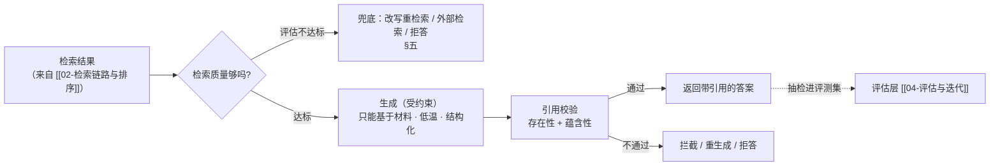
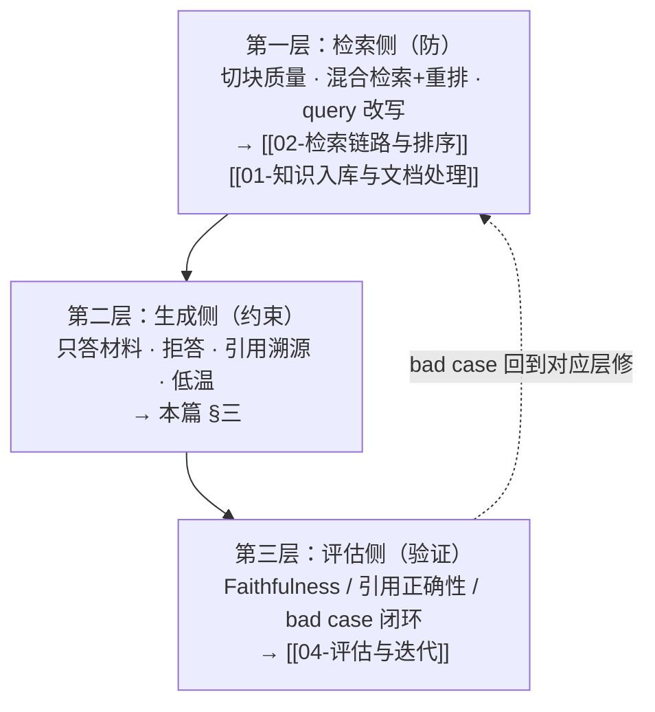
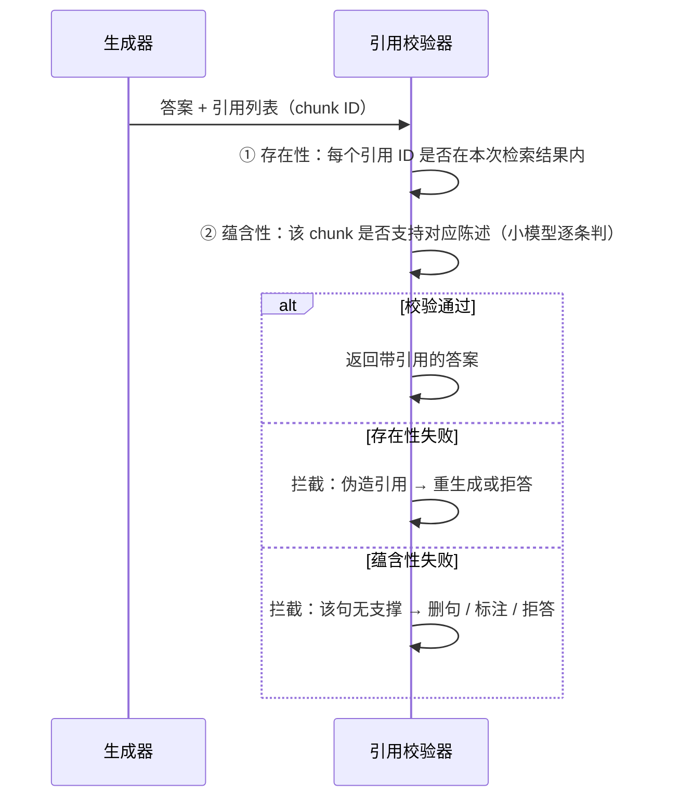
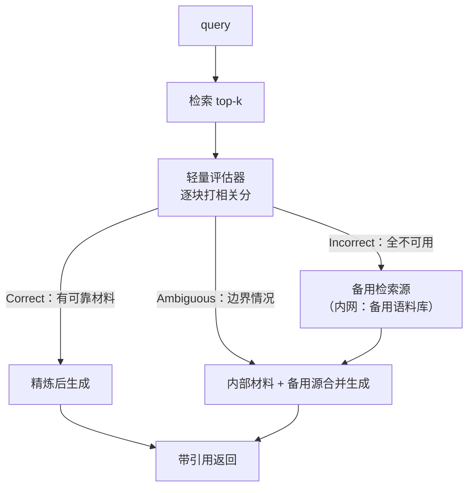

---
tags:
  - ai
  - rag
  - generation
  - 面试
created: 2026-11-15
updated: 2026-11-15
status: 已整理
---

# 🧾 生成控制与幻觉治理

> **面向面试 / 面向工程**：设计一套分层的幻觉治理方案——检索侧防什么、生成侧约束什么、评估侧验证什么；回答「有了检索为什么还会错」「引用怎么保证可核查」；多轮对话下保持答案一致。
>
> **本篇不写什么**：检索链路本身在 [[02-检索链路与排序]]；Faithfulness 等指标怎么算在 [[04-评估与迭代]]（本篇只指向验证层）；权限与知识时效的机制在 [[05-生产化与进阶模式]]。

**全文主线**：幻觉有三种来源，各自的修法不同——没给够要修检索、被忽略要修约束、被淹没要修组装 → 三层治理（检索防 / 生成约束 / 评估验证）缺一层都不完整 → 生成侧的核心是**约束输出只能来自材料 + 引用可校验** → 多轮对话要在检索前把指代补全 → 最后给「检索失败」留出兜底路径：宁可慢一点答对，也不要快一点答错。



> 📌 **一句话立场**：幻觉不是模型的错，是「检索没给够」或「生成没对齐」。治理幻觉的本质，是让模型只能「照着材料说」，材料里没有的，宁可说不知道。

---

## 一、有检索仍会错：幻觉的三种来源

「上了 RAG 为什么还胡说」——因为检索质量、上下文利用、生成约束三件事里任何一件掉链子都会错，且**症状看起来一样（答案错），根因完全不同**：

| 来源 | 机理 | 修法归属 |
|---|---|---|
| **① 检索没给够** | 相关块根本没进 top-k（召回失败），或检索到不相关内容 | 检索侧（[[02-检索链路与排序]] 全篇） |
| **② 给了但被忽略** | 指令约束不够强，模型混入参数知识「自由发挥」；或材料之间相互矛盾 | 生成侧（本篇 §三） |
| **③ 给了但被淹没** | 上下文过长、关键块在中段（lost in the middle），模型「看得见但用不上」 | 组装侧（[[02-检索链路与排序]] §七）+ 生成侧 |
| （衍生）**溯源幻觉** | 答案部分对，但**引用是编的**——不存在的页码、条款号 | 本篇 §三引用校验 |

> ⚠️ CRAG 论文里的经典例子：问「某电影编剧是谁」，检索器返回了**另一部同名电影**的资料——模型拿着错误上下文照样给出自信流畅的错误答案。**生成器把检索文本当作可信上下文，坏检索直接制造幻觉**——这就是为什么治理必须从检索质量评估开始（§五），而不是只在 prompt 里写「请不要编造」。

---

## 二、三层治理框架



| 层 | 治什么 | 单独用的盲区 |
|---|---|---|
| 检索侧防 | 从源头保证「有料」 | 材料对了但模型仍可能自由发挥 |
| 生成侧约束 | 保证「照着材料说」 | 检索没给够时，再强的约束也只输出「不知道」——约束不产出信息 |
| 评估侧验证 | 证明「真的没编」 | 只能发现问题，不能修复 |

> 📌 面试答「怎么治幻觉」的结构就是这三层：先说分层，再说每层两条具体手段，最后强调「检索侧没给够时，生成侧无解」——这句话能把「只会在 prompt 里写不要编造」的候选区分出来。

---

## 三、生成侧约束：只能照着材料说

### 3.1 Prompt 硬约束与拒答设计

约束要让模型**没有编造的余地**，而不是「请求」它诚实：

```text
生成约束要点：
□ 「只依据给定材料回答；材料不含相关信息时，明确回答『材料中未涉及』」
□ 每个事实性陈述绑定来源编号（引用与答案同构）
□ 不确定时降级为部分回答 + 指出缺口，而不是补全
□ 拒答是正常路径：检索无结果 / 全部低置信 → 走 §五 兜底，不硬答
□ temperature 降到接近 0（采样参数口径见 [[01-模型接入与硬件评估]] §五）——
  低温降低随机性，但治不了「材料本身错」或「没给够」
```

### 3.2 引用溯源：「有引用」不等于「引用对了」

引用可核查要过**两道独立的检查**，缺一不可：

| 检查 | 问题 | 典型失败 |
|---|---|---|
| **引用存在性** | 被引用的 chunk 是否真的在这次检索结果里？ | 模型编造页码 / 条款号（溯源幻觉） |
| **引用蕴含** | 被引用的 chunk 是否真的**支持**这句话？ | 引用真实存在，但内容并不蕴含结论（断章取义、多块错误拼接） |



**工程防范**：要求模型**摘抄材料原文**而不是转述数字（数字转述是编造高发区）；返回前用小模型逐条跑蕴含校验，失败句删除或标注——这层校验是把「Faithfulness」从离线指标变成**在线门禁**。

### 3.3 冲突材料的处理

检索结果里两块材料互相矛盾（常见于版本混杂）时，模型会随机偏向一个或强行拼接。生成侧的规则：**明确裁决规则**——按元数据里的生效日期 / 权威级取优先者（字段设计见 [[01-知识入库与文档处理]] §四），并在答案里注明依据的版本；根因治理靠 05 的版本过滤，不该留给模型仲裁。

---

## 四、多轮对话的上下文一致性

### 4.1 指代丢失：多轮检索的第一杀手

第二轮用户问「**它**的申请条件是什么」——「它」不在检索 query 里，直接拿去检索必然失败或漂移。标准解法：**先用 LLM 结合对话历史把 query 改写成自包含形式**，再进检索链路（改写手段见 [[02-检索链路与排序]] §五）。

### 4.2 历史要不要参与检索

| 策略 | 做法 | 取舍 |
|---|---|---|
| 只改写当前轮 | 历史 → 消解指代 → 改写出自包含 query | 简单、延迟低；丢掉多轮积累的上下文 |
| 历史参与检索 | 历史摘要也作为检索输入之一 | 召回更全；易被旧话题带偏、token 成本上升 |
| 混合 | 改写 query 为主 + 最近一轮为辅 | 实践默认起点，按 bad case 调 |

### 4.3 前后答案矛盾的原因

| 现象 | 根因 | 修法 |
|---|---|---|
| 上一轮说 A、这一轮说 B | 语料里新旧版本并存，两轮检到了不同版本 | 版本过滤（[[05-生产化与进阶模式]] §三） |
| 同一问题换个说法答案不同 | 检索漂移（query 表述影响召回） | 评测集覆盖同义改写（[[04-评估与迭代]]） |
| 后一轮无视前一轮的约束 | 历史没有进入上下文组装 | 历史摘要压缩后随上下文一起组装 |

---

## 五、兜底与降级：检索失败时的出路

### 5.1 CRAG：给检索加一道质量闸门

CRAG（Corrective RAG，Yan et al. 2024）在检索与生成之间插入一个轻量评估器，对检索结果打分后走三个分支：

| 分支 | 触发 | 动作 |
|---|---|---|
| **Correct** | 评估置信度高于上限 | 保留材料，做「拆分-过滤-重组」精炼后生成 |
| **Incorrect** | 低于下限 | **丢弃全部检索结果**，转外部检索（原论文用 web search；内网场景换成备用语料库 / 第二套索引） |
| **Ambiguous** | 介于两阈值之间 | 内部材料与外部检索结果**合并**使用——对评估器误判的兜底 |



**评估器该查三件事**（2026 年的生产实践口径，不只是相关性）：**相关性**（是否涉及该主题）、**具体性**（是否包含问题要的具体事实）、**时效性**（时间窗是否匹配——相关且具体的过期材料照样答错，时效的根因治理在 [[05-生产化与进阶模式]] §三）。

### 5.2 Self-RAG 一句话对比

Self-RAG（Asai et al. 2023）是另一条路线：训练模型在输出中内嵌「反思 token」自行判断要不要检索、材料是否相关、答案是否被支持。**需要专门微调模型**；CRAG 是外挂包装（任何检索器与生成器都能套），工程上通常是先落 CRAG。两者的定位差异要能说清：**CRAG 是管道模式，Self-RAG 是模型能力。**

### 5.3 降级顺序与代价

```text
降级顺序（从便宜到贵）：
① 低置信 → 改写 query 重检索一轮（一次额外检索）
② 仍低置信 → 备用语料库 / 外部检索（CRAG Incorrect 分支）
③ 仍失败 → 明确拒答 + 转人工（高风险场景）
简单问题路由直答，不进 RAG（避免检索噪声 + 省 token）
```

> 📌 **CRAG 的代价是每请求多一次评估调用**，阈值按业务风险调（高风险问答阈值高、宁可多兜底；FAQ 场景阈值低甚至不设）。它的价值前提是「错误答案的代价 > 一次额外调用的成本」——检索器已经很准的窄域场景，加评估器只买到延迟。

---

## 六、本篇边界与误判收口

**边界**：
- 检索链路与改写手段 → [[02-检索链路与排序]]（本篇只消费它的输出）
- Faithfulness / 引用正确性的指标定义与评测集 → [[04-评估与迭代]]（本篇把校验做成在线门禁，那边定义怎么量）
- 版本过滤与时效治理的机制 → [[05-生产化与进阶模式]] §三
- Agent 编排与工具调用 → [[Pi-agent]]、[[05-生产化与进阶模式]] §五（Agentic RAG）
- 采样参数的推理侧口径 → [[01-模型接入与硬件评估]] §五

**高频误判收口**：

| 误判 | 正确认知 |
|---|---|
| 「RAG 天然没幻觉」 | 检索不到 / 被忽略 / 被淹没三个来源都会错；RAG 只是给了可核查的材料 |
| 「prompt 写不要编造就够了」 | 治「被忽略」，治不了「没给够」；必须三层配套 |
| 「有引用 = 可信」 | 引用存在性与蕴含性是两道独立检查；编造页码与断章取义是两种失败 |
| 拒答是失败 | 拒答是正常路径：材料不含 → 明确说没有；硬答才是事故 |
| 多轮直接拿原话检索 | 指代必须先消解，「它怎么办」检索必然漂移 |
| 前后矛盾是模型不稳定 | 根因常是新旧版本并存或检索漂移；修数据与过滤，不是修 prompt |
| CRAG 会重训模型 | CRAG 是外挂评估器 + 分支路由，模型不动；要训练的是 Self-RAG |
| 评估器只看相关性 | 生产口径查三件事：相关性、具体性、**时效性** |

---

## 七、面试高频问答 🎯

**Q1：RAG 为什么还会有幻觉？**
三种来源：检索没给够（召回失败）、给了但被忽略（约束弱、材料冲突）、给了但被淹没（lost in the middle）；衍生问题是溯源幻觉（编造引用）。三者症状相同、根因不同，治理必须分层。

**Q2：幻觉治理的完整框架？**
三层：检索侧防（切块、混合检索、重排、改写——保证有料）、生成侧约束（只答材料、拒答、引用溯源、低温——保证照着说）、评估侧验证（Faithfulness、引用正确性、bad case 闭环——证明没编）。单靠任何一层都不够：检索没给够时生成侧无解，评估只能发现不能修复。

**Q3：有引用为什么还可能不可信？**
引用存在性与蕴含性是两道独立检查。存在性：引用的 chunk 是否真在检索结果里（防编造页码）；蕴含性：该 chunk 是否真支持这句话（防断章取义与多块错误拼接）。生产做法：答案绑定 chunk ID 返回前，小模型逐条跑蕴含校验，失败句删除或标注。

**Q4：拒答该怎么设计？**
拒答是正常路径而非兜底失败：检索无结果或全部低置信时明确说「材料中未涉及」，高风险场景转人工。工程上把拒答率与拒答正确性（该拒的拒、不该拒的不拒）都纳入评测集。

**Q5：多轮对话里「历史要不要参与检索」怎么取舍？**
默认起点：历史先做指代消解，把当前轮改写成自包含 query（只改写当前轮）——简单、延迟低；召回不足时再加「最近一轮」作为辅助检索输入；全量历史参与检索易被旧话题带偏且 token 成本高。用同义改写的 bad case 评测来决定边界。

**Q6：前后两轮答案矛盾，可能是什么原因？**
三类根因：语料新旧版本并存（两轮检到不同版本 → 版本过滤修）、检索漂移（表述变化影响召回 → 评测集覆盖同义改写）、历史约束没有进入组装。先归因再修，不要直接调 prompt。

**Q7：CRAG 是什么，怎么工作？**
在检索与生成之间加轻量评估器，逐块打分后走三分支：Correct（精炼后生成）、Incorrect（丢弃检索结果、转备用检索源）、Ambiguous（两者合并——对评估器误判的兜底）。原论文评估器是小模型，生产里常用小 LLM；评估查相关性、具体性、时效性三件事。

**Q8：CRAG 和 Self-RAG 的区别？**
CRAG 是**管道模式**：外挂评估器 + 分支路由，模型不动、即插即用。Self-RAG 是**模型能力**：训练模型内嵌反思 token 自行决定是否检索、材料是否相关、答案是否被支持，需要专门微调。工程上通常先落 CRAG；定位差异要能说清。

**Q9：temperature 在 RAG 生成侧扮演什么角色？**
低温降低随机性、让输出更贴材料，但它治不了根因——材料本身错或检索没给够时，低温只是「稳定地错」。采样是输出控制的手段之一，幻觉治理的主体是检索质量与引用校验。

**Q10：评估器的阈值怎么定？**
按业务风险：高风险问答（医疗/合规）阈值调高、宁可多触发兜底与拒答；FAQ 场景阈值低甚至不设评估。同时监控兜底触发率——突然升高往往说明语料出了问题（新领域没入库、版本混乱）。

**Q11：简单问题要不要走 RAG？**
不需要：寒暄、闲聊、明确无关的问题路由直答。好处是省检索噪声（无关块的干扰）与 token 成本；路由本身可以用分类器或轻量 LLM，误路由的代价是漏掉本该检索的问题——用评测集校准路由边界。

**Q12：怎么把「幻觉治理」做成可验证的工程？**
三层都有可测产物：检索层看 Recall@k、生成层看 Faithfulness 与引用校验拦截率、兜底层看触发率与拒答正确率；bad case 归档进评测集做回归。指标定义见 [[04-评估与迭代]]，报告纪律同 [[04-优化选型与工程验证]] §七。

**Q13：材料之间冲突怎么办？**
先在生成侧定明确规则：按元数据生效日期 / 权威级裁决，答案注明依据版本；根因在语料治理——版本过滤（[[05-生产化与进阶模式]] §三）与入库时矛盾裁决（[[01-知识入库与文档处理]] §五）。把仲裁交给模型随机性是最差解。

**Q14：线上突然大量「答非所问」，按什么顺序排查？**
先分检索失败还是生成失败：抽 bad case 查「正确材料是否在 top-k」（在 → 生成侧约束 / 组装问题；不在 → 检索侧）。再看近期变更（语料更新、切块策略、模型版本）、兜底触发率是否异常升高。一次只隔离一层（完整排查路径见 [[04-评估与迭代]] §四）。

---

## 八、关联

- 索引 → [[RAG 与知识库]]（岗位调研结论 §1、知识地图 §3、事实口径 §7）
- 同板块 → [[01-知识入库与文档处理]]（上游：切块质量与元数据）、[[02-检索链路与排序]]（上游：召回与改写）、[[04-评估与迭代]]（Faithfulness 与 bad case）、[[05-生产化与进阶模式]]（版本过滤、Agentic RAG）
- 推理侧 → [[LLM 推理基础]]（采样与上下文）· [[01-模型接入与硬件评估]]（采样参数口径）
- 应用层 → [[Pi-agent]]（编排检索与工具调用）
- 上游 → [[AI 工程]]
