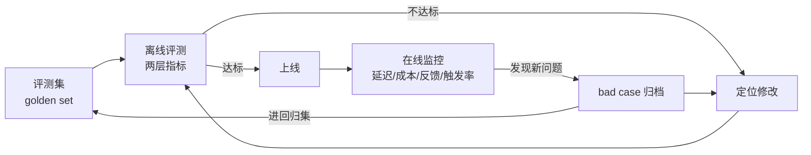
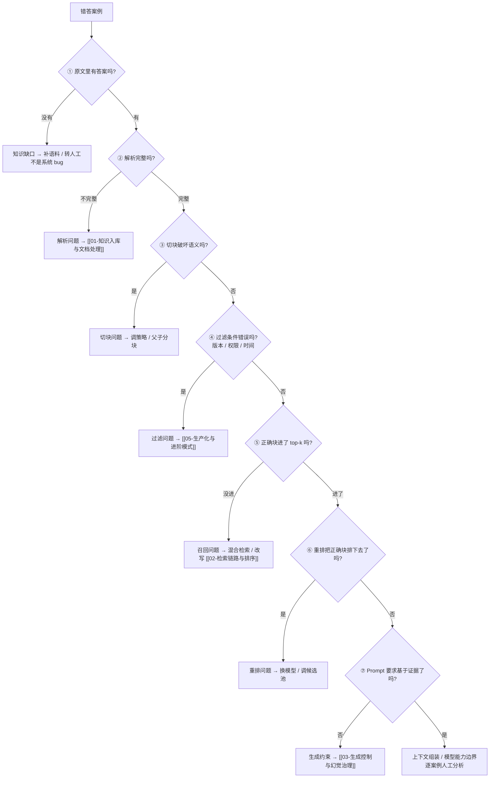

---
tags:
  - ai
  - rag
  - evaluation
  - 面试
created: 2026-11-15
updated: 2026-11-15
status: 已整理
---

# 📊 评估与迭代

> **面向面试 / 面向工程**：为 RAG 系统建立可执行的评估体系——评测集怎么建、指标怎么分层选型、bad case 怎么定位到具体环节；回答「怎么证明这次改动有效」「线上质量下降怎么排查」。
>
> **本篇不写什么**：检索手段在 [[02-检索链路与排序]]；幻觉治理手段在 [[03-生成控制与幻觉治理]]（本篇只定义怎么量它）；推理服务的 TTFT/TPOT 等指标物理定义在 [[03-性能指标与瓶颈诊断]]，压测方法在 [[06-推理服务工程]]——本篇管的是 **RAG 质量指标**，不是服务指标。

**全文主线**：没有评测集的优化是盲调 → 评测集从真实问题里来、按任务分桶、与校准数据分离 → 指标分两层（检索看 Recall@k 系、生成看 RAGAS 三元组系），**两层分开打分才能归因** → bad case 按固定顺序分层定位、一次只隔离一层 → 修一个进回归集一个 → 离线把关改动、在线发现新问题。



> 📌 **顺序不可逆**：先建评估，再调链路。所有「感觉变好了」在没有固定评测集与口径前都不算数——这是区分「Demo RAG」与「生产 RAG」的分水岭，也是 JD 里「独立设计 Bad Case 分析闭环与 A/B 测试方案」的原意。

---

## 一、评估先行：为什么是第一件事

| 没有评测集的团队 | 有评测集的团队 |
|---|---|
| 改动靠感觉验收，改进互相抵消 | 每次改动有 Recall@k / Faithfulness 前后对比 |
| 「检索不行还是 prompt 不行」说不清 | 两层指标分开打分，问题直接归因到环节 |
| bad case 修了又复发 | 修一个进回归集一个，只增不减 |
| 换模型 / 换 embedding 靠信仰 | 同口径实验对比，决策有依据 |

RAG 的「好」是**多维的**：召回要全、答案要忠实、要答了所问、该拒的要拒、还要合规——**没有单一指标**，任何「一个分数定优劣」的方案都在掩盖某一面。评估体系的第一步不是选指标，是承认多维并分层。

---

## 二、评测集构建：一切评估的地基

### 2.1 组成与来源

```text
golden set 构成（常见 100~500 题起步，随业务增长）：
□ 每题四要素：问题 + 期望答案要点 + 来源引用（正确 chunk 应该是什么）+ 所属任务桶
□ 来源 = 真实高频问题抽样（客服记录 / 用户日志 / 业务方访谈），不是工程师编的
□ 期望答案由领域专家参与标注（口径对不对，业务说了算）
□ 覆盖难例：长问题、多跳、口语化、错别字、同义改写
□ 划出独立「校准区」：调参用的数据（如混合检索的 alpha）绝不进验收集——防自证
```

### 2.2 按任务分桶：不同桶考不同的东西

| 桶 | 考什么 | 主看指标 |
|---|---|---|
| FAQ / 单跳事实 | 精确命中 | Hits@1 / MRR |
| 文档问答（手册、制度） | 召回 + 忠实 | Recall@k + Faithfulness |
| 多跳 / 跨文档 | 关联检索能力 | Recall@k（分层答案）+ 人工评 |
| 表格 / 结构化内容 | 解析与切块质量 | Recall@k + 答案正确率 |
| 拒答场景（语料里没有） | 不硬答 | 拒答正确率 |
| 同义改写对 | 表述鲁棒性 | 两版 query 指标差 |

> 📌 **拒答桶与同义改写桶最容易被漏**：前者决定系统「知不知道自己不知道」，后者决定指标波动是不是表述噪声。评测集要版本化管理（语料演进、业务变化时增补），但改动评测集本身也要留档——否则历史对比就断了。

---

## 三、两层指标：检索与生成分开打分

### 3.1 检索层：排序质量指标

| 指标 | 定义一句话 | 什么时候看它 |
|---|---|---|
| **Recall@k** | 正确 chunk 出现在 top-k 中的比例 | **RAG 的首选**——top-k 会全部送进上下文，漏了就答不了 |
| **Hits@1** | 第一位就是正确答案的比例 | FAQ 场景（只取第一条） |
| **MRR** | 正确答案排名倒数的平均（1/rank） | 看排序整体水平；FAQ 与精度敏感场景 |
| **NDCG@k** | 折损累计增益（位置越靠后贡献越小） | 需要分级相关性标注时 |

> 📌 **选型口径**：RAG 把 top-k 全送上下文 → 优先看 **Recall@k**；只取第一条 → MRR 或 Hits@1 更有意义。提高 k 是最便宜也最被滥用的杠杆——它按定义抬 Recall@k，代价是精度、噪声与 token 成本（该代价由重排与组装层消化，见 [[02-检索链路与排序]] §六、§七）。

### 3.2 生成层：RAGAS 三元组与配套

| 指标 | 回答的问题 | 注意 |
|---|---|---|
| **Context Relevance**（上下文相关性） | 检索到的内容对回答有没有用？ | 归因到检索侧 |
| **Faithfulness（忠实度）** | 答案的每条事实是否被上下文支持？ | RAG 特有——普通 LLM 没有这一项；口径 = 被支持的陈述数 / 总陈述数 |
| **Answer Relevance**（答案相关性） | 是否答了用户问的那个问题？ | 答得忠实但答非所问也判低 |
| **引用正确性** | 引用存在 + 引用蕴含（[[03-生成控制与幻觉治理]] §三的两道检查） | 在线门禁 + 离线抽样双重执行 |
| **拒答表现** | 该拒的拒了吗？不该拒的误拒了吗？ | 看拒答桶，两类错误分开算 |
| **Noise Sensitivity** | 无关内容混入上下文时答案退化多少？ | 上下文组装质量的压力测试 |

> ⚠️ **LLM-as-judge 有系统性偏差**（位置偏差、自偏好、长度偏好），自动化评分必须**抽样人工校验**校准，且 judge 模型不要与被评模型同源——否则是在让考生给自己打分。

### 3.3 指标联动诊断：背离比数字更有信息量

两个指标**同向变好**是好改动；**背离**则精确指向问题环节：

| Recall@k | MRR | 解读 | 查哪里 |
|---|---|---|---|
| ↓ | ↓ | 可达的正确 chunk 变少 | 切块 / embedding / 索引新鲜度 |
| — | ↓ | 正确块还在，但排到后面了 | **重排器 / 相似度打分** |
| ↑ | ↓ | 新召回进来了但排在老结果后面 | 加 k 却没加重排；重排权重 |
| ↑ | ↑ | 严格改善 | 放心上线 |

> 📌 实例：Recall@5 从 0.82 → 0.88，MRR 从 0.71 → 0.55——**这不是可上线的改进**：读第一位结果的生成器拿到的正确块反而更少了。背离表是把「两层指标」从记账工具变成诊断工具的关键。

---

## 四、Bad Case 分析闭环：一次只隔离一层

线上 or 离线发现错答后，按固定顺序排查——**顺序就是依赖顺序**，前一层没排除前不动后一层：



**闭环纪律**：
- **一次只隔离一层**——比「换个更强的模型」快得多，且能积累出「哪类问题归哪层」的团队经验；
- **修一个进回归集一个**：每个修掉的 bad case 连同期望答案进评测集，防止复发；
- **归档记录根因类别**：一段时间后各类别占比直接告诉你下一轮投入该给哪一层。

---

## 五、在线监控与 A/B：离线把关，在线发现

### 5.1 离线与在线的分工

| | 离线评测 | 在线监控 |
|---|---|---|
| 回答什么 | 这次改动有没有变好 | 真实流量里新出了什么问题 |
| 时机 | 上线前，每次改动必跑 | 持续 |
| 数据 | 固定评测集 | 真实流量信号 |

### 5.2 线上信号清单

| 信号 | 说明 |
|---|---|
| 查询延迟与 token 成本 | 与检索链路各段延迟联动（→ [[05-生产化与进阶模式]] §四） |
| 检索覆盖率 | 有结果返回（且过置信阈值）的请求占比——骤降常意味着语料或过滤出问题 |
| 拒答率与兜底触发率 | 骤升 = 语料缺口或检索劣化（[[03-生成控制与幻觉治理]] §五） |
| 用户反馈 | 点赞点踩、追问率、转人工率——主观但不可替代 |
| 引用校验拦截率 | 伪造 / 无支撑引用的比例（在线门禁的副产品） |

### 5.3 A/B 测试要点

```text
□ 同流量切分（按用户/请求哈希），实验组对照组同期运行——排除时间性波动
□ 评测口径两臂一致（同一评测集 + 同一 judge 配置）
□ 主指标先定死（防止看完数据再挑指标）
□ 样本量撑起分位数结论，不只看均值
□ 报告遵循可复现纪律：做了什么 / 为什么有效 / 收益多少 / 代价与前提
  （模板与固定变量清单见 [[04-优化选型与工程验证]] §七）
```

---

## 六、本篇边界与误判收口

**边界**：
- 检索手段与重排 → [[02-检索链路与排序]]（本篇只定义怎么量）
- 治理手段 → [[03-生成控制与幻觉治理]]（本篇只定义怎么验证）
- 服务指标（TTFT/TPOT/吞吐）的物理定义 → [[03-性能指标与瓶颈诊断]]；压测与容量 → [[06-推理服务工程]]
- 优化实验的固定变量与报告模板 → [[04-优化选型与工程验证]] §七（方法论同源，对象不同）

**高频误判收口**：

| 误判 | 正确认知 |
|---|---|
| 「先上线再补评估」 | 顺序不可逆：没有评测集的优化是盲调，回补评测集时连基线都没有 |
| 「平均分好就是好」 | 均值掩盖分桶差异；按任务桶分打分，看分位数 |
| 「RAGAS 分数高就放心」 | LLM-as-judge 有系统性偏差（位置/自偏好/长度），必须抽样人工校准 |
| 「Recall@k 涨了就是改进」 | 看 MRR 是否背离——召回进来了排在后面，生成器拿到的第一位反而更差 |
| 「调混合检索权重凭感觉」 | alpha 类参数必须有评测集支撑；没有就用无参数的 RRF（→ 02 §四） |
| 「bad case 修完就完了」 | 修一个进回归集一个；根因类别占比决定下一轮投入方向 |
| 「 Faithfulness 低就换模型」 | 先过分层定位：多数 Faithfulness 问题的根因在检索侧，不在生成器 |
| 「拒答越少越好」 | 该拒不拒是事故（编造）；拒答正确率分两类错误分别算 |

---

## 七、面试高频问答 🎯

**Q1：为什么评估是 RAG 工程的第一件事？**
两个理由：① RAG 的「好」是多维的（召回全、答得忠实、答了所问、该拒就拒），没有评测集就无法在多维之间做取舍决策；② 没有固定口径，任何改动的「变好」都无法与噪声区分。先建评估再调链路，顺序不可逆——回补时连历史基线都补不出来。

**Q2：评测集怎么建？**
每题四要素（问题 + 期望答案要点 + 来源引用 + 任务桶），规模 100~500 起步；问题从真实高频流量抽样而非编造；领域专家参与标注；覆盖难例（多跳、口语化、错别字）与特殊桶（拒答、同义改写）；校准数据与验收集严格分离；评测集本身版本化管理。

**Q3：检索层指标怎么选？**
RAG 把 top-k 全送上下文 → 首选 Recall@k（漏了就答不了）；FAQ 只取第一条 → Hits@1 或 MRR；要分级相关性 → NDCG。提高 k 是最便宜的杠杆也最容易被滥用——它按定义抬 Recall@k，代价是精度与 token，要靠重排与组装层消化。

**Q4：RAGAS 三元组各自回答什么？**
Context Relevance——检索的内容对回答有没有用（归因检索侧）；Faithfulness——答案每条事实是否被上下文支持（RAG 特有指标，口径 = 被支持陈述 / 总陈述）；Answer Relevance——是否答了所问。三者加引用正确性与拒答表现，构成生成层的完整画像。

**Q5：LLM-as-judge 能直接信吗？**
不能直接信：有位置偏差、自偏好、长度偏好等系统性偏差。纪律是抽样人工校准 judge 的输出、judge 模型与被评模型不同源、judge prompt 与配置固定留档。自动化评分的价值在规模化回归，正确性锚点来自人工。

**Q6：Recall@k 涨了但 MRR 跌了，说明什么？**
正确块进来了但排在老结果后面——典型场景是加了 k 没加重排，或重排权重失衡。这不是可上线的改进：读头部结果的生成器拿到的正确块反而更少。两层指标背离时，背离方向本身就是归因。

**Q7：线上答案质量突然下降，怎么排查？**
固定顺序分层定位：① 原文里有没有答案（没有 → 知识缺口，补语料）→ ② 解析完整吗 → ③ 切块破坏语义吗 → ④ 过滤条件错吗（版本/权限）→ ⑤ 正确块进 top-k 了吗 → ⑥ 重排把它排下去了吗 → ⑦ prompt 约束还在吗。一次只隔离一层，先查「答案是否在索引里」永远排第一。

**Q8：bad case 闭环的纪律是什么？**
一次只隔离一层（比换模型快，且积累「哪类问题归哪层」的经验）；修一个进回归集一个（防复发）；归档根因类别（类别占比决定下一轮投入方向）。没有闭环的排查知识只存在个人脑子里。

**Q9：离线评测和在线监控怎么分工？**
离线：上线前把关改动（固定评测集 + 两层指标）。在线：持续发现新问题（延迟、成本、检索覆盖率、拒答率、兜底触发率、用户反馈、引用拦截率）。两者互替不了——离线发现不了真实流量的新分布，在线没有 ground truth 做精确归因。

**Q10：拒答怎么评估？**
分两类错误分别算：该拒没拒（语料没有却硬答——事故）与不该拒误拒（语料有却拒了——体验损失）。两者是同一个阈值旋钮的两端，阈值按业务风险调；拒答桶必须独立成桶才能量出这两类错误。

**Q11：Noise Sensitivity 量的是什么？**
无关内容混入上下文时答案的退化程度——它测的是「上下文组装 + 生成抗噪」的综合质量。过噪声测试差，说明该收紧重排 top-k、做 MMR 去重或上下文压缩，而不是换模型。

**Q12：换 embedding 模型的决策流程？**
同一评测集上候选模型跑 Recall@k / MRR → 显著提升才换 → 换意味着全量重建索引（成本记入决策）→ 灰度验证后再全量。MTEB 榜单不构成决策依据（与业务语料无关，→ [[02-检索链路与排序]] §二）。

**Q13：A/B 测试最容易犯什么错？**
同期运行但评测口径不一致、看完数据再挑指标、样本量不够只报均值、把时间性波动当成改动效果。纪律：按哈希切分流量、主指标先定死、两臂同口径、分位数报告。

**Q14：怎么回答「你怎么证明你的优化有效」？**
固定变量 + 固定评测集 + 前后对比 + 分层指标（这次改动动的是检索层还是生成层，就看那层的指标）+ bad case 回归通过 + 带条件的收益表述。模板与固定变量清单见 [[04-优化选型与工程验证]] §七——RAG 评估与推理优化共享同一套「可复现」纪律。

---

## 八、关联

- 索引 → [[RAG 与知识库]]（岗位调研结论 §1、知识地图 §3、事实口径 §7）
- 同板块 → [[01-知识入库与文档处理]]（解析/切块问题的定位终点）、[[02-检索链路与排序]]（Recall@k 实验选型）、[[03-生成控制与幻觉治理]]（Faithfulness 与引用校验）、[[05-生产化与进阶模式]]（在线监控与成本信号）
- 方法论同源 → [[04-优化选型与工程验证]]（固定变量、可复现报告）、[[03-性能指标与瓶颈诊断]]（分层归因思维同构）
- 上游 → [[AI 工程]]
