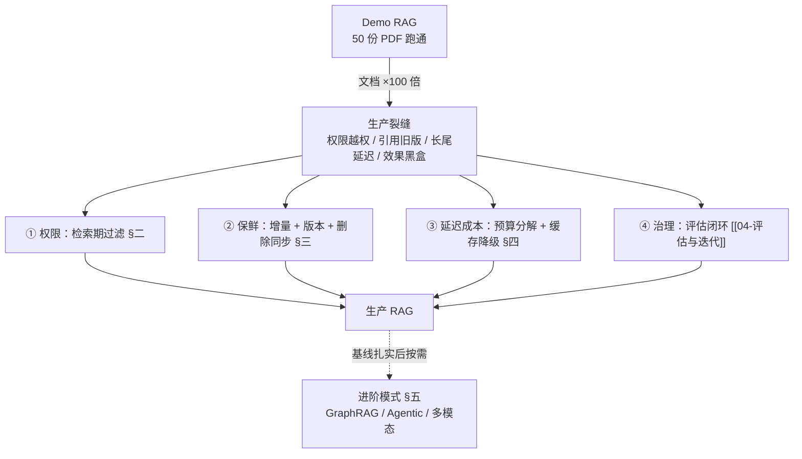
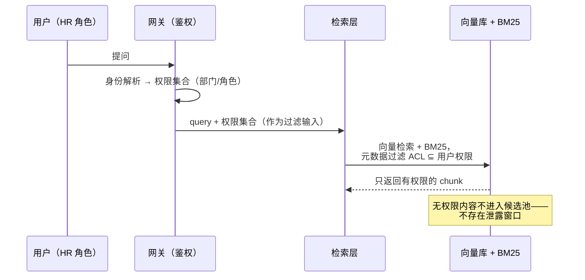
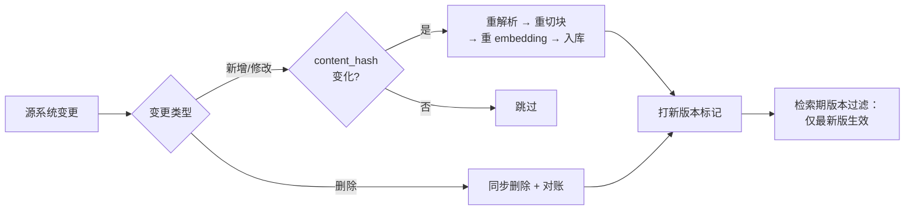
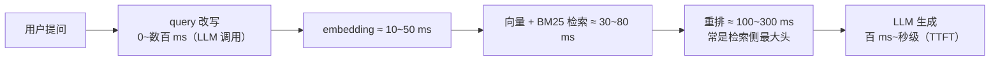

---
tags:
  - ai
  - rag
  - production
  - 面试
created: 2026-11-15
updated: 2026-11-15
status: 已整理
---

# 🏭 生产化与进阶模式

> **面向面试 / 面向工程**：把 Demo 变成生产系统要补的四件事——权限隔离、知识更新、延迟成本、效果治理；以及 GraphRAG / Agentic RAG / 多模态这些进阶模式的选型边界。回答「周末原型为什么到 500 万文档就崩」「企业知识库怎么不做越权漏斗」。
>
> **本篇不写什么**：入库管道与切块在 [[01-知识入库与文档处理]]（本篇讲权限与更新的**机制**，那边讲**字段**怎么打）；检索与生成技术在 ②③；服务化部署形态（容器化、扩缩容、灰度）在 [[02-KServe]] 与 [[06-推理服务工程]]；Agent 编排本身在 [[Pi-agent]]。

**全文主线**：企业 RAG 的失败几乎都不在「把链路搭起来」，而在数据治理、权限、更新与运维体系 → 权限必须做到**检索期过滤**（无权限者检不到），不是生成后过滤 → 知识必须**持续保鲜**（删除是一等事件、版本过滤治「引用旧版」）→ 延迟与成本要有预算分解和降级路径 → 进阶模式（GraphRAG / Agentic）只在基线扎实且确有需求时上，**过度架构比没有架构更贵**。

---

## 一、Demo 与生产的差距

### 1.1 八大生产痛点总览

| # | 痛点 | 表现 | 根因层 |
|---|---|---|---|
| 1 | 幻觉与溯源幻觉 | 召回片段片面/冲突/过时；编造页码条款 | 检索 + 生成（→ [[03-生成控制与幻觉治理]]） |
| 2 | 检索漂移、召回不准 | 固定切块破坏条款表格语义；纯向量丢编号文号；多跳断链 | 入库 + 检索（→ ① ②） |
| 3 | 知识新鲜度失控 | 引用已废止制度；新旧版本混杂 | **更新机制（本篇 §三）** |
| 4 | 权限越权 | 语义相似把涉密片段跨部门召回 | **权限模型（本篇 §二）** |
| 5 | 复杂文档解析弱 | 扫描件、表格、图纸乱码 | 入库（→ [[01-知识入库与文档处理]] §二） |
| 6 | 多轮上下文衰减 | 指代丢失、前后矛盾 | 生成侧（→ ③ §四） |
| 7 | 延迟成本失控 | 长尾延迟、rerank 与 token 累积、高峰雪崩 | **工程预算（本篇 §四）** |
| 8 | 效果黑盒 | 没有评估看板，优化无抓手 | 评估体系（→ [[04-评估与迭代]]） |

> 📌 结论与调研一致：**企业 RAG 的瓶颈不在生成侧，而在数据预处理、检索链路、权限与运维体系**。表中 3、4、7、8 四项的机制都在本篇——这是「教程 RAG」与「企业 RAG」的真正分界。

### 1.2 为什么规模一上来就崩

50 份文档时所有问题都被规模掩盖：全量重建只要几分钟、检索结果肉眼可查、权限靠自觉。文档到百万级后，四个隐含假设同时失效：**全量重建不可行**（必须增量）、**人工审不可行**（必须权限自动化）、**单次检索延迟可忽略**（必须预算分解）、**效果肉眼可判**（必须评估体系）。

---

## 二、权限隔离：企业落地的生死线

### 2.1 向量库不认识「谁能看」

向量检索按**语义相似度**工作，权限是**业务属性**——薪酬制度与考勤制度在向量空间里可能很近，检索器不知道前者只有 HR 能看。不做隔离的后果：低权限员工用巧妙提问套出越权信息，且**检索路径绕过了所有应用层的权限控制**——这是企业信任事故，也是等保与合规审查的硬伤。

### 2.2 检索期过滤 vs 生成后过滤

| 方式 | 做法 | 缺陷 |
|---|---|---|
| ❌ 生成后过滤 | 先检索，LLM 生成后再按权限裁剪答案 | **泄露窗口已经发生**：越权内容进入过上下文与日志；裁剪不干净就是事故 |
| ✅ **检索期过滤** | 每个 chunk 带 ACL 标签（[[01-知识入库与文档处理]] §四），查询时把**用户权限集合作为元数据过滤条件**与向量检索同时执行 | 无权限者根本检不到——「看不见才检得到」 |

### 2.3 实施要点

- **权限粒度**：文档级起步（每块继承文档 ACL），敏感字段做行级 / 列级脱敏（如合同金额只对财务角色可见）；
- **与企业身份体系对接**：权限集合来自统一身份认证（LDAP / OAuth / 内部 RBAC），不要在 RAG 层另建一套账号体系；动态权限变化要有失效机制（用户调岗后旧权限不能残留）；
- **多租户**：namespace / 索引分区隔离租户数据（物理或逻辑隔离按合规要求选，→ [[02-检索链路与排序]] §三）；
- **越权测试是验收项**：用对抗性提问（换说法、组合查询、间接引用）做 red-team，证明无权限内容**检不到**而不是「不容易检到」。

> 📌 **一句话口径**：权限过滤必须在检索期做——「无权限者检不到、不可见、不生成」，三者缺一不可。

---

## 三、知识更新与版本管理：保鲜机制

### 3.1 删除是一等事件

源系统删了文档、向量库没删，系统会**自信地继续引用已废止的内容**——这不是「检索质量问题」，是数据一致性问题。生产要求：删除事件与新增事件同等对待，双向对账（源系统 → 索引），定期校验两边集合一致。HNSW 删除的墓碑机制与重建窗口（[[02-检索链路与排序]] §三）是这层机制在索引侧的落地。

### 3.2 增量更新：哈希触发 + 版本过滤

| 机制 | 解决什么 | 要点 |
|---|---|---|
| **内容哈希触发** | 全量重建不可行 | 只有哈希变化的文档走完整管道（[[01-知识入库与文档处理]] §四打了字段、§五有最低实现） |
| **删除同步 + 对账** | 废止内容继续被引用 | 删除是一等事件；定期双向对账 |
| **版本过滤** | 「AI 总引用旧版制度」 | 检索期按 `version` / 生效日期过滤，历史版本不进候选池 |
| **重建窗口** | 索引参数变更（M、切块策略） | 低峰期批量重建 + 双索引切换灰度（部署形态 → [[02-KServe]]） |

> 📌 真实教训（调研中的典型案例）：几十个版本的产品手册全进索引，系统总引用旧版参数、用户投诉「AI 乱讲」——加版本过滤与「仅最新版生效」规则后问题消失。**数据治理规则对 RAG 的影响远大于换一个更聪明的模型。**

---

## 四、延迟与成本：预算分解与降级

### 4.1 延迟预算分解

各段量级与优化手段详见 [[02-检索链路与排序]] §一、§六。生产层的额外杠杆：

| 手段 | 作用 | 注意 |
|---|---|---|
| **缓存** | 高频 query 的改写结果 / embedding / 最终答案 | 语义缓存按相似度命中，注意权限差异（同 query 不同权限答案不同） |
| **并行化** | embedding 与 BM25 并行；改写与路由并行 | 融合点前必须汇合 |
| **候选池裁剪** | 重排 top-50 → top-20 | 每次裁剪用评测集验证不掉分 |
| **流式返回** | 生成阶段流式输出，降低生成段的首字感知延迟；检索段无法流式，用「检索中」状态反馈掩盖等待 | 口径衔接 [[LLM 推理基础]] 的 TTFT |
| **路由降级** | 简单问题直答；高峰期关闭重排 / 改写 | 降级要可观测（触发率进监控） |

### 4.2 成本漂移

成本会随规模**非线性上涨**：rerank 按候选对计算（O(n)）、改写与 Contextual Retrieval 是每块/每次的 LLM 调用、上下文越长生成越贵。预算纪律：给每条链路算「单次查询成本」，改动前先算账——这也是评估体系（[[04-评估与迭代]] §五）把 token 成本列为一等信号的原因。

---

## 五、进阶模式的选型边界

### 5.1 GraphRAG：索引成本极高，别所有场景硬上

| | 说明 |
|---|---|
| 解决什么 | **跨文档多跳**（客户 → 合同 → 回款 → 审批这类关联链）与**全局主题归纳**（单一向量检索只能取局部匹配，答不了「整体上讲什么」） |
| 怎么做 | LLM 抽取实体与关系建知识图谱 → 社区检测分层摘要 → 检索时图遍历 + 社区摘要 |
| 代价 | **索引成本极高**（每个文档多次 LLM 调用）、图谱更新与语料变更同步困难、查询延迟更高 |
| 什么时候上 | 确有多跳与全局归纳需求、且混合检索 + 重排基线已达标仍不满足 |
| 什么时候不上 | FAQ / 制度查阅 / 单跳问答——**基础混合检索是投入低、维护简单、延迟可控的企业首选基线** |

### 5.2 Agentic RAG：多步检索的代价

让 Agent 决定「要不要检索、检索什么、结果够不够、要不要再查」（query 分解、迭代检索、工具调用）。价值在复杂任务（多跳推理、跨源组合）；代价是**每步都是一次 LLM 调用**，延迟与成本成倍增长，且行为不可枚举、评测更难。生产建议：CRAG 式的**固定 corrective 模式**先行（评估器 + 三分支，[[03-生成控制与幻觉治理]] §五），确有需求再演进到完整 Agent——这是从「可预测」到「更聪明」的渐进路线。

### 5.3 多模态检索：绕过解析的另一条路

ColPali 类方案把文档页渲染成图像、用视觉模型做 patch 向量检索——**绕过解析错误**，对图纸、扫描页、版式极端的表格页有效。代价：视觉 patch 向量的存储成本远高于文本向量、检索延迟更高。选型前提：**文本解析路线已经认真试过且不达标**——它是混合检索体系里的一个分支，不是默认起点。

> 📌 **三条共同原则**：① 先有扎实的「混合检索 + 重排 + 评估」基线，进阶模式的收益才有对照组；② 每种进阶模式都有明确的成本曲线（索引成本 / 延迟 / 存储），上之前先算账；③ 按文档类型分流——多数语料走基础链路，少数难文档走专用分支，比全量上 GraphRAG / 视觉检索便宜得多。

---

## 六、本篇边界与误判收口

**边界**：
- 入库管道、切块、ACL/哈希**字段** → [[01-知识入库与文档处理]]
- 检索、生成、评估的技术内容 → ② ③ ④
- 容器化、扩缩容、灰度发布、成本模型 → [[02-KServe]] · [[06-推理服务工程]]
- Agent 框架与工具调用 → [[Pi-agent]]
- KV 分层与推理侧缓存 → [[05-推理网关与路由]]

**高频误判收口**：

| 误判 | 正确认知 |
|---|---|
| 「权限在生成后过滤就行」 | 生成后过滤存在泄露窗口（越权内容已进上下文与日志）；必须检索期过滤 |
| 「RAG 层自己管账号权限」 | 权限集合来自企业统一身份体系，RAG 层只消费；动态权限变化要有失效机制 |
| 「删文档 = 删向量库记录」 | 删除是双向对账 + 一等事件；HNSW 删除是墓碑机制，需重建窗口策略 |
| 「知识库定期全量重建就行」 | 百万级文档全量重建不可行；哈希触发增量 + 版本过滤是基本机制 |
| 「旧版文档放着不管」 | 无版本过滤必然引用旧版；「仅最新版生效」规则 + 历史版本不进候选池 |
| 「重排加上去就行，延迟无所谓」 | rerank 常是检索侧最大头；预算分解 + 候选池裁剪 + 降级路径是生产必备 |
| 「GraphRAG 更先进所以默认上」 | 索引成本极高；FAQ/单跳场景基础混合检索更优；确有多跳需求才上 |
| 「Agentic RAG 是免费升级」 | 每步一次 LLM 调用，延迟成本成倍；先落 CRAG 固定模式再演进 |
| 「语义缓存对所有用户共用」 | 同 query 不同权限答案不同——缓存 key 必须包含权限上下文 |

---

## 七、面试高频问答 🎯

**Q1：企业 RAG 和教程 RAG 的差别在哪？**
教程 RAG 是「PDF → 向量库 → top-k → 生成」的单向链路；生产 RAG 补四件事：检索期权限过滤、增量更新与删除同步、延迟成本预算与降级、评估闭环。调研结论一句话：瓶颈不在生成侧，在数据治理、权限与运维体系。

**Q2：RAG 的权限隔离为什么不能只在生成后过滤？**
生成后过滤时越权内容已经进入上下文、模型输入与日志——泄露已经发生，裁剪只是事后补救且不彻底。正确做法是检索期过滤：chunk 带 ACL 标签，查询时把用户权限集合作为元数据过滤条件，无权限者检不到、不可见、不生成。

**Q3：权限体系怎么与企业对接？**
权限集合来自统一身份认证（LDAP / OAuth / 内部 RBAC），RAG 层只消费不另建账号体系；动态权限变化（调岗、离职）要有令牌失效机制；粒度从文档级 ACL 起步，敏感字段做行级脱敏；验收用对抗性 red-team 测试证明「检不到」而非「不容易检到」。

**Q4：知识库怎么保证引用的是最新版制度？**
三层机制：入库时每块带版本/生效日期元数据 → 检索期「仅最新版生效」过滤，历史版本不进候选池 → 删除与对账保证废止内容同步下线。只靠 prompt 说「请用最新版」不可靠——检索根本没把新版排上来。

**Q5：为什么说删除是一等事件？**
源系统删了、向量库没删，系统会自信地继续引用已废止内容——这是数据一致性事故而非检索质量问题。工程要求：删除与新增同等对待、双向对账、HNSW 的墓碑删除配合重建窗口策略。

**Q6：增量更新怎么设计？**
入库时记录 content_hash（[[01-知识入库与文档处理]] §四），定期扫描源系统，哈希变化才触发重解析重切块重向量化；删除同步走对账；索引参数变更走低峰重建 + 双索引灰度切换。百万级文档全量重建不可行，增量是唯一可行路径。

**Q7：检索延迟太高，按什么顺序优化？**
先测延迟分布定位大头（rerank 常是最大头），再按收益排序：砍重排候选池 → 缓存（改写/embedding/答案，key 含权限上下文）→ 并行化 → 简单问题路由直答 → 高峰降级（关重排/改写，触发率可观测）。每步裁剪用评测集验证不掉分。

**Q8：语义缓存有什么坑？**
同 query 不同权限的用户答案不同——缓存 key 必须包含权限上下文，否则就是变相越权。另外语义缓存按相似度命中，阈值太松会把不同问题的答案错配。

**Q9：GraphRAG 什么时候值得上？**
确有跨文档多跳关联（客户→合同→回款）与全局主题归纳需求、且混合检索基线达标仍不满足时。代价是索引成本极高（每文档多次 LLM 调用）与图谱同步困难；FAQ、制度查阅、单跳问答用基础混合检索——投入低、维护简单、延迟可控。

**Q10：Agentic RAG 和 CRAG 什么关系？**
CRAG 是固定的 corrective 模式（评估器 + 三分支），可预测、成本低；Agentic RAG 让模型自行决定检索策略与步数，能力更强但每步都是 LLM 调用、行为难枚举、评测更难。生产路线：先落 CRAG，确有复杂多跳需求再演进到 Agent——渐进式，不是二选一。

**Q11：ColPali 这类视觉检索什么时候用？**
文本解析路线认真试过且不达标、文档价值集中在版式（图纸、扫描页、复杂表格）时，作为混合检索体系的专用分支处理少数难文档——不是默认起点。代价是视觉 patch 向量的存储与延迟远高于文本向量。

**Q12：怎么估算一条 RAG 链路的单次查询成本？**
逐段算账：改写（LLM 调用，如有）+ embedding（本地推理或 API）+ 检索（CPU/内存）+ 重排（候选对数 × 模型）+ 生成（上下文 token 数 × 单价）。上下文越长生成越贵——「塞更多块」同时抬高延迟与成本，这就是 top-k 不能无限加的经济学原因。

**Q13：生产 RAG 的验收清单里必须有哪几项？**
功能之外至少四项：越权 red-team 测试（无权限检不到）、删除同步对账（废止内容不再被引用）、延迟分位数与降级演练（高峰雪崩预案）、评估基线与回归集（改动可验证）。缺一项都是上线后的定时炸弹。

**Q14：「进阶模式」的通用决策原则是什么？**
三条：① 基线先行——混合检索 + 重排 + 评估没达标之前，进阶模式的收益没有对照组；② 先算成本曲线——每种模式的索引成本、延迟、存储都要量化后再决策；③ 按文档类型分流——多数语料走基础链路、少数难文档走专用分支，比全量上 GraphRAG / 视觉检索便宜一个量级。

---

## 八、关联

- 索引 → [[RAG 与知识库]]（岗位调研结论 §1、知识地图 §3、事实口径 §7）
- 同板块 → [[01-知识入库与文档处理]]（ACL/版本/哈希字段的出处）、[[02-检索链路与排序]]（延迟预算与过滤执行）、[[03-生成控制与幻觉治理]]（CRAG 与拒答路径）、[[04-评估与迭代]]（在线监控与验收）
- 部署与成本 → [[02-KServe]]（服务化形态）、[[06-推理服务工程]]（成本模型、离线环境）、[[05-推理网关与路由]]（路由与过载保护）
- 推理侧 → [[LLM 推理基础]]（TTFT 口径、上下文窗口）
- 应用层 → [[Pi-agent]]（Agent 编排）
- 上游 → [[AI 工程]]
