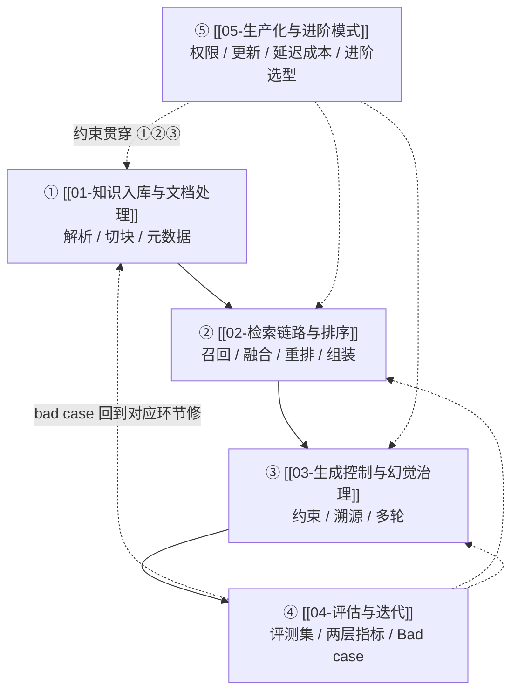

---
tags:
  - ai
  - rag
  - moc
created: 2026-11-15
updated: 2026-11-15
status: 索引
---

# 📚 RAG 与知识库

> **本文件是板块索引**：先给出招聘调研结论，再据此定知识地图、五篇笔记的分类依据与章节归属，以及写正文时要守住的事实口径。本篇不展开知识点。
>
> **板块定位**：AI 工程板块的**应用层基础**——让大模型用上企业私有知识。与 [[LLM 推理基础]]（原理层）分工：那边管「模型怎么跑起来」，这边管「模型知道什么、答案怎么可信」。

## 一、岗位调研结论（本次重组的依据）

> 2026-11-15 检索 BOSS 直聘、猎聘、智联的 RAG / 大模型应用岗 JD（天维信息、赛微瑞云、无锡 RAG 算法工程师、北京垂类知识库团队等），英文 RAG Engineer 岗位画像，企业级 RAG 落地长文（织蝶云、Akantik、nlpx 工程决策点），以及 2026 面试题库（RAG 面试高频、Learnixo 进阶问答）做校准。

**JD 里反复出现的能力要求，以及在本板块的落点**：

| 高频要求 | 落点 |
|---|---|
| RAG 全链路：文档解析 → 分块 → 向量化 → 召回 → 重排 → 生成 | ① · ② · ③ |
| 非结构化文档 ETL：PDF/扫描件/表格，OCR、版面分析（Marker / MinerU / Docling） | ① |
| 分块策略：动态分块、父子分块、元数据增强、切块实验 | ① |
| Embedding 模型原理、BGE / E5 / Jina 选型评测与微调 | ② |
| 向量数据库（Milvus / ES / Weaviate / Qdrant / pgvector）及索引机制（HNSW） | ② |
| 混合检索、RRF、Query 改写、HyDE、多路召回、难负例 | ② |
| 重排序（cross-encoder / reranker）、过滤、MMR 去重 | ② |
| 幻觉治理、引用溯源、拒答设计、多轮一致性 | ③ |
| RAGAS 等量化评估、评测集构建、Bad Case 闭环、A/B | ④ |
| 知识库更新维护机制（增量、版本、时效性）、权限隔离 | ⑤ |
| 高并发检索延迟与吞吐优化、生产级稳定性 | ⑤ |
| GraphRAG、Knowledge Graph 融合、Agentic RAG（多为加分项） | ⑤ |
| LangChain / LlamaIndex 等框架 | **只讲原理与定位**（→ ② §一），不背 wrapper——框架是链路的封装，链路懂了框架就会用 |
| 服务化部署（FastAPI、容器化、扩缩容） | **不属本板块** → [[02-KServe]] · [[06-推理服务工程]] |
| Agent 应用编排、Tool-Calling | → [[Pi-agent]]（应用层） |

> 📌 招聘方在筛的核心能力一句话：**能把「教程 RAG」和「生产 RAG」区分开**——知道瓶颈在数据治理与检索链路而不是模型，权限与增量更新是企业落地生死线，且能用量化评估证明每次改动有效。纯向量检索、只看平均分、说不出 RRF 与 cross-encoder 差异的回答，在 2026 年的面试里都是减分项。

### 本次相对旧骨架的重构

| 变化 | 理由 |
|---|---|
| 8 个占位主题清单 → **5 篇按岗位任务划分的骨架** | 旧清单是主题罗列，没有任务线；JD 的职责天然构成「建库 → 检索 → 生成 → 评估 → 生产化」五步 |
| 取消「运维知识库应用」独立主题 | 项目语境（K8s 文档入库、AIOps 检索案例）违反「纯讲知识点」原则；应用场景归 [[Pi-agent]]，通用场景分散进各篇 |
| 「RAG 原理与流程」不再独立成篇 | 全链路图放在索引知识地图 + ② §一，原理散在各篇定位里，不值得单独一篇 |
| 新增「评估与迭代」独立篇 | JD 把「RAGAS、评测集、Bad case 闭环」写成硬性职责，旧骨架只有一行占位 |
| 新增「生产化与进阶模式」独立篇 | 权限隔离、增量更新、延迟成本是调研里企业落地的生死线；GraphRAG / Agentic 是加分项集中地 |

## 二、板块定位与三条硬边界

| 要回答的问题 | 归属 |
|---|---|
| 知识怎么入库、检索怎么做、答案怎么可信、效果怎么量、怎么生产化 | **本板块（5 篇）** |
| 模型怎么跑起来（显存、引擎、并行） | [[LLM 推理基础]] · [[03-vLLM]] |
| 模型服务怎么部署与扩缩 | [[02-KServe]] · [[06-推理服务工程]] |
| Agent 怎么编排检索与应用 | [[Pi-agent]] |

> 📌 三条硬边界：**不写训练**（Embedding/LLM 微调只讲「什么时候值得做」，训练方法本身不展开）；**不重复 [[06-推理服务工程]]**（那边管容量、SLO、成本模型，这边只管 RAG 质量指标与知识治理）；**不掺项目场景**（运维知识库这类应用归 [[Pi-agent]]，本板块讲通用企业知识库）。

## 三、知识地图：五项工作任务 + 评估闭环

五篇不是学科章节，而是**建一个企业知识库依次要过的五关**：文档变知识（①）→ 找得准（②）→ 答得实（③）→ 量得出（④）→ 落地稳（⑤）。④ 的 bad case 闭环会回到 ①②③ 对应环节修复，⑤ 的企业约束（权限、版本、延迟）贯穿前三篇。

> 📌 **一条主线判据**：RAG 的失败先分「检索失败」还是「生成失败」——检索侧看 Recall@k，生成侧看 Faithfulness；优化动作必须先归因到环节，再动手。这与 [[03-性能指标与瓶颈诊断]] 的瓶颈三分法是同一种思维方式。

## 四、五篇笔记清单与章节归属

| 篇 | 对应的岗位任务 | 要产出的结论 | 状态 |
|---|---|---|---|
| ① [[01-知识入库与文档处理]] | 建库：文档 → 可检索知识 | 解析 / 切块 / 元数据管道设计与质量风险 | ✅ 已整理（5 图 / 14 问） |
| ② [[02-检索链路与排序]] | 检索调优：找得准 | 召回 → 融合 → 重排 → 组装链路与选型 | ✅ 已整理（7 图 / 14 问） |
| ③ [[03-生成控制与幻觉治理]] | 质量治理：答得实 | 三层幻觉治理、引用溯源、多轮一致性 | ✅ 已整理（4 图 / 14 问） |
| ④ [[04-评估与迭代]] | 效果评测：量得出 | 评测集、两层指标、bad case 闭环 | ✅ 已整理（2 图 / 14 问） |
| ⑤ [[05-生产化与进阶模式]] | 企业落地：落地稳 | 权限 / 增量更新 / 延迟成本 / 进阶选型边界 | ✅ 已整理（4 图 / 14 问） |

**各篇章节与结论锚点**（写正文时要高亮的那句话）：

| 篇 | 章节 | 结论锚点 |
|---|---|---|
| ① | 入库质量决定上限 / 解析与版面恢复 / Chunking 策略 / 元数据设计 / 清洗与去重 | **切块质量是 RAG 上限**；检索的最优表示 ≠ 生成的最优表示（父子分块） |
| ② | 链路全景 / Embedding 选型 / 向量库与 HNSW / 混合检索与 RRF / Query 改写 / 重排 / 上下文组装 | **默认上混合检索**；纯向量是教程基线；重排放在高召回粗排之后 |
| ③ | 幻觉三来源 / 三层治理 / 生成约束 / 多轮一致性 / 兜底降级 | **幻觉不是模型的错，是「检索没给够」或「生成没对齐」** |
| ④ | 评估先行 / 评测集 / 两层指标 / Bad case 闭环 / 在线监控 | **没有评测集的优化是盲调**；一次只隔离一层 |
| ⑤ | 生产痛点 / 权限隔离 / 增量更新 / 延迟成本 / 进阶选型 | **删除是一等事件**；权限必须在检索期过滤；先有基线再谈进阶 |

## 五、外部引用锚点（均已落点）

库内共 **18 处**反向指向 `[[RAG 与知识库]]`：板块外 12 处、板块内 6 处（五篇关联区各 1 + 索引自身 1）。下表为板块外引用方及索取内容的落点，均已核对落地：

| 引用方（处数） | 索取的内容 | 承接落点 |
|---|---|---|
| [[AI 工程]]（×2） | 板块定位与学习顺序 | 本索引 §三、§四 |
| [[AI Infra]]（×2）· [[03-vLLM]]（×2）· [[04-Triton]]（×2）· [[02-KServe]]（×1） | 上下文窗口与 token 成本、板块关系 | ② §七（token 预算）+ 本索引 §二 |
| [[LLM 推理基础]]（×2） | 板块分工（原理层 vs 知识层）、token/上下文换算 | 本索引 §二 · ② §七 |
| [[Pi-agent]]（×1） | 知识库检索能力（应用层视角） | 各篇通用场景 + ② §一（链路全景） |

## 六、面试锚点清单（题目级，均已落点）

> 前 12 题来自原理与链路，后 8 题取自调研里的高频「送命题」。**22 题全部有正文落点**：链路原理题分布在 ①②③④ 的「面试高频问答」区（Q2 RAG 与微调分工 → ① §1.3），送命题集中在 ⑤ 与 ③ 的生产主题。

**链路与原理**
1. 完整 RAG 链路：离线索引与在线问答两段各自做什么。
2. RAG 与微调怎么分工？什么场景该选哪个？
3. Chunk 大小怎么选？为什么没有通用数字？
4. 父子分块（small-to-big）解决什么问题？
5. Dense / Sparse / 混合检索的区别；RRF 的公式与为什么用它融合。
6. 为什么需要 reranker？cross-encoder 与 bi-encoder 的结构差异。
7. HNSW 的原理一句话版；efSearch 调大调小各什么后果。
8. HyDE / 多查询扩展 / step-back 各解决什么问题。
9. lost in the middle 是什么，上下文怎么摆放。
10. RAGAS 三元组各自的定义；Faithfulness 和答案正确性的区别。
11. Recall@k、MRR、NDCG 分别适用什么场景。
12. 多轮对话里「历史要不要参与检索」的取舍。

**JD 送命题（答错即减分）**
13. 「上了向量数据库就是 RAG 了」错在哪？
14. 为什么纯向量检索召回不了「Invoice #8829」？怎么修？
15. 有引用仍可能答错——「引用存在」与「引用蕴含」为什么是两个检查？
16. RAG 怎么做权限隔离？只在生成后过滤为什么不行？
17. 企业知识库「AI 总引用旧版制度」怎么治？
18. 源系统删除文档但向量库没删，会发生什么？该怎么设计？
19. rerank 加在链路哪一段？直接对全语料跑 rerank 会怎样？
20. GraphRAG 什么时候值得上、什么时候是过度架构？
21. 线上答案质量突然下降，怎么分层定位？
22. 「评测就看平均分」错在哪？

## 七、写正文时必须核对的事实口径（防知识性错误）

| 易错点 | 正确口径 |
|---|---|
| RRF 公式 | `score = Σ 1/(k + rank_i)`，k 常取 60；只用排名不用原始分值，跨检索器分数不可比时仍可用 |
| cross-encoder vs bi-encoder | bi-encoder 独立编码可离线建索引；cross-encoder 每对 query-doc 一次前向，精度高但只能小候选集在线跑 |
| rerank 位置 | 在「高召回粗排」之后、生成之前；候选池常见 top-50 → top-5；对全语料跑 rerank 等于放弃向量索引 |
| HNSW | 多层图导航；efSearch ↑ 召回率 ↑ 延迟 ↑；M 是每节点连接数；构建参数与查询参数是两组 |
| 混合检索权重 | alpha 加权融合的权重必须用评测集调，无评测集时用 RRF（无参数） |
| RAGAS 三元组 | Context Relevance（检索的相关性）/ Faithfulness（答案是否被上下文支持）/ Answer Relevance（是否答了所问）；LLM-as-judge 有偏差需抽样人工校验 |
| 检索 vs 生成失败 | 先分环节：Recall@k 判检索，Faithfulness 判生成；「有引用仍答错」要分别查引用存在性与引用蕴含 |
| 权限过滤位置 | 必须在**检索期**做元数据过滤（无权限者检不到）；生成后过滤存在泄露窗口 |
| 增量更新 | 删除是一等事件；内容哈希变更触发重入库；版本过滤解决「引用旧版」 |
| lost in the middle | 长上下文中部信息利用率低；关键块放头尾；上下文不是塞得越多越好 |
| 工具链版本 | Marker / MinerU / Docling、bge 系列版本演进快，写「以官方仓库当前版本为准」，不写死结论 |

## 八、结构说明与写作顺序

- **分类依据**：按「建一个企业知识库依次要过的五关」分 5 篇，每篇对应 JD 里一条完整职责；篇间用「本篇边界」互斥。
- **依赖顺序**：① → ② → ③ → ④ 闭环 → ⑤ 生产化。**五篇全部完成**：①（9739 字 / 5 图）、②（11791 字 / 7 图）、③（8010 字 / 4 图）、④（7847 字 / 2 图）、⑤（8762 字 / 4 图），各 14 问，合计 **53469 字 / 23 图（五篇 22 图 + 索引知识地图 1 图）/ 70 问**。
- **已交付图表**：① 入库管道全景、解析范式决策树、切块策略演进、父子分块、哈希变更检测；② 链路全景（离线/在线）、HNSW 分层、三参数关系、RRF 融合、bi/ce 对比、query 改写；③ 约束流水线、三层治理、引用校验时序、CRAG 三分支；④ 评估闭环、bad case 决策树；⑤ Demo→生产裂缝、权限过滤时序、增量更新、延迟预算。
- **目录**：`03-RAG 与知识库/` 下现为 **1 索引 + 5 篇大笔记**，序号在文件名上，与 `01-AI Infra`、`02-LLM 推理基础` 扁平风格一致。
- 旧骨架已移入 Obsidian 回收站 `.trash/RAG与知识库-旧骨架-20261115/`，可恢复。

## 九、调研依据

**招聘来源**：BOSS 直聘（AI 应用研发工程师-RAG、RAG 算法工程师）、猎聘（RAG 开发工程师 40-70k·15 薪）、智联（无锡 RAG 算法工程师）、jobdescription.org RAG Engineer 画像；样本约 10 份直接 JD + 3 份岗位画像，跨 2025-2026。

**工程与面试来源**：企业级 RAG 落地长文（织蝶云八大痛点、Akantik 六阶段参考架构、nlpx 六个工程决策点、中培伟业落地难点）；面试题库（第七空间 RAG 面试、Learnixo Advanced RAG Q&A、Maywise Enterprise RAG Guide、interviewbaba 生产管线、dochaoing 面试高频）；RAGAS / LangChain / LlamaIndex / Qdrant 官方文档口径。

## 十、关联

- 本板块五篇 → [[01-知识入库与文档处理]] · [[02-检索链路与排序]] · [[03-生成控制与幻觉治理]] · [[04-评估与迭代]] · [[05-生产化与进阶模式]]
- 上游 → [[AI 工程]] · [[LLM 推理基础]]（上下文窗口与采样参数）
- 下游应用 → [[Pi-agent]]（AIOps 助手检索知识库）
- 服务与部署 → [[02-KServe]] · [[06-推理服务工程]] · [[05-推理网关与路由]]
- 相邻板块 → [[AI Infra]] · [[Kubernetes]]
