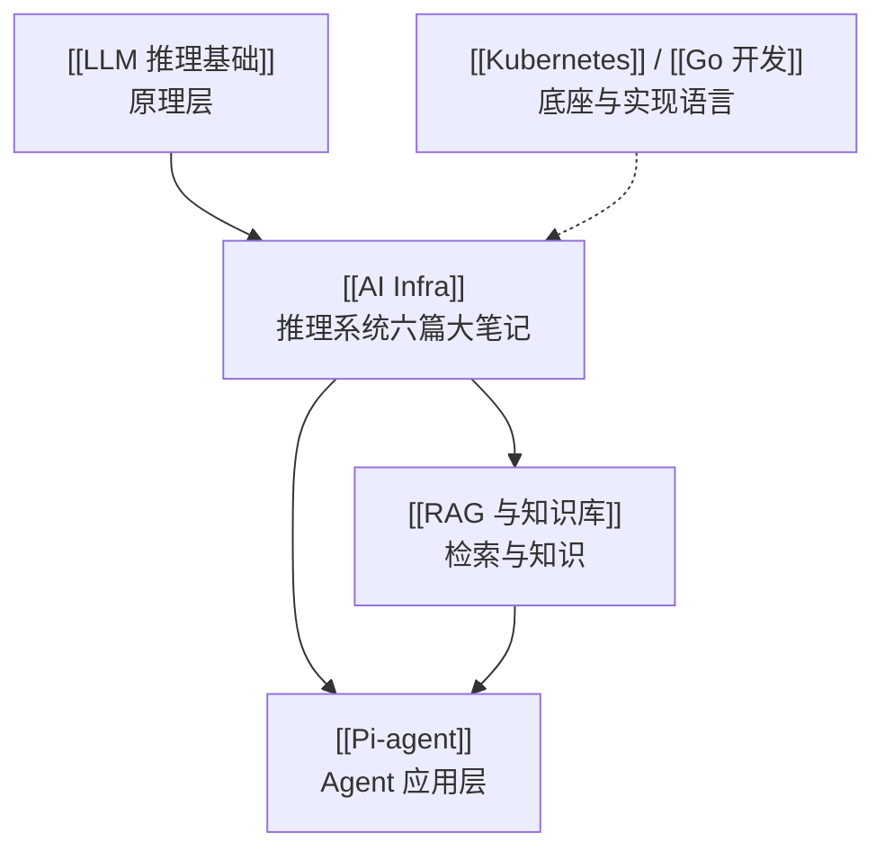

---
tags:
  - ai
  - llm
  - moc
created: 2026-11-14
updated: 2026-11-15
---

# 🤖 AI 工程与私有化 LLM

> 两层结构：**AI Infra 层**（模型服务的底座，讲推理系统本身）+ **Agent 应用层**（[[Pi-agent]]，讲 Agent 如何消费推理能力）。本板块的知识点按「技术本身」组织，不绑定任何具体部署平台。

## 板块结构

### AI Infra 层 → [[AI Infra]]（分层知识地图）

| 层 | 笔记 | 覆盖内容 | 状态 |
|---|---|---|---|
| ① 资源层 | [[01-GPU Operator]] | 驱动容器 / ClusterPolicy / CDI / device plugin / DRA / MIG / DCGM、离线与异构算力 | ✅ 已整理（13 图 / 14 问） |
| ② 引擎层 | [[03-vLLM]] | V1 架构、PagedAttention、KV cache、continuous batching、量化与并行、压测与离线运行 | ✅ 已整理（14 图 / 14 问） |
| ② 引擎层 | [[04-Triton]] | 非 LLM 模型、dynamic batching、ensemble / BLS、config.pbtxt、模型仓库 | ✅ 已整理（14 图 / 14 问） |
| ③ 平台层 | [[02-KServe]] | InferenceService / LLMInferenceService、Standard 与 Knative 模式、灰度与弹性 | ✅ 已整理（14 图 / 14 问） |
| ④ 路由层 | [[05-推理网关与路由]] | OpenAI 兼容网关、Inference Extension / EPP、KV 感知路由、PD 分离、过载保护 | ✅ 已整理（13 图 / 14 问） |
| ⑤ 横切能力域 | [[06-推理服务工程]] | 指标与 SLO、压测基线、容量与弹性、成本、模型资产与灰度、供应链安全、离线与异构环境 | ✅ 已整理（12 图 / 14 问） |

> 📌 **2026-11-15 整理说明**：①~④ 是一条请求真实穿过的链路，⑤ 是不占链路一跳、却决定「能否上生产」的横切能力域。原大纲里④/⑤两层的主题只有占位链接、没有实体内容，现补成两篇完整大笔记；同时把各组件篇中与知识本身无关的具体部署场景剥离，改为中性的通用技术表述——**讲组件就只讲组件本身**。（板块名中的「私有化 LLM」指技术方向，与具体平台无关。）

### 原理与支撑层

| 板块 | 内容 | 状态 |
|---|---|---|
| [[LLM 推理基础]] | 索引 + 4 篇（按 AI Infra 岗位 JD 重组）：模型接入与硬件评估 / 生成过程与显存账本 / 性能指标与瓶颈诊断 / 优化选型与工程验证 | ✅ 全部完成（约 6.3 万字 / 38 图 / 56 问） |
| [[RAG 与知识库]] | 索引 + 5 篇（按企业知识库五关任务重组）：知识入库与文档处理 / 检索链路与排序 / 生成控制与幻觉治理 / 评估与迭代 / 生产化与进阶模式 | ✅ 全部完成（约 4.5 万字 / 22 图 / 70 问） |

### Agent 应用层 → [[Pi-agent]]

Tool Calling、MCP、Agent Loop、AIOps 方法论、Agent 架构解析、本地模型对接。

## 学习路线（按依赖）

```
1. LLM 推理基础                  ← 原理前置：不懂显存估算装不对模型
2. AI Infra 请求链路（①→②→③→④）:
   GPU Operator → vLLM            ← 最小可用组合：一个 OpenAI 兼容端点
   → 推理服务工程 §1~§4           ← 跑通即补：指标 / 压测 / 容量，否则无法判断好坏
   KServe / Triton                ← 进阶：平台化、辅助模型
   推理网关与路由 / PD 分离         ← 副本与模型数量上量后再上
   → 推理服务工程 §7              ← 无外网 / 异构算力环境的前置约束
3. RAG 与知识库                  ← 让模型用上外部知识
4. Pi-agent                      ← Agent 应用层收口
```

> 📌 两条主线并行：**「请求怎么走」**（①→④）与**「怎么判断走得对」**（⑤）。只学前者能把服务跑起来，学完后者才能扛住生产流量与面试追问。

## 板块知识关系



## 相关

- 上游：[[云原生]]（K8s 是部署底座）、[[Go 开发]]（服务与 Agent 的实现语言）
- K8s 机制 → [[07-API 与 Watch 机制]]（Reconcile / Informer）、[[05-调度与资源管理]]（HPA / PDB / 配额）
- 工程能力 → [[02-可观测性]]、[[09-生态与工具]]、[[08-集群运维]]、[[07-工程实践]]
