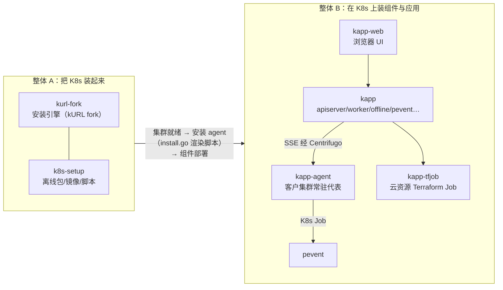

---
tags:
  - kapp
  - moc
created: 2026-11-16
---

# 🗺️ kapp 平台总览

> 本 folder 是 [[项目实践]] 的**项目实例层**：概念层知识（[[长连接与通信]]、[[组件安装部署]]、[[Agent 架构模式]]…）在 10/20 板块，这里记"这套真实系统如何落地"。
> 组织原则：**按系统行为（流程/机制）记知识，仓库只作组件卡片与证据索引**——跨仓库的知识不切碎。

## 1. 两个整体与交接点

- **整体 A** 解决"从无到有 K8s"；**整体 B** 解决"从有 K8s 到平台组件/应用就绪"。
- 交接点：集群装好 → apiserver 渲染安装脚本注入 agent → agent 出站接入 → 组件部署主链路启动。
- 云端部署声明（Centrifugo/各服务 chart、flux）在 `ops` 仓库。

## 2. 仓库职责表

| 仓库 | 整体 | 角色 | 组件卡 |
|---|---|---|---|
| kapp | B | 云控制面：apiserver、worker、offline、pevent、devops 等多服务同仓 | [[apiserver]]、[[pevent]] |
| kapp-agent | B | 客户集群常驻代表：收事件/协调/上报 | [[kapp-agent]] |
| kapp-web | B | 前端 UI，EventSource 收推送 | [[kapp-web]] |
| kapp-tfjob | B | 云资源 provisioning 的 Terraform Job 镜像 | [[kapp-tfjob]] |
| kurl-fork | A | K8s 安装引擎（kURL fork） | [[kurl-fork]] |
| k8s-setup | A | K8s 离线安装包/镜像清单/推送脚本 | [[k8s-setup]] |
| ops | B | 云端 chart/flux 部署声明 | — |

## 3. 笔记地图

**流程**（端到端行为，连接线）：
- [[组件部署流程]] ← 主链路：apiserver→Centrifugo→agent→pevent
- [[集群接入与agent安装]] ← 整体 A→B 交接
- [[证书分发流程]]、[[集群代理查询流程]]
- [[K8s安装流程]]（整体 A，待深化）

**机制**（横切知识，只写一处）：
- [[双通道通信架构]]、[[Proto契约与代码生成]]、[[令牌与信封加密]]

**组件**（卡片+特有深潜）：见上表。

## 4. 术语速查

| 术语 | 含义 |
|---|---|
| clusterCode | 集群标识，即 Centrifugo channel 名，烧进 SubToken |
| SubToken | HS256 JWT（SSEServerKey 签），SSE 订阅+上行 RPC 一证两用 |
| NotifyToken | 事件级一次性令牌设计（Redis DEL 消费；现拦截器被注释） |
| EventTrigger | SSE pub 事件体：type=job/proxyk8s/proxyhttp/cert |
| ops_event | apiserver 事件表，pevent 凭 event-id 领取 |
| uni_sse | Centrifugo 单向 SSE 传输端点 `/connection/uni_sse` |
| kd-cosmic-ops | 客户集群内 agent/Job 的 namespace 与 ServiceAccount |
| DEK | 信封加密的数据密钥（X25519 包裹，AES-GCM 加密业务数据） |

## 5. 关联

- 概念层 → [[长连接与通信]]、[[组件安装部署]]、[[Agent 架构模式]]、[[多集群管理]]、[[平台 API 设计]]
- 板块入口 → [[项目实践]]