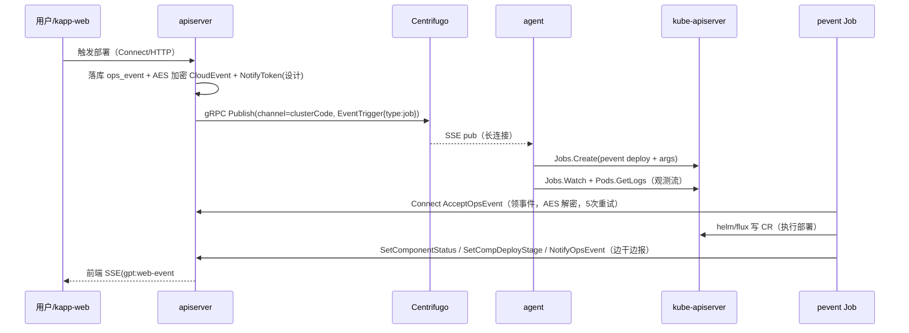

---
tags:
  - kapp
  - 流程
created: 2026-11-16
---

# 组件部署流程

> 整体 B 的主链路：一次组件部署如何穿过 4 个仓库。机制细节见 [[双通道通信架构]]、[[Proto契约与代码生成]]、[[令牌与信封加密]]。
> 参与组件：[[apiserver]] → Centrifugo → [[kapp-agent]] → [[pevent]]；进度可见于 [[kapp-web]]。

## 1. 端到端时序

## 2. 各仓库的"动词"

| 阶段 | 仓库 | 动词 | 代码锚点 |
|---|---|---|---|
| 触发/落库 | kapp | 写 ops_event、组装 EventTrigger | `services/deploy_task.go` L1854、`ops_event_notify.go` L255（`JobCommand: "pevent deploy"`） |
| 注入 | kapp | gRPC Publish | `pkg/sse/grpclient.go` |
| 接收/物化 | kapp-agent | 路由 type=job → Jobs.Create | `process/job.go`、`pkg/k8sutils/jobrun/run.go` |
| 执行 | kapp(pevent) | AcceptOpsEvent → helm/flux → 上报 | `cmd/pevent/deploy/deploy.go`、`process/cloudevent_process.go` |
| 观测 | kapp-agent | Watch Job + GetLogs 转远程日志 | jobrun L244-388 |
| 呈现 | kapp-web | EventSource 收推送 | `src/store/sse/SSEService.ts` |

## 3. 参数流与结果流（agent↔pevent 零直连）

- **参数流**：agent → JobSpec.Command/Args → pevent：`--event-id / --apiserver / --token(SubToken) / --secret-key / --timeout` + 扩展 args；镜像默认 `registry.kingdee.com/galaxy-prod/image/kapp:latest`，ns/SA `kd-cosmic-ops`。
- **结果流**：pevent → 云 apiserver（Connect），不经过 agent。
- **观测流**：pevent Pod 日志 → agent GetLogs → 远程日志。
- 共享 kube-apiserver 当总线：Job/Secret 对象即消息（详见 [[kapp-agent]] §集群内协调）。

## 4. Job 韧性与坑

- backoffLimit 2、TTL 1 天、limits 500m/512Mi、挂 private-registry docker-config Secret。
- pevent 领事件 5s/5 次重试；AES 无 key 兼容老 agent 明文。
- NotifyToken 一次性消费拦截器现被注释，主路径 Bearer=SubToken（见 [[令牌与信封加密]]）。
- agent 只等 Job 终态（Complete/Failed），不解析部署语义——**薄 agent 厚 Job**。

## 5. 关联

- 上游交接 → [[集群接入与agent安装]]；同类事件 → [[证书分发流程]]、[[集群代理查询流程]]
- 概念层 → [[组件安装部署]]、[[配置下发与任务编排]]