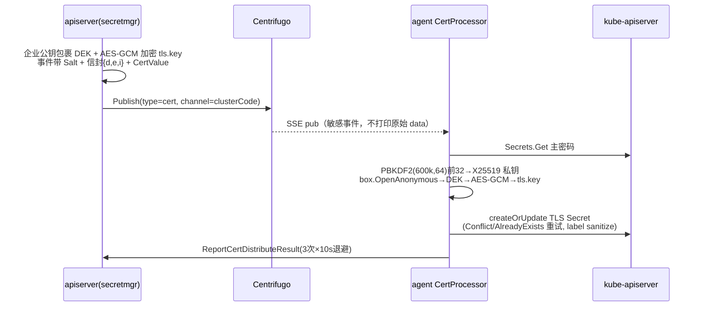

---
tags:
  - kapp
  - 流程
created: 2026-11-16
---

# 证书分发流程

> 云侧签发证书、集群侧落地 TLS Secret 的端到端流程；密码学细节见 [[令牌与信封加密]]。
> 参与：[[apiserver]]（加密/下发）→ Centrifugo → [[kapp-agent]]（解密/建 Secret/回报）。

## 1. 时序

## 2. 关键约束

- `TimeoutSecs` 约束业务处理（预留回调 RTT 余量）；**上报用原始 ctx**，结果必回传。
- 失败也上报（success=false + errMsg），避免云 DB 与集群真实状态失联。
- Secret 带 label `kapp.kingdee.com/domain`（sanitize 后）与 `managed=true`，供云侧识别托管证书。
- 与 kapp `pkg/secretmgr/crypto.go` 逻辑逐段对齐（keySize 32 / 迭代 600000）。

## 3. 关联

- [[令牌与信封加密]]、[[双通道通信架构]]、[[kapp-agent]]、[[kapp平台总览]]