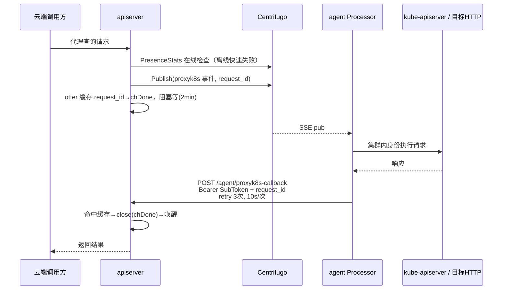

---
tags:
  - kapp
  - 流程
created: 2026-11-16
---

# 集群代理查询流程

> 云端"借"集群的手：一次 RPC 被拆成"下行事件 + 上行回调"两半，用 request_id 缝合。
> 参与：[[apiserver]]（发起/等待）→ Centrifugo → [[kapp-agent]]（本地执行/回传）。

## 1. 时序（proxyk8s；proxyhttp 同构，仅 requester 不同）

## 2. 设计点

- 两种 requester：`KubeAPIRequester`（调 kube-apiserver）/ `HttpProxyRequester`（发任意 HTTP），共用 `pkg/proxyk8s.Processor` 与同一 callback URL。
- 超时分层：云端等 2min；agent 回调单次 10s、3 次——**回调预算 < 云端等待预算**。
- 无入站约束的又一实例：云端不直连集群 API，把"请求"当消息下发（见 [[双通道通信架构]]）。

## 3. 关联

- [[双通道通信架构]]、[[令牌与信封加密]]、[[kapp-agent]]、[[apiserver]]