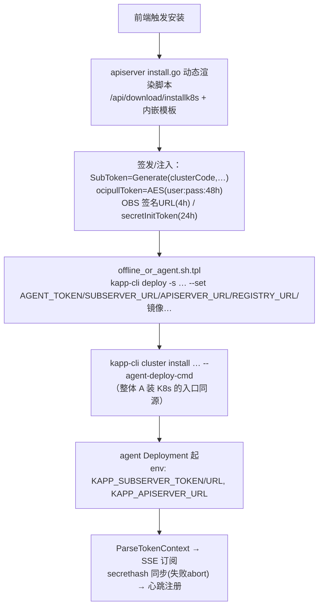

---
tags:
  - kapp
  - 流程
created: 2026-11-16
---

# 集群接入与 agent 安装

> 整体 A→B 的交接点：K8s 就绪后，agent 如何被"注入身份"并出站接入。
> 参与：[[apiserver]]（渲染/签发）、[[kurl-fork]]/[[k8s-setup]]（上游 K8s 就绪）、[[kapp-agent]]（接入）。

## 1. 流程

## 2. 信息分类（安装语句里带什么）

| 类别 | 内容 | 时效 |
|---|---|---|
| 身份 | SubToken（channel=clusterCode） | 长期 |
| 地址 | SUBSERVER_URL / APISERVER_URL / REGISTRY_URL | 配置 |
| 拉取凭证 | ocipullToken(AES 48h)、OBS 签名 URL(4h)、secretInitToken(24h) | 短时效 |
| 镜像坐标 | AGENT_IMAGE_REPOSITORY / TAG | 版本 |

模板执行后 `unset KAPP_MASTER_PASSWORD/SALT`——敏感值不留环境（主密码走 K8s Secret，见 [[令牌与信封加密]]）。

## 3. 接入后的注册动作

- SSE connect（主动拨出，channel 读自 token）→ [[双通道通信架构]]
- `ReportMasterPasswordHash`（启动一次性，失败中断）
- `SetAgentStatus` 首发 CONNECTED → 云端 `cluster_agents` 有记录 → 后续 Publish 前 PresenceStats 在线检查成立。

## 4. 待深化

- kapp-cli deploy 的 OCI 包结构、flux 开关语义（`--use-flux=false`）→ 待调研。
- 整体 A 内部 → [[K8s安装流程]]。

## 5. 关联

- [[kapp平台总览]]、[[kapp-agent]]、[[令牌与信封加密]]、[[组件部署流程]]