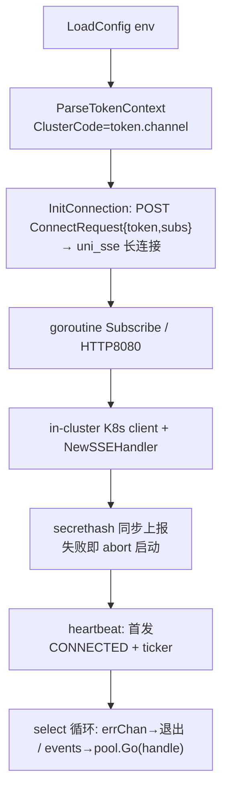
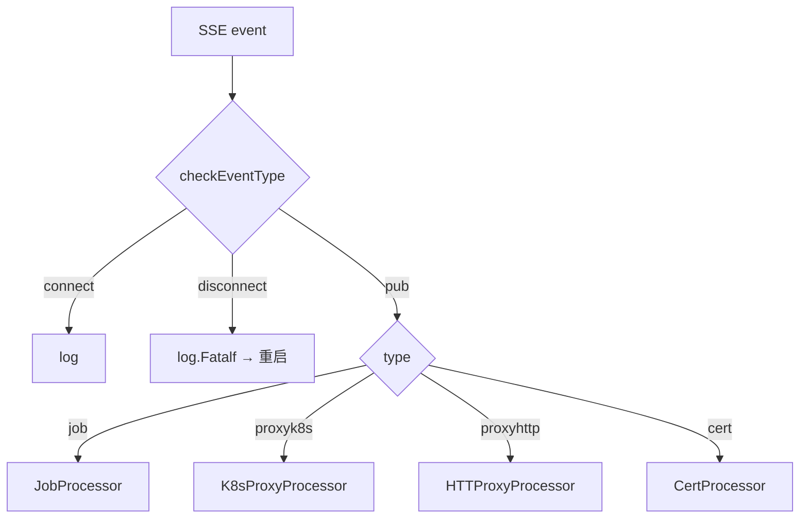

---
tags:
  - kapp
  - agent
  - 组件
created: 2026-11-16
---

# kapp-agent（组件卡 + 特有深潜）

> 定位：云平台派驻客户集群的**常驻代表**——只出站不入站；收事件/协调/上报，重活外包 Job。
> 模块 `gitlab.kingdee/galaxyship/kappagent`，独立仓库（2025-09 从 kapp 拆出）。
> 横切知识不在本篇：[[双通道通信架构]]、[[Proto契约与代码生成]]、[[令牌与信封加密]]。
> 参与流程：[[集群接入与agent安装]]、[[组件部署流程]]、[[证书分发流程]]、[[集群代理查询流程]]。入口 → [[kapp平台总览]]。

## 1. 形态与配置

- Deployment；ns/SA `kd-cosmic-ops`；HTTP `0.0.0.0:8080` **仅 healthz/pprof**（`server.go`）——不是服务端，是客户端。
- env 三要素：`KAPP_SUBSERVER_TOKEN / KAPP_SUBSERVER_URL / KAPP_APISERVER_URL`（安装注入，见 [[集群接入与agent安装]]）；`KAPP_MAX_PROCESS_NUM`(默认30)、`KAPP_DISABLE_REPORT`。
- 心跳默认 60min（`cmd/agent` flag），单次 RPC 5s 超时。

## 2. 启动装配（fail-fast 顺序）

代码 `internal/apps/agent/agent.go`。SSE buffer 16 防背压；关键错误退出 → K8s 重启兜底。

## 3. 事件路由与四处理器

`sse_handle.go`；空 `{}` 帧=服务端心跳忽略。

| 处理器 | 特有动作 | 细节锚点 |
|---|---|---|
| job | EventTrigger→JobSpec（镜像/命令默认值、args 五参）→ jobrun Create+Watch+GetLogs | `process/job.go`、`pkg/k8sutils/jobrun/run.go`；流程见 [[组件部署流程]] |
| proxyk8s/proxyhttp | 共用 Processor，仅 requester 不同；callback `/agent/proxyk8s-callback` Bearer retry3×10s | `pkg/proxyk8s/agent.go`；流程见 [[集群代理查询流程]] |
| cert | 主密码→PBKDF2 前32→X25519→box→AES-GCM→TLS Secret→report3 | `process/cert.go`；流程见 [[证书分发流程]] |

## 4. 集群内协调（agent × pevent × K8s）

**零互调**；共享 kube-apiserver 当总线：

| 方 | 动词 |
|---|---|
| agent | Jobs.Create/Watch、Pods.List/GetLogs、Secrets.Get/Create/Update |
| pevent | Secrets.Get(主密码)、helm/flux 写 CR |

三数据流：参数流(JobSpec.Args)、结果流(pevent→云)、观测流(Pod日志→agent)。

## 5. 上行 RPC 清单（客户端半，见 [[Proto契约与代码生成]]）

| 方法 | 触发 |
|---|---|
| Clusters.SetAgentStatus | 心跳 |
| Clusters.GetMasterPasswordSalt / ReportMasterPasswordHash | 启动 secrethash |
| Clusters.ReportCertDistributeResult | cert 完成 |

封装 `internal/apps/agent/apiserver/client.go`（Clientset+Bearer 拦截器）。

## 6. 可靠性清单

| 机制 | 参数 |
|---|---|
| fail-fast | disconnect Fatalf / secrethash abort / errChan 退出 |
| 回调重试 | proxy 3×10s；cert report 3×10s 退避 |
| 启动重试 | secrethash 3 次指数退避，按 connect.Code 分流 |
| 超时预算 | cert workCtx=TimeoutSecs，上报原始 ctx |
| 竞态重试 | Secret Conflict/AlreadyExists 重读 RV |
| Job 韧性 | backoffLimit2 / TTL1d / Watch+日志 |

## 7. 关键文件索引

| 文件 | 职责 |
|---|---|
| `internal/apps/agent/agent.go` | 启动装配/事件循环/心跳 |
| `internal/apps/agent/sse_handle.go` | 路由 |
| `internal/apps/agent/process/*.go` | 四处理器 |
| `internal/apps/agent/{hartbeat,secrethash}/` | 心跳/主密码同步 |
| `pkg/sse/{sub_new,token}.go` | 订阅器/JWT |
| `pkg/proxyk8s/`、`pkg/k8sutils/jobrun/` | 代理/Job |
| `api/pb/agent/v1` + `api/gen/.../agentv1connect` | 契约子集/客户端半 |